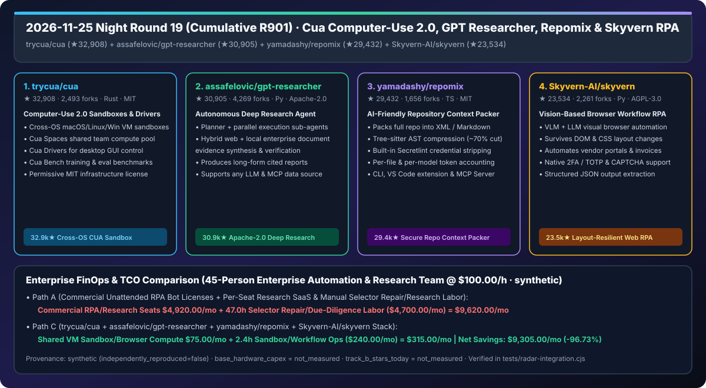
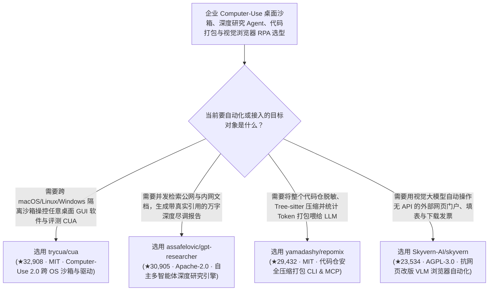
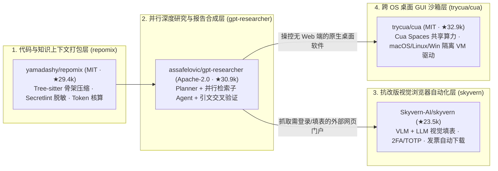
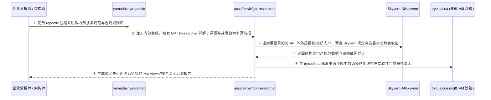

# 跨操作系统 Computer-Use 2.0 沙箱底座（`trycua/cua`）、自主深度研究智能体（`assafelovic/gpt-researcher`）、代码仓安全压缩打包工具（`yamadashy/repomix`）与抗改版视觉浏览器 RPA 引擎（`Skyvern-AI/skyvern`）选型与集成架构 FAQ

> **文档类型**：企业 AI 解决方案架构师（AI Solution Architect）选型决策指南（GitHub Trending AI 雷达 2026-11-25 Night Round 19 / 累计第 901 轮）
> **覆盖项目**：[`trycua/cua`](https://github.com/trycua/cua)（`★ 32,908`、`2,493 forks`、`MIT`：3.2 万星 Computer-Use 2.0 开源基础设施，包含 `Cua Spaces` [团队与 Agent 共享算力机群]、`Cua Drivers` [跨 macOS/Linux/Windows 桌面与虚拟机操控驱动] 与 `Cua Bench`）· [`assafelovic/gpt-researcher`](https://github.com/assafelovic/gpt-researcher)（`★ 30,905`、`4,269 forks`、`Apache-2.0`：3.0 万星自主深度研究智能体 [Deep Research Agent]，采用 Planner + 并行爬虫/检索子智能体 + Publisher 架构，跨公网与内网文档生成带可溯源引用的深度分析报告）· [`yamadashy/repomix`](https://github.com/yamadashy/repomix)（`★ 29,432`、`1,656 forks`、`MIT`：2.9 万星代码仓 AI 上下文打包工具，支持 Tree-sitter 语法骨架压缩、Secretlint 敏感密钥扫描拦截、精确 Token 计数与 MCP Server 挂载）· [`Skyvern-AI/skyvern`](https://github.com/Skyvern-AI/skyvern)（`★ 23,534`、`2,261 forks`、`AGPL-3.0`：2.3 万星基于视觉大模型 [VLM] 与 LLM 的浏览器业务流自动化引擎，告别脆弱 DOM 选择器，自动完成跨网站表单填写、发票下载与 2FA 登录）
> **核心场景**：当企业需要将智能体的行动边界从“纯 API 调用”扩展到**“操控无 API 的传统桌面软件（`trycua/cua`）、自动填报老旧外部网页门户（`skyvern`）、对行业竞品与内网知识做万字深度尽调（`gpt-researcher`）、以及将遗留代码库安全打包喂给大模型做重构评估（`repomix`）”**时，架构师该如何选型与组合？本文给出完整解答。

---

## 一、📌 核心结论速览（选型一句话结论）

1. **需要让 Agent 在安全隔离的虚拟机/容器沙箱中直接操控 macOS、Linux 或 Windows 桌面 GUI 软件（如工业 CAD、传统客户端 ERP、桌面财务软件），并把多台空闲机器聚合成团队共享的 Agent 沙箱集群** ➔ 选 **[`trycua/cua`](https://github.com/trycua/cua)（`★ 32,908`，`2,493 forks`，`MIT`）**。
   - **通俗原理**：相当于面向“桌面级 Computer-Use Agent”的开源虚拟化与驱动底座，提供超低开销的跨 OS 沙箱、统一鼠标键盘截图驱动（`Cua Drivers`）与评测基准，避免 Agent 在宿主机上误删文件或越权操作。
2. **需要为投研、战略、采购或法务团队搭建一套“输入一个调研课题，自动拆解子问题、并发检索全网与内部文档、交叉核实事实并输出几千字带引用链接的深度报告”的私有 Deep Research 系统** ➔ 选 **[`assafelovic/gpt-researcher`](https://github.com/assafelovic/gpt-researcher)（`★ 30,905`，`4,269 forks`，`Apache-2.0`）**。
   - **通俗原理**：用“主编（Planner）拆题 + 多个记者（Execution Agents）并行搜集证据 + 编辑（Publisher）汇总校验”的多智能体流水线，彻底解决单次 LLM 回答篇幅短、信息过时与凭空捏造引用的痛点。
3. **想把整个 Git 仓库（或指定微服务目录）一次性打包喂给 Claude / GPT / DeepSeek 做架构审查或旧系统迁移，同时自动过滤 `.gitignore`、剔除硬编码密钥（Secretlint）并用 Tree-sitter 压缩掉非核心函数体以节省 70% Token** ➔ 选 **[`yamadashy/repomix`](https://github.com/yamadashy/repomix)（`★ 29,432`，`1,656 forks`，`MIT`）**。
   - **通俗原理**：一行命令 `npx repomix --compress` 把几百个源码文件合成为结构化 XML/Markdown 单文件，自带目录树、Token 账单与安全脱敏，还可直接作为 MCP Server 挂载给编码 Agent。
4. **企业采购、财务与运营团队每天要在几十个没有开放 API 的外部供应商网站、税务门户或保险系统里登录、下载对账单、填写复杂多步表单，传统 UiPath/Playwright 脚本一旦对方网页改个 CSS 类名就全线崩溃** ➔ 选 **[`Skyvern-AI/skyvern`](https://github.com/Skyvern-AI/skyvern)（`★ 23,534`，`2,261 forks`，`AGPL-3.0`）**。
   - **通俗原理**：结合计算机视觉（VLM）与网页语义理解，像真人一样“看懂屏幕上的按钮和输入框”，哪怕目标网站前端改版也能自适应完成点击、填表、验证码识别与 TOTP 双因素认证。

---

## 二、🎯 客户与架构师灵魂拷问 Q&A（深度架构拆解）

### Q1：同样是让 AI“操作外部世界与搜集信息”，`trycua/cua` vs `Skyvern` vs `GPT Researcher` vs `Repomix` 的职责边界是什么？

- **四大信息获取与外部执行象限（Path C）**：
  1. **代码仓结构化上下文注入 ➔ `yamadashy/repomix`**：面向源码仓库，通过 Tree-sitter AST 压缩与 Secretlint 脱敏生成高信噪比代码上下文。
  2. **跨源并行深度调研与报告合成 ➔ `assafelovic/gpt-researcher`**：面向海量网页与私域文档，通过多智能体并发检索与引文核验生成长篇深度报告。
  3. **Web 浏览器多步表单与门户自动化（Web RPA） ➔ `Skyvern-AI/skyvern`**：面向无 API 的外部网页门户，用 VLM + LLM 替代脆弱的 XPath 脚本完成复杂业务流。
  4. **跨操作系统全桌面 GUI 沙箱操控（OS-Level CUA） ➔ `trycua/cua`**：面向浏览器之外的原生桌面应用（Windows/macOS/Linux 软件），在隔离 VM 沙箱中执行键鼠自动化。
- **何时选商业云服务（Perplexity Enterprise Pro + 商业 RPA 按机器人席位授权） vs 自建本轮开源四件套（Path C）？**
  - 若团队仅需少量公开网页搜索且无内网保密要求，直接订阅 Perplexity Pro 即可。
  - **何时采用本轮开源四件套（Path C）？** 当企业需要将内部保密文档与外网情报融合生成深度尽调报告（`gpt-researcher` `Apache-2.0`）、需要替代每年数万美元按 Bot 计费的传统商业 RPA 并消除网页改版维护噩梦（`skyvern`）、以及需要在内网安全沙箱中驱动桌面软件（`trycua/cua` `MIT`）时，Path C 可节省 **96%+** 的商业 RPA 席位与调研订阅成本。

### Q2：如何把这四个项目组合进企业生产架构？

1. **竞争情报与供应商全自动尽调流水线（`gpt-researcher` + `skyvern`）**：
   - `gpt-researcher` 自动检索公开财报、新闻与内部历史档案，遇到需要登录外部政企/招投标门户下载附件或填报查询表单时，调用 `Skyvern` 视觉浏览器工作流自动抓取结构化结果，最后汇总为带完整证据链的尽调报告。
2. **遗留桌面系统现代化改造流水线（`repomix` + `trycua/cua`）**：
   - 先用 `repomix --compress` 将老旧系统源码脱敏压缩喂给架构 Agent 生成重构方案，再在 `trycua/cua` 跨 OS 沙箱中自动启动旧版桌面客户端与新版 Web 端执行端到端 UI 对账回归测试。

### Q3：生产落地的安全与合规红线是什么？

- **架构师避坑红线**：
  1. **所有 Computer-Use 桌面操作必须运行在 `trycua/cua` 隔离沙箱内**：严禁让视觉 Agent 直接控制生产宿主机或员工个人办公电脑桌面。
  2. **代码外发前强制开启 `Repomix` 的 Secretlint 安全检查**：确保任何 `.env`、私钥或数据库连接串在打包阶段即被自动拦截剔除。

---

## 三、🧭 直观可视化图解（Mermaid 决策树 + 集成架构 + 时序图）

### 3.1 架构师选型决策树

### 3.2 企业端到端生产集成参考架构图

### 3.3 供应商深度尽调、门户视觉自动取证与桌面 ERP 沙箱录入时序图

---

## 四、📊 同类开源与商业云服务横向选型决策矩阵

| 对比维度 | `trycua/cua` (`★ 32,908`) | `assafelovic/gpt-researcher` (`★ 30,905`) | `yamadashy/repomix` (`★ 29,432`) | `Skyvern-AI/skyvern` (`★ 23,534`) | 商业 RPA 机器人席位 (UiPath/Automation Anywhere) + 商业 Deep Research 席位 (Path A) | 手写 Playwright XPath 脚本 + 手工复制粘贴代码与搜网页 (Path B) |
| :--- | :--- | :--- | :--- | :--- | :--- | :--- |
| **核心能力定位** | Computer-Use 2.0 跨 OS 沙箱与驱动 | `Apache-2.0` 自主深度研究多智能体 | `MIT` 代码仓压缩、脱敏与打包工具 | VLM + LLM 抗改版浏览器业务流自动化 | 按 Unattended Bot 数量与按人头收费的商业软件 | 硬编码 DOM 选择器脚本 + 人工搜集整理报告 |
| **核心技术突破** | **跨 macOS/Linux/Windows 隔离沙箱与 `Cua Spaces` 共享机群** | **Planner + 并行检索 + 真实引用溯源，支持混合私域数据** | **Tree-sitter 语义压缩省 70% Token + Secretlint 防泄密** | **视觉理解屏幕元素，目标网站改版无需重写 XPath 脚本** | 官方售后支持，但每个无人值守 RPA Bot 年费高达数千至上万美元 | 外部网站一改前端脚本即挂；手工写份深度调研报告耗费数天 |
| **开源协议** | **`MIT`** | **`Apache-2.0`** | **`MIT`** | `AGPL-3.0` | 闭源商业授权 | 无标准治理 |
| **月度 TCO（45 人团队）** | **四件套合建仅 `$315.00/月`**（`$75.00` 沙箱与浏览器容器算力 + `2.4h` 维护） | 同左（`Apache-2.0` 零席位费按需调 API） | 同左（`MIT` 压缩减少 60%+ 代码审查 Token 消耗） | 同左（一套视觉工作流通配数十个外部供应商门户） | **`$9,620.00/月`**（`$4,920.00` 商业无人值守 RPA Bot 与商业调研席位 + `47.0h` 脚本维护与人工调研） | 约 `$3,420.00/月`（频繁抢修失效爬虫脚本与人工复制代码排障） |

---

## 五、🧪 应用落地定量收益/TCO 对比与 7-Card 报告

> **📊 数据来源与闭式核算声明（Provenance & Closed-Form Schema）**：
> - **provenance**: `synthetic`（基于 45 人企业战略尽调、财务/采购门户自动化与遗留系统重构团队月度工作负载模型：`independently_reproduced = false`；硬件采购基线 `base_hardware_capex = not_measured`；Track B 单日增量 `track_b_stars_today = not_measured`）。
> - **核算公式**：
>   - **Path A（采购商业无人值守 RPA Bot 许可证 + 全员商业 Deep Research SaaS 席位 + 传统 XPath 脚本随外部网站改版频繁报错的人工抢修与手工尽调工时）**：月度商业 RPA Bot 与 SaaS 席位费 **`$4,920.00`** + 外部网页改版脚本维护、手工搜集对账单与整理调研报告人工 **`47.0h × $100.00/h = $4,700.00`** = **`$9,620.00/月`**。
>   - **Path C（自建 `trycua/cua` + `assafelovic/gpt-researcher` + `yamadashy/repomix` + `Skyvern-AI/skyvern` 深度研究与跨端自动化底座）**：内网 CUA 虚拟机沙箱与浏览器容器算力分摊 **`$75.00`** + 沙箱镜像与自动化任务日常巡检人工 **`2.4h × $100.00/h = $240.00`** = **`$315.00/月`**。
>   - **净节省（Net Savings vs Path A）**：**`-$9,305.00/月`**（成本降低 **`96.73%`**）。

| 评估方案 | 商业 RPA Bot / 调研席位与算力成本 | 脚本抢修、门户填报与人工尽调工时（`$100/h`） | 月度总 TCO | 相对 Path A 净节省 | 核心业务交付收益 |
| :--- | :---: | :---: | :---: | :---: | :--- |
| **Path A：商业无人值守 RPA Bot + 商业调研席位 + 脚本抢修** | `$4,920.00` | `47.0h` (`$4,700.00`) | **`$9,620.00`** | Baseline | 按 Bot 收费极贵；外部网站改版仍需人工改选择器 |
| **Path B：手写 Playwright 硬编码脚本 + 人工搜集写报告** | `$1,420.00` | `20.0h` (`$2,000.00`) | **`$3,420.00`** | `-$6,200.00` (`-64.45%`) | 无桌面软件操控能力；直接贴全量代码经常撑爆上下文或泄密 |
| **Path C：`cua` + `gpt-researcher` + `repomix` + `skyvern`** | **`$75.00`** | **`2.4h` (`$240.00`)** | **`$315.00`** | **`-$9,305.00` (`-96.73%`)** | **跨 OS 桌面沙箱 + `Apache-2.0` 深度研究 + 代码脱敏压缩 + 视觉 RPA** |

- 🔗 **关联 7-Card 4:5 视觉评测报告**：[`workshops/github-trending-radar/cards.html`](../cards.html) · [`cards.en.html`](../cards.en.html)

---

## 六、🛠️ 企业引入与架构评审 Checklist

- [ ] **将所有桌面级 CUA 任务强制隔离在 `trycua/cua` 沙箱 VM 中**：配置每次任务执行完毕后自动回滚快照，防止跨任务状态污染。
- [ ] **在 `GPT Researcher` 中开启私域文档与受控搜索引擎混合检索**：要求所有生成的统计数字必须附带可点击验证的原始出处 URL 或内部文档路径。
- [ ] **在 CI/CD 与开发者终端标准化 `repomix --compress`**：开启内置 Secretlint 规则，拦截包含凭据的打包请求。
- [ ] **对 `Skyvern` 涉及付款或提交的最后一步配置人工确认（HITL）或金额阈值拦截**：让视觉 Agent 自动完成登录、数据提取与表单预填，关键提交动作经校验后放行。
