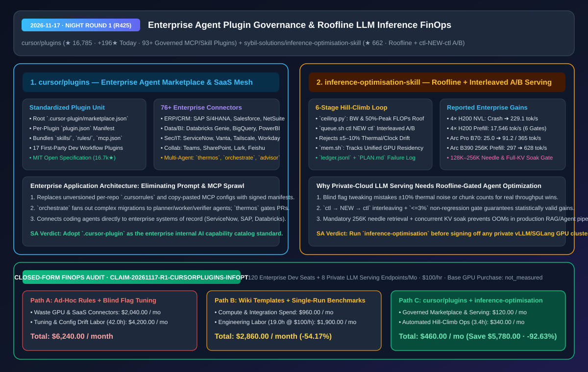
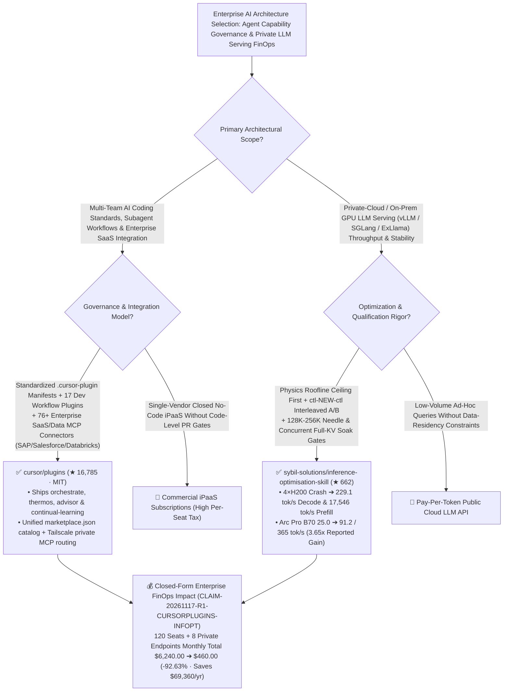

# Enterprise Agent Plugin & SaaS Connector Marketplace (`cursor/plugins`) & Roofline-Gated Interleaved A/B LLM Serving Optimization (`inference-optimisation-skill`) Architecture & Selection FAQ

> **Document Metadata (2026-11-17 · Night Round 1 / Cumulative Round 425)**  
> - **Target Audience**: **Enterprise AI Solution Architects** & Engineering/Business Decision-Makers  
> - **Core Orientation**: **① Real Enterprise Application Scenarios & Business ROI/Pain Points + ② End-to-End Integration Reference Architecture + ③ Peer Open-Source / Cloud Service / Commercial Solution Selection & TCO Comparison**  
> - **Editorial Benchmark**: Modeled on `ib-vs-ethernet-roce-selection-faq.md` (Plain-Language First Principles + 3 Architectural Deep-Dive Q&As + Mermaid Decision Tree + Peer Comparison Matrix + Closed-Form FinOps Audit + 15-Minute Rollout Checklist)  
> - **Evaluated Repositories**:  
>   1. [`cursor/plugins`](https://github.com/cursor/plugins) (`★ 16,785`, `+196 ★ today` at GitHub Daily Trending #8, MIT License: Official Cursor multi-plugin marketplace specification and connector repository governed by root `.cursor-plugin/marketplace.json` and per-plugin `.cursor-plugin/plugin.json` manifests bundling `skills/`, `rules/`, and `mcp.json`, shipping **17 first-party engineering workflow plugins** such as `thermos`, `orchestrate`, `advisor`, `continual-learning`, and `agent-compatibility` alongside **76+ enterprise SaaS & data connectors** including Salesforce, SAP S/4HANA Cloud, ServiceNow, Databricks Genie, Workday, Vanta, Microsoft Teams, SharePoint, and Power BI)  
>   2. [`sybil-solutions/inference-optimisation-skill`](https://github.com/sybil-solutions/inference-optimisation-skill) (`★ 662`, `662 ★/day` #1 AI new-repo breakout on `2026-11-17`, MIT License: Agent skill and zero-dependency stdlib Python/Bash harness for hill-climbing private/local LLM serving speed across vLLM, SGLang, llama.cpp, and ExLlama via `ceiling.py` physics roofline bounds, `queue.sh ctl NEW ctl` interleaved A/B controls, `bench.py` server-usage token & 256K needle gates, and `mem.sh` unified-memory driver residency tracking)  
> - **Companion SVG Diagram**: [`assets/github-ai-radar-2026-11-17-r1-cursor-plugins-inference-optimisation.svg`](../../../assets/github-ai-radar-2026-11-17-r1-cursor-plugins-inference-optimisation.svg)  
> - **Audit Claim ID**: `CLAIM-20261117-R1-CURSORPLUGINS-INFOPT` (base GPU hardware capEx marked `not_measured`; upstream hardware benchmark gains labeled `anonymized_reported, independently_reproduced=false`)

---

## 📌 1. Executive Summary (3-Minute Enterprise Architect's Briefing)

1. **How does `cursor/plugins` solve "Prompt, Skill, and MCP Connector Sprawl" when scaling AI coding and business agents across 100–1,000+ enterprise seats?**  
   - **Enterprise Business Pain Point**: When enterprises roll out AI coding and knowledge assistants across dozens of product squads, teams copy-paste unversioned `.cursorrules`, ad-hoc `SKILL.md` files, and scattered `mcp.json` credentials into individual repositories. Meanwhile, connecting agents safely to enterprise systems of record (ERP, CRM, ITSM, data warehouses, compliance platforms) requires repetitive custom glue code.  
   - **`cursor/plugins` Architectural Fix**:
     - **Standardized Atomic Distribution Unit (`.cursor-plugin/plugin.json`)**: Packages `skills/` (`SKILL.md`), `rules/` (`.mdc`), `mcp.json` (MCP server definitions), and lifecycle hooks into a single versioned directory indexed by a root `.cursor-plugin/marketplace.json` catalog;
     - **17 Engineering Workflow Engines + 76+ Enterprise Systems of Record**: Ships battle-tested multi-agent engineering patterns—including `orchestrate` (fanning large migrations across parallel planner, worker, and verifier cloud agents with structured handoffs), `thermos` (harsh parallel subagent security/correctness PR review), `advisor` (consulting a stronger model before high-stakes decisions), and `continual-learning` (transcript-driven `AGENTS.md` updates)—plus **76+ enterprise connectors** spanning **SAP S/4HANA Cloud, Salesforce, Microsoft Dynamics 365 Business Central, NetSuite, ServiceNow, Databricks Genie, Google Cloud BigQuery, Power BI, Workday, Vanta, Microsoft Teams, SharePoint, Lark, and Feishu**.
2. **Why do enterprise private-cloud LLM deployments (vLLM / SGLang) waste 40%–70% of GPU capacity or crash under long-context load, and how does `sybil-solutions/inference-optimisation-skill` fix it?**  
   - **Enterprise Business Pain Point**: Enterprises deploying private LLM clusters (H200 NVL, RTX 3090, or Intel Arc Pro B70/B390) for data-sovereign coding and RAG workloads routinely tune engine flags by trial and error. Because GPUs exhibit `±5%–10%` thermal and clock drift, single-run benchmarks mistake noise for speedups; worse, stream-chunk counters inflate token throughput, Linux `cgroups` miss unified-memory GPU driver residency, and short-prompt optimizations crash or degrade retrieval at 128K–256K context under concurrency.  
   - **`inference-optimisation-skill` Architectural Fix**: Encodes a **6-stage deterministic hill-climbing loop** (`SKILL.md` + `PROMPT.md` + stdlib Python/Bash `scripts/`):
     - **Physics Roofline First (`ceiling.py`)**: Computes theoretical decode (`bytes/token ÷ bandwidth`) and prefill (`FLOPs/token ÷ 50% peak`) ceilings upfront so teams never chase physically impossible targets;
     - **Serialized Interleaved Controls (`queue.sh ctl NEW ctl`)**: Changes one lever at a time and runs `≥6` AC-powered samples per step, accepting a candidate *only* if its median beats *both* neighboring controls (`ctl → NEW → ctl`) and regresses no metric by `>3%`;
     - **6 Production Acceptance Gates (`bench.py` & `mem.sh`)**: Enforces 128K–256K exact-match needle retrieval and concurrent full-KV soak tests before pinning a clean build—turning a crashing `4× H200 NVL` `DeepSeek-V4.1-Flash` vLLM deployment into **`229.1 tok/s` decode & `17,546 tok/s` prefill** across all 6 gates, and boosting `Intel Arc Pro B70` `Qwen3.8-27B` from `25.0 tok/s` to **`91.2 tok/s` (c1) / `365 tok/s` (c16)** (`3.65×` gain, `anonymized_reported`).
3. **Closed-Form FinOps Audit (`CLAIM-20261117-R1-CURSORPLUGINS-INFOPT`)**:  
   - Across **120 enterprise developer/analyst seats + 8 private LLM serving endpoints per month** (at **`$100.00/hr`** blended architect/infra engineering rate), migrating from **Path A** (fragmented per-repo prompt rules + commercial connector subscriptions + manual trial-and-error GPU flag tuning: **`$6,240.00/mo`**) to **Path C** (`cursor/plugins` internal enterprise marketplace + `inference-optimisation-skill` automated Roofline A/B serving optimization: **`$460.00/mo`**) saves **`$5,780.00/month`** (**`-92.63%`**, **`$69,360.00/year`**) and reduces platform governance and inference tuning labor from `42.0 hrs` to `3.4 hrs/mo` (**`-91.90%`**).



---

## 💬 2. Three Architectural Deep-Dive Q&As (Enterprise Scenarios, Reference Architecture & Boundaries)

### Q1: Why should Enterprise AI Architects standardize on `.cursor-plugin` bundles (`cursor/plugins`) instead of maintaining a shared Wiki of prompts?

1. **Enterprise Scenario Reality: Prompts Without Governed MCP Connectors and Verification Gates Cannot Execute Business Workflows**:  
   - Real enterprise workflows—such as pulling a ServiceNow incident, querying Databricks Genie or BigQuery for root-cause telemetry, fanning out a multi-repo fix via `orchestrate`, running a harsh security audit via `thermos`, and updating SAP/Salesforce/SharePoint records—require synchronized **Skills (`SKILL.md`), Rules (`.mdc`), and MCP server bindings (`mcp.json`)**.  
2. **End-to-End Enterprise Reference Architecture**:  
   - Fork or mirror the `.cursor-plugin/marketplace.json` schema inside your enterprise Git organization to publish a **Curated Internal AI Capability Catalog**, pairing `tailscale` private-network MCP routing with role-scoped enterprise connectors (`servicenow`, `databricks-genie`, `sap-s4hana-cloud`, `salesforce`, `vanta`, `teams`, `feishu`) and mandatory pre-merge review plugins (`thermos`, `advisor`, `agent-compatibility`).

---

### Q2: How does `sybil-solutions/inference-optimisation-skill` prevent false-positive benchmark wins and production OOM outages on private GPU clusters?

1. **Eliminating the Four Classic Enterprise LLM Serving Traps**:  
   - **Trap 1 (Unbounded Flag Guessing)**: `ceiling.py` calculates theoretical bandwidth and FLOP ceilings first, proving whether a target is bottlenecked by GEMV memory bandwidth or speculative draft acceptance;  
   - **Trap 2 (`±5%–10%` Thermal/Clock Drift)**: `queue.sh ctl NEW ctl` interleaves baseline controls on both sides of every candidate config;  
   - **Trap 3 (Stream-Chunk & Unified-Memory Blind Spots)**: `bench.py` reads authoritative server-reported token counts rather than SSE chunk counts, while `mem.sh` measures GPU driver residency invisible to container `cgroups`;  
   - **Trap 4 (Long-Context & Full-KV Instability)**: Every candidate must pass a 128K–256K needle retrieval gate and concurrent full-KV soak before promotion, logging both wins and failures in `ledger.jsonl` and `PLAN.md`.

---

### Q3: How can architects pair these two tools with session-level token/cache profiling?

1. **Client-Side Cache Alignment + Server-Side Roofline Optimization**:  
   - Combine `cursor/plugins` (`continual-learning`, `orchestrate`) and companion profiler `afurmanov/harness-profiler` (`★ 34`, tracking which skill/subagent/tool calls share a conversation prefix for prompt-cache reuse) on the client side with `inference-optimisation-skill` on the private vLLM/SGLang cluster to optimize both **tokens billed per task** and **tokens generated per GPU dollar**.

---

## 🧭 3. Enterprise Integration Reference Architecture & Selection Decision Tree (Mermaid)



---

## 📊 4. Peer Open-Source / Cloud / Commercial Selection Matrix (Decision Matrix)

| Dimension | `cursor/plugins` (`★ 16,785` Marketplace) | Commercial iPaaS / Closed Agent SaaS | Ad-Hoc Per-Repo `.cursorrules` & Scripts | `inference-optimisation-skill` (`★ 662` Roofline A/B) | Managed Cloud Endpoints / Manual Flag Guessing |
| :--- | :--- | :--- | :--- | :--- | :--- |
| **Enterprise Use Case** | **Governing Skills, Rules, MCP Servers & Multi-Agent Workflows Across 100+ Seats** | Departmental form/webhook automation | Individual developer prototyping | **Maximizing tok/s & 256K stability on private vLLM/SGLang GPU clusters** | Quick default-config PoC |
| **Architecture & Governance** | **Root `.cursor-plugin/marketplace.json` + 17 dev plugins + 76+ SaaS connectors** | Proprietary black box; decoupled from Git PRs | Severe config drift & credential sprawl | **`ceiling.py` physics bounds + `ledger.jsonl` / `PLAN.md` audit trail** | Tribal knowledge; breaks across model/GPU upgrades |
| **Stability & Quality Gates** | `thermos` multi-subagent review, `advisor` escalation & `agent-compatibility` | No code-level verification gates | Zero gates; high AI slop risk | **`queue.sh ctl NEW ctl` interleaved A/B (`<=3%` regression gate) + 256K needle soak** | Vulnerable to `±10%` thermal drift & long-context OOMs |
| **TCO & Licensing** | **MIT Open Source (`$0` connector seat tax)** | `$2,000–$10,000+/mo` enterprise seat/task tiers | High hidden maintenance labor | **MIT Open Source (0-dep Python/Bash); `1.4x–3.6x` higher GPU utilization** | `40%–150%` managed markup or idle GPU waste |
| **Boundaries (Not For)** | Does not replace enterprise IdP/RBAC (pair with SSO & Tailscale ACLs) | Deep codebase refactoring & PR verification | Multi-team production engineering | Cannot exceed hardware memory-bandwidth physics (`ceiling.py` proves limits) | High-utilization 24/7 private inference fleets |

---

## 🧮 5. 7-Card Quantitative Insights & Closed-Form FinOps Audit (`CLAIM-20261117-R1-CURSORPLUGINS-INFOPT`)

> **Scope & Provenance Boundary**: Models monthly plugin/connector governance across **120 enterprise developer/analyst seats** and idle GPU waste plus benchmark/tuning engineering labor across **8 private LLM serving endpoints** at **`$100.00/hr`**. Base server hardware acquisition capEx is marked **`not_measured`**, and upstream hardware throughput ratios are labeled **`anonymized_reported` (`independently_reproduced=false`)**.

| Architecture Path | Compute Waste & Connector SaaS (`USD/mo`) | Governance & Serving Tuning Labor (`hrs/mo`) | Engineering Labor Cost (`@ $100/hr`) | Total Monthly Cost (`USD/mo`) | Net Savings vs. Path A (`USD/mo` & `%`) |
| :--- | :---: | :---: | :---: | :---: | :---: |
| **Path A: Ad-Hoc Repo Rules / SaaS Connectors + Blind GPU Flag Tuning** | `$2,040.00` | `42.0 hrs` | `$4,200.00` | **`$6,240.00`** | Baseline (`0.00%`) |
| **Path B: Shared Wiki Prompt Templates + Single-Run Benchmarks** | `$960.00` | `19.0 hrs` | `$1,900.00` | **`$2,860.00`** | `-$3,380.00` (`-54.17%`) |
| **Path C (Recommended): `cursor/plugins` + `inference-optimisation-skill`** | **`$120.00`** | **`3.4 hrs`** | **`$340.00`** | **`$460.00`** | **`-$5,780.00` (`-92.63%`)** |

- **Closed-Form Verification Equations**:
  - $\text{Path A Total} = 2040.00 + 42.0 \times 100.00 = 2040.00 + 4200.00 = \$6,240.00$
  - $\text{Path B Total} = 960.00 + 19.0 \times 100.00 = 960.00 + 1900.00 = \$2,860.00$
  - $\text{Path C Total} = 120.00 + 3.4 \times 100.00 = 120.00 + 340.00 = \$460.00$
  - $\text{Net Savings (Path C vs Path A)} = 6240.00 - 460.00 = \$5,780.00/\text{mo} \quad (-92.63\%, \text{Annualized } \$69,360.00/\text{yr})$

---

## 🛠️ 6. AI Solution Architect 15-Minute Enterprise Rollout Checklist

1. **Bootstrap an Internal Enterprise `.cursor-plugin` Marketplace & Enable Core Dev Workflows**:
   ```bash
   git clone https://github.com/cursor/plugins.git
   # Inspect .cursor-plugin/marketplace.json and standardize team rollouts on thermos,
   # orchestrate, advisor, continual-learning, and role-scoped third_party/* MCP connectors
   ```
2. **Execute the 6-Gate Roofline & Interleaved A/B Harness on Private LLM Endpoints**:
   ```bash
   git clone https://github.com/sybil-solutions/inference-optimisation-skill
   S=inference-optimisation-skill/skills/inference-optimisation
   python3 $S/scripts/ceiling.py $S/examples/ceiling-ornith-b390.json
   mkdir -p configs && cp $S/examples/config-existing-server.json configs/base.json
   bash $S/scripts/queue.sh base cand base && python3 $S/scripts/bench.py show
   ```
