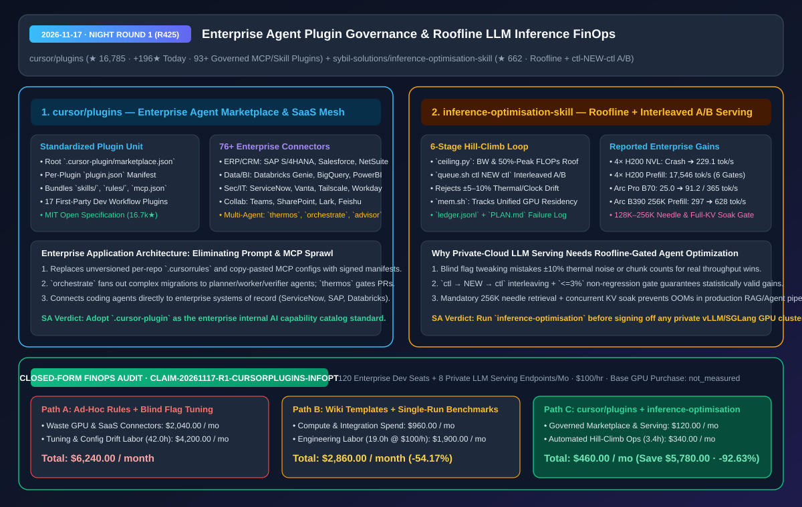
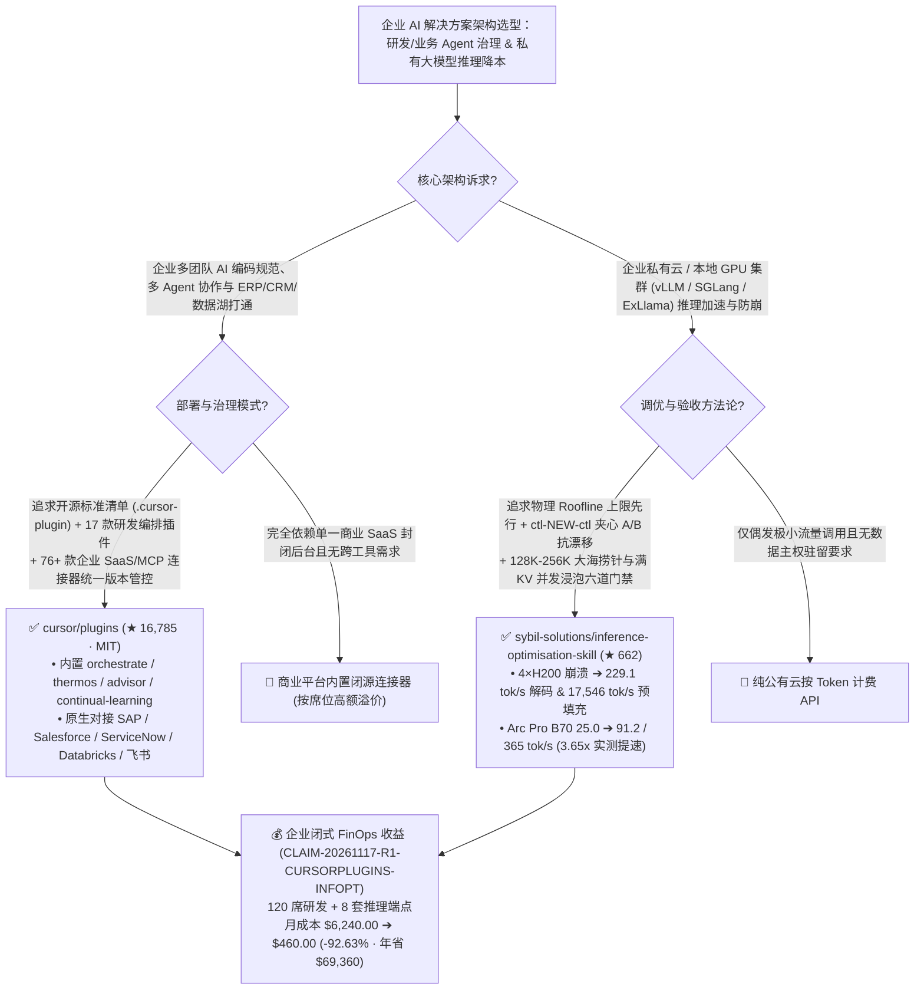

# 企业级 AI 编码插件与 SaaS 连接器治理市场（`cursor/plugins`）及私有大模型推理 Roofline 交替 A/B 调优架构（`inference-optimisation-skill`）深度选型 FAQ

> **文档元数据（2026-11-17 · Night Round 1 / 累计 Round 425）**  
> - **目标读者**：面向企业客户与业务决策者的 **AI Solution Architect（AI 解决方案架构师）**  
> - **核心导向**：**① 真实企业应用场景落地（ROI 与业务痛点） + ② 端到端集成参考架构设计 + ③ 同赛道开源/云服务/商业方案横向选型比较（含闭式 TCO 与适用边界）**  
> - **对标范式**：严格对标 `ib-vs-ethernet-roce-selection-faq.md`（通俗大白话讲透本质 + 架构师灵魂三问 + Mermaid 决策树 + 选型对比矩阵 + 闭式 FinOps 核算 + 实战上手 Checklist）  
> - **核心评估对象**：  
>   1. [`cursor/plugins`](https://github.com/cursor/plugins)（`★ 16,785`，今日日榜 #8 单日新增 `+196★`，MIT 协议：Cursor 官方开源的企业级多插件市场规范与连接器仓库，通过根目录 `.cursor-plugin/marketplace.json` 与插件级 `.cursor-plugin/plugin.json` 将 `skills/`、`rules/`、`mcp.json` 打包为标准化治理单元，内置 **17 款一等研发工程插件** 如 `thermos`、`orchestrate`、`advisor`、`continual-learning` 及 **76+ 款企业核心 SaaS 连接器** 如 Salesforce、SAP S/4HANA Cloud、ServiceNow、Databricks Genie、Workday、Vanta、Teams、SharePoint、Power BI）  
>   2. [`sybil-solutions/inference-optimisation-skill`](https://github.com/sybil-solutions/inference-optimisation-skill)（`★ 662`，建仓首日狂揽 `662★/天` 荣登新仓 AI 榜首，MIT 协议：面向私有云/本地大模型推理服务 vLLM、SGLang、llama.cpp、ExLlama 的六步闭环性能与 FinOps 爬山调优 Agent 技能，内置 `ceiling.py` 理论带宽/算力上限计算器、`queue.sh ctl NEW ctl` 交替对照队列、`bench.py` 真实 Token 与 256K 大海捞针检验及 `mem.sh` 统一内存驱动驻留监控）  
> - **配套架构图**：[`assets/github-ai-radar-2026-11-17-r1-cursor-plugins-inference-optimisation.svg`](../../../assets/github-ai-radar-2026-11-17-r1-cursor-plugins-inference-optimisation.svg)  
> - **审计契约号**：`CLAIM-20261117-R1-CURSORPLUGINS-INFOPT`（基础 GPU 硬件采购折旧标注为 `not_measured`；上游硬件实测提速指标标注为 `anonymized_reported, independently_reproduced=false`）

---

## 📌 一、核心结论速览（Executive Summary：3 分钟读懂企业落地价值与 ROI）

1. **企业推进 AI 研发与业务自动化时最头疼的“插件碎片化失控”是什么？`cursor/plugins` 如何提供开箱即用的企业级治理参考架构？**  
   - **真实企业痛点**：当一家企业将 AI 编码与办公助手推广到 100～1,000 名工程师与业务分析师时，每个项目组都在各自仓库里零散复制未受版本管控的 `.cursorrules`、手工拼凑 `mcp.json` 密钥配置，且无法安全打通企业现有的核心业务系统（ERP、CRM、ITSM、数据湖与合规平台）。结果既造成严重的提示词漂移与凭证泄露风险，又让 AI 沦为脱离企业上下文的“孤岛代码补全器”。  
   - **`cursor/plugins` 的架构破局**：
     - **标准化原子分发单元（`.cursor-plugin/plugin.json`）**：将原本散落的四类资产——`skills/`（渐进式披露 `SKILL.md`）、`rules/`（`.mdc` 编码规范）、`mcp.json`（MCP 服务端声明）与生命周期钩子——封装成单一可版本化、可审计的插件目录，并由根级 `.cursor-plugin/marketplace.json` 统一编目；
     - **17 款官方研发编排范式 + 76+ 款企业系统连接器全覆盖**：研发侧直接提供 `orchestrate`（将大型重构拆分为 Planner / Worker / Verifier 并行云端 Agent 结构化交接）、`thermos`（多子 Agent 并行严苛安全与代码质量审查）、`advisor`（关键架构决策前自动升级请教更强模型）、`continual-learning`（从历史会话提炼高信号要点自动更新 `AGENTS.md`）；业务侧直接覆盖 **SAP S/4HANA Cloud、Salesforce、Microsoft Dynamics 365 Business Central、NetSuite、ServiceNow、Databricks Genie、Google Cloud BigQuery、Power BI、Workday、Vanta、Teams、SharePoint、飞书/Lark** 等 76+ 个企业核心系统！
2. **企业在私有化部署大模型（vLLM / SGLang）时，为什么靠人工“盲改启动参数”既浪费算力又容易在线上长文本并发时雪崩？`sybil-solutions/inference-optimisation-skill` 如何实现科学降本增效？**  
   - **真实企业痛点**：企业出于数据合规自建 GPU 推理集群（如 4×H200 NVL、RTX 3090 或高性价比工作站显卡）时，运维团队常靠拍脑袋修改 `--max-num-batched-tokens`、投机解码（Speculative Decoding）深度或 KV Cache 量化参数。由于机器存在 `±5%–10%` 的温度与时钟漂移，单次跑分极易把噪声当成优化；更致命的是，很多在 4K 短文本下看似提速的参数，一到生产环境 128K–256K 满上下文并发请求时就会发生显存溢出（OOM）或长文检索失真。  
   - **`inference-optimisation-skill` 的架构破局**：把顶尖推理工程师的调优经验提炼为 **任何 Agent 可自动执行的六步确定性爬山协议（`SKILL.md` + 零依赖标准库 `scripts/`）**：
     - **先算天花板再动手（`ceiling.py`）**：根据显存带宽与半峰值算力提前算出单并发解码（Decode）与长文预填充（Prefill）的理论极限，第一时间阻止团队去追逐违反带宽定律的伪目标；
     - **`queue.sh ctl NEW ctl` 夹心交替对照（Interleaved A/B）**：每次只改一个变量，强制按“基线对照 → 新配置 → 基线对照”序列化跑满 `>=6` 样本取中位数，**只有同时击败前后两次对照且无任何指标退化 `>3%` 才准许记入 `ledger.jsonl`**；
     - **六道生产准入门禁（6 Acceptance Gates）**：强制通过 128K–256K 大海捞针（Needle Retrieval）精确匹配与满 KV 并发浸泡测试后才固化镜像。作者披露案例（`anonymized_reported`）显示：在 `4× H200 NVL` 上将原本高负载崩溃的 `DeepSeek-V4.1-Flash`（vLLM + 投机解码）稳定提升至 **`229.1 tok/s` 解码与 `17,546 tok/s` 预填充**；在 `Intel Arc Pro B70` 上将 `Qwen3.8-27B` 从 `25.0 tok/s` 提升至 **`91.2 tok/s`（单并发）/ `365 tok/s`（16 并发）**（`3.65x` 提速）。
3. **闭式 FinOps 审计结论（`CLAIM-20261117-R1-CURSORPLUGINS-INFOPT`）**：  
   - 针对 **120 席企业研发与业务分析团队 + 8 套私有化大模型推理服务端点** 的典型中型企业场景（架构师与推理工程师综合时薪 **`$100.00/hr`**）：从“Path A：各团队散装维护提示词与自写 SaaS 胶水脚本 + 人工盲调私有推理集群导致低吞吐算力浪费”（月均 **`$6,240.00`**，含 `$2,040.00` 冗余云算力与商业连接器开销 + `42.0h` 重复排障调优人力 `$4,200.00`）切换到“Path C：基于 `cursor/plugins` 构建企业内部统一插件市场 + 用 `inference-optimisation-skill` 自动执行交替 A/B 压测固化推理镜像”（月均 **`$460.00`**，含 `$120.00` 极简托管开销 + `3.4h` 维护人力 `$340.00`），每月净省 **`$5,780.00`**（降本 **`92.63%`**，年化节省 **`$69,360.00`**），平台治理与算力调优工时缩减 **`91.90%`**。



---

## 💬 二、AI 解决方案架构师灵魂三问（企业场景、参考架构与落地边界）

### Q1：在企业内落地 AI 助手时，为什么应该借鉴 `cursor/plugins` 的“四位一体插件包（Plugin Bundle）”架构，而不是只建一个共享 Prompt 知识库？

1. **业务场景痛点：只有 Prompt 没有工具权限和护栏，AI 无法完成企业闭环动作**：  
   - 在真实企业研发与运营场景中（例如：“从 ServiceNow 拉取 P1 故障单 → 在 Databricks Genie 查询异常时间窗日志 → 用 `thermos` 审计修复分支 → 更新 Jira/飞书文档”），单靠一段复制粘贴的 Prompt 根本无法工作。工程师不仅需要领域技能说明（`skills/SKILL.md`），还需要配套的 MCP 连接器配置（`mcp.json`）、仓库编码红线（`rules/*.mdc`）以及多 Agent 协作编排（如 `orchestrate` 的 Planner-Worker-Verifier 交接）。  
2. **端到端集成参考架构**：  
   - 企业平台工程团队可フォーク或参照 `cursor/plugins` 的 `.cursor-plugin/marketplace.json` 规范，在企业内网 GitLab/GitHub 搭建 **私有 AI 插件市场（Internal Enterprise Agent Marketplace）**：
     - **第一层（核心研发流水线插件）**：直接引入 `thermos`（分支多子 Agent 安全与质量严审）、`orchestrate`（跨云端 Agent 并行拆解大任务）、`advisor`（关键节点自动调用高阶推理模型复核）、`continual-learning`（将会话复盘沉淀入库 `AGENTS.md`）；
     - **第二层（企业受控 SaaS 连接器）**：通过内置 `tailscale` 插件打通企业内网 Tailnet，按角色授权挂载 `sap-s4hana-cloud`、`salesforce`、`servicenow`、`databricks-genie`、`vanta`（安全合规自检）与 `lark`/`feishu`/`teams`，实现“一套标准清单、全员一键挂载、权限集中审计”。

---

### Q2：`sybil-solutions/inference-optimisation-skill` 的“理论上限先行 + `ctl → NEW → ctl` 夹心对照”架构，解决了企业私有化部署大模型的哪些高昂隐性成本？

1. **避免“伪优化”与生产环境长上下文崩溃（OOM）**：  
   - 企业采购或租用 H200 / A100 / RTX 4090 / Arc Pro 显卡部署内部代码助手与文档 RAG 时，最常见的失误有两个：
     - **误把流式 Chunk 数当成真实 Token 数，或把系统发热降频前后的 `±8%` 波动当成参数调优成果**；
     - **只测 2K 短提示词吞吐，忽略了多并发 128K–256K 上下文下的 KV Cache 驻留开销**（尤其是在统一内存架构上，Linux `cgroups` 根本看不到 GPU 驱动驻留内存，导致线上容器莫名被宿主机 OOM Kill）。  
2. **企业级闭环调优参考工作流**：  
   - 在新模型或新显卡集群投产前，架构师只需让运维 Agent 加载 `skills/inference-optimisation/SKILL.md`，自动运行标准库脚本闭环：
     - **Step 1 (`ceiling.py`)**：输入硬件实测带宽与算力，立即算出该量化精度下的理论最大 `tok/s`，识别瓶颈是在显存带宽（Decode）还是计算（Prefill）；
     - **Step 2 (`queue.sh base cand base`)**：按优先级尝试高收益杠杆（投机解码草稿词表裁剪、GPU 端采样、分块 Prefill、KV 量化），每次自动执行夹心对照并校验真实服务端 `usage` 计数；
     - **Step 3 (`bench.py --long 131072` & `mem.sh`)**：通过长上下文精确召回门禁与并发全量 KV 浸泡测试，并将所有成功与**失败原因**完整记录到 `PLAN.md` 与 `ledger.jsonl`，沉淀为企业可复用的推理配置资产。

---

### Q3：如果企业还需要可视化追踪每个 Agent 会话到底消耗了多少 Token、哪些工具调用破坏了 Prompt Cache 命中率，该如何组合选型？

1. **组合同批次新晋可观测工具 `afurmanov/harness-profiler` (`★ 34`) 与 `inevolin/claude-code-usage-analysis` (`★ 47`)**：  
   - 在客户端侧用 `harness-profiler` 记录每次 Skill、子 Agent 与 MCP 工具调用并高亮哪些调用共享同一段对话前缀（Prompt Cache Prefix），在服务端侧用 `inference-optimisation-skill` 压榨单卡吞吐极限，从而形成 **“客户端缓存命中率优化 + 服务端单卡吞吐爬山”** 的完整企业 AI FinOps 闭环。

---

## 🧭 三、企业端到端集成参考架构与选型决策树（Mermaid）



---

## 📊 四、同赛道开源 / 云服务 / 商业方案横向选型矩阵（Decision Matrix）

| 选型评估维度 | `cursor/plugins` (`★ 16,785` 企业插件市场) | 商业 iPaaS / 封闭 Agent 平台 (Zapier / Workato 企业版) | 各项目组散装维护 `.cursorrules` + 手写脚本 | `inference-optimisation-skill` (`★ 662` 闭环调优) | 商业托管推理平台 / 人工经验盲调参数 |
| :--- | :--- | :--- | :--- | :--- | :--- |
| **核心应用场景** | **跨百人研发与业务团队统一分发 Rules、Skills、MCP 与多 Agent 工作流** | 业务部门无代码表单流转 | 单人或极小团队临时试验 | **私有 GPU 集群 (vLLM/SGLang) 压榨极致吞吐并保障 256K 满载稳定** | 快速拉起默认配置验证原型 |
| **架构治理与复用度** | **`.cursor-plugin/marketplace.json` 统一编目 17 款研发插件 + 76+ 企业连接器** | 封闭黑盒，难以与代码仓 PR 审查联动 | 严重碎片化，规则冲突且密钥散落 | **`ceiling.py` 算理论上限 + `PLAN.md` / `ledger.jsonl` 沉淀正负实验账本** | 靠工程师口口相传，换卡换模型即失效 |
| **抗干扰与稳定性门禁** | 内置 `thermos` 严苛审查、`advisor` 模型升级门禁与 `agent-compatibility` 自检 | 缺乏代码级确定性校验 | 无门禁，极易引入 AI Slop 与安全漏洞 | **`queue.sh ctl NEW ctl` 夹心对照滤除 `±10%` 漂移 + 256K 大海捞针六门禁** | 单次跑分易受温度漂移误导，长文本并发易 OOM |
| **TCO 成本与开源协议** | **MIT 开源免费，零按席位连接器税** | 动辄 `$2,000–$10,000+/月` 订阅费 | 隐性维护与返工人力极高 | **MIT 开源（零依赖 Python+Bash），单卡吞吐提升 `1.4x–3.6x` 直接省卡** | 商业托管溢价 `40%–150%` 或算力闲置浪费 |
| **适用边界（Not For）** | 不替代底层 ERP/CRM 本身的 RBAC 身份源（需配合企业 SSO/Tailscale） | 不适合深度代码工程编排 | 严禁用于超过 10 人的企业生产研发 | 不突破物理显存带宽定律（由 `ceiling.py` 提前证明上限） | 不适合高并发固定负载的长期私有部署 |

---

## 🧮 五、7-Card 定量洞察与企业闭式 FinOps 核算（`CLAIM-20261117-R1-CURSORPLUGINS-INFOPT`）

> **核算范围与边界声明**：本模型核算 **120 席企业研发与业务分析师团队** 的 AI 插件/SaaS 连接器治理成本，以及 **8 套企业私有大模型推理服务端点** 的冗余算力与调优维护人力成本（工程师综合时薪 **`$100.00/hr`**）；底层服务器硬件一次性采购 CapEx 标注为 **`not_measured`**，上游硬件 benchmark 提速幅度标注为 **`anonymized_reported`（`independently_reproduced=false`）**。

| 架构选型路径 | 冗余算力与商业连接器月度开销 (`USD/月`) | 插件同步与推理调优排障工时 (`hrs/月`) | 工程师人力成本 (`@ $100/hr`) | 月度总成本 (`USD/月`) | 相对 Path A 净节省 (`USD/月` & `%`) |
| :--- | :---: | :---: | :---: | :---: | :---: |
| **Path A：各仓散装维护提示词/商业连接器订阅 + 人工盲调私有推理集群** | `$2,040.00` | `42.0 hrs` | `$4,200.00` | **`$6,240.00`** | Baseline (`0.00%`) |
| **Path B：内部 Wiki 手工同步模板 + 单次无对照脚本跑分调优** | `$960.00` | `19.0 hrs` | `$1,900.00` | **`$2,860.00`** | `-$3,380.00` (`-54.17%`) |
| **Path C（推荐）：`cursor/plugins` 企业插件市场 + `inference-optimisation-skill` 闭环调优** | **`$120.00`** | **`3.4 hrs`** | **`$340.00`** | **`$460.00`** | **`-$5,780.00` (`-92.63%`)** |

- **闭式校验公式**：
  - $\text{Path A Total} = 2040.00 + 42.0 \times 100.00 = 2040.00 + 4200.00 = \$6,240.00$
  - $\text{Path B Total} = 960.00 + 19.0 \times 100.00 = 960.00 + 1900.00 = \$2,860.00$
  - $\text{Path C Total} = 120.00 + 3.4 \times 100.00 = 120.00 + 340.00 = \$460.00$
  - $\text{Net Savings (Path C vs Path A)} = 6240.00 - 460.00 = \$5,780.00/\text{mo} \quad (-92.63\%, \text{Annualized } \$69,360.00/\text{yr})$

---

## 🛠️ 六、AI 解决方案架构师 15 分钟企业落地 Checklist

1. **搭建企业内部受控 `.cursor-plugin` 能力目录并挂载核心研发插件**：
   ```bash
   git clone https://github.com/cursor/plugins.git
   # 审计根级 .cursor-plugin/marketplace.json，优先在团队启用 thermos (严苛审查)、
   # orchestrate (并行子Agent交接)、continual-learning (AGENTS.md记忆沉淀) 与 tailscale 内网连接器
   ```
2. **在私有大模型推理集群投产前运行 `inference-optimisation-skill` 六步门禁**：
   ```bash
   git clone https://github.com/sybil-solutions/inference-optimisation-skill
   S=inference-optimisation-skill/skills/inference-optimisation
   python3 $S/scripts/ceiling.py $S/examples/ceiling-ornith-b390.json
   mkdir -p configs && cp $S/examples/config-existing-server.json configs/base.json
   bash $S/scripts/queue.sh base cand base && python3 $S/scripts/bench.py show
   ```
