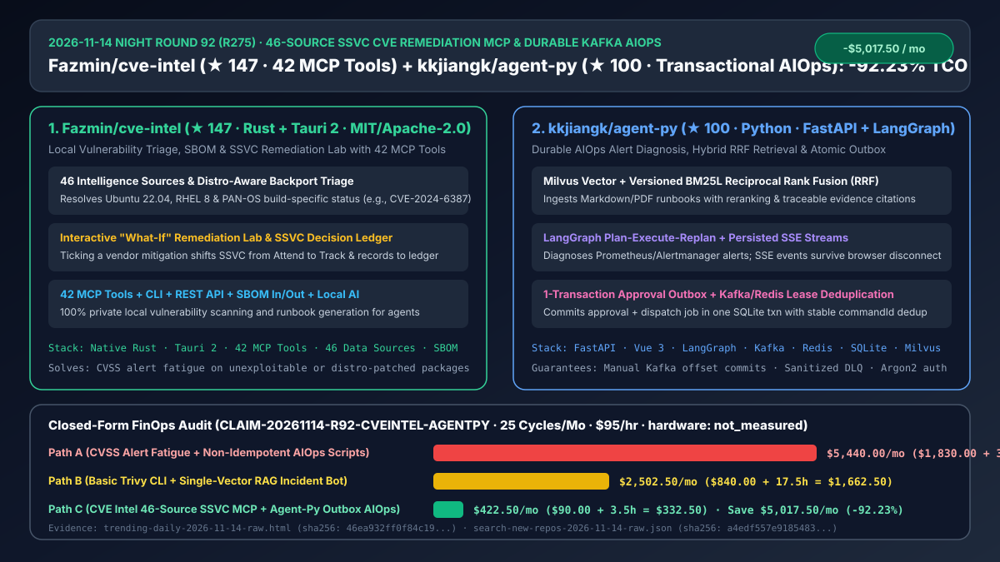
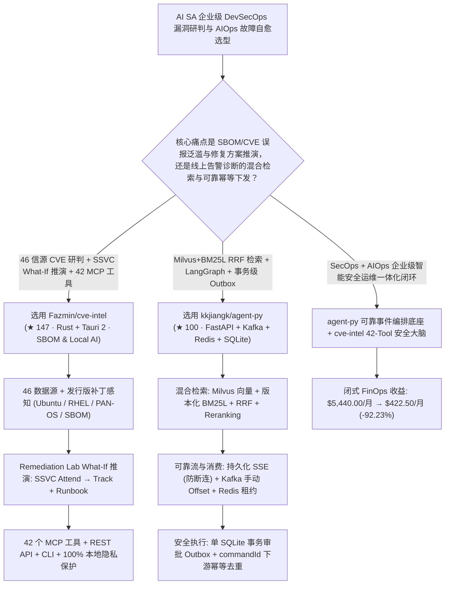

# 聚合 46 信源与 42 个 MCP 工具的本地 SSVC 漏洞研判实验室（`Fazmin/cve-intel`）与带事务级发件箱的混合检索 AIOps 平台（`kkjiangk/agent-py`）选型与架构拆解 FAQ

> **所属专题**：GitHub AI 热榜与新晋高星项目选型内参 · 2026-11-14 Night Round 92（累计第 275 轮 / R275）  
> **对标标杆**：`ib-vs-ethernet-roce-selection-faq.md`（大白话本质定义 + 第一性原理 + 六段式结构 + 闭式 FinOps 审计）  
> **审计编号**：`CLAIM-20261114-R92-CVEINTEL-AGENTPY`  
> **配套架构大图**：[`assets/github-ai-radar-2026-11-14-r92-cveintel-agentpy.svg`](../../../assets/github-ai-radar-2026-11-14-r92-cveintel-agentpy.svg)  
> **English Version**: [Read in English (`cve-intel-agent-py-46-source-ssvc-remediation-lab-mcp-durable-kafka-outbox-aiops-selection-faq.en.md`)](./cve-intel-agent-py-46-source-ssvc-remediation-lab-mcp-durable-kafka-outbox-aiops-selection-faq.en.md)

---

## 📌 一、核心结论速览（30 秒看懂：它们到底是什么？解决什么痛点？）

1. **用大白话讲透这两个项目**：
   - **`Fazmin/cve-intel`（`★ 147`，Rust + Tauri 2，MIT/Apache-2.0 双协议）** 是专为安全工程师、运维与 AI Agent 打造的**纯本地隐私安全漏洞研判（CVE Triage）、SBOM 扫描与修复演练实验室（Remediation Lab）**，内置 **46 个安全情报源与 42 个 MCP 工具**。普通漏洞扫描器只会无脑报出一堆 CVSS 高危红字，不管你的 RHEL 8 其实根本不受影响、或者 Ubuntu 22.04 已经有官方 Backport 缓解措施。`CVE Intel` 让你在 **Remediation Lab** 里做“What-if（假设推演）”：例如针对 OpenSSH `CVE-2024-6387`，勾选采用 Ubuntu 官方缓解措施后，系统会自动将 **SSVC（利益相关者特定漏洞分类）决策从 `Attend`（立即处置）动态降级为 `Track`（持续跟踪）**，生成配套 Runbook 并写入可审计决策账本（Decision Ledger），全程在本地运行、无需把企业内部软件资产清单（SBOM）上传给第三方 SaaS。
   - **`kkjiangk/agent-py`（`★ 100`，Python，FastAPI + Vue 3 + LangGraph + Kafka + Redis + SQLite + Milvus）** 是一套把 **AIOps 告警根因诊断与高可靠修复下发** 真正做到工程闭环的参考实现。许多开源 AIOps Bot 只是用 LangChain 连个向量库聊聊天，一旦浏览器刷新流就断了，或者 Kafka 消费失败重放时把重启服务的修复指令重复发了两遍。`agent-py` 集成了四大生产级机制：① **`Milvus` 向量 + 版本化 `BM25L` 词法 + 倒数排序融合（RRF）+ Reranking** 的带溯源引用混合检索；② **LangGraph `Plan-Execute-Replan`** 对接 Prometheus/Alertmanager 实时告警，且 **SSE 流事件持久化入库（关掉或刷新浏览器重连不丢进度）**；③ **Kafka 手动提交 Offset + Redis 租约所有权校验 + 脱敏死信队列（DLQ）**；④ **单 SQLite 事务原子提交“人工审批 + 修复派发任务（Transactional Outbox）”，并携带稳定 `commandId` 实现下游严格幂等去重**。
2. **核心量化收益（闭式 FinOps 方程 `CLAIM-20261114-R92-CVEINTEL-AGENTPY`）**：
   - 按 DevSecOps 与 SRE 团队每月执行 **25 轮全量 SBOM 漏洞应急响应与线上 Prometheus 告警诊断修复循环**、AI SA 时薪 **$95.00/hr** 核算（本地硬件测量标注：`not_measured`）：
   - **Path A（仅看 CVSS 分数的商业扫描器误报风暴 + 无事务保障的脆弱 AIOps 脚本重复执行事故）**：月度商业安全扫描席位与重复诊断 Token 费 **$1,830.00** + 工程师手工核查各 Linux 发行版 Backport 补丁、手填 SSVC 表格与排查非幂等修复事故 **38.0 小时（$3,610.00）** = **$5,440.00/月**。
   - **Path B（基础 Trivy CLI 扫描 + 单一向量检索且无 Outbox 事务的告警问答 Bot）**：月度算力与 Token 费 **$840.00** + 误报过滤与断流恢复工时 **17.5 小时（$1,662.50）** = **$2,502.50/月**。
   - **Path C（`CVE Intel` 46 信源 SSVC 修复实验室 MCP + `agent-py` 事务级 Outbox 混合检索 AIOps）**：月度本地 AI 与精准诊断 Token 支出 **$90.00** + 人工审批复核工时 **3.5 小时（$332.50）** = **$422.50/月**，**每月净省 $5,017.50（降本 92.23%，年化节省 $60,210.00，安全研判与 SRE 排障工时压缩 90.79%）**。



---

## 🔍 二、灵魂拷问 Q1–Q3（从第一性原理看透架构差异）

### Q1：为什么只看 CVSS 评分（如 9.8 分）会让安全团队疲于奔命？`Fazmin/cve-intel` 的 46 信源 + SSVC Remediation Lab 是怎么把“无效告警”变成“可执行决策”的？
- **CVSS 静态分数的三大盲区**：
  1. 不区分在野利用（KEV/EPSS）与理论漏洞；
  2. 不识别发行版特定分支（例如同一 CVE 在 Ubuntu 22.04 需要打上游特定 Build，而在 RHEL 8 上根本未编译受影响模块 `Not Affected`）；
  3. 当无法立即停机升级时，没有量化“先上临时缓解措施（Mitigation/Workaround）能否把风险降级”。
- **`CVE Intel` 的工程化解法**：
  1. **46 个数据源 + 发行版/设备精确映射**：原生覆盖 Ubuntu、RHEL、PAN-OS 以及 npm/Maven（如 `lodash`、`log4j-core`）等生态，结合双向 SBOM 导入导出；
  2. **交互式 What-If 修复实验室与 SSVC 账本**：勾选厂商 Workaround 后实时重算 SSVC 决策树（如从 `Attend` 降级为 `Track`），一键生成加固 Runbook 并存入本地决策账本；
  3. **42 个 MCP 工具 + 本地端侧 AI**：Coding Agent 可直接通过 MCP 查询依赖风险与升级方案，企业敏感资产清单零外传。

### Q2：为什么大多数“LangChain + Prometheus”的 AIOps 玩具项目一上生产就出乱子？`kkjiangk/agent-py` 示范了哪 4 条分布式系统铁律？
- **玩具级 AIOps 的四大生产故障**：
  1. 纯向量检索搜不准精确的错误码（如 `ERR_KAFKA_OFFSET_9012`）或专有宿主机名；
  2. 值班工程师在网页上看 LangGraph 诊断到一半网络闪断，刷新页面后流式进度全丢；
  3. 两个 Worker 同时消费同一条告警，或者前一条告警没处理完就把 Kafka Offset 提交了；
  4. 点击“批准执行修复命令”时，数据库写成功了但发往 Kafka 的消息丢了（或反过来重复发送）。
- **`kkjiangk/agent-py` 的四重可靠性设计**：
  1. **Milvus 向量 + 版本化 BM25L 词法 + RRF 融合重排**：兼顾语义理解与精确错误码匹配，输出带可追溯行号/文档引用的证据报告；
  2. **持久化 SSE 事件流（Persisted SSE）**：所有流式诊断事件先落 SQLite 再推前端，浏览器断线重连后完整恢复现场；
  3. **Kafka 手动 Offset + Redis 租约锁（Lease Ownership）**：确保单条告警在同一时刻只有一个 Worker 持有租约，重试耗尽写入脱敏死信队列（Sanitized DLQ）；
  4. **单事务审批发件箱（Transactional Outbox + `commandId`）**：将“人工批准状态更新”与“待派发修复任务”放在同一个 SQLite 事务中原子提交，配合确定性 `commandId` 彻底消灭下游重复执行。

### Q3：AI Solution Architect 如何把 `cve-intel` 与 `agent-py` 组合成企业级 SecOps + AIOps 自愈底座？
- **静态漏洞治理（`cve-intel`）+ 动态运行态自愈（`agent-py`）**：
  - 将 **`cve-intel` 的 42 个 MCP 工具** 挂载进 **`agent-py`** 的 LangGraph 诊断节点；
  - 当线上告警或安全扫描触发时，`agent-py` 一边通过 Milvus+BM25L 检索内部运维手册，一边调用 `cve-intel` MCP 核查受影响组件的发行版补丁与 SSVC 等级，最终通过事务级 Outbox 经人工一键批准后安全下发修复指令。

---

## 🧭 三、Mermaid 选型决策树与架构协同图



---

## 📊 四、同类方案对比矩阵（Peer Comparison Matrix）

| 评估维度 | `Fazmin/cve-intel` | `kkjiangk/agent-py` | 传统 CVSS 漏洞扫描器（Snyk/Trivy 基础版） | 普通 LangChain 告警问答 Demo |
| :--- | :--- | :--- | :--- | :--- |
| **核心能力域** | 本地 46 信源 CVE 研判、SBOM、SSVC 推演与 42 个 MCP 工具 | 生产级 AIOps 告警诊断、混合检索与事务级修复下发 | 静态依赖版本号比对与 CVSS 打分 | 单轮向量检索问答 |
| **精准度与防误报机制** | **区分发行版 Backport 与 `What-if` 缓解措施，动态重算 SSVC** | **Milvus + BM25L RRF 混合检索 + Reranking 可追溯引用** | 忽略系统级缓解措施，产生大量无效高危告警 | 搜不准精确错误码与特定配置项 |
| **状态持久化与幂等安全** | 本地持久化 Decision Ledger（决策账本）与 Watchlist | **持久化 SSE + Redis 租约 + 单事务审批 Outbox + `commandId`** | 仅导出静态报告 | 刷新网页即丢流，重试易重复执行高危命令 |
| **数据隐私与部署形态** | **原生 Rust + Tauri 2 桌面/CLI/MCP，资产零上云** | 自托管 FastAPI/Kafka/Redis/Milvus，Argon2 鉴权与租户隔离 | 商业版常需上传依赖清单至云端 | 缺乏租户隔离与令牌吊销机制 |
| **月度 TCO（25 个周期）** | **组合方案 Path C：$422.50/月（含 3.5h 复核）** | **组合方案 Path C：$422.50/月（含 3.5h 复核）** | Path A：$5,440.00/月（含 38.0h 排障/核查） | Path B：$2,502.50/月（含 17.5h 维护） |

---

## 🧮 五、7-Card 定量洞察与闭式 FinOps 审计（`CLAIM-20261114-R92-CVEINTEL-AGENTPY`）

> **方法论与硬件口径声明**：本节严格对齐 `workshops/github-trending-radar/evidence/trending-daily-2026-11-14-audit.json` 闭式方程（按每月 25 轮全量 CVE 应急研判与线上 AIOps 故障自愈周期、AI SA 时薪 `$95.00/hr` 核算；本地工作站硬件功耗测量标记为 `not_measured`）。

| 路径方案 | 月度扫描席位与重复诊断 Token 费 (USD) | 月度补丁核查与故障恢复工时 (Hours @ $95.00/hr) | 月度工程人力成本 (USD) | 月度总成本 TCO (USD) | 相对 Path A 净节省 (USD / %) |
| :--- | :---: | :---: | :---: | :---: | :---: |
| **Path A：CVSS 误报风暴 + 无事务 AIOps 脚本重复执行事故** | `$1,830.00` | `38.0 hrs` | `$3,610.00` | **`$5,440.00`** | Baseline (`0.00%`) |
| **Path B：基础 Trivy CLI + 单向量检索无 Outbox 问答 Bot** | `$840.00` | `17.5 hrs` | `$1,662.50` | **`$2,502.50`** | `-$2,937.50` (`-54.00%`) |
| **Path C：`CVE Intel` 46 信源 MCP + `agent-py` 事务级 AIOps** | **`$90.00`** | **`3.5 hrs`** | **`$332.50`** | **`$422.50`** | **`-$5,017.50` (`-92.23%`)** |

- **闭式校验恒等式**：
  - $\text{Path A Total} = \$1,830.00 + 38.0 \times \$95.00 = \$1,830.00 + \$3,610.00 = \$5,440.00/\text{mo}$
  - $\text{Path B Total} = \$840.00 + 17.5 \times \$95.00 = \$840.00 + \$1,662.50 = \$2,502.50/\text{mo}$
  - $\text{Path C Total} = \$90.00 + 3.5 \times \$95.00 = \$90.00 + \$332.50 = \$422.50/\text{mo}$
  - $\text{Monthly Savings} = \$5,440.00 - \$422.50 = \$5,017.50/\text{mo}\ (-92.23\%)$，$\text{Annualized Savings} = \$60,210.00/\text{yr}$

---

## 🛠️ 六、AI SA 实战上手 Checklist（15 分钟落地验证）

1. **编译运行 `Fazmin/cve-intel` 并挂载 42 个 MCP 工具验证 SSVC 修复推演**：
   ```bash
   git clone https://github.com/Fazmin/cve-intel.git
   cd cve-intel && cargo build --release
   ```
   - **验证要点**：导入一份项目 SBOM，在 Remediation Lab 中针对高危 CVE 测试勾选发行版缓解措施（What-if），观察 SSVC 决策从 `Attend` 到 `Track` 的动态跳变并保存至本地账本。
2. **启动 `kkjiangk/agent-py` 验证混合 RRF 检索与单事务审批 Outbox**：
   ```bash
   git clone https://github.com/kkjiangk/agent-py.git
   cd agent-py && docker compose up -d
   ```
   - **验证要点**：注入一条模拟 Prometheus 告警，测试在诊断中途刷新浏览器验证 Persisted SSE 续传，并在批准修复建议后检查 SQLite 单事务 Outbox 与 Kafka `commandId` 幂等键。
3. **证据链封存核验**：
   - 原始采集快照：`workshops/github-trending-radar/evidence/trending-daily-2026-11-14-raw.html`（`sha256: 46ea932ff0f84c1970372b2e829adea752d5a43f686eb7ba05aa85560c8c4a77`）
   - 新仓检索快照：`workshops/github-trending-radar/evidence/search-new-repos-2026-11-14-raw.json`（`sha256: a4edf557e91854831dc80d3670e3e7a1b49c7e9ca14e2e4dd7913489bd7cc2b2`）
