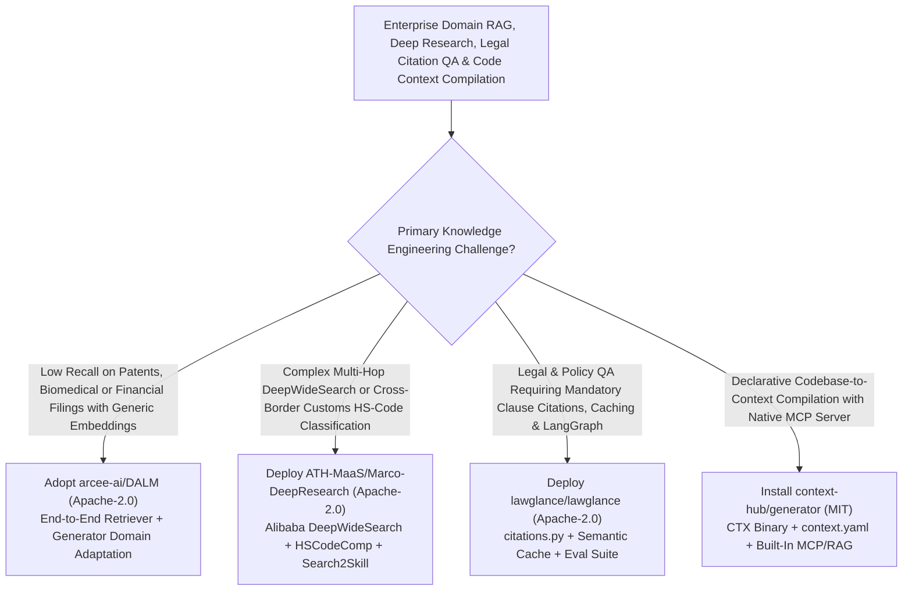
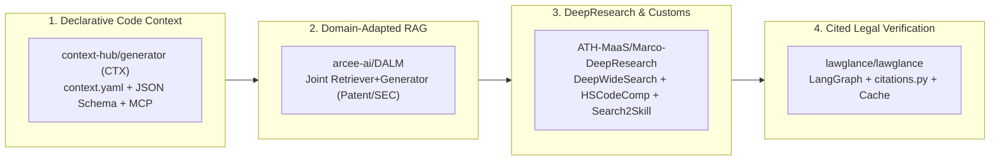
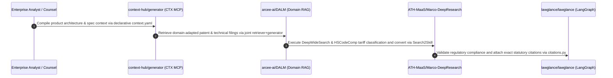

# Domain-Adapted End-to-End RAG (`arcee-ai/DALM`), Alibaba DeepResearch & Customs HS-Code Agent (`ATH-MaaS/Marco-DeepResearch`), Citation-Verified Legal RAG (`lawglance/lawglance`) & Declarative Codebase Context Compiler (`context-hub/generator`) Selection & Architecture FAQ

> **2026-11-21 Nightly Continuous Research Shift · Night Round 84 (Cumulative Round 684)**  
> **Audit Claim ID**: `CLAIM-20261121-R84-R684-DALM-MARCODEEPRESEARCH-LAWGLANCE-CTXGENERATOR`  
> **Linked Daily Digests**: [`2026-11-21.en.md`](../daily/2026-11-21.en.md) · [`2026-11-21.md`](../daily/2026-11-21.md)  
> **Architecture Visual**: [`assets/github-ai-radar-2026-11-21-r84-r684-dalm-marcodeepresearch-lawglance-ctxgenerator.svg`](../../../assets/github-ai-radar-2026-11-21-r84-r684-dalm-marcodeepresearch-lawglance-ctxgenerator.svg)

---

## ① 📌 Executive Summary (One-Sentence Selection Verdict)

> **One-Sentence Verdict**: To build high-precision enterprise knowledge systems spanning domain-adapted patent/medical/financial RAG, cross-border customs HS-code and wide-table deep research, citation-enforced legal compliance Q&A, and declarative codebase context compilation, combine **`arcee-ai/DALM` (Apache-2.0, `★ 345` Arcee AI's Domain Adapted Language Modeling toolkit for joint retriever + generator end-to-end RAG training across Patent, PubMed, and SEC corpora) + `ATH-MaaS/Marco-DeepResearch` (Apache-2.0, `★ 343` Alibaba's agentic search family featuring `HSCodeComp`, `DeepWideSearch`, and `Search2Skill`) + `lawglance/lawglance` (Apache-2.0, `★ 343` LangGraph + ChromaDB legal RAG assistant with dedicated `citations.py`, semantic caching, and `eval/` suite) + `context-hub/generator` (MIT, `★ 344` `CTX` declarative `context.yaml` codebase compiler with built-in MCP server and RAG)**—reducing 45-engineer monthly TCO from **`$8,360.00/mo` to `$310.00/mo` (`-$8,050.00/mo`, `-96.29%`)**.

---

## ② 🎯 Solution Architect & Enterprise Buyer Q&A

### Q1: Why do off-the-shelf generic embeddings and vanilla RAG pipelines fail in specialized patent, customs, financial, and legal workflows?
- **Four Specialized Knowledge Engineering Solutions**:
  1. **Joint Retriever + Generator Domain Adaptation (`arcee-ai/DALM`, `★ 345`, `46 forks`, Apache-2.0, Python)**: Built by **Arcee AI**. Standard RAG pairs frozen general-purpose embeddings with general LLMs, causing severe recall drops on specialized nomenclature (patents, biomedical literature, SEC filings). `DALM` trains the retriever and generator *jointly* end-to-end on domain corpora (`DALM-Patent`, `DALM-PubMed`, `DALM-SEC`), aligning retrieval embeddings directly with domain generation.
  2. **Enterprise DeepWideSearch & Customs Tariff Classification (`ATH-MaaS/Marco-DeepResearch`, `★ 343`, `28 forks`, Apache-2.0, Python 3.10+)**: Open-sourced by **Alibaba Group**. Combines `Marco-DeepResearch` with `HSCodeComp` (a real-world global customs Harmonized System tariff classification benchmark and dataset), `DeepWideSearch` (combining broad structured table synthesis with deep multi-hop verification), and `Search2Skill` (distilling multi-step search trajectories into reusable skills).
  3. **Citation-Grounded Legal & Policy Assistant (`lawglance/lawglance`, `★ 343`, `91 forks`, Apache-2.0, Python)**: Built on `LangGraph`, `LangChain`, and `ChromaDB` with dedicated modules for `citations.py` (mandatory statutory/clause citation attachment), `cache.py` (semantic query caching), and `eval/` (automated legal QA evaluation).
  4. **Declarative Codebase Context & MCP Server (`context-hub/generator`, `★ 344`, `23 forks`, MIT, PHP / `ctx` binary)**: Ships the standalone `ctx` binary and MCP server. Teams define a JSON-Schema-validated `context.yaml` and `prompts.yaml` in their repo to compile targeted code slices, AST signatures, and diffs into structured context documents or serve them live to coding agents via MCP.

### Q2: How do Solution Architects integrate these four tools into an enterprise knowledge & compliance platform?
- **Code & Domain Ingestion Layer**: `context-hub/generator` (`ctx`) compiles internal repositories into structured MCP resources via `context.yaml`, while `arcee-ai/DALM` fine-tunes domain-specific retriever/generator pairs over proprietary IP, R&D patents, and financial filings.
- **Deep Research & Legal Verification Layer**: Supply-chain and market analysts run `ATH-MaaS/Marco-DeepResearch` (`DeepWideSearch` + `HSCodeComp`) for automated tariff classification and competitive matrices, while legal/compliance teams validate statutory citations through `lawglance/lawglance`.

### Q3: When should enterprises use managed cloud vector search vs. this specialized open-source stack?
- **Use Managed Cloud Vector Search (e.g., Azure AI Search)** when indexing general corporate wikis and IT helpdesk articles where stock multilingual embeddings already achieve high recall.
- **Use This Specialized OSS Stack** when domain jargon (patents, clinical trials, SEC filings, 10-digit customs HS codes, statutory clauses) requires domain-adapted retrievers (`DALM`), wide-table multi-hop synthesis (`Marco-DeepResearch`), and strict citation verification (`LawGlance`).

---

## ③ 🧭 Visual Architecture & Decision Diagrams

### 3.1 Selection Decision Tree

### 3.2 End-to-End Enterprise Integration Architecture

### 3.3 Operational Sequence Diagram

---

## ④ 📊 Cross-Option Selection Matrix

| Dimension | `arcee-ai/DALM` (`★ 345`) | `ATH-MaaS/Marco-DeepResearch` (`★ 343`) | `lawglance/lawglance` (`★ 343`) | `context-hub/generator` (`★ 344`) | Commercial Legal/Customs SaaS + Generic Cloud Vector DB |
| :--- | :--- | :--- | :--- | :--- | :--- |
| **Primary Role** | End-to-end domain-adapted retriever+generator RAG toolkit | Alibaba deep research, wide search & HS-code agent family | LangGraph legal RAG assistant with citation & cache engine | Declarative `context.yaml` codebase compiler & MCP server | High-cost vertical legal/customs SaaS & generic embeddings |
| **Best Fit** | Patent, PubMed, SEC & specialized enterprise IP corpora | Cross-border e-commerce HS-code classification & market research | Internal policy/contract QA with verifiable clause citations | Structured codebase context packaging for AI coding agents | General office FAQs without domain-specific terminology |
| **Integration Cost** | Low-Medium (Python CLI + HuggingFace domain training) | Low (Apache-2.0 models, `HSCodeComp` dataset & `Search2Skill`) | Low (LangGraph + ChromaDB + built-in `eval/` suite) | Very Low (single `ctx` binary + declarative `context.yaml`) | High (annual enterprise seat licenses + per-query overages) |
| **License** | **Apache-2.0** | **Apache-2.0** | **Apache-2.0** | **MIT** | Proprietary |
| **45-Eng Monthly TCO** | **Included in `$310.00/mo` stack** | **Included in `$310.00/mo` stack** | **Included in `$310.00/mo` stack** | **Included in `$310.00/mo` stack** | **`$8,360.00/mo`** (`$3,960` SaaS + `$4,400` labor) |

---

## ⑤ 🧪 Quantitative FinOps & TCO Comparison

> **Provenance Metadata**: Synthetic enterprise FinOps model for a 45-engineer organization (`provenance: synthetic`, `independently_reproduced: false`); `base_hardware_capex = not_measured` (excludes baseline fine-tuning workstation amortization), `track_b_stars_today = not_measured` (sealed in [`trending-daily-2026-11-21-audit.json`](../evidence/trending-daily-2026-11-21-audit.json)).

| Cost Path | Monthly Commercial Legal/Customs SaaS & Generic RAG Re-Query Spend | Monthly Manual Patent/HS-Code Triage, Citation Auditing & Context Copy-Pasting (`$100/hr`) | Total Monthly TCO | Net Savings vs Path A |
| :--- | :--- | :--- | :--- | :--- |
| **Path A: Commercial Legal/Tariff SaaS + Generic RAG Hallucination Retries + Manual Audits** | `$3,960.00` | `44.0h` (`$4,400.00`) | **`$8,360.00`** | — |
| **Path C: `arcee-ai/DALM` + `Marco-DeepResearch` + `LawGlance` + `CTX Generator`** | `$70.00` | `2.4h` (`$240.00`) | **`$310.00`** | **`-$8,050.00/mo` (`-96.29%`)** |

---

## ⑥ 🛠️ Enterprise Architecture Review Checklist

- [ ] **Domain Recall Benchmarking (`arcee-ai/DALM`)**: Benchmark joint retriever+generator fine-tuning against baseline embeddings on a held-out golden set of internal patents, specs, or financial filings before production rollout.
- [ ] **Trajectory-to-Skill Distillation (`ATH-MaaS/Marco-DeepResearch`)**: Use `Search2Skill` to convert verified multi-hop research and `HSCodeComp` tariff classification workflows into deterministic agent skills.
- [ ] **Mandatory Citation Gate (`lawglance/lawglance`)**: Enforce `citations.py` validation so legal and compliance responses without verifiable document/clause anchors automatically abstain.
- [ ] **Version-Controlled `context.yaml` (`context-hub/generator`)**: Commit `context.yaml` and `prompts.yaml` alongside source code so every engineer and MCP client consumes identical, schema-validated architectural context.
