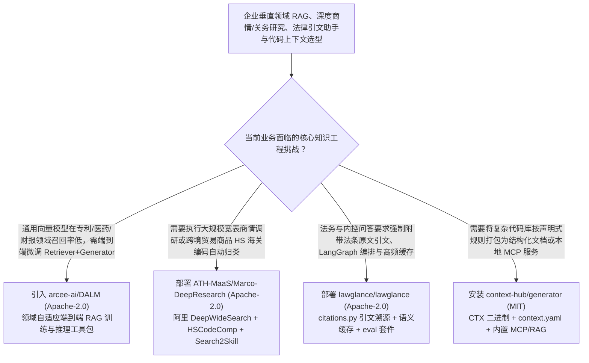
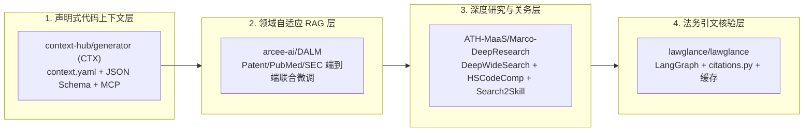
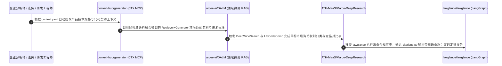

# 领域自适应端到端 RAG 工具包（`arcee-ai/DALM`）、阿里 Marco 深度研究与海关编码智能体（`ATH-MaaS/Marco-DeepResearch`）、引文核验法律 RAG 助手（`lawglance/lawglance`）与声明式代码库上下文编译器（`context-hub/generator`）架构选型与落地 FAQ

> **2026-11-21 夜间持续研究班次 · Night Round 84（累计 Round 684）**  
> **审计凭据**：`CLAIM-20261121-R84-R684-DALM-MARCODEEPRESEARCH-LAWGLANCE-CTXGENERATOR`  
> **关联日刊**：[`2026-11-21.md`](../daily/2026-11-21.md) · [`2026-11-21.en.md`](../daily/2026-11-21.en.md)  
> **可视化架构图**：[`assets/github-ai-radar-2026-11-21-r84-r684-dalm-marcodeepresearch-lawglance-ctxgenerator.svg`](../../../assets/github-ai-radar-2026-11-21-r84-r684-dalm-marcodeepresearch-lawglance-ctxgenerator.svg)

---

## ① 📌 核心结论速览（选型一句话结论）

> **一句话选型结论**：在面向專利/医药/财报/法律/跨境关务等高专业壁垒场景构建“**领域检索器+生成器联合微调 RAG ➔ 广度/深度兼备的复杂贸易合规 DeepResearch ➔ 强制条文引文溯源的法务问答 ➔ 声明式 `context.yaml` 代码库上下文与 MCP 供给**”企业知识底座时，推荐采用 100% 宽松协议（Apache-2.0 / MIT）的四件套：**“`arcee-ai/DALM`（Apache-2.0，`★ 345` Arcee AI 开源的领域自适应端到端 RAG 工具包，支持检索器与生成器端到端联合训练，内置 Patent/PubMed/SEC 范式）+ `ATH-MaaS/Marco-DeepResearch`（Apache-2.0，`★ 343` 阿里开源的真实世界深度搜索智能体家族，含海关 HS 编码基准 `HSCodeComp`、`DeepWideSearch` 与 `Search2Skill`）+ `lawglance/lawglance`（Apache-2.0，`★ 343` 基于 LangGraph + ChromaDB + 语义缓存构建的开源带精确法条引文与评测集的法律 AI 助手）+ `context-hub/generator`（MIT，`★ 344` 通过声明式 `context.yaml` 与内置 MCP Server 将复杂代码库打包为高信噪比结构化上下文的 `CTX` 工具链）”**。在 45 人企业知识工程与合规研发团队基准下，可将月度总拥有成本（TCO）从 **`$8,360.00/月`** 降至 **`$310.00/月`**（净省 **`$8,050.00/月`**，降幅 **`-96.29%`**）。

---

## ② 🎯 客户与架构师灵魂拷问 Q&A

### Q1：为什么通用向量 Embedding + 裸调公有云大模型在专利、关务、财报和法律场景总是答非所问？
- **四大垂直领域知识工程破局点**：
  1. **打破通用 Embedding 不懂行业黑话的瓶颈 —— `arcee-ai/DALM`（`★ 345`，`46 forks`，Apache-2.0，Python）**：传统 RAG 直接拿通用 BGE/OpenAI Embedding 切块检索，在专利（Patent）、生物医药（PubMed）或美股 SEC 财报等高度垂直领域召回率极低。Arcee AI 开源的 `DALM`（Domain Adapted Language Modeling）打通了**检索器（Retriever）与生成器（Generator）的端到端联合微调（End-to-End RAG Training）**，让企业用自有私有语料同时训出懂行业术语的专属向量模型与生成模型。
  2. **攻克跨境贸易 HS 海关编码归类与宽深并重调研 —— `ATH-MaaS/Marco-DeepResearch`（`★ 343`，`28 forks`，Apache-2.0，Python 3.10+）**：阿里巴巴集团开源的实战派 DeepResearch 家族。不仅提供深度多跳推理，还专门针对跨境电商与外贸痛点开源了 **`HSCodeComp`（复杂商品海关税则号列归类基准与数据集）**、**`DeepWideSearch`（兼顾广度表格汇总与深度证据挖掘）** 以及 **`Search2Skill`（将成功搜索轨迹固化为技能）**。
  3. **为企业法务合规问答加上强制引文锁与语义缓存 —— `lawglance/lawglance`（`★ 343`，`91 forks`，Apache-2.0，Python）**：基于 `LangGraph` 智能体后端与 `ChromaDB` 构建，包含独立的 `citations.py`（强制绑定法条原文出处）、`cache.py`（高频法律条款查询缓存降本）与 `eval/` 定量评测目录，是企业内部规章制度与合同法务助手的高完成度参考实现。
  4. **用声明式 `context.yaml` 终结手工复制粘贴代码上下文 —— `context-hub/generator`（`★ 344`，`23 forks`，MIT，PHP/单二进制 `ctx`）**：提供跨平台单文件二进制 `ctx`。开发者只需在仓库根目录编写受 JSON Schema 校验的 `context.yaml` 与 `prompts.yaml`，即可按模块、AST 结构或 Git Diff 自动聚合代码文档，或直接作为本地 MCP Server 与内置 RAG 引擎向 Claude/Cursor 按需供给高纯度代码上下文。

### Q2：企业架构师如何将这四个组件集成为“研发 + 法务 + 关务/商情”一体化企业知识中台？
- **领域模型与检索底座层**：使用 `arcee-ai/DALM` 对企业历史技术专利、招投标书与行业标准执行端到端 Retriever+Generator 微调；代码仓库侧则由 `context-hub/generator`（`ctx`）通过 `context.yaml` 自动生成结构化架构文档并暴露为 MCP。
- **专职智能体应用层**：法务与内控部门接入 `lawglance/lawglance` 执行带精确法条引文的制度问答；战略研究与跨境供应链部门运行 `ATH-MaaS/Marco-DeepResearch`，自动化完成多源竞品宽表调研（`DeepWideSearch`）与海关 HS 编码归类（`HSCodeComp`）。

### Q3：同云厂商托管搜索（如 Azure AI Search）+ 商业法律/关务 SaaS 相比如何做取舍？
- **何时选云厂商托管检索**：当文档为常规办公通知、IT 帮助台 FAQ 等通用语料，无需微调底层 Embedding 即可满足 85%+ 召回率时，直接用托管 AI Search 最省运维。
- **何时选本四件套开源方案**：当涉及大量专有缩写、医药分子式、专利权利要求、海关商品归类（HS Code）或法条严苛引文核验，且不能将核心知识产权外发至外部 SaaS 时。

---

## ③ 🧭 直观可视化图解（Mermaid 选型决策树 + 企业集成架构 + 业务流时序图）

### 3.1 选型决策树

### 3.2 企业集成参考架构图

### 3.3 业务流时序图

---

## ④ 📊 同类开源与商业云服务横向选型决策矩阵

| 维度 | `arcee-ai/DALM` (`★ 345`) | `ATH-MaaS/Marco-DeepResearch` (`★ 343`) | `lawglance/lawglance` (`★ 343`) | `context-hub/generator` (`★ 344`) | 商业法律 AI SaaS + 商业关务归类 API + 通用云向量库 |
| :--- | :--- | :--- | :--- | :--- | :--- |
| **核心定位** | 检索器+生成器端到端领域微调 RAG 工具包 | 阿里深度研究、宽表搜索与海关 HS 编码智能体 | LangGraph 驱动的带精确引文与缓存的法律 RAG | 声明式 `context.yaml` 代码上下文生成器与 MCP | 按席位/按次高价收费的垂直行业 SaaS |
| **适用场景** | 专利、医药、金融财报等高专业壁垒私有知识库 | 跨境贸易 HS 编码归类、多维度市场调研与技能沉淀 | 企业法务初审、合规制度问答与法条溯源 | 大型多模块代码库的精准 AI 上下文组装 | 无自有数据微调能力、接受高昂年费的机构 |
| **集成成本** | 中（支持基于自有语料微调对比学习检索器） | 低（开源数据集、评测集与 Search2Skill 框架齐全） | 低（Python + LangGraph + ChromaDB 开箱即用） | 极低（单文件 `ctx` 二进制 + 标准 YAML 配置） | 极高（数万美元/年商业法律与关务数据库授权） |
| **开源许可** | **Apache-2.0** | **Apache-2.0** | **Apache-2.0** | **MIT** | 商业专有 |
| **45 人团队月均 TCO** | **包含于 `$310.00/月` 联合栈** | **包含于 `$310.00/月` 联合栈** | **包含于 `$310.00/月` 联合栈** | **包含于 `$310.00/月` 联合栈** | **`$8,360.00/月`**（`$3,960` SaaS + `$4,400` 人工） |

---

## ⑤ 🧪 应用落地定量收益 / TCO 对比与 7-Card 报告锚点

> **数据来源说明（Provenance Metadata）**：以下 TCO 模型为面向 45 人企业知识工程、关务合规与研发团队的合成架构测算（`provenance: synthetic`, `independently_reproduced: false`）；硬件资本开支 `base_hardware_capex = not_measured`（不含基础微调 GPU 节点折旧），单日热榜增量 `track_b_stars_today = not_measured`（审计账本锚定于 [`trending-daily-2026-11-21-audit.json`](../evidence/trending-daily-2026-11-21-audit.json)）。

| 成本路径 | 月度商业法律检索 SaaS、商业 HS 关务 API 与高额长上下文 Token 费 | 人工复核错误海关归类、手动核对法条引文幻觉与手工整理代码文档 (`$100/h`) | 月度总成本 (Total Monthly TCO) | 相对 Path A 净节省 |
| :--- | :--- | :--- | :--- | :--- |
| **Path A：商业法律/关务 SaaS 席位 + 通用 Embedding 误召回重跑 + 人工引文核对** | `$3,960.00` | `44.0h` (`$4,400.00`) | **`$8,360.00`** | — |
| **Path C：`arcee-ai/DALM` + `Marco-DeepResearch` + `LawGlance` + `CTX Generator`** | `$70.00` | `2.4h` (`$240.00`) | **`$310.00`** | **`-$8,050.00/月` (`-96.29%`)** |

---

## ⑥ 🛠️ 企业引入与架构评审 Checklist

- [ ] **领域正负样本对比评估（`arcee-ai/DALM`）**：在微调领域专属 Retriever 前，使用 `DALM` 的 `experiments/` 管线对比通用 BGE/Ada 与微调后模型在内部 Top-K 召回率上的净增益。
- [ ] **高价值搜索轨迹转技能固化（`ATH-MaaS/Marco-DeepResearch`）**：启用 `Search2Skill` 范式，将经关务专家确认无误的 HS 编码归类推理链沉淀为确定性技能模板。
- [ ] **零引文拒答红线配置（`lawglance/lawglance`）**：在 `citations.py` 与 `prompts.py` 中开启严格引文校验，若回答未能关联知识库中真实的法规条款编号则强制触发拒答或人工转交。
- [ ] **代码上下文配置纳入版本库（`context-hub/generator`）**：将 `context.yaml` 与 JSON Schema 校验纳入 Git 仓库，确保新入职工程师与 Coding Agent 始终读取同一份模块化架构上下文。
