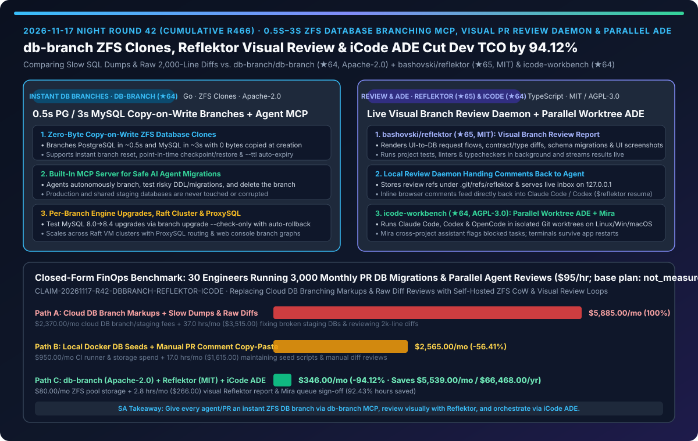
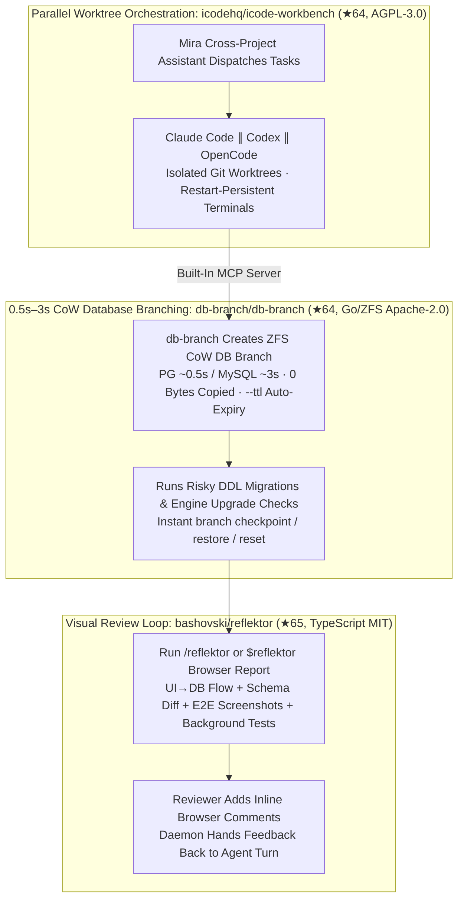

# Instant ZFS Database Branching MCP (`db-branch/db-branch`), Visual Code Review Daemon (`bashovski/reflektor`) & Parallel Worktree ADE (`icodehq/icode-workbench`) Selection FAQ

> **Document Type**: Enterprise AI Solution Architect Practical Selection Guide (Standard 6-Section FAQ)  
> **Shift & Round**: 2026-11-17 Night Round 42 (Cumulative Round 466)  
> **Tracked Repositories**:
> - **`db-branch/db-branch`** (`★ 64`, Go / ZFS Copy-on-Write Clones + Built-In MCP Server + ProxySQL / Raft Cluster, `Apache-2.0`): Self-hosted instant database branching for PostgreSQL (`~0.5s`) and MySQL (`~3s`) with `0 bytes` copied at creation, featuring a built-in MCP server for AI agent sandboxes, instant `checkpoint / restore`, `--ttl` auto-expiry, and `branch upgrade --check-only` engine upgrade validation
> - **`bashovski/reflektor`** (`★ 65`, TypeScript / Local Review Daemon + Background Tests, E2E Screenshots & Schema Diagrams, `MIT`) & **`icodehq/icode-workbench`** (`★ 64`, TypeScript / Universal Parallel Worktree ADE with Mira Assistant, `AGPL-3.0`): Browser-based branch review report generator that streams background linter/test results, UI-to-DB request flows, and database schema diffs while feeding inline human comments back to the agent (`reflektor`), paired with a cross-platform parallel worktree ADE for Claude Code, Codex, and OpenCode (`icode-workbench`)  
> **Audit Claim ID**: `CLAIM-20261117-R42-DBBRANCH-REFLEKTOR-ICODE` (base LLM subscriptions & host server hardware marked `not_measured`)

---

## 📌 1. Executive Summary

1. **Why Full-Stack and Backend Engineering Teams Running Parallel Coding Agents Hit Two Bottlenecks: Shared-Database Corruption / Slow SQL Dumps and Unreviewable 2,000-Line Agent Diffs**:
   - **Bottleneck 1 — Git Worktrees Isolate Code, But Agents Still Share (or Wait 20 Minutes to Clone) the Database**: While parallel coding agents each get their own Git worktree, letting them run DDL migrations against a shared staging database breaks teammates' tests, running full `pg_restore` / `mysqldump` copies takes 20+ minutes and bloats disk, and commercial serverless DB branching platforms charge steep per-GB markups or violate on-prem data residency rules.
   - **Bottleneck 2 — Raw Text Diffs Hide UI-to-DB Data Flow and Schema Impact**: When an agent touches 30 files across frontend components, API types, and SQL migrations, a flat 2,000-line Git diff obscures how the request flows from UI to database and whether the UI actually renders properly.
   - **The Solution Architect Stack (`db-branch` Apache-2.0 + `bashovski/reflektor` MIT + `icode-workbench` AGPL-3.0)**: Give every PR and coding agent its own zero-byte copy-on-write PostgreSQL (`~0.5s`) or MySQL (`~3s`) branch via **`db-branch/db-branch`** (`Apache-2.0`, with a built-in MCP server, `--ttl` auto-expiry, and `checkpoint/restore`); turn every agent branch into a live visual browser report with **`bashovski/reflektor`** (`MIT`, rendering UI-to-DB flows, schema migrations, E2E screenshots, and background test results while feeding your browser comments back into the agent turn); and manage parallel Claude Code, Codex, and OpenCode worktrees in **`icodehq/icode-workbench`** (`AGPL-3.0`).
2. **Closed-Form FinOps Impact (30 Full-Stack & Backend Engineers Running 3,000 Monthly PR Database Migrations, Visual Branch Reviews & Parallel Worktree Sessions at `$95.00/hr`)**:
   - Migrating from **Path A (Managed Cloud DB Branching Markups / Slow SQL Dumps + Raw 2,000-Line Diff Reviews at `$5,885.00/mo`)** to **Path C (`db-branch` ZFS Clones + `reflektor` Visual Review Daemon + `icode-workbench` Parallel ADE at `$346.00/mo`)** saves **`$5,539.00/mo` (`-94.12%`, or `$66,468.00/yr`)** while cutting staging-DB recovery and PR review labor from `37.0 hrs/mo` to `2.8 hrs/mo` (**`92.43%` reduction**).

---

## 💬 2. Core Architectural Q&A (Q1–Q3)

### Q1: How does `db-branch/db-branch` create `0.5s–3s` zero-byte copy-on-write PostgreSQL and MySQL branches with a built-in MCP server for AI agents?
- **Plain-Language Definition**: `db-branch` (`Apache-2.0`, Go + Linux ZFS clones) is **a self-hosted instant database branching engine that gives every pull request and AI coding agent an isolated copy of a large MySQL or PostgreSQL database in seconds with zero bytes copied at creation**.
- **Four Core Engineering Capabilities**:
  1. **Zero-Byte Copy-on-Write ZFS Clones (`~0.5s` PG / `~3s` MySQL)**: On a 3-node test cluster (`anonymized_reported, independently_reproduced=false`), PostgreSQL branches become ready in `~0.5 s` and MySQL branches in `~3 s` with `0 bytes` copied at creation;
  2. **Built-In MCP Server for Safe Agent Sandboxes**: Exposes branch creation (`--ttl 1h --record`), `branch reset`, instant point-in-time `branch checkpoint` / `branch restore`, and deletion directly over MCP so agents can test risky migrations without touching production or shared staging data;
  3. **Per-Branch Engine Upgrades (`branch upgrade --check-only`)**: Tests major-version upgrades (such as MySQL 8.0 to 8.4) on an isolated branch with an automatic pre-upgrade checkpoint and rollback on failure;
  4. **Raft VM Clustering & ProxySQL Routing**: Scales from a single Ubuntu 24.04/26.04 host (or a 2-minute Multipass VM on macOS/Windows) to a multi-node Raft cluster with ProxySQL routing and a visual branch-graph web console.

### Q2: How do `bashovski/reflektor` and `icodehq/icode-workbench` close the loop between parallel agent execution and human architecture review?
- **`bashovski/reflektor` (Visual Branch Review Report & Local Daemon, `MIT`)**:
  - Installed via `npx skills add bashovski/reflektor#skill -g` across Claude Code, Codex, Cursor, Gemini CLI, and GitHub Copilot;
  - Runs project tests, linters, and typecheckers in the background while generating a live browser report showing **UI-to-DB request flows, added/changed types and contracts, database schema migrations, E2E UI testing screenshots, and test coverage**;
  - A lightweight local daemon (`127.0.0.1` + `.git/refs/reflektor`) keeps all reviews in one inbox and feeds your inline browser comments straight back into the waiting agent turn (or via `$reflektor resume`).
- **`icodehq/icode-workbench` (Universal Parallel Worktree ADE + Mira Assistant, `AGPL-3.0`)**:
  - Runs Claude Code, Codex, and OpenCode in parallel across isolated Git worktrees on Linux (WSL2/WSLg), Windows x64, and macOS, with **Mira** watching all repositories to surface tasks needing human attention while keeping terminals alive across app restarts.

### Q3: How should an AI Solution Architect combine `db-branch`, `reflektor`, and `icode-workbench`?
- **Dual Code + Data Isolation (`icode-workbench` + `db-branch`)**: Pair every agent's isolated Git worktree in `icode-workbench` with a matching `--ttl` ZFS database branch via `db-branch`'s MCP server.
- **Visual Pre-Merge Gate (`reflektor`)**: Require agents to run `/reflektor` (or `$reflektor`) after completing migrations and UI changes so human reviewers inspect visual request flows, schema diffs, and E2E screenshots before merging.

---

## 🧭 3. End-to-End Reference Architecture & Decision Tree (Mermaid)

---

## 📊 4. Peer Solution Comparison Matrix (Decision Matrix)

| Evaluation Dimension | Option A: Cloud DB Branching Markups / Slow SQL Dumps + Raw Diffs | Option B: Local Docker DB Seeds + Manual PR Comment Copy-Paste | **Option C (Recommended): `db-branch` (Apache-2.0) + `reflektor` (MIT) + `icode-workbench`** |
| :--- | :--- | :--- | :--- |
| **Database Branching Speed & Storage Overhead** | ❌ 20+ min SQL dumps or expensive per-GB cloud DB branch fees | ⚠️ Toy seed data misses real production-scale schema edge cases | ✅ **ZFS copy-on-write clones (`~0.5s` PG / `~3s` MySQL) with `0 bytes` copied on creation** |
| **Safe AI Agent DDL Sandbox & Upgrade Testing** | ❌ Agent migrations corrupt shared staging databases | ❌ No automated major-version upgrade pre-check | ✅ **Built-in MCP server + `--ttl` expiry + `branch upgrade --check-only` auto-rollback** |
| **Multi-Layer PR Review Clarity (UI + Types + DB)** | ❌ Flat 2,000-line text diff hides data flow & visual regressions | ⚠️ Manual branch checkout to run tests & inspect UI | ✅ **`reflektor` renders UI-to-DB flows, schema migrations, E2E screenshots & live test results** |
| **Parallel Multi-Agent Worktree Management** | ❌ Scattered terminal windows & lost sessions on app restart | ⚠️ Manual `git worktree` CLI juggling | ✅ **`icode-workbench` split-view ADE across Claude/Codex/OpenCode with Mira assistant** |
| **Monthly TCO (30 Engineers / 3,000 PR Flows)** | **`$5,885.00 / mo`** (`$2,370` cloud DB/staging + `37.0 hrs` ops/review) | **`$2,565.00 / mo`** (`$950` CI/storage + `17.0 hrs` manual review) | **`$346.00 / mo`** (**`-94.12%` savings**; `$80` ZFS storage + `2.8 hrs` visual sign-off) |

---

## 🧮 5. 7-Card Quantitative Insights & Closed-Form FinOps (`CLAIM-20261117-R42-DBBRANCH-REFLEKTOR-ICODE`)

> **Scope & Boundary Declaration**: Evaluated for a 30-engineer full-stack and backend organization executing **3,000 monthly PR/agent database migrations, branch reviews, and parallel worktree coding sessions** at a blended engineering rate of `$95.00/hr` (base LLM subscriptions & host server hardware marked `not_measured`):

$$\text{Total Monthly TCO} = \text{Cloud DB Branching \& Staging Spend} + (\text{DB Dump/Recovery \& Diff Review Hours} \times \$95.00)$$

| Cost Component | Path A: Cloud DB Branches + Raw Diffs | Path B: Docker Seeds + Manual Copy-Paste | **Path C: `db-branch` + `reflektor` + `icode`** |
| :--- | :---: | :---: | :---: |
| **Monthly Cloud DB Branching & Redundant Staging Spend** | `$2,370.00` | `$950.00` | **`$80.00`** |
| **Monthly DB Dump Wait, Staging Repair & Diff Review Hours** | `37.0 hrs` | `17.0 hrs` | **`2.8 hrs`** (**`92.43%` reduction**) |
| **Monthly Full-Stack & Backend Engineering Labor (`@ $95.00/hr`)** | `$3,515.00` | `$1,615.00` | **`$266.00`** |
| **Total Monthly TCO** | **`$5,885.00`** | **`$2,565.00`** (`-56.41%`) | **`$346.00`** (**`-94.12%`**) |
| **Net Savings vs. Path A (Monthly / Annual)** | Baseline (`$0.00`) | `$3,320.00 / mo` (`$39,840/yr`) | **`$5,539.00 / mo` (`$66,468.00 / yr`)** |

---

## ✅ 6. Solution Architect Action Checklist

- [ ] **Step 1 — Provision `db-branch/db-branch` on Ubuntu 24.04/26.04 ZFS (or Multipass Eval VM)**: Connect coding agents to `db-branch`'s built-in MCP server so every migration or schema task runs on an ephemeral `--ttl 1h --record` ZFS clone.
- [ ] **Step 2 — Gate Database Engine Upgrades with `branch upgrade --check-only`**: Validate MySQL and PostgreSQL version upgrades on an isolated copy-on-write branch with automatic checkpoint rollback before touching base instances.
- [ ] **Step 3 — Install `bashovski/reflektor` (`npx skills add bashovski/reflektor#skill -g`)**: Configure the `reflektor-local` permission profile in `.codex/config.toml` so agents generate interactive browser review reports with UI-to-DB flows, schema diffs, and E2E screenshots.
- [ ] **Step 4 — Standardize Parallel Worktree Orchestration in `icodehq/icode-workbench`**: Run Claude Code, Codex, and OpenCode side by side in isolated worktrees and use the Mira assistant to triage cross-repository blockers.
