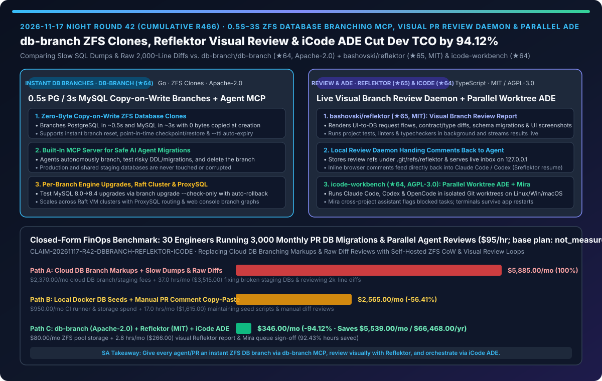
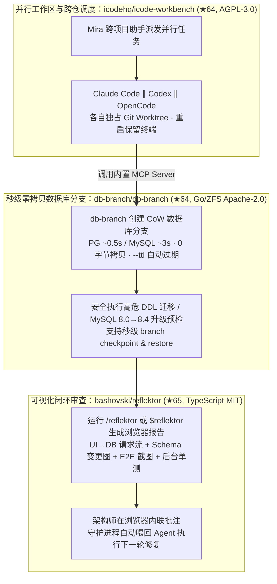

# 秒级零拷贝数据库分支 MCP（`db-branch/db-branch`）与可视化代码审查守护进程及跨平台并行智能体工作台（`bashovski/reflektor` & `icode-workbench`）架构选型 FAQ

> **文档类型**：AI Solution Architect（AI 解决方案架构师）实战选型指南（六段式标准 FAQ）  
> **所属轮次**：2026-11-17 Night Round 42（Cumulative Round 466）  
> **追踪目标**：
> - **`db-branch/db-branch`**（`★ 64`，Go / ZFS 写时复制克隆 + 内置 MCP Server + ProxySQL / Raft 集群，`Apache-2.0`）：在自有服务器上实现 **PostgreSQL `~0.5s`、MySQL `~3s` 创建时 0 字节拷贝** 的秒级数据库分支系统，自带原生 MCP Server 让 AI Agent 自主拉起带 `--ttl` 自动过期的独立数据库分支验证高危 DDL/迁移或跨大版本升级（`branch upgrade --check-only`）
> - **`bashovski/reflektor`**（`★ 65`，TypeScript / 本地审查守护进程 + 后台测试/E2E 截图/Schema 可视化，`MIT`）& **`icodehq/icode-workbench`**（`★ 64`，TypeScript / 支持 Claude Code, Codex, OpenCode 并行 Git Worktree 的通用 ADE，`AGPL-3.0`）：把任意代码分支转化为浏览器里的交互式可视化审查报告并将批注直接喂回当前 Agent 轮次的 `reflektor`，配合自带跨项目助手 **Mira** 的并行 Worktree 智能体开发工作台 `icode-workbench`  
> **计量审计 ID**：`CLAIM-20261117-R42-DBBRANCH-REFLEKTOR-ICODE`（底层大模型基础订阅与宿主机物理硬件标记为 `not_measured`）

---

## 📌 一、核心结论速览（Executive Summary）

1. **为什么企业全栈与后端工程团队在让多个 Coding Agent 并行开发涉及数据库 Schema 变更与前端交互的复杂功能时，常被“Agent 跑个迁移把共享测试库搞崩或等 20 分钟导 SQL Dump”、“商业云数据库按分支/GB 收取天价溢价”、以及“面对 Agent 一次吐出的 2,000 行跨层 Diff 人类根本审不过来”三大瓶颈拖垮？**
   - **瓶颈一：AI 改库无沙箱与商业 Serverless 数据库分支高溢价**：在写代码层面 Git Worktree 已经解决了多 Agent 文件隔离，但**数据库通常只有一份**！让 Agent 直接连共享测试库跑迁移极易误删表影响全组；若每个 PR 走传统 `mysqldump / pg_restore` 动辄耗时 20 分钟且占满磁盘；而商用云数据库分支服务按存储与计算时长收费高昂，且内网合规数据不允许上公有云。
   - **瓶颈二：纯文本 Diff 无法看清“UI → 接口契约 → 数据库 Schema”全链路影响**：Agent 一次性修改 30 个文件时，传统 GitHub PR 文本对比看不出请求流向、类型契约变化、数据库迁移影响以及前端页面真实渲染效果。
   - **架构师黄金组合（`db-branch` Apache-2.0 + `bashovski/reflektor` MIT + `icode-workbench` AGPL-3.0）**：在数据沙箱层自建 **`db-branch/db-branch`**（基于 ZFS Clones 实现 PostgreSQL `~0.5 秒`、MySQL `~3 秒` 零字节写时复制分支，内置 MCP Server 让 Agent 自己建分支、跑迁移、随时 `checkpoint / restore` 并在 `--ttl` 到期后自动销毁）；在代码审查层部署 **`bashovski/reflektor`**（本地守护进程自动在后台跑测试/Linter/Typecheck、截取 E2E UI 截图、绘制 UI 到 DB 的数据流与 Schema 变更图，网页批注直接回传给等待中的 Claude Code / Codex）；在多 Agent 并行底座使用 **`icodehq/icode-workbench`**（在独立 Git Worktree 中并行托管 Claude Code、Codex 与 OpenCode，由跨项目助手 Mira 统一汇总阻塞提醒）。
2. **闭式 FinOps 量化收益（30 名全栈与后端工程师、每月执行 3,000 次 PR/Agent 数据库迁移测试、分支代码审查与并行 Worktree 开发，综合时薪 `$95.00/hr`）**：
   - 从 **Path A（商业云数据库分支溢价/慢速导库 + 人工硬啃 2,000 行裸 Diff，`$5,885.00/月`）** 切换至 **Path C（`db-branch` 自建秒级 ZFS 分支 + `reflektor` 可视化闭环审查 + `icode-workbench` 并行 ADE，`$346.00/月`）**，每月净省 **`$5,539.00/月`（降幅 `-94.12%`，年化节省 `$66,468.00/年`）**，修测试库、等导库与代码走查返工工时从 `37.0 小时/月` 降至 `2.8 小时/月`（节省 **`92.43%`**）。

---

## 💬 二、灵魂拷问 Q1–Q3（大白话拆解应用场景与架构本质）

### Q1：`db-branch/db-branch` 是如何做到在自有服务器上“0.5 秒拉起一个大体积 PostgreSQL 分支、0 字节额外拷贝”并让 AI Agent 通过 MCP 自助试错的？
- **大白话本质定义**：`db-branch`（`Apache-2.0`，Go 编写，底层基于 Linux ZFS 写时复制克隆）是**“装在你自己服务器上的私有化 Neon/PlanetScale——让每个 PR 和每个 AI Agent 在几秒内拥有一份随便删表、随时回滚、到期自动销毁的完整真实数据库副本”**。
- **四大核心工程能力**：
  1. **秒级零拷贝分支（Zero-Byte Copy-on-Write）**：在官方 3 节点测试集群上（标注 `anonymized_reported, independently_reproduced=false`），PostgreSQL 分支约 **`0.5 秒`** 就绪、MySQL 分支约 **`3 秒`** 就绪，创建瞬间 **0 字节物理复制**；
  2. **原生内置 MCP Server 赋能 AI Agent 沙箱**：LLM Agent 可直接通过内置 MCP 接口自主执行 `branch create --ttl 1h --record`、在真实全量数据副本上测试高危 SQL 迁移、`branch checkpoint` / `branch restore` 秒级闪回，或 `branch reset` 重置回初始状态，完全不碰生产或公共测试库；
  3. **单分支跨大版本升级预检（`branch upgrade --check-only`）**：在不影响主库和其他分支的前提下，单独把某一个分支从 MySQL 8.0 升级到 8.4（升级前自动存快照，失败自动回滚）；
  4. **多机 Raft 集群与 ProxySQL 统一路由**：支持单机或跨 VM 的 Raft 集群部署，配合 ProxySQL 让应用无需頻繁修改连接地址，并提供直观的 Web 控制台分支拓扑图。

### Q2：`bashovski/reflektor` 与 `icodehq/icode-workbench` 如何把“多 Agent 并行写代码 → 人类高效验收”体验拉满？
- **`bashovski/reflektor`（Code Review on Steroids，`MIT`）**：
  - 一行 `npx skills add bashovski/reflektor#skill -g` 即可装入 Claude Code、Codex、Cursor、Gemini CLI 与 GitHub Copilot；
  - 输入 `/reflektor`（或 `$reflektor`）后，本地守护进程（`127.0.0.1` + `.git/refs/reflektor`）自动在后台并行跑项目自身的单测、Linter 与类型检查，同时在浏览器生成包含**“从 UI 到数据库的请求流与新增/修改/删除的类型契约图、数据库 Schema 迁移可视化、带截图的 E2E UI 实测结果、测试覆盖率建议”**的结构化审查报告；
  - **双向闭环**：当你在浏览器报告里写完审查批注，正在当前轮次等待的 Agent（或通过 `$reflektor resume`）会直接读取你的批注并开启下一轮迭代！
- **`icodehq/icode-workbench`（跨平台并行 Git Worktree 智能体开发工作台，`AGPL-3.0`）**：
  - 跨越 Linux (WSL2/WSLg)、Windows x64 与 macOS，让 Claude Code、Codex 与 OpenCode 默认在各自独立的分支与 Git Worktree 中并行工作；内置跨项目助手 **Mira** 监控所有仓库并在需要人类介入时主动提醒，且应用重启后终端会话保持存活。

### Q3：企业 AI 架构师如何将这三者整合为“代码 + 数据库双隔离”的智能研发流水线？
- **工作区与数据库双克隆底座（`icode-workbench` + `db-branch`）**：每个并行 Agent 任务既分配独立的 Git Worktree（`icode-workbench`），又通过 `db-branch` MCP 分配独立的 ZFS 数据库分支（`--ttl 2h`）；
- **提交前可视化验收门禁（`reflektor`）**：Agent 完成开发与数据库迁移后必须先生成 `reflektor` 报告（含 Schema 变更图、E2E 截图与后台单测结果），架构师在浏览器中一屏批注验收。

---

## 🧭 三、端到端集成参考架构与选型决策树（Mermaid）

---

## 📊 四、同赛道方案横向选型对比矩阵（Decision Matrix）

| 评估维度 | 方案 A：商业云数据库分支 / 慢速 SQL Dump + 裸看 2,000 行 Diff | 方案 B：本地空 Docker 库跑 Seed + 手工复制 PR 评论 | **方案 C（推荐）：`db-branch` (Apache-2.0) + `reflektor` (MIT) + `icode-workbench`** |
| :--- | :--- | :--- | :--- |
| **大体积数据库分支创建速度与存储成本** | ❌ 导库耗时 20+ 分钟且翻倍占盘；商业云分支按 GB 高价计费 | ⚠️ 空库 Seed 数据失真，抓不到真实存量脏数据迁移 Bug | ✅ **ZFS 写时复制克隆：PG `~0.5s` / MySQL `~3s`，创建 0 字节拷贝，100% 私有可控** |
| **AI Agent 自助改库安全性与版本升级预检** | ❌ Agent 误操作直接污染共享测试库 | ❌ 无法快速测试跨大版本（如 MySQL 8.0→8.4）兼容性 | ✅ **内置 MCP Server + `--ttl` 自动销毁 + `branch upgrade --check-only` 自动回滚** |
| **复杂跨层分支（UI + 契约 + DB）审查效率** | ❌ 面对几千行纯文本 Diff 极易漏看类型破坏与表结构变更 | ⚠️ 需人工切分支跑前端看效果、再复制评论回终端 | ✅ **`reflektor` 自动生成请求流、Schema 变更图、E2E 截图与后台测试报告并回传批注** |
| **多 Agent 并行工作树与跨仓阻塞感知** | ❌ 多个终端窗口来回切换找不到哪个卡住了 | ⚠️ 手工管理 `git worktree` 繁琐 | ✅ **`icode-workbench` 分屏管理多 Agent Worktree，由 Mira 统一提示待办** |
| **月度总拥有成本（TCO，30 人 / 3,000 次迁移与审查）** | **`$5,885.00 / 月`**（含 `$2,370` 云分支/实例费 + `37.0h` 导库/审码） | **`$2,565.00 / 月`**（含 `$950` 算力费 + `17.0h` 维护与走查） | **`$346.00 / 月`**（**净省 `-94.12%`**，仅 `$80` ZFS 存储与 `2.8h` 可视化终审） |

---

## 🧮 五、7-Card 定量洞察与闭式 FinOps 核算（`CLAIM-20261117-R42-DBBRANCH-REFLEKTOR-ICODE`）

> **核算范围与边界声明**：面向 30 名全栈与后端工程师团队，每月执行 **3,000 次 PR/Agent 数据库迁移验证、跨层分支代码审查与并行 Worktree 会话**（综合时薪 `$95.00/hr`；底层大模型基础订阅与基础物理服务器标记为 `not_measured`）：

$$\text{Total Monthly TCO} = \text{Cloud DB Branching \& Staging Spend} + (\text{DB Dump/Recovery \& Diff Review Hours} \times \$95.00)$$

| 成本构成项 | Path A：云数据库分支 + 裸看大 Diff | Path B：Docker Seed + 手工复制评论 | **Path C：`db-branch` + `reflektor` + `icode`** |
| :--- | :---: | :---: | :---: |
| **月度云数据库分支溢价与冗余测试实例开销** | `$2,370.00` | `$950.00` | **`$80.00`** |
| **月度等待导库、修复共享测试库与走查大 Diff 工时** | `37.0 hrs` | `17.0 hrs` | **`2.8 hrs`**（直降 **`92.43%`**） |
| **月度全栈与后端工程师人工成本（`@ $95.00/hr`）** | `$3,515.00` | `$1,615.00` | **`$266.00`** |
| **月度总拥有成本（Monthly TCO）** | **`$5,885.00`** | **`$2,565.00`**（`-56.41%`） | **`$346.00`**（**`-94.12%`**） |
| **相对 Path A 净节省（月度 / 年化）** | 基线（`$0.00`） | `$3,320.00 / 月`（`$39,840/年`） | **`$5,539.00 / 月`（`$66,468.00 / 年`）** |

---

## ✅ 六、AI 解决方案架构师实战上手 Checklist（SA Action Checklist）

- [ ] **Step 1 — 在 Ubuntu 24.04/26.04 ZFS 服务器（或 Multipass VM）部署 `db-branch/db-branch`**：将 `db-branch` 的内置 MCP Server 暴露给团队 Coding Agents，要求所有涉及 SQL 迁移的任务先创建带 `--ttl 1h --record` 的写时复制分支。
- [ ] **Step 2 — 使用 `branch upgrade --check-only` 预检数据库版本升级**：在对生产 MySQL 或 PostgreSQL 进行版本升级前，先在秒级克隆出的分支上执行预检并验证自动回滚。
- [ ] **Step 3 — 全局安装 `bashovski/reflektor`（`npx skills add bashovski/reflektor#skill -g`）**：在 Codex 的 `.codex/config.toml` 中配置 `reflektor-local` 权限档案，让每个分支提交自动生成含 UI-to-DB 数据流、Schema 变更与 E2E 截图的浏览器审查报告。
- [ ] **Step 4 — 采用 `icodehq/icode-workbench` 统一编排并行 Git Worktree**：将 Claude Code、Codex 与 OpenCode 纳入统一多标签分屏工作台，通过 Mira 助手集中处理跨项目阻塞点。
