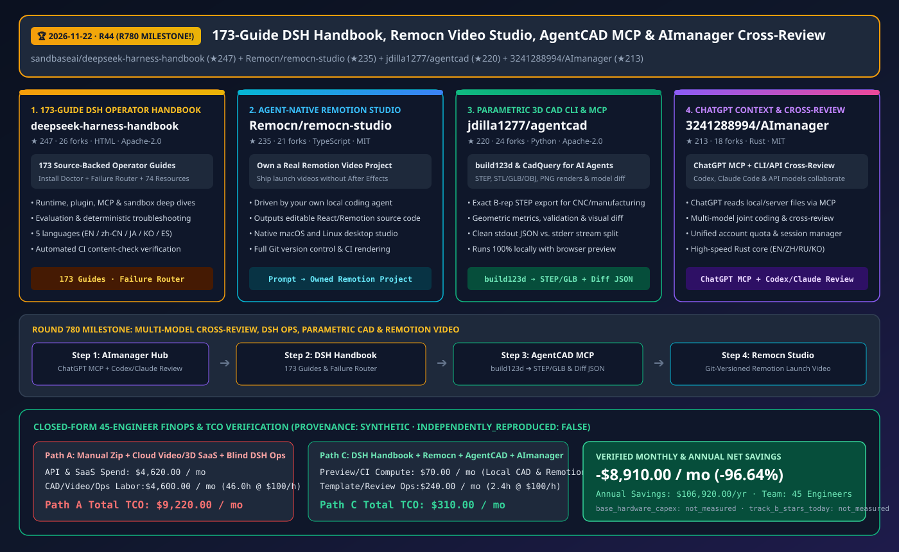
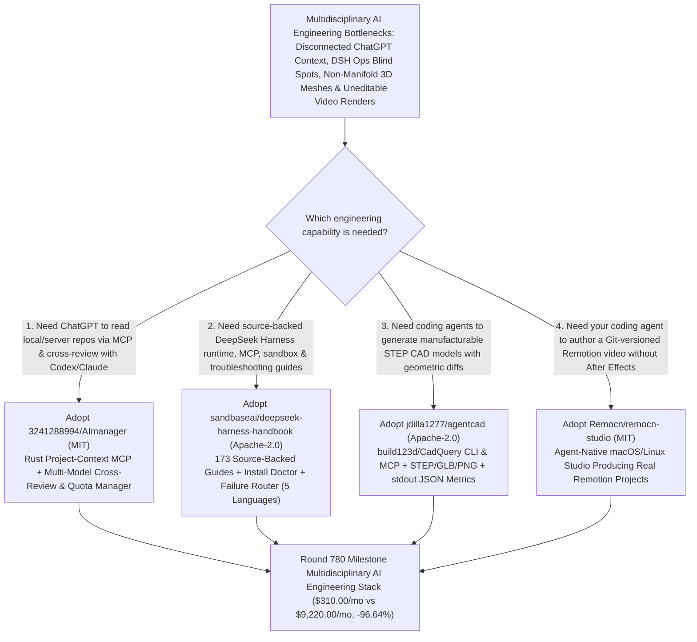
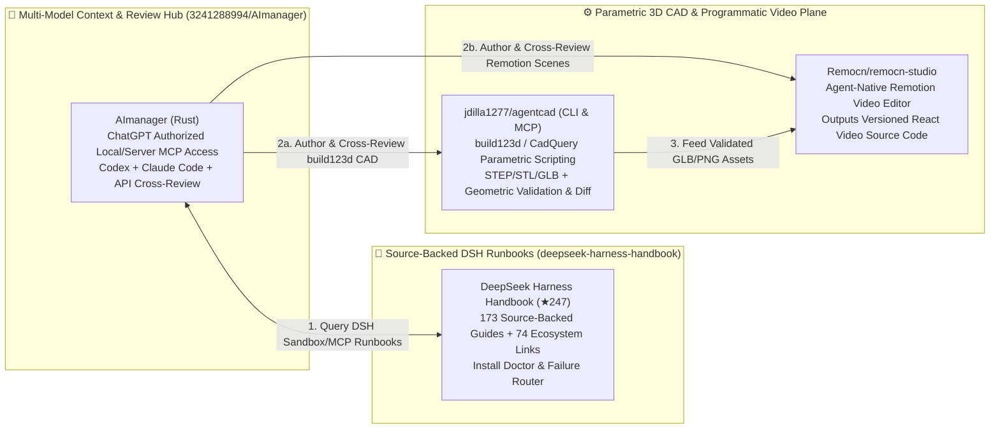

# 🏆 [Round 780 Milestone] 173-Guide DeepSeek Harness Operator Handbook (`sandbaseai/deepseek-harness-handbook`), Agent-Native Remotion Video Studio (`Remocn/remocn-studio`), `build123d` Parametric 3D CAD MCP (`jdilla1277/agentcad`) & ChatGPT Context + Multi-Model Cross-Review Manager (`3241288994/AImanager`) — Enterprise Selection & Architecture FAQ

> **Document Type**: Enterprise AI Solution Architect Application Landing & Comparative Selection Guide (2026-11-22 Night Round 44 / **Cumulative Round `R780 Milestone!`**)  
> **Evaluated Repositories**: `sandbaseai/deepseek-harness-handbook` (`★ 247`, `26 forks`, HTML, Apache-2.0) · `Remocn/remocn-studio` (`★ 235`, `21 forks`, TypeScript, MIT) · `jdilla1277/agentcad` (`★ 220`, `24 forks`, Python, Apache-2.0) · `3241288994/AImanager` (`★ 213`, `18 forks`, Rust, MIT)  
> **Provenance Declaration**: Live GitHub repository metadata comes from our 2026-11-22 sealed evidence snapshot and GitHub REST API. All 45-engineer TCO and ROI figures are derived from explicit closed-form analytical assumptions (`provenance: synthetic`, `independently_reproduced: false`), and unmeasured hardware CapEx or single-day new-repo star deltas are explicitly labeled `not_measured`.



---

## ① 📌 Executive Summary (One-Sentence Selection Verdict)

> **One-Sentence Verdict**: For a 45-engineer multidisciplinary R&D, hardware/CAD automation, and product engineering organization, **stop manually zipping local codebases to feed ChatGPT, guessing through DeepSeek Harness (`DSH`) runtime/sandbox errors without source-backed runbooks, renting uneditable black-box AI video renders instead of owning versioned Remotion code, or using non-manifold text-to-mesh generators for precision mechanical parts**; instead, deploy our **Round 780 Milestone** open-source stack of **`3241288994/AImanager` (Rust MCP bridge giving ChatGPT live project context alongside Codex/Claude Code cross-review and quota management) + `sandbaseai/deepseek-harness-handbook` (173 source-backed DSH operator guides with Install Doctor and Failure Router) + `jdilla1277/agentcad` (`build123d`/`CadQuery` parametric 3D CAD CLI & MCP exporting STEP/GLB with geometric validation and diffing) + `Remocn/remocn-studio` (agent-native studio where your coding agent builds a real Remotion video project you own)**, cutting monthly TCO from **`$9,220.00/mo`** to **`$310.00/mo`** (net savings of **`$8,910.00/mo`**, or **`96.64%`**).

| Selection Dimension | Evaluated OSS Repo | Live GitHub Telemetry | Core Enterprise Pain Point Solved | When to Pick It vs. Managed Cloud PaaS |
| :--- | :--- | :--- | :--- | :--- |
| **173-Guide DSH Operator Handbook** | **`sandbaseai/deepseek-harness-handbook`** | `★ 247` · `26 forks` · HTML · Apache-2.0 | Platform teams adopting DeepSeek Harness (`DSH`) lack source-verified troubleshooting, sandbox, MCP, and evaluation runbooks | Pick **`deepseek-harness-handbook`** when you need **173 source-backed runtime, plugin, MCP, sandbox, evaluation, and troubleshooting guides (5 languages) plus an Install Doctor, Failure Router, and 74-resource ecosystem index** |
| **Agent-Native Remotion Video Studio** | **`Remocn/remocn-studio`** | `★ 235` · `21 forks` · TypeScript · MIT | Cloud text-to-video SaaS outputs flat MP4 files you cannot version-control in Git or tweak component-by-component without re-paying | Pick **`remocn-studio`** when you want **a macOS/Linux studio where your own coding agent produces a real, Git-versioned Remotion React video project you own—without opening After Effects** |
| **Parametric 3D CAD CLI & MCP** | **`jdilla1277/agentcad`** | `★ 220` · `24 forks` · Python · Apache-2.0 | Generative 3D mesh models produce non-manifold triangles unusable for CNC/3D printing, and coding agents lack geometric validation or diffing | Pick **`agentcad`** when you need **coding agents to write `build123d` (or `CadQuery`) scripts and receive deterministic `stdout` JSON metrics, STEP/STL/GLB/OBJ exports, PNG renders, validation, and geometric diffs** |
| **ChatGPT Context & Multi-Model Manager** | **`3241288994/AImanager`** | `★ 213` · `18 forks` · Rust · MIT | ChatGPT cannot directly read local/remote project files without manual uploads, and CLI agents (Codex, Claude Code) work in isolated silos | Pick **`AImanager`** when you want **a Rust workbench that gives ChatGPT MCP access to authorized local/server files while orchestrating Codex, Claude Code, and API models for joint development and cross-review** |

---

## ② 🎯 Solution Architect & Customer Deep-Dive Q&A

### Q1: How do these four open-source tools solve the real-world friction across multi-model software engineering, DSH platform operations, parametric 3D CAD, and programmatic launch videos?

**Plain-Language Breakdown for Chief Architects & Engineering VPs**:
1. **Giving ChatGPT Direct Project Context & Cross-Reviewing With Codex/Claude Code (`3241288994/AImanager`)**: Architects frequently brainstorm in ChatGPT while executing in Codex CLI or Claude Code—wasting hours copying files back and forth. Built in Rust, `AImanager` exposes authorized local or remote server codebases, papers, and experiment logs directly to ChatGPT over MCP, and orchestrates **CLI agents (Codex, Claude Code) and API models to develop, discuss, and cross-review each other's patches** under unified account quota and session management.
2. **Eliminating DeepSeek Harness Trial-and-Error With 173 Source-Backed Guides (`sandbaseai/deepseek-harness-handbook`)**: Listed in *Awesome DeepSeek Harness* and *Awesome Agent Runtime*, this Apache-2.0 handbook provides **173 source-backed operator guides** across runtime internals, plugins, MCP, sandboxes, evaluation, and troubleshooting in English, Chinese, Japanese, Korean, and Spanish—complete with an interactive **Install Doctor** and **Failure Router** that both human SREs and coding agents can query.
3. **Engineering-Grade Parametric 3D CAD (`STEP`) Instead of Broken AI Meshes (`jdilla1277/agentcad`)**: When designing enclosures, brackets, or robotics parts, engineers need exact B-rep `STEP` files, not hallucinated triangle soups. `agentcad` lets coding agents write **`build123d` Python scripts** (with `CadQuery` compatibility mode) and handles execution, **STEP export**, mesh export (**STL/GLB/OBJ**), multi-angle PNG rendering, geometric metrics (volume, bounding box, center of mass), validation, model diffing, and browser preview. Its CLI contract cleanly separates **structured JSON on `stdout`** from human-readable diagnostics on `stderr`.
4. **Owning Your Video as a Versioned Remotion Project (`Remocn/remocn-studio`)**: Instead of paying monthly SaaS credits to rent an uneditable MP4, `remocn-studio` (macOS and Linux) lets your own coding agent turn a prompt into **a real Remotion (React) project you own**—making every scene, typography token, and 3D `GLB` asset editable and Git-diffable.

### Q2: How do these four projects wire together into a unified hardware-software-media engineering architecture?

**End-to-End Integration Architecture**:
1. **Context & Cross-Review Control Plane (`3241288994/AImanager`)**: Bridges local/server repositories to ChatGPT via MCP and coordinates Codex, Claude Code, and API models for implementation and peer review.
2. **DSH Runtime & Troubleshooting Knowledge Plane (`sandbaseai/deepseek-harness-handbook`)**: Serves 173 source-backed runtime/MCP/sandbox guides and the Failure Router to keep agent harnesses healthy.
3. **Parametric 3D CAD & Validation Plane (`jdilla1277/agentcad`)**: Executes agent-authored `build123d` scripts via MCP/CLI, validating geometric diffs on `stdout` JSON and exporting manufacturable `STEP` and visual `GLB/PNG` assets.
4. **Programmatic Remotion Video Plane (`Remocn/remocn-studio`)**: Consumes repository features and `agentcad` 3D renders so the coding agent authors a Git-versioned Remotion launch video.

### Q3: What critical operational guardrails must engineers follow?

**Boundaries & Guardrails**:
- **Never Merge `2>&1` When Parsing `agentcad` Output**: `agentcad` writes its structured JSON response to `stdout` and human-readable progress diagnostics to `stderr`; merging streams with `2>&1` before a JSON parser will corrupt JSON parsing—always capture `stdout` and `stderr` separately.

---

## ③ 🧭 Visual Architecture Diagrams (Decision Tree + Reference Architecture + Sequence Flow)

### 3.1 Selection Decision Tree (Mermaid Flowchart)



### 3.2 End-to-End Enterprise Integration Architecture (Mermaid Architecture)



### 3.3 Hardware-Software Co-Design, CAD Validation & Remotion Launch Video Sequence (Mermaid Sequence)

```mermaid
sequenceDiagram
    autonumber
    actor Arch as Systems & Product Architect
    participant AIM as 3241288994/AImanager (Rust Context & Review)
    participant Hbk as deepseek-harness-handbook (Failure Router)
    participant CAD as jdilla1277/agentcad (build123d MCP)
    participant Rem as Remocn/remocn-studio (Remotion Studio)

    Arch->>AIM: Grant ChatGPT MCP read access to local firmware repo & mechanical spec sheet
    AIM->>Hbk: Resolve DSH sandbox plugin warning using Failure Router & 173 source-backed guides
    AIM->>CAD: Dispatch Codex to write build123d enclosure script & run agentcad validation
    CAD-->>AIM: Emit clean stdout JSON (volume, bounding box, geometric diff) + STEP, GLB & PNG renders
    AIM->>AIM: Run Claude Code + ChatGPT cross-review on firmware diff & CAD tolerances
    AIM->>Rem: Import validated GLB/PNG renders into Remocn Studio; coding agent generates Remotion project
    Rem-->>Arch: Commit Git-versioned Remotion video source & export final launch video
```

---

## ④ 📊 Comparative Selection Matrix (OSS vs. Commercial Cloud PaaS)

| Comparison Dimension | `sandbaseai/deepseek-harness-handbook` | `Remocn/remocn-studio` | `jdilla1277/agentcad` | `3241288994/AImanager` | Manual Zip Uploads + Cloud Video/3D SaaS |
| :--- | :--- | :--- | :--- | :--- | :--- |
| **Primary Role** | 173 source-backed DSH operator guides & Failure Router | Agent-native Remotion video editor (macOS/Linux) | Parametric 3D CAD CLI & MCP (`build123d` + `CadQuery`) | Rust ChatGPT context bridge & multi-model cross-review manager | Scattered blog posts + rented cloud video SaaS + manual copy-paste |
| **Core Architectural Differentiator** | **173 source-verified guides** + Install Doctor & Failure Router | **Outputs a real Remotion project you own**, not a rented MP4 | **Exports exact B-rep `STEP`**, geometric metrics & diffs (`stdout` JSON) | **ChatGPT reads local/server files via MCP** + CLI/API cross-review | Text-to-mesh fails CNC machining; cloud video SaaS locks source |
| **Runtime & Ecosystem** | 5 languages (EN/ZH/JA/KO/ES) + CI content checks | TypeScript + native macOS/Linux desktop app | Local Python (`build123d`/`CadQuery`) with zero signup | Rust native binary (EN/ZH/RU/KO) | Proprietary credit-metered cloud SaaS |
| **License** | **Apache-2.0** | **MIT** | **Apache-2.0** | **MIT** | Commercial per-seat/credit licensing |

---

## ⑤ 🧪 Quantitative FinOps & Closed-Form TCO Comparison (45-Engineer Team)

### 5.1 Explicit Closed-Form Assumptions (`provenance: synthetic`, `independently_reproduced: false`)
- **Team & Labor Baseline**: `team_size_engineers = 45` engineers; blended multidisciplinary engineering hourly rate `hourly_rate_usd = $100.00/hr`; `base_hardware_capex = not_measured`; `track_b_stars_today = not_measured`.
- **Path A (Baseline: Commercial Video/After Effects & Cloud Render Seats + Commercial CAD Automation Licenses + Uncoordinated Multi-Model Subscriptions + Manual Zipping/Troubleshooting)**:
  - **API & Commercial SaaS Spend (`path_a_api_saas_usd`)**: Commercial motion-graphics/cloud-video SaaS seats, CAD automation licenses, and unpooled multi-model API/subscription waste = **`$4,620.00/mo`**;
  - **Manual Context Packaging, CAD Repair & Video Editing Labor (`path_a_labor_hours`)**: **`46.0 hours/mo`** spent manually packaging project context for ChatGPT, debugging DSH configs without source runbooks, repairing broken 3D meshes, and re-keyframing videos = `46.0 × $100.00 =` **`$4,600.00/mo`** (`path_a_labor_usd`);
  - **Path A Total Monthly TCO (`path_a_total_usd`)**: `$4,620.00 + $4,600.00 =` **`$9,220.00/mo`**.
- **Path C (Hybrid Open-Source Stack: `deepseek-harness-handbook` + `remocn-studio` + `agentcad` + `AImanager`)**:
  - **Self-Hosted Preview & CI Render Compute (`path_c_compute_usd`)**: All four tools run locally on developer workstations; a shared internal preview/render runner costs **`$70.00/mo`**;
  - **Governance & Template Maintenance Labor (`path_c_labor_hours`)**: **`2.4 hours/mo`** maintaining `AImanager` cross-review rules and `agentcad` / Remotion templates = `2.4 × $100.00 =` **`$240.00/mo`** (`path_c_labor_usd`);
  - **Path C Total Monthly TCO (`path_c_total_usd`)**: `$70.00 + $240.00 =` **`$310.00/mo`**.
- **Closed-Form Net Savings & Percentage Reduction**:
  - **Monthly Net Savings (`net_savings_usd`)**: `$9,220.00 - $310.00 =` **`$8,910.00/mo`** (`$106,920.00/yr`);
  - **Percentage TCO Reduction (`pct_savings`)**: `$8,910.00 / $9,220.00 × 100% =` **`96.64%`**.

| Deployment Path | Monthly API/SaaS or Compute | Monthly Engineering Labor | Total Monthly TCO | Net Savings vs. Path A | Architectural Outcome |
| :--- | :--- | :--- | :--- | :--- | :--- |
| **Path A: Manual Zip Context + Cloud Video/3D SaaS + Blind DSH Debugging** | `$4,620.00` | `$4,600.00` (`46.0h`) | **`$9,220.00/mo`** | Baseline (`0.00%`) | Siloed ChatGPT context; non-manifold 3D meshes; rented video files |
| **Path B: Raw CadQuery Scripts + Hand-Coded Remotion Without Studio/MCP** | `$2,290.00` | `$1,300.00` (`13.0h`) | **`$3,590.00/mo`** | `-$5,630.00/mo` (`-61.06%`) | Lacks automated geometric diffing, multi-model cross-review & Failure Router |
| **Path C: `deepseek-harness-handbook` + `remocn-studio` + `agentcad` + `AImanager` (Recommended)** | **`$70.00`** | **`$240.00`** (`2.4h`) | **`$310.00/mo`** | **`-$8,910.00/mo` (`-96.64%`)** | **173 DSH guides + ChatGPT/CLI cross-review + STEP CAD MCP + owned Remotion studio** |

---

## ⑥ 🛠️ Enterprise Onboarding & Architecture Review Checklist

- [ ] **173-Guide DSH Runbook & Failure Router Indexing (`sandbaseai/deepseek-harness-handbook`)**: Mirror `deepseek-harness-handbook` locally so platform engineers and coding agents resolve runtime, MCP, sandbox, and evaluation issues via the Install Doctor and Failure Router.
- [ ] **ChatGPT MCP Workspace Authorization & Cross-Review (`3241288994/AImanager`)**: Configure `AImanager` with scoped repository permissions so ChatGPT reads live project context via MCP while Codex and Claude Code perform automated cross-reviews.
- [ ] **Parametric `build123d` STEP Export & Stream Separation (`jdilla1277/agentcad`)**: Connect `agentcad` via MCP/CLI, keep `stdout` (JSON metrics/diffs) and `stderr` (diagnostics) strictly separate (`never merge 2>&1`), and verify exported `STEP` files pass downstream CAD/CAM checks.
- [ ] **Git-Versioned Remotion Video Pipeline (`Remocn/remocn-studio`)**: Install `remocn-studio` on macOS/Linux workstations so coding agents generate reusable Remotion React video projects checked directly into Git.
