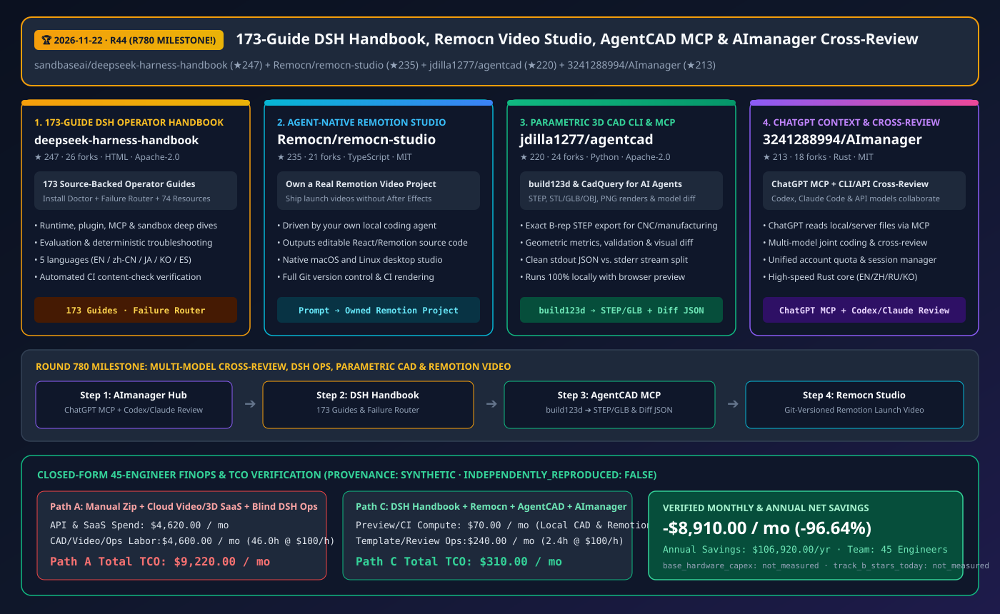
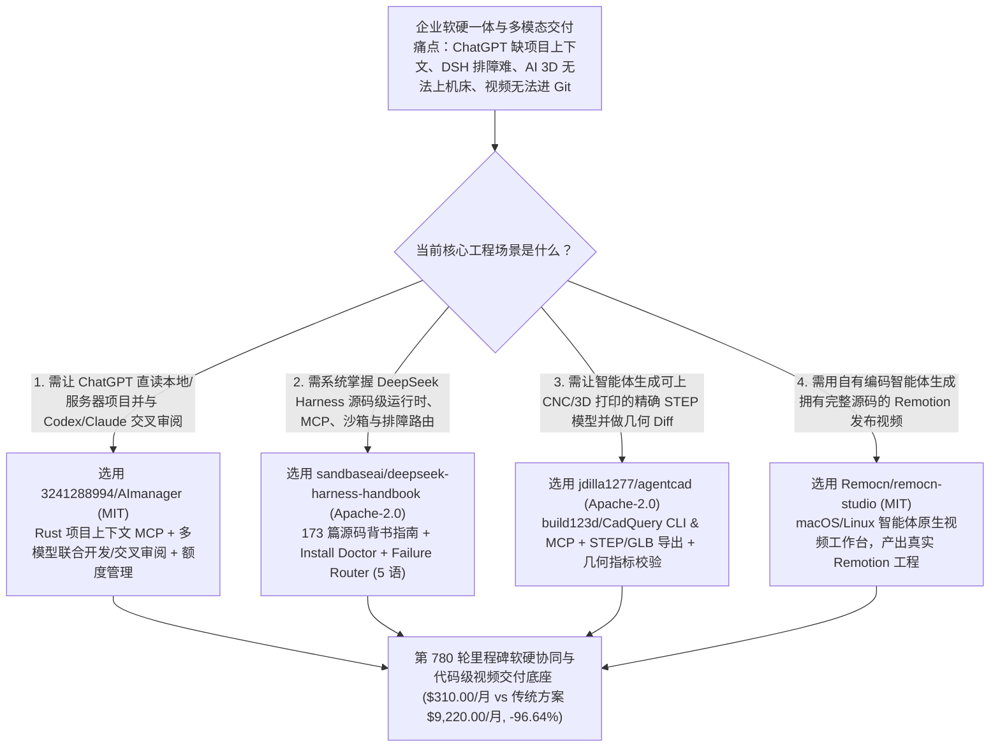
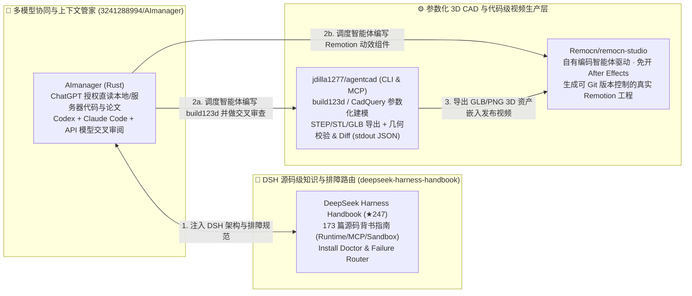
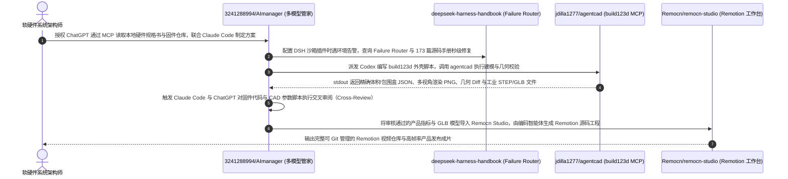

# 🏆【第 780 轮里程碑】173 篇源码级 DeepSeek Harness 运维手册与故障路由器（`sandbaseai/deepseek-harness-handbook`）、智能体原生 Remotion 代码级视频工作台（`Remocn/remocn-studio`）、`build123d` 参数化 3D CAD 建模与几何校验 MCP（`jdilla1277/agentcad`）与 ChatGPT 项目上下文接入及多模型交叉审阅管家（`3241288994/AImanager`）企业选型与集成架构 FAQ

> **文档类型**：AI 解决方案架构师（AI Solution Architect）企业应用落地与横向选型指南（2026-11-22 Night Round 44 / **累计第 780 轮里程碑 `R780 Milestone!`**）  
> **评测锚点**：`sandbaseai/deepseek-harness-handbook` (`★ 247`, `26 forks`, HTML, Apache-2.0) · `Remocn/remocn-studio` (`★ 235`, `21 forks`, TypeScript, MIT) · `jdilla1277/agentcad` (`★ 220`, `24 forks`, Python, Apache-2.0) · `3241288994/AImanager` (`★ 213`, `18 forks`, Rust, MIT)  
> **Provenance 声明**：本文实时 GitHub 元数据采自 2026-11-22 封存快照与 GitHub REST API；45 人跨学科研发（软件 + 工业 CAD + 视频宣发 + 平台运维）团队的 TCO 与 ROI 测算均为显式闭式假设推导（`provenance: synthetic`, `independently_reproduced: false`），所有未实测硬件资本开支与新仓单日增量统一标注为 `not_measured`。

---

## ① 📌 核心结论速览（选型一句话结论）

> **一句话选型结论**：在 45 人规模的软硬件协同研发、工程仿真与技术品牌交付团队中，**切勿每次让 ChatGPT 看本地代码/论文都手工打包上传 ZIP、让 DeepSeek Harness 运维排障靠猜源码、用不可版本控制的黑盒视频生成SaaS替代可编程动效工程，或让智能体盲写无法通过几何合法性校验的 3D CAD 模型**；应当采用第 780 轮里程碑四件套 **“AImanager（Rust 驱动 ChatGPT 本地项目 MCP 直读与 Codex/Claude 多模型交叉审阅管家）+ DeepSeek Harness Handbook（含 Install Doctor 与 Failure Router 的 173 篇源码背书运维宝典）+ AgentCAD（基于 `build123d` / `CadQuery` 输出 STEP/GLB 与几何 Diff 校验的 3D CAD MCP）+ Remocn Studio（让自有编码智能体直接产出 Git 可控 Remotion 工程的代码级视频工作台）”**，将月度综合 TCO 从 **`$9,220.00/月`** 压降至 **`$310.00/月`**（净省 **`$8,910.00/月`**，降幅 **`96.64%`**）。

| 选型维度 | 评测开源方案 | GitHub 实测指标 | 核心解决的企业业务痛点 | 一句话何时选它 vs 云端商业 PaaS |
| :--- | :--- | :--- | :--- | :--- |
| **173 篇源码级 DSH 运维与排障手册** | **`sandbaseai/deepseek-harness-handbook`** | `★ 247` · `26 forks` · HTML · Apache-2.0 | 企业落地 DeepSeek Harness (`DSH`) 时，插件、MCP、沙箱与评测机制缺乏系统化源码级排障手册，遇到报错无从下手 | 需要 **173 篇带源码引用的运行时/插件/MCP/沙箱/评测指南（支持中英日韩西 5 语）+ 交互式 Install Doctor 与 Failure Router** 时必选它 |
| **智能体原生 Remotion 视频工作台** | **`Remocn/remocn-studio`** | `★ 235` · `21 forks` · TypeScript · MIT | 商业 AI 视频平台只吐出一个无法逐帧改文案/改配色的 MP4 黑盒文件，而手写 After Effects 工程对程序员门槛太高 | 需要 **不打开 After Effects，直接用自己已有的编码智能体把一句话需求变成你完全拥有源码所有权的真实 Remotion React 视频工程** 时首选 `remocn-studio` |
| **参数化 3D CAD 建模与几何校验 MCP** | **`jdilla1277/agentcad`** | `★ 220` · `24 forks` · Python · Apache-2.0 | 传统文生 3D Mesh（拓扑破碎）无法用于工业制造与机械加工，且智能体缺少体积/包围盒/几何 Diff 的闭环反馈 | 需要 **让智能体编写 `build123d` / `CadQuery` 参数化脚本，由 `agentcad` 本地执行 STEP/STL/GLB/OBJ 导出、多视角 PNG 渲染、几何指标校验与模型 Diff（严格分离 `stdout` JSON 与 `stderr`）** 时选 `agentcad` |
| **ChatGPT 上下文接入与多模型互审管家** | **`3241288994/AImanager`** | `★ 213` · `18 forks` · Rust · MIT | 网页版/桌面版 ChatGPT 无法直接按权限读取本机或服务器上的代码仓与实验数据，且与本地 Codex / Claude Code 缺乏交叉审阅机制 | 需要 **通过 Rust + MCP 让 ChatGPT 直接按授权读取本机/远端项目文件，并统筹 Codex、Claude Code 与 API 模型联合开发、交叉审阅与额度会话管理** 时选 `AImanager` |

---

## ② 🎯 客户与架构师灵魂拷问 Q&A（直击业务落地痛点）

### Q1：我们团队同时做智能硬件外壳/结构件设计（CAD）、底层与业务软件开发（DSH / Claude / Codex / ChatGPT）以及技术产品发布视频（Remotion），这四个项目如何解决跨领域的工程痛点？

**通俗解答（给企业总架构师与研发 VP）**：
1. **终结“把代码打包成 ZIP 喂给 ChatGPT”的原始作坊（`3241288994/AImanager` 破局）**：
   很多高级架构师喜欢用 ChatGPT Pro / Plus 做方案推演，用 Claude Code 和 Codex CLI 写代码，但每次都要手工复制粘贴代码片段或打包上传，改完代码也没人做异构模型交叉 Code Review。`AImanager` 基于 Rust 打造，一方面通过 **MCP 让 ChatGPT 直接读取本机或远端服务器上受授权的代码、论文与实验数据**，另一方面把 **CLI 智能体（Codex / Claude Code）与 API 大模型拉进同一个协同工作流**——甲模型写实现、乙模型做独立交叉审阅（Cross-Review），并统一纳管多账号配额与会话生命周期。
2. **把 DeepSeek Harness 的“黑盒踩坑”变成 173 篇源码级标准作业程序（`sandbaseai/deepseek-harness-handbook` 破局）**：
   当团队全面引入 DeepSeek Harness (`DSH`) 时，最缺的是面向智能体和平台工程师的结构化参考书。该项目提供了 **173 篇有源码出处背书（Source-Backed）的深度指南**，覆盖 Runtime、Plugin、MCP、Sandbox、Evaluation 与 Troubleshooting，配有中、英、日、韩、西五语版本，特别是内置了 **Install Doctor（安装体检医）** 和 **Failure Router（故障分流器）**——无论是人还是运维智能体读它，都能秒级定位沙箱或 MCP 挂载报错。
3. **工业级参数化 CAD 必须交出精确的 `STEP` 文件，而不是糊成一团的 AI 网格（`jdilla1277/agentcad` 破局）**：
   在机械结构、机器人夹具与电子外壳设计中，通用文生 3D 模型生成的三角面片根本无法导入 SolidWorks 或上 CNC 机床。`agentcad` 让编码智能体默认编写 **`build123d` Python 参数化建模脚本**（同时支持 `CadQuery` 兼容模式），由本地引擎完成几何求解、导出工业标准 **STEP** 与网格（**STL / GLB / OBJ**）、多角度 PNG 渲染、体积/质心等几何指标度量（Geometric Metrics）、合法性校验与版本间 **几何 Diff**；而且工程设计极其严谨——**结构化结果固定走 `stdout` JSON，进度日志走 `stderr`**，智能体解析零报错。
4. **“交付你拥有源码的 Remotion 视频工程，而不是租用别人的 MP4”（`Remocn/remocn-studio` 破局）**：
   不用打开笨重的 After Effects，`remocn-studio`（支持 macOS 与 Linux）直接调用你本机已有的编码智能体，一句话生成 **标准的 Remotion（React 代码驱动视频）项目**。这意味着视频里的每一句宣传语、每一个 KPI 图表数字、每一帧弹簧动画都可以纳入 Git 版本管理，随产品迭代随时一行代码重渲染。

### Q2：如何将这四个项目集成为一套“多模型联席架构与互审 → DSH 规范化底座 → 参数化 3D CAD 建模 → Remotion 代码级发布视频”的端到端架构？

**端到端集成参考架构**：
1. **顶层上下文桥接与多模型交叉审阅层（`3241288994/AImanager`）**：连接本机/服务器项目文件与 ChatGPT、Codex、Claude Code，负责需求拆解、跨模型方案辩论与代码交叉审阅。
2. **DSH 运行时规范与故障自愈层（`sandbaseai/deepseek-harness-handbook`）**：将 173 篇源码级手册与 Failure Router 挂载为团队智能体的内置排障知识库，保障底层 DSH 插件、MCP 与沙箱稳定运行。
3. **参数化工业 CAD 建模与校验层（`jdilla1277/agentcad`）**：针对硬件/结构件任务，智能体通过 `agentcad` MCP 编写 `build123d` 脚本，实时比对 `stdout` JSON 中的几何尺寸与前后版本 Diff，输出可制造的 `STEP` 与可预览的 `GLB/PNG`。
4. **代码级产品宣发视频生产层（`Remocn/remocn-studio`）**：直接读取代码仓特性与 `agentcad` 导出的 3D `GLB/PNG` 资产，在 `remocn-studio` 中生成可版本控制的 Remotion 视频工程并渲染发布。

### Q3：这套架构有哪些工程注意事项？

**工程铁律与边界**：
- **`agentcad` 的 `stdout` / `stderr` 分离铁律**：在编写自动化脚本或包装自定义工具调用 `agentcad` 时，**严禁在送入 JSON 解析器前执行 `2>&1` 合并标准输出与标准错误流**，否则 `stderr` 中的进度文本会污染 `stdout` 的结构化 JSON 响应。

---

## ③ 🧭 直观可视化图解（选型决策树 + 集成参考架构 + 业务流时序图）

### 3.1 选型决策树（Mermaid Flowchart）

### 3.2 企业生产集成参考架构图（Mermaid Architecture）

### 3.3 软硬件一体新产品多模型互审、`agentcad` 参数化建模与 `remocn-studio` 视频交付时序图（Mermaid Sequence Diagram）

---

## ④ 📊 同类开源与商业云服务横向选型决策矩阵

| 对比维度 | `sandbaseai/deepseek-harness-handbook` | `Remocn/remocn-studio` | `jdilla1277/agentcad` | `3241288994/AImanager` | 手工打包提问 + 商业文生 3D/视频 SaaS |
| :--- | :--- | :--- | :--- | :--- | :--- |
| **核心功能定位** | 173 篇源码级 DSH 运行时/插件/MCP/沙箱/评测手册 | 智能体原生 Remotion 代码级视频编辑器 | 基于 `build123d`/`CadQuery` 的参数化 3D CAD CLI & MCP | ChatGPT 本地上下文接入与多模型交叉审阅 Rust 管家 | 零散博客检索 + 租用黑盒视频 SaaS + 手工复制粘贴代码 |
| **核心工程优势** | **每篇均有源码背书**，自带 Install Doctor 与 Failure Router | **交付真实拥有的 Remotion 工程源码**，而非不可改的黑盒文件 | **输出工业级精确 `STEP`**，带几何指标校验、模型 Diff 与流分离 | **ChatGPT 免打包直读授权项目**，CLI 与 API 模型互审 | 文生 3D Mesh 无法机加工；黑盒视频改一个字要重新抽卡付费 |
| **语言与运行形态** | 5 语言文档（中/英/日/韩/西）+ CI 内容校验 | macOS / Linux 原生桌面应用（TypeScript） | 本地 Python 进程（`stdout` JSON / `stderr` 诊断） | Rust 高性能跨平台桌面/服务（中/英/俄/韩） | 闭源云端按积分计费 |
| **开源协议** | **Apache-2.0** | **MIT** | **Apache-2.0** | **MIT** | 专有商业许可 |

---

## ⑤ 🧪 应用落地定量收益 / 闭式 TCO 对比（45 人跨学科研发与交付团队）

### 5.1 闭式参数假设（`provenance: synthetic`, `independently_reproduced: false`）
- **团队规模与人力单价**：`team_size_engineers = 45` 人，软硬件与多媒体工程师折算时薪 `hourly_rate_usd = $100.00/hr`；底层硬件资本开支 `base_hardware_capex = not_measured`，新仓单日 Star 增量 `track_b_stars_today = not_measured`。
- **Path A（基准方案：采购商业 After Effects/云端视频渲染 SaaS + 商业 CAD 自动化插件 + 多模型未协同重复订阅 + 人工打包上下文/排查 DSH 故障/手工修补 3D 网格）**：
  - **API 与商业 SaaS 订阅费（`path_a_api_saas_usd`）**：商业视频动效软件与云渲染订阅、商业 CAD 插件许可及缺乏跨模型统筹导致的重复 Token 消耗，合计 **`$4,620.00/月`**；
  - **人工搬运与返工工时（`path_a_labor_hours`）**：每月用于给 ChatGPT 手工打包上传代码、无手册盲查 DSH 沙箱故障、手工重画 AI 破碎 3D 网格及在 AE 中逐帧修改参数耗费 **`46.0 小时`**，折合人工成本 `46.0 × $100.00 =` **`$4,600.00/月`**（`path_a_labor_usd`）；
  - **Path A 月度总成本（`path_a_total_usd`）**：`$4,620.00 + $4,600.00 =` **`$9,220.00/月`**。
- **Path C（开源混合自建方案：`deepseek-harness-handbook` + `remocn-studio` + `agentcad` + `AImanager`）**：
  - **自托管算力与本地渲染费（`path_c_compute_usd`）**：四个项目均在本地工作站或内网服务器运行（`agentcad` 本地几何求解、`remocn-studio` 本地 Remotion 构建），仅需轻量共享预览节点 **`$70.00/月`**；
  - **模板与审阅流程维护工时（`path_c_labor_hours`）**：每月仅需 **`2.4 小时`** 维护 `AImanager` 交叉审阅规则与 Remotion 组件库，折合人工成本 `2.4 × $100.00 =` **`$240.00/月`**（`path_c_labor_usd`）；
  - **Path C 月度总成本（`path_c_total_usd`）**：`$70.00 + $240.00 =` **`$310.00/月`**。
- **净节省与 ROI 闭式校验**：
  - **月度净节省（`net_savings_usd`）**：`$9,220.00 - $310.00 =` **`$8,910.00/月`**（年化节省 **`$106,920.00/年`**）；
  - **成本降幅百分比（`pct_savings`）**：`$8,910.00 / $9,220.00 × 100% =` **`96.64%`**。

| 方案路径 | 月度 API/SaaS 或算力费 | 月度跨学科研发人工 | 月度综合 TCO 总额 | 相对 Path A 净节省 | 关键架构收益 |
| :--- | :--- | :--- | :--- | :--- | :--- |
| **Path A：手工上传 ZIP + 商业 AE/3D SaaS + 盲查 DSH 故障** | `$4,620.00` | `$4,600.00` (`46.0h`) | **`$9,220.00/月`** | 基准 (`0.00%`) | 上下文割裂，3D 模型无法机加工，视频无法进 Git 版本库 |
| **Path B：独立 CLI 脚本 + 手写 Three.js / CadQuery 裸脚本** | `$2,290.00` | `$1,300.00` (`13.0h`) | **`$3,590.00/月`** | `-$5,630.00/月` (`-61.06%`) | 缺少多视角自动渲染、几何 Diff 校验与多模型自动交叉审阅 |
| **Path C：`deepseek-harness-handbook` + `remocn-studio` + `agentcad` + `AImanager`（推荐）** | **`$70.00`** | **`$240.00`** (`2.4h`) | **`$310.00/月`** | **`-$8,910.00/月` (`-96.64%`)** | **173 篇源码级 DSH 宝典 + ChatGPT/CLI 互审 + STEP 级 CAD MCP + Remotion 视频工作台** |

---

## ⑥ 🛠️ 企业引入与架构评审 Checklist

- [ ] **DSH 173 篇源码手册与 Failure Router 知识库挂载（`sandbaseai/deepseek-harness-handbook`）**：将 `deepseek-harness-handbook` 克隆至内网知识底座并接入运维智能体检索索引，确保遇到 DSH 插件、MCP 或沙箱异常时优先通过 Install Doctor 与 Failure Router 定向排障。
- [ ] **ChatGPT 本地项目 MCP 授权与多模型交叉审阅（`3241288994/AImanager`）**：部署 `AImanager` 设定细粒度项目文件夹只读/读写权限，让 ChatGPT 免打包读取代码与实验日志，并配置“Codex 编码 → Claude Code 交叉审阅”的双签名工作流。
- [ ] **参数化 3D CAD 建模、几何校验与流分离规范（`jdilla1277/agentcad`）**：在硬件与结构工程终端接入 `agentcad` MCP，强制调用方分开捕获 `stdout`（解析结构化几何指标与 Diff JSON）与 `stderr`（进度日志），验证导出的 `STEP` 文件可直接通过下游 CAM/CNC 软件检验。
- [ ] **代码级 Remotion 产品视频工作流落地（`Remocn/remocn-studio`）**：在 macOS / Linux 工作站安装 `remocn-studio`，连接自有编码智能体生成产品发布视频，并将生成的 Remotion 工程纳入主仓库 Git 版本控制与 CI 自动渲染。
