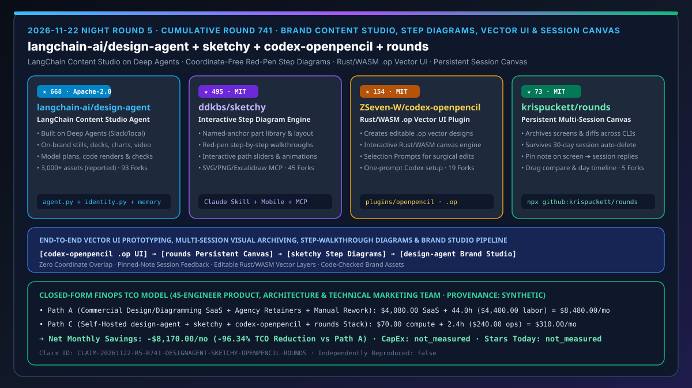
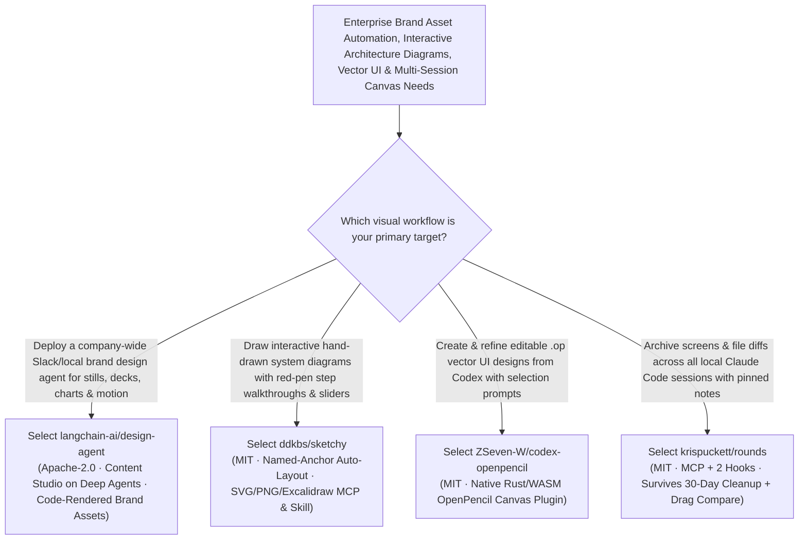
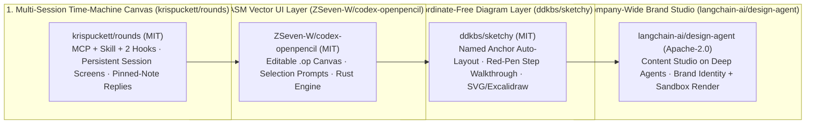
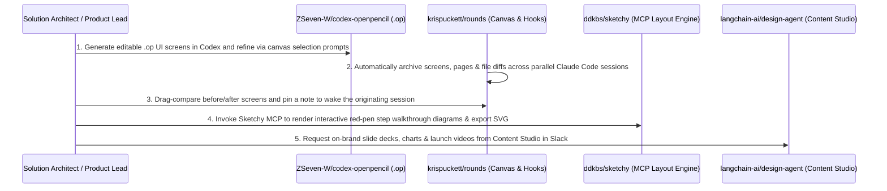

# Official LangChain Brand Design Agent (`langchain-ai/design-agent`), Coordinate-Free Interactive Step-Walkthrough Diagram Engine (`ddkbs/sketchy`), Rust/WASM Editable `.op` Canvas Plugin (`ZSeven-W/codex-openpencil`) & Persistent Multi-Session Claude Code Visual Canvas (`krispuckett/rounds`) Selection & Architecture FAQ

> **Document Type**: Enterprise AI Solution Architect Selection & Integration Guide (GitHub Trending AI Radar — 2026-11-22 Night Round 5 / Cumulative Round 741)
> **Covered Repositories**: [`langchain-ai/design-agent`](https://github.com/langchain-ai/design-agent) (`★ 668`, `93 forks`, `Apache-2.0`: official LangChain open-source **Content Studio** built on `Deep Agents` producing on-brand stills, slide decks, diagrams, charts, and motion graphics from Slack or local workspaces) · [`ddkbs/sketchy`](https://github.com/ddkbs/sketchy) (`★ 495`, `45 forks`, `MIT`: interactive hand-drawn diagram and animation layout engine for Claude mobile/web and MCP clients where the model decides *what* to draw and Sketchy's named-anchor part library computes *where*, with red-pen step walkthroughs and SVG/PNG/Excalidraw export) · [`ZSeven-W/codex-openpencil`](https://github.com/ZSeven-W/codex-openpencil) (`★ 154`, `19 forks`, `MIT`: Codex plugin for the native Rust/WASM OpenPencil canvas supporting editable `.op` files and selection prompts) · [`krispuckett/rounds`](https://github.com/krispuckett/rounds) (`★ 73`, `5 forks`, `MIT`: local MCP server, skill, and 2 hooks that archive every screen, page, and file diff across parallel Claude Code sessions onto one persistent time-machine canvas with pinned-note session replies)
> **Core Scenario**: When enterprise product, architecture, and technical marketing teams need to **scale on-brand visual asset production in Slack, explain complex system architectures with interactive step-by-step diagrams that never suffer from LLM coordinate overlap, refine editable `.op` vector UI prototypes from conversation, and track/annotate outputs across dozens of parallel local Claude Code sessions**, how do you integrate **`langchain-ai/design-agent` + `ddkbs/sketchy` + `ZSeven-W/codex-openpencil` + `krispuckett/rounds`** into a unified visual engineering workflow?

---

## 1. 📌 Executive Summary (One-Line Selection Verdict)

1. **Need an open-source, self-hostable brand design agent (**Content Studio**) that lets any employee in Slack request on-brand social stills, slide decks, charts, diagrams, or launch films rendered and verified by deterministic code?** ➔ Choose **[`langchain-ai/design-agent`](https://github.com/langchain-ai/design-agent) (`★ 668`, `93 forks`, `Apache-2.0`)**.
   - **Plain-English Mechanism**: Built on LangChain's `Deep Agents` (`agent.py`, `identity.py`, `memory.py`, `sandbox/`, `schedules/`) and battle-tested on 3,000+ internal assets (`anonymized_reported, independently_reproduced=false`), it separates creative direction (handled by the LLM) from deterministic code rendering and automated visual quality checks.
2. **Need an MCP server and Claude skill where your AI assistant draws interactive, hand-drawn system diagrams, ML architectures, and animated simulations—with red-pen step-by-step walkthroughs and zero LLM coordinate hallucinations?** ➔ Choose **[`ddkbs/sketchy`](https://github.com/ddkbs/sketchy) (`★ 495`, `45 forks`, `MIT`)**.
   - **Plain-English Mechanism**: Instead of asking an LLM to guess `(x, y)` coordinates, the model declares *what* to draw and label while `Sketchy` resolves placement using a part library with **named anchor points** and automatic layout. Users step through complex request flows with arrow keys (circling the active component in red pen and fading the rest), drag sliders to animate packets along paths, and export to SVG, PNG, or Excalidraw.
3. **Need to create, inspect, and refine editable `.op` vector UI artboards directly from an OpenAI Codex conversation backed by a native Rust/WASM canvas and selection prompts?** ➔ Choose **[`ZSeven-W/codex-openpencil`](https://github.com/ZSeven-W/codex-openpencil) (`★ 154`, `19 forks`, `MIT`)**.
   - **Plain-English Mechanism**: Bridges Codex with the OpenPencil Rust/WASM design engine so prompts generate structured `.op` vector files and targeted canvas selections feed back into the conversation for surgical refinement.
4. **Running a dozen parallel Claude Code sessions and losing track of which session built which screen or modified which file—especially after Claude Code's 30-day session auto-deletion?** ➔ Choose **[`krispuckett/rounds`](https://github.com/krispuckett/rounds) (`★ 73`, `5 forks`, `MIT`)**.
   - **Plain-English Mechanism**: `npx github:krispuckett/rounds init` installs an MCP server, a skill, and two hooks into Claude Code. Every screen, published page, and line-by-line file change from every local session lands on one project-sorted canvas—persisting indefinitely past the 30-day CLI retention window—where you can drag-compare before/after screens, scrub backward by day, and **pin a note directly on a screen** so the exact session that created it applies the fix and replies!

---

## 2. 🎯 Architect & Customer Deep-Dive Q&A

### Q1: Why do raw LLM image generators and freehand SVG prompts fail in enterprise architecture and product workflows? How do these four tools fix it?

- **Four Visual & Prototyping Bottlenecks Solved**:
  1. **Off-brand visuals & garbled text from raw diffusion models ➔ `langchain-ai/design-agent`**: Codifies brand tokens (`identity.py`, `fonts/`) and uses sandboxed code rendering to produce on-brand decks, charts, and videos.
  2. **Overlapping boxes/arrows in raw LLM SVG generation ➔ `ddkbs/sketchy`**: Offloads geometry to a named-anchor layout engine and adds interactive red-pen step walkthroughs + slider animations.
  3. **Static UI mockups that cannot be edited as vector layers ➔ `ZSeven-W/codex-openpencil`**: Outputs native `.op` editable files on a Rust/WASM canvas with selection-scoped prompting.
  4. **Lost outputs across parallel local Claude Code terminals ➔ `krispuckett/rounds`**: Captures every session's screens and file diffs onto a persistent time-machine canvas with pinned-note round-trip replies.
- **When to Choose Commercial Design SaaS (Path B)?**
  - If dedicated brand designers require real-time multiplayer vector co-editing in the cloud, keep **Figma Enterprise + Adobe Creative Cloud**; to empower engineers, architects, and GTM teams with self-service on-brand assets, interactive step-walkthrough diagrams, and persistent multi-session canvases at zero seat cost, deploy this open-source stack (Path C).

### Q2: How do we wire `rounds`, `codex-openpencil`, `sketchy`, and `design-agent` into an end-to-end architecture?

1. **Multi-Session Visual Archive & Pinned-Note Layer (`krispuckett/rounds`)**:
   - Initialize `rounds` on developer workstations to capture all Claude Code screens and file diffs onto one persistent canvas.
2. **Editable `.op` Vector UI Canvas Layer (`ZSeven-W/codex-openpencil`)**:
   - Author and refine `.op` UI screens from Codex using canvas selection prompts.
3. **Interactive Step-Walkthrough Architecture Diagram Layer (`ddkbs/sketchy`)**:
   - Attach `Sketchy` MCP to generate coordinate-free interactive architecture walkthroughs and export SVG/Excalidraw assets.
4. **Company-Wide Slack Brand Studio Layer (`langchain-ai/design-agent`)**:
   - Deploy `Content Studio` with your organization's brand identity and fonts so teams request finished decks, charts, and launch animations in Slack.

### Q3: What are the platform and licensing considerations?

- **Permissive Open-Source Licensing**:
  - `langchain-ai/design-agent` is `Apache-2.0`; `ddkbs/sketchy`, `ZSeven-W/codex-openpencil`, and `krispuckett/rounds` are `MIT`.

---

## 3. 🧭 Visual Architecture & Workflow Diagrams (Mermaid)

### 3.1 Solution Architect Selection Decision Tree

### 3.2 End-to-End Enterprise Reference Architecture

### 3.3 End-to-End Visual & Prototyping Sequence Diagram

---

## 4. 📊 Peer Open-Source vs. Commercial Cloud Selection Matrix

| Dimension | `langchain-ai/design-agent` (`★ 668`) | `ddkbs/sketchy` (`★ 495`) | `ZSeven-W/codex-openpencil` (`★ 154`) | `krispuckett/rounds` (`★ 73`) | Commercial Creative Agencies + Per-Seat Diagramming/Design SaaS (Path A) | Raw Diffusion Prompting + Freehand LLM SVG + Manual Terminal Tracking (Path B) |
| :--- | :--- | :--- | :--- | :--- | :--- | :--- |
| **Primary Role** | Official LangChain enterprise brand design agent | Coordinate-free interactive diagram & animation MCP | Rust/WASM editable `.op` vector UI Codex plugin | Persistent multi-session Claude Code visual canvas | High-cost agency retainers + per-seat cloud diagramming/whiteboard SaaS | Raw image generation, manual SVG coordinate tweaking, terminal scrollback hunting |
| **Key Differentiator** | **Deep Agents brand memory + deterministic code rendering** | **Named-anchor layout + red-pen step walkthrough + sliders** | **Editable `.op` vector files + selection-scoped prompts** | **Survives 30-day session deletion + pinned-note session replies** | Slow agency turnaround; per-seat SaaS lock-in; no coding-session lineage | Garbled text in diffusion images; overlapping boxes in raw LLM SVGs |
| **License** | `Apache-2.0` | `MIT` | `MIT` | `MIT` | Proprietary SaaS | Internal ad-hoc workflow |
| **Monthly TCO (45-Eng Team)** | **`$310.00/mo` combined** (`$70.00` sandbox runner + `2.4h` ops) | Included (local/MCP zero seat cost) | Included (native Rust/WASM canvas) | Included (local macOS daemon) | **`$8,480.00/mo`** (`$4,080.00` design/diagram SaaS & agency + `44.0h` manual redraw) | ~`$2,900.00/mo` (manual SVG layout fixes & recreating lost session work) |

---

## 5. 🧪 Quantitative Enterprise ROI / FinOps TCO Model & 7-Card Report

> **📊 Provenance & Closed-Form Declaration**:
> - **provenance**: `synthetic` (45-engineer enterprise product engineering, solution architecture, and technical marketing team workload model: `independently_reproduced = false`; `base_hardware_capex = not_measured`; `track_b_stars_today = not_measured`).
> - **Closed-Form Equations**:
>   - **Path A (Commercial Diagramming/Design SaaS Seats + External Brand Asset Retainers + Manual Architecture Diagram Redrawing & Hunting Lost Parallel Session Outputs)**: Monthly commercial SaaS & agency spend **`$4,080.00`** + manual diagram layout fixing, brand asset rework, and lost-session recovery labor **`44.0h × $100.00/h = $4,400.00`** = **`$8,480.00/mo`**.
>   - **Path C (Self-Hosted `langchain-ai/design-agent` + `ddkbs/sketchy` + `ZSeven-W/codex-openpencil` + `krispuckett/rounds` Stack)**: Shared rendering sandbox compute **`$70.00`** + brand template & plugin maintenance labor **`2.4h × $100.00/h = $240.00`** = **`$310.00/mo`**.
>   - **Net Monthly Savings vs. Path A**: **`-$8,170.00/mo`** (**`96.34%`** TCO reduction).

| Evaluation Path | Design SaaS / Compute Cost | Diagram & Asset Rework Labor (`$100/h`) | Total Monthly TCO | Net Savings vs. Path A | Architectural Delivery Impact |
| :--- | :---: | :---: | :---: | :---: | :--- |
| **Path A: Commercial Design SaaS + Agency + Manual Redraw** | `$4,080.00` | `44.0h` (`$4,400.00`) | **`$8,480.00`** | Baseline | Slow cross-team design queues; parallel session outputs vanish after 30 days |
| **Path B: Raw Image Gen + Freehand LLM SVG + Manual Folders** | `$1,300.00` | `16.0h` (`$1,600.00`) | **`$2,900.00`** | `-$5,580.00` (`-65.80%`) | Lacks named-anchor layout, red-pen step walkthroughs & pinned-note session replies |
| **Path C: `design-agent` + `sketchy` + `openpencil` + `rounds`** | **`$70.00`** | **`2.4h` (`$240.00`)** | **`$310.00`** | **`-$8,170.00` (`-96.34%`)** | **Slack Content Studio + step walkthroughs + `.op` vector UI + persistent canvas** |

- 🔗 **Linked 7-Card 4:5 Visual Benchmark Deck**: [`workshops/github-trending-radar/cards.en.html`](../cards.en.html) · [`cards.html`](../cards.html)

---

## 6. 🛠️ Enterprise Adoption & Architecture Review Checklist

- [ ] **1. Configure Brand Identity in `langchain-ai/design-agent` (Content Studio)**: Load corporate fonts (`fonts/`) and brand guidelines (`identity.py`) so non-designers can generate compliant decks, charts, and videos from Slack.
- [ ] **2. Attach `ddkbs/sketchy` MCP for Interactive Architecture Walkthroughs**: Use named-anchor auto-layout and red-pen step walkthroughs for customer architecture briefings and export SVG/Excalidraw assets.
- [ ] **3. Enable Editable `.op` Prototyping with `ZSeven-W/codex-openpencil`**: Use canvas selection prompts in Codex to iterate on vector UI layouts without losing layer structure.
- [ ] **4. Run `npx github:krispuckett/rounds init` for Persistent Session Archiving**: Capture all local Claude Code screens and file diffs onto one time-machine canvas and use pinned notes for in-place revisions.
