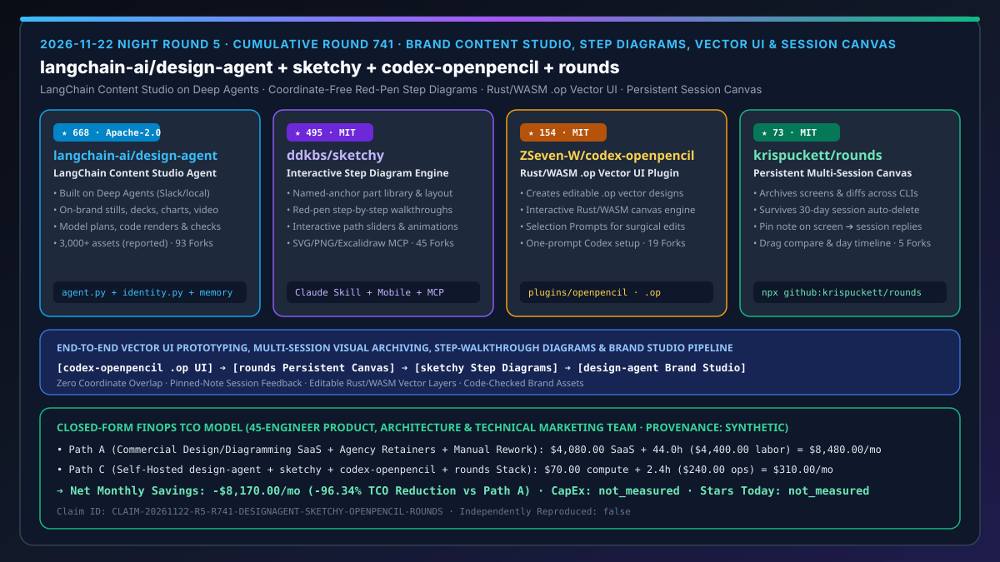
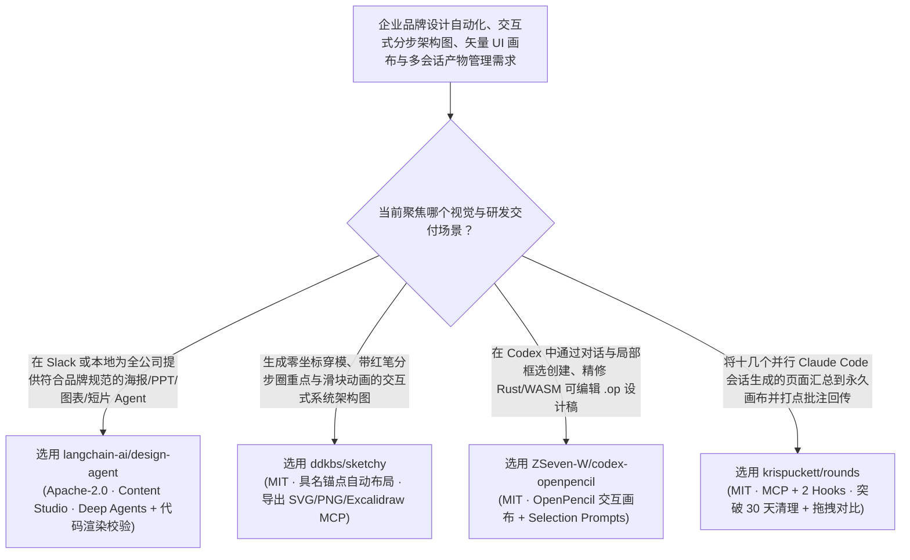
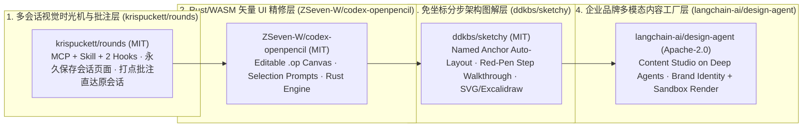
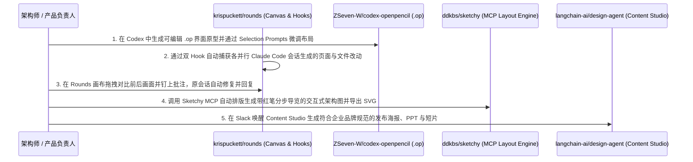

# LangChain 官方品牌级多模态设计智能体（`langchain-ai/design-agent`）、免算坐标交互式分步架构图引擎（`ddkbs/sketchy`）、Rust/WASM 可编辑 `.op` 画布插件（`ZSeven-W/codex-openpencil`）与跨 Claude 会话全量产物时间轴画布（`krispuckett/rounds`）选型与集成架构 FAQ

> **文档类型**：企业 AI 解决方案架构师（AI Solution Architect）选型决策指南（GitHub Trending AI 雷达 2026-11-22 Night Round 5 / 累计第 741 轮）
> **覆盖项目**：[`langchain-ai/design-agent`](https://github.com/langchain-ai/design-agent)（`★ 668`、`93 forks`、`Apache-2.0`，LangChain 官方开源的内部生产级品牌设计智能体 **Content Studio**，基于 `Deep Agents` 构建，在 Slack 或本地工作区一键生成符合企业品牌规范的海报、PPT、图表与发布短片）· [`ddkbs/sketchy`](https://github.com/ddkbs/sketchy)（`★ 495`、`45 forks`、`MIT`，支持 Claude 手机端与全系 MCP 客户端的交互式手绘架构图与动态图解引擎，“模型决定画什么、Sketchy 具名锚点决定画在哪”，支持红笔分步圈重点、滑块动画与 SVG/PNG/Excalidraw 导出）· [`ZSeven-W/codex-openpencil`](https://github.com/ZSeven-W/codex-openpencil)（`★ 154`、`19 forks`、`MIT`，基于原生 Rust/WASM 渲染引擎的 OpenPencil Codex 插件，支持从对话创建、圈选局部并精细打磨可编辑 `.op` 矢量 UI 设计文件）· [`krispuckett/rounds`](https://github.com/krispuckett/rounds)（`★ 73`、`5 forks`、`MIT`，通过 MCP + Skill + 2 个 Hook 将本机所有并行 Claude Code 会话生成的页面、截图与代码变更汇聚到同一块永久画布，支持拖拽对比、按天时光倒流与在画面上打点批注直接唤醒原会话修改回复）
> **核心场景**：当企业产品、架构与技术市场团队希望用 AI 加速**“品牌视觉物料与发布会短片制作、客户汇报中的交互式分步系统架构图讲解、对话式矢量 UI 原型精修、以及多窗口并行 Claude Code 会话产物的持久化归档与打点批注”**时，如何组合**`langchain-ai/design-agent` + `ddkbs/sketchy` + `ZSeven-W/codex-openpencil` + `krispuckett/rounds`** 构建端到端视觉与前端协同工作台？

---

## 一、📌 核心结论速览（选型一句话结论）

1. **想在公司 Slack 或内部平台部署一个“懂全公司品牌字体、配色与视觉规范”的 AI 设计师，让非设计部门员工像找真人设计师一样在群里提需求就能拿到合规海报、图表、演示文稿与动画短片** ➔ 选 **[`langchain-ai/design-agent`](https://github.com/langchain-ai/design-agent)（`★ 668`，`93 forks`，`Apache-2.0`）**。
   - **通俗原理**：这是 LangChain 内部自用并已交付超 3,000 件资产（`anonymized_reported, independently_reproduced=false`）的 **Content Studio** 源码。基于 `Deep Agents` 架构（含 `agent.py`、`identity.py`、`memory.py`、`sandbox/` 与 `schedules/`），严格遵循**“大模型负责创意决策，确定性代码负责渲染、自检与交付”**的分工，彻底避免纯生图模型的文字乱码与品牌走样。
2. **想让 Claude、Cursor、Codex 或手机端 Claude App 在解释复杂分布式架构、网络请求链路或算法原理时，直接画出零连线穿模的交互式手绘图，并能按方向键一步步用红笔圈出当前讲解节点或拖动滑块演示数据包流动** ➔ 选 **[`ddkbs/sketchy`](https://github.com/ddkbs/sketchy)（`★ 495`，`45 forks`，`MIT`）**。
   - **通俗原理**：传统让大模型直接手算 SVG 坐标必出重叠乱线。`Sketchy` 采用职责解耦——**AI 只负责声明“画什么组件与连线标签”，Sketchy 内置的具名锚点零件库（Named Anchor Points）与自动布局引擎负责计算精确坐标**。生成的图自带交互式分步导览（每一步自动用红笔圈出核心模块并淡化背景）、支持滑块驱动物体沿路径运动，且一键导出 SVG、PNG 与 Excalidraw。
3. **想在 Codex 会话中一边对话一边在高性能原生 Rust/WASM 矢量画布上生成、圈选（Selection Prompts）并双向精修可编辑的 `.op` UI 设计稿** ➔ 选 **[`ZSeven-W/codex-openpencil`](https://github.com/ZSeven-W/codex-openpencil)（`★ 154`，`19 forks`，`MIT`）**。
   - **通俗原理**：将 Codex 智能体与 OpenPencil 矢量画布深度绑定，摆脱一次性静态出图的局限，允许设计师或前端工程师在画布上框选任意图层组件后直接下达局部修改指令。
4. **经常同时开十几个 Claude Code 终端窗口并行写项目，想把所有会话生成的网页、界面截图与文件 Diff 自动按项目归档在同一块永久画布上，并在截图上直接钉便利贴让对应的那个会话自动改完回复你** ➔ 选 **[`krispuckett/rounds`](https://github.com/krispuckett/rounds)（`★ 73`，`5 forks`，`MIT`）**。
   - **通俗原理**：执行 `npx github:krispuckett/rounds init` 自动向 Claude Code 注册 1 个 MCP Server、1 个 Skill 与 2 个生命周期 Hook。即便 Claude Code 默认 30 天自动清理终端历史，所有会话产出的页面与截图仍永久保留在 `Rounds` 画布上；支持按天时间轴回溯、拖拽新旧画面叠图对比、查看跨会话同一文件的冲突改动，以及点击画面任意位置留批注直达原会话闭环修复！

---

## 二、🎯 客户与架构师灵魂拷问 Q&A（深度架构拆解）

### Q1：为什么企业技术团队在画架构图、做产品原型和做品牌物料时，用通用大模型聊天框效率依然不高？这四个项目如何改变工作流？

- **四大视觉与原型工程突破**：
  1. **品牌视觉资产一致性失控 ➔ `langchain-ai/design-agent`**：把品牌字体（`fonts/`）、视觉规范（`identity.py`）与跨会话记忆（`memory.py`）固化在 Deep Agents 沙箱流水线里，让市场、销售与研发在 Slack 里自助产出标准品牌物料。
  2. **架构图手算坐标穿模且静态图难以向客户讲清多步流转 ➔ `ddkbs/sketchy`**：具名锚点自动布局 + 红笔分步高亮导览 + 滑块动态模拟，让架构师在技术汇报中像播放交互式动画一样拆解系统链路。
  3. **AI 生成的 UI 稿无法作为标准矢量源文件二次编辑 ➔ `ZSeven-W/codex-openpencil`**：基于 Rust/WASM 引擎生成结构化可编辑 `.op` 设计文件并支持局部框选对话。
  4. **多路并行编码会话产物散落丢失 ➔ `krispuckett/rounds`**：用双 Hook + MCP 自动捕获每个会话的页面快照与文件级血缘，提供跨 30 天不丢失的视觉时光机与图上批注回流。
- **何时直接用云厂商或商业设计 SaaS（Path B）？**
  - 若大型专业视觉设计团队重度依赖云端多人实时商业矢量协同与 Adobe 全家桶，可继续使用 **Figma Enterprise + Adobe Firefly**；若希望在研发与架构工作流内零席位费实现 Slack 自助品牌设计、交互式分步架构图生成与多会话视觉归档，则选用本轮开源组合（Path C）。

### Q2：典型企业级“多会话视觉归档画布 (`rounds`) + 矢量 UI 精修 (`codex-openpencil`) + 交互式分步架构图 (`sketchy`) + 品牌物料工作室 (`design-agent`)”架构怎么搭？

1. **研发多会话产物归档与批注层（`krispuckett/rounds`）**：
   - 在开发者 Mac 终端运行 `rounds init`，自动汇聚所有 Claude Code 会话页面与代码变更，架构师在画布拖拽对比前后版本并钉批注驱动修复。
2. **交互式分步架构图解与导出层（`ddkbs/sketchy`）**：
   - 在 Claude Code / Cursor / Codex 中挂载 `Sketchy` MCP，为技术方案自动生成带红笔分步导览的交互图并导出 SVG/Excalidraw 嵌入文档。
3. **矢量 `.op` 界面原型协同层（`ZSeven-W/codex-openpencil`）**：
   - 通过 Codex 插件生成可编辑 `.op` 移动与 Web 界面稿，利用 Selection Prompts 精细调整组件布局。
4. **全员 Slack 品牌内容生产层（`langchain-ai/design-agent`）**：
   - 部署 `Content Studio` 连接企业 Slack 频道，统一调用受控沙箱渲染发布海报、数据图表与产品演示短片。

### Q3：这套架构的部署边界与环境要求是什么？

- **核心优势**：
  - **100% 宽松开源协议（`Apache-2.0` + `MIT`）**，支持将设计规范、架构图与会话产物完全保存在企业自有基础设施与本地磁盘。
- **平台兼容性说明**：
  - `krispuckett/rounds` 目前主要面向 macOS + Node 20+ 本地 Claude Code 会话设计；而 `langchain-ai/design-agent`、`ddkbs/sketchy` 与 `ZSeven-W/codex-openpencil` 均支持跨平台部署与主流编码器接入。

---

## 三、🧭 直观可视化图解（Mermaid 决策树 + 集成架构 + 时序图）

### 3.1 架构师选型决策树

### 3.2 企业端到端生产集成参考架构图

### 3.3 多会话页面归档批注、`.op` 矢量精修、`Sketchy` 分步架构图生成与 `Content Studio` 品牌交付时序图

---

## 四、📊 同类开源与商业云服务横向选型决策矩阵

| 对比维度 | `langchain-ai/design-agent` (`★ 668`) | `ddkbs/sketchy` (`★ 495`) | `ZSeven-W/codex-openpencil` (`★ 154`) | `krispuckett/rounds` (`★ 73`) | 商业品牌设计外包 + 商业白板/绘图 SaaS 席位 + 手工整理多窗口产物 (Path A) | 裸调文生图模型 + 裸写 SVG 坐标 + 终端翻历史记录 (Path B) |
| :--- | :--- | :--- | :--- | :--- | :--- | :--- |
| **核心能力定位** | LangChain 官方企业品牌设计智能体 | 免算坐标交互式分步手绘架构图 MCP | Rust/WASM 可编辑 `.op` 矢量 UI 插件 | 跨 Claude Code 会话永久视觉画布与批注 | 按席位/按件计费的商业设计 SaaS 与外部设计代理商 | 直接用通用模型生图、手写 SVG 与人肉记录终端目录 |
| **核心技术突破** | **Deep Agents 记忆/品牌锁定 + 代码确定性渲染自检** | **具名锚点自动布局 + 红笔分步导览 + 滑块运动** | **原生 Rust 渲染 `.op` 源文件 + 局部框选 Prompt** | **双 Hook 自动归档突破 30 天限制 + 画面钉批注回传** | 外包周期长、单件成本高；多会话研发产物无法自动关联代码行 | 文生图文字易乱码；大模型手算 SVG 坐标必重叠；30 天后会话被删 |
| **开源协议** | `Apache-2.0` | `MIT` | `MIT` | `MIT` | 闭源商业 SaaS | 内部零散操作 |
| **月度 TCO（45 人团队）** | **组合仅 `$310.00/月`**（`$70.00` 渲染沙箱容器 + `2.4h` 模板维护） | 同左（本地/MCP 零席位费） | 同左（本地 Rust/WASM 画布免费） | 同左（本机运行零云端费用） | **`$8,480.00/月`**（`$4,080.00` 商业设计/白板席位与外包 + `44.0h` 手工重绘与找版本） | 约 `$2,900.00/月`（大量人工修 SVG 重叠连线与重做丢失会话工时） |

---

## 五、🧪 应用落地定量收益/TCO 对比与 7-Card 报告

> **📊 数据来源与闭式核算声明（Provenance & Closed-Form Schema）**：
> - **provenance**: `synthetic`（基于 45 人企业产品工程、解决方案架构与技术市场团队月度工作负载模型：`independently_reproduced = false`；硬件采购基线 `base_hardware_capex = not_measured`；Track B 单日增量 `track_b_stars_today = not_measured`）。
> - **核算公式**：
>   - **Path A（采购全员商业图表/白板/设计 SaaS 席位 + 外部品牌物料制作服务 + 架构师手工调整穿模的架构图连线、工程师在十几个终端间手工翻找或重做被清理的会话页面）**：月度商业设计 SaaS 与外包费用 **`$4,080.00`** + 架构图手工重排、品牌物料返工与多会话版本找回人工 **`44.0h × $100.00/h = $4,400.00`** = **`$8,480.00/月`**。
>   - **Path C（自建 `langchain-ai/design-agent` + `ddkbs/sketchy` + `ZSeven-W/codex-openpencil` + `krispuckett/rounds` 开源视觉与原型工程栈）**：共享沙箱渲染容器开销 **`$70.00`** + 品牌规范配置与画布插件维护人工 **`2.4h × $100.00/h = $240.00`** = **`$310.00/月`**。
>   - **净节省（Net Savings vs Path A）**：**`-$8,170.00/月`**（成本降低 **`96.34%`**）。

| 评估方案 | 设计 SaaS / 算力成本 | 架构图与物料重排人工（`$100/h`） | 月度总 TCO | 相对 Path A 净节省 | 关键架构交付指标 |
| :--- | :---: | :---: | :---: | :---: | :--- |
| **Path A：商业设计/绘图 SaaS 席位 + 外包物料 + 人工排版** | `$4,080.00` | `44.0h` (`$4,400.00`) | **`$8,480.00`** | Baseline | 跨部门品牌需求排队慢；多终端编码产物超过 30 天易丢失 |
| **Path B：裸调生图 API + 大模型手算 SVG + 手工建目录备份** | `$1,300.00` | `16.0h` (`$1,600.00`) | **`$2,900.00`** | `-$5,580.00` (`-65.80%`) | 缺少具名锚点自动布局、红笔分步导览与画面钉批注自动唤醒原会话 |
| **Path C：`design-agent` + `sketchy` + `openpencil` + `rounds`** | **`$70.00`** | **`2.4h` (`$240.00`)** | **`$310.00`** | **`-$8,170.00` (`-96.34%`)** | **Slack 品牌工作室 + 红笔分步架构图 + `.op` 矢量画布 + 永久多会话画布** |

- 🔗 **关联 7-Card 4:5 视觉评测报告**：[`workshops/github-trending-radar/cards.html`](../cards.html) · [`cards.en.html`](../cards.en.html)

---

## 六、🛠️ 企业引入与架构评审 Checklist

- [ ] **1. 部署 `langchain-ai/design-agent`（Content Studio）建立企业品牌自助设计中枢**：在 `identity.py` 与 `fonts/` 中注入企业标准 VI，接入内部 Slack 频道赋能非设计团队自助生成合规物料。
- [ ] **2. 在架构师终端挂载 `ddkbs/sketchy` MCP 服务**：用具名锚点自动布局与红笔分步导览替代手算坐标 SVG，提升客户技术方案讲解的直观度。
- [ ] **3. 引入 `ZSeven-W/codex-openpencil` 打通对话式矢量 UI 原型设计**：在 Codex 中直接产出可二次编辑的 `.op` 矢量源文件。
- [ ] **4. 执行 `npx github:krispuckett/rounds init` 开启多会话永久视觉归档**：将本机所有并行 Claude Code 会话的页面与文件变更统一收拢到 `Rounds` 画布，通过画面钉批注实现闭环修订。
