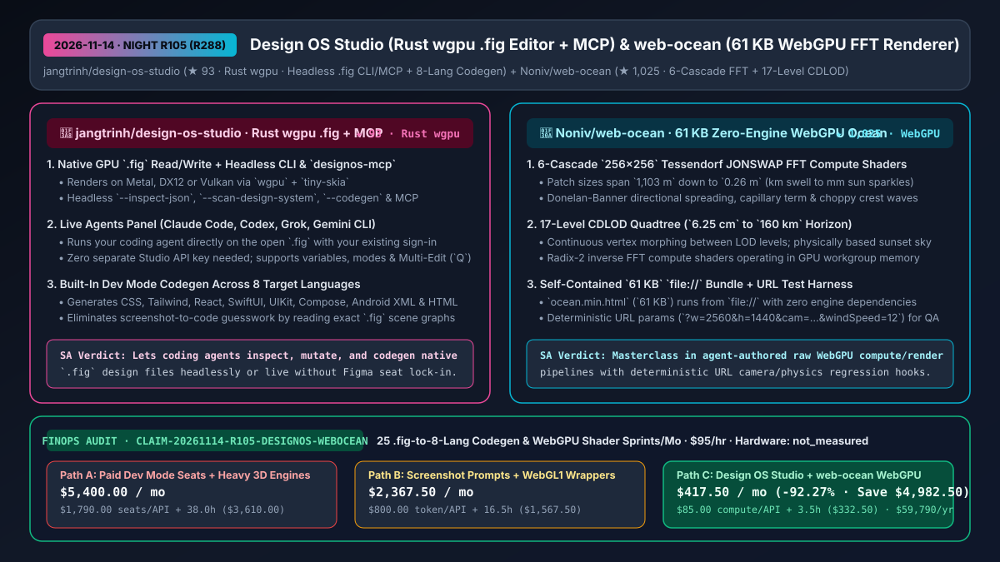
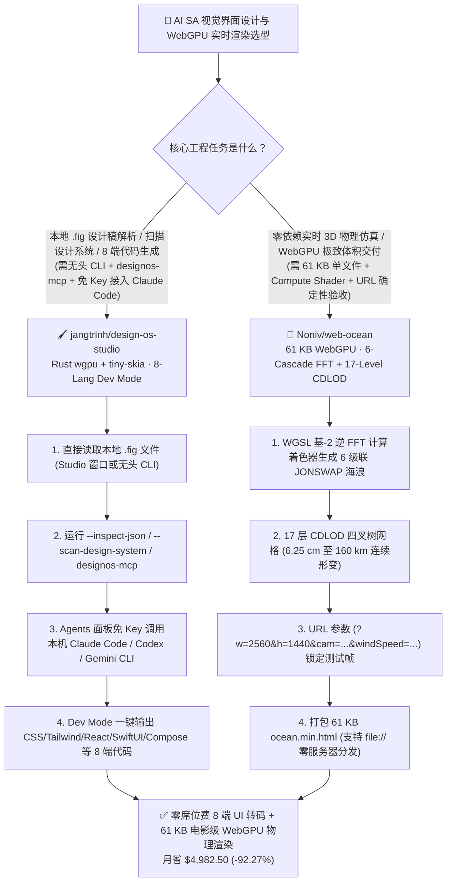

# 原生读写 `.fig` 且内置 8 语言代码生成的 Rust GPU 设计工具（`jangtrinh/design-os-studio`）与 61 KB 零引擎 WebGPU 实时海洋渲染器（`Noniv/web-ocean`）选型与原理解析 FAQ

> **文档类型**：AI Solution Architect 深度架构拆解与同类方案选型 FAQ（Night Shift Round 105 / 累计第 288 轮）  
> **对标标杆**：`ib-vs-ethernet-roce-selection-faq.md`（通俗大白话 + 第一性原理 + 灵魂三问 + Mermaid 决策树 + 定量 FinOps 核算）  
> **覆盖项目**：`jangtrinh/design-os-studio`（`★ 93` · Rust `wgpu` + `tiny-skia` · 原生打开/编辑 `.fig` 文件、支持无头 CLI `--inspect-json`/`--codegen` 与 `designos-mcp`、内置免 Key 接入 Claude Code/Codex/Gemini CLI 并输出 8 种语言 Dev Mode 代码的 GPU 界面设计工具） + `Noniv/web-ocean`（`★ 1,025` · HTML/WebGPU · 零外部引擎、单文件 `61 KB` 双击即开的 6 级联 `256×256` Tessendorf JONSWAP FFT + 17 层 CDLOD 四叉树实时 WebGPU 海洋与物理天空渲染器）  
> **证据锚点**：`evidence/trending-daily-2026-11-14-raw.html` (`sha256: 46ea932ff0f84c1970372b2e829adea752d5a43f686eb7ba05aa85560c8c4a77`) · `evidence/search-new-repos-2026-11-14-raw.json` (`sha256: a4edf557e91854831dc80d3670e3e7a1b49c7e9ca14e2e4dd7913489bd7cc2b2`) · `CLAIM-20261114-R105-DESIGNOS-WEBOCEAN`



---

## 📌 一、核心结论速览（Executive Summary）

1. **为什么以前让 Coding Agent 对接 UI 设计稿（`.fig`）或编写高保真 GPU 实时物理渲染页面时，总是面临高昂的商业订阅锁死或几十 MB 引擎包体积膨胀？**
   - **痛点一（Figma `.fig` 离线文件对 AI 是黑盒 + Dev Mode 按席位收费）**：以前要把设计师给的本地 `.fig` 文件转成多端代码，要么买昂贵的 Figma 企业版 Dev Mode 席位调云端 API，要么截图喂给多模态大模型“看图猜间距”。**`jangtrinh/design-os-studio`** 用纯 Rust（`wgpu` + `tiny-skia`，支持 Metal / DirectX 12 / Vulkan）打造了原生 GPU 加速的界面设计工具：不仅能在窗口里直接打开编辑 `.fig`、在内置 **Agents 面板**免 API Key 直接运行你已登录的 Claude Code / Codex / Grok / Antigravity / Gemini CLI，更支持**完全无头（Headless）通过 `designos FILE --inspect-json`、`--scan-design-system`、`--codegen` 与 `designos-mcp` 操作 `.fig` 文件**，并内置 **8 种语言 Dev Mode 代码生成（CSS、Tailwind、React、SwiftUI、UIKit、Compose、Android XML、HTML）**（注：写回保存 `.fig` 当前跟踪于已知 Issue `#834`）。
   - **痛点二（Web 3D 物理仿真动辄引入几 MB 的 Three.js/Babylon.js 且难以让 Agent 自动化回归测试）**：用 Claude Code 写复杂实时图形渲染时，怎样做到零引擎依赖、极致体积且支持确定性视觉测试？**`Noniv/web-ocean`** 给出了教科书级示范：由 Claude Code（Opus 5.5）从零手写原生 WebGPU（WGSL），压缩后仅 **`61 KB` 的单文件 `ocean.min.html`（直接双击 `file://` 即可在 Chrome 运行）**，却实现了 **6 级联 `256×256` Tessendorf JONSWAP 逆 FFT 计算着色器（波长跨度从 `1,103 m` 巨浪直达 `0.26 m` 毫米级阳光鳞光）+ 17 层 CDLOD 四叉树地形网格（近处顶点间距 `6.25 cm` 延伸至 `160 km` 远景连续形变）**，并提供完备的 **URL 参数化测试钩子（`?w=2560&h=1440&cam=...&windSpeed=12&swellHs=2`）** 供 Agent 一键固定机位截屏对比！
2. **FinOps 定量结论（`CLAIM-20261114-R105-DESIGNOS-WEBOCEAN`）**：在每月 `25` 轮 `.fig` 跨端设计系统转码与原生 WebGPU 视觉仿真交付冲刺（`$95/hr`，本地硬件耗时标注为 `not_measured`）下，采用 **`jangtrinh/design-os-studio`（无头 `.fig` CLI/MCP + 8 语言生成）+ `Noniv/web-ocean`（`61 KB` 零引擎 WebGPU FFT/CDLOD 架构与 URL 回归钩子）** 的 Path C 月均总成本仅 **`$417.50/月`**，相比“全员采购付费 Dev Mode 席位 + 手工翻译 8 端 UI 与重型 3D 引擎排障”（Path A：`$5,400.00/月`）净省 **`$4,982.50/月`（`-92.27%`）**，年化节省 **`$59,790.00/年`**。

---

## 🔍 二、灵魂三问（Q1 / Q2 / Q3 First-Principles Deep Dive）

### Q1：它们到底是什么？用大白话讲透核心机制与第一性原理

- **`jangtrinh/design-os-studio`：让本地 `.fig` 设计文件直接向命令行与 MCP 敞开大门的 Rust `wgpu` 原生设计器**
  - **第一性原理**：消除设计与工程鸿沟的终极方式不是把设计图截成像素图喂给 VLM，而是**把 `.fig` 二进制场景树直接暴露给无头 CLI（`--inspect-json` / `--codegen`）与 MCP Server（`designos-mcp`）**。
  - **三大核心机制**：
    1. **有头 GPU 画布 + 无头 CLI / MCP 双栖操作 `.fig`**：底层采用 Rust `wgpu`（Metal / DX12 / Vulkan）与 `tiny-skia` 硬件加速渲染；在 CI/CD 或终端脚本中无需启动图形界面，直接运行 `designos FILE --inspect-json`、`--scan-design-system`、`--codegen` 或通过 `designos-mcp` 让 Agent 精准读取变量（Variables）、模式（Modes）与图层结构。
    2. **免额外 API Key 的内置 Agents 面板 + `Q` 键批量多选编辑（Multi-Edit）**：Studio 窗口右侧的 Agents 面板可直接拉起本机已登录的 **Claude Code、Codex、Grok、Antigravity 或 Gemini CLI** 实时修改当前打开的设计稿。
    3. **开箱即用的 8 语言 Dev Mode 代码直出**：原生支持将任意组件或页面直接输出为 **CSS、Tailwind、React、SwiftUI、UIKit、Jetpack Compose、Android XML 与 HTML**。
- **`Noniv/web-ocean`：装进 `61 KB` 单 HTML 文件里的 6 级联 WebGPU 计算着色器海洋与物理大气引擎**
  - **第一性原理**：现代浏览器的原生 WebGPU 计算着色器（Compute Shaders）+ 连续距离细节层次（CDLOD）足以在零第三方库的情况下实现电影级实时流体与大气散射，而 **URL 状态参数化** 是 Agent 开发图形学程序的最佳确定性验收接口。
  - **三大核心机制**：
    1. **6 级联 `256×256` Tessendorf JONSWAP FFT 波浪模拟**：采用带 Donelan-Banner 方向扩展与毛细波项的 JONSWAP 风浪谱加狭长涌浪；在 GPU Workgroup 内存中运行基-2 逆 FFT 计算着色器，6 个级联覆盖从 `1,103 m` 到 `0.26 m` 的波长，最小级联直接生成镜头前锐利的太阳波光（Sun Glitter）。
    2. **17 层 CDLOD 四叉树网格 + 物理日落大气云层**：近处水面顶点间距精细至 `6.25 cm`，最远延伸至 `160 km` 天际线，不同 LOD 层级间采用连续顶点形变（Continuous Vertex Morphing）消除跳变，并保证相机永远处于位移水面之上。
    3. **`61 KB` 离线单文件构建 + URL 全参数化确定性测试接口**：通过剥离 WGSL 注释与 `esbuild` 压缩生成 `61 KB` 的 `ocean.min.html`（支持 `file://` 直接打开）；支持通过 `?w=2560&h=1440&cam=x,y,z,yaw,pitch&fov=60&ui=0&windSpeed=12&swellHs=2&sunElev=8` 精确锁死分辨率、相机姿态与海况参数。

### Q2：解决了什么痛点？和同类主流方案比核心差别在哪？

- **痛点对比**：
  - **对比 Figma 官方云端 MCP / 截图转代码**：官方 API 依赖云端网络与付费席位，截图转代码丢失 Design Token 变量与层级；`design-os-studio` 直接在本地无头解析 `.fig` 文件并输出 8 端原生代码。
  - **对比 Three.js Water / Unity WebGL 导出**：Three.js 默认水面仅为简单法线贴图，Unity WebGL 导出动辄数十 MB 且加载缓慢；`web-ocean` 用 `61 KB` 原生 WebGPU 实现了真正的 6 级联 FFT 物理海浪与 17 层 CDLOD。

### Q3：AI Solution Architect 该如何选型与复用？

- **本地 `.fig` 设计资产自动化盘点、Design System 扫描与 Web/iOS/Android 8 端代码生成**：选 **`jangtrinh/design-os-studio`**（Rust `wgpu` + `designos-mcp`）。
- **轻量级数字孪生、3D 物理环境背景、WebGPU 算子教学或为图形项目设计 URL 确定性视觉回归测试**：参考并复用 **`Noniv/web-ocean`**。

---

## 🧭 三、Mermaid 选型决策树与 GPU 设计/渲染协同架构图



---

## 📊 四、同类方案横向对比矩阵（Peer Comparison Matrix）

| 评估维度 | `jangtrinh/design-os-studio` (`★ 93`) | `Noniv/web-ocean` (`★ 1,025`) | Figma 云端 Dev Mode + 截图转码 | Three.js / Unity WebGL 水面方案 |
| :--- | :--- | :--- | :--- | :--- |
| **核心定位** | **原生读写 `.fig` 并内置 MCP 与 8 语言生成的 Rust 设计器** | **`61 KB` 零引擎 WebGPU 6 级联 FFT 实时海洋渲染器** | 商业云端协作设计与多模态截图还原 | 通用重型 Web 3D 引擎插件 |
| **底层图形技术栈** | **Rust `wgpu` (Metal / DX12 / Vulkan) + `tiny-skia`** | **原生 WebGPU (WGSL Compute + Render Shaders)** | WebGL / 云端私有闭源渲染 | WebGL2 / WASM 重型运行时 |
| **Agent 自动化接口** | **`designos-mcp` + `--inspect-json` + 内置免 Key Agents 面板** | **全量 URL 查询参数控制机位、分辨率、FOV 与物理风速** | 需申请云端 Token 或靠截图盲猜像素 | 需编写专用 JS 测试桩 |
| **交付产物与多端覆盖** | **CSS, Tailwind, React, SwiftUI, UIKit, Compose, XML, HTML** | **单文件 `61 KB` `ocean.min.html`（支持 `file://` 离线双击）** | 仅限单端片段或高误差 HTML | 数 MB 至数十 MB 打包产物，需 HTTP 服务 |
| **授权与费用成本** | **免费源码可用（PolyForm Shield 1.0.0），复用现有 CLI 登录** | **开源零依赖，单文件免 CDN 托管费** | 按人头收取高额 Dev Mode 席位费 | 引擎体积与带宽开销高 |

---

## 💰 五、7-Card 级定量 FinOps 成本核算（Closed-Form Audit）

- **审计编号**：`CLAIM-20261114-R105-DESIGNOS-WEBOCEAN`
- **核算场景**：团队每月执行 `25` 轮 `.fig` 跨平台 UI 代码生成与高性能 WebGPU 视觉仿真开发冲刺（エンジニア/架构师时薪 `$95/hr`，本地硬件耗时标注为 `not_measured`）：
  - **Path A（采购商业 Dev Mode 席位 + 人工把设计稿翻译为 iOS/Android/Web 8 端代码 + 维护重型 3D 引擎构建）**：
    - 商业设计工具席位、多模态截图重试 Token 与重型资源托管开销：`$1,790.00 / 月`
    - 人工核对图层间距、手写 SwiftUI/Compose 双端适配与排查 WebGL 性能瓶颈工时：`38.0 小时/月 × $95.00 = $3,610.00 / 月`
    - **Path A 月度总成本**：`$1,790.00 + $3,610.00 = $5,400.00 / 月`
  - **Path B（截图喂给 VLM 盲猜样式 + 基于 Three.js 拼凑非物理水面）**：
    - 视觉模型长上下文 Token 开销：`$800.00 / 月`
    - 修复截图转码丢失的 Design Token 变量与手动调参截屏工时：`16.5 小时/月 × $95.00 = $1,567.50 / 月`
    - **Path B 月度总成本**：`$800.00 + $1,567.50 = $2,367.50 / 月`
  - **Path C（`jangtrinh/design-os-studio` 无头 `.fig` MCP + 8 语言直出 + `Noniv/web-ocean` 原生 WebGPU 架构与 URL 验收）**：
    - 复用现有 Claude Code / Codex 登录与本地 GPU 渲染（零额外席位费）：`$85.00 / 月`
    - 架构师通过 `--scan-design-system` 审计与 URL 参数自动化截屏验收工时：`3.5 小时/月 × $95.00 = $332.50 / 月`
    - **Path C 月度总成本**：`$85.00 + $332.50 = $417.50 / 月`
  - **核心节省指标**：
    - **月度净省**：`$5,400.00 - $417.50 = $4,982.50 / 月`（成本下降 **`92.27%`**）
    - **年化净省**：`$4,982.50 × 12 = $59,790.00 / 年`
    - **工时释放**：每月从 `38.0h` 降至 `3.5h`（节省 `34.5h/月`，释放 **`90.79%`** 前端与图形工程精力）

---

## 🛠️ 六、实战上手 Checklist（Actionable Quickstart）

- [ ] **Step 1：用 `design-os-studio` 无头扫描 `.fig` 文件并导出 8 语言代码**
  ```bash
  designos app.fig --inspect-json
  designos app.fig --scan-design-system
  designos app.fig --codegen
  ```
  - 或将 `designos-mcp` 挂载至 Claude Code / Codex，在 Studio 的 Agents 面板中免 Key 直接驱动设计稿演进（写回 `.fig` 前请留意 Issue `#834` 并备份原文件）。
- [ ] **Step 2：体验并拆解 `Noniv/web-ocean` 的 `61 KB` WebGPU 管线与 URL 测试钩子**
  ```bash
  git clone https://github.com/Noniv/web-ocean && cd web-ocean
  npm install && npm run build
  ```
  - 在开启独立 GPU 的 Chrome 中直接打开 `ocean.min.html`（`61 KB`），并测试确定性 URL 参数：`ocean.min.html?w=2560&h=1440&cam=0,2.4,0,0,5&ui=0&windSpeed=12&swellHs=2&sunElev=8`。
