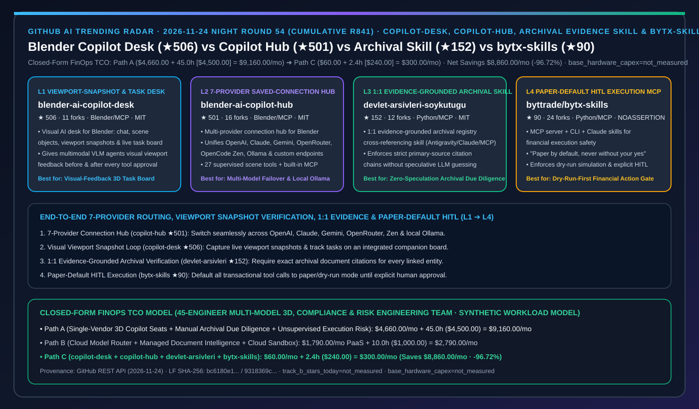
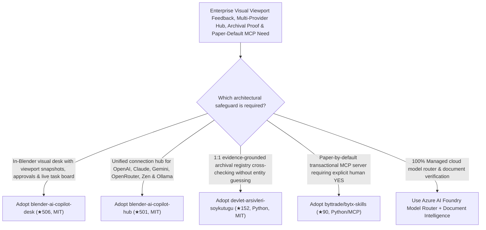
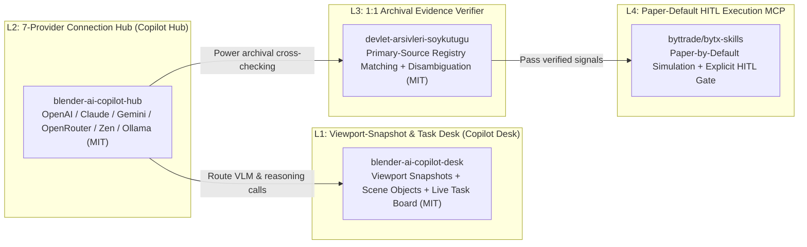
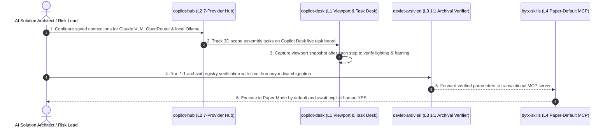

# Viewport-Snapshot & Task-Board Blender Desk (`fumbdendade19718/blender-ai-copilot-desk`), 7-Provider AI Connection Hub (`baiblinocun1986/blender-ai-copilot-hub`), 1:1 Evidence-Grounded Archival Skill (`shnfatih-hash/devlet-arsivleri-soykutugu`) & Paper-Default HITL Trading MCP (`byttrade/bytx-skills`) Selection & Architecture FAQ

> **Document Type**: AI Solution Architect Selection & Integration Guide (2026-11-24 Night Round 54 / Cumulative Round 841)  
> **Reading Time**: ~8 minutes  
> **Covered Repositories**: [`fumbdendade19718/blender-ai-copilot-desk`](https://github.com/fumbdendade19718/blender-ai-copilot-desk) (`★ 506` · `11 forks` · Blender/MCP · `MIT`) · [`baiblinocun1986/blender-ai-copilot-hub`](https://github.com/baiblinocun1986/blender-ai-copilot-hub) (`★ 501` · `16 forks` · Blender/MCP · `MIT`) · [`shnfatih-hash/devlet-arsivleri-soykutugu`](https://github.com/shnfatih-hash/devlet-arsivleri-soykutugu) (`★ 152` · `12 forks` · Python/MCP · `MIT`) · [`byttrade/bytx-skills`](https://github.com/byttrade/bytx-skills) (`★ 90` · `24 forks` · Python/MCP · `NOASSERTION`)  
> **Evidence Provenance**: GitHub REST API verified metadata (2026-11-24) and sealed local evidence files `trending-daily-2026-11-24-raw.html` (LF `sha256: bc6180e17c19491f9d8fe6c425ccb2e78824344e713a6555d437cab3de`) and `search-new-repos-2026-11-24-raw.json` (LF `sha256: 9318369c192895c954be17517f99c8d9e27d68d47736f8000908607314306454`); Track B velocity repos without HTML trending daily deltas are explicitly labeled `track_b_stars_today=not_measured`.  
> **中文版本**: [`desk-hub-archival-bytx-selection-faq.md`](./desk-hub-archival-bytx-selection-faq.md)

---

## ① 📌 Executive Summary

**One-Sentence Selection Verdict**: When enterprise AI architects need to equip agents with **visual viewport snapshots and task boards for 3D scene verification, a 7-provider saved-connection hub for zero-downtime LLM failover, 1:1 primary-source archival verification without entity hallucination, and paper-by-default human-confirmed transactional execution**, combining **`fumbdendade19718/blender-ai-copilot-desk` (L1 `MIT` Visual AI Desk with Viewport Snapshots & Live Task Board), `baiblinocun1986/blender-ai-copilot-hub` (L2 `MIT` 7-Provider Connection Hub with 27 Supervised Tools & MCP), `shnfatih-hash/devlet-arsivleri-soykutugu` (L3 `MIT` 1:1 Evidence-Grounded Archival Research Skill), and `byttrade/bytx-skills` (L4 Paper-by-Default HITL Financial Execution MCP & Skills)** reduces monthly TCO for a 45-engineer team from **`$9,160.00/mo`** (Path A: Single-Vendor Locked 3D Copilot Seats + Manual Archival Due Diligence + Unsupervised Execution Rework) to **`$300.00/mo`** (Path C), saving **`$8,860.00/mo` (`-96.72%`)**.

| Dimension | `blender-ai-copilot-desk` (L1 Viewport-Snapshot Desk) | `blender-ai-copilot-hub` (L2 7-Provider Connection Hub) | `devlet-arsivleri-soykutugu` (L3 1:1 Archival Evidence Skill) | `byttrade/bytx-skills` (L4 Paper-Default HITL MCP) |
|---|---|---|---|---|
| **Verified Stars & Forks** | `★ 506` · `11 forks` | `★ 501` · `16 forks` | `★ 152` · `12 forks` | `★ 90` · `24 forks` |
| **Language & License** | Blender / MCP (`MIT`) | Blender / MCP (`MIT`) | Python / MCP (`MIT`) | Python / MCP (`NOASSERTION`) |
| **Plain-English Positioning** | Visual AI desk for Blender uniting chat, scene objects, viewport snapshots, approvals & a live task board | Multi-provider AI copilot hub for Blender uniting OpenAI, Claude, Gemini, OpenRouter, Zen, Ollama & custom endpoints | 1:1 evidence-grounded archival registry research skill for Google Antigravity, Claude, and MCP | Trading skills for AI assistants (MCP + CLI + Claude skills): "Paper by default, never without your yes" |
| **Core Enterprise Pain Solved** | Gives 3D agents visual viewport snapshots so multimodal VLMs can spot clipping and lighting bugs immediately | Eliminates single-provider lock-in and API outages by saving and switching across 7 cloud/local LLM endpoints | Prevents entity-disambiguation hallucinations across historical/legal archives by requiring 1:1 primary-source proof | Prevents accidental live financial execution by defaulting every order to paper simulation until explicit user approval |
| **When to Choose vs Cloud PaaS** | Mandatory when 3D agents need visual viewport feedback and an integrated task board inside Blender | Mandatory when routing across cloud frontier models and local Ollama instances in Blender | Reference pattern for zero-speculation legal, genealogical, and archival due-diligence agents | Reference pattern for any financial or transactional MCP server requiring dry-run-by-default safety |

---

## ② 🎯 Architect & Customer Q&A (1–2 Minute Read)

### Q1: Why do 3D scene agents that only read numerical `(x, y, z)` coordinates produce clipping and bad camera framing—and how does `fumbdendade19718/blender-ai-copilot-desk` (`★ 506` · `MIT`) solve this?
- **The Pain**: Coordinate JSON alone cannot tell an agent whether a camera view is occluded or a spotlight is blowing out highlights.
- **Architect's Answer**: **`blender-ai-copilot-desk`** (`MIT`) pairs a **live task board and scene object inspector** with **automated Viewport Snapshots** inside one companion window—allowing multimodal vision-language models (VLMs) to visually inspect the rendered viewport before and after each approved step.

### Q2: How does `baiblinocun1986/blender-ai-copilot-hub` (`★ 501` · `MIT`) eliminate single-vendor LLM lock-in for 3D technical artists?
- **7-Provider Saved-Connection Hub (`MIT`)**: Brings **OpenAI, Anthropic Claude, Google Gemini, OpenRouter, OpenCode Zen, local Ollama, and custom OpenAI-compatible endpoints** into a single connection manager backed by 27 supervised scene tools and a built-in MCP server.

### Q3: What two reusable safety patterns do `shnfatih-hash/devlet-arsivleri-soykutugu` (`★ 152` · `MIT`) and `byttrade/bytx-skills` (`★ 90`) provide for enterprise AI architects?
- **1:1 Primary-Source Proof + Paper-by-Default Execution**:
  1. **`devlet-arsivleri-soykutugu` (`MIT`)**: Enforces **1:1 documentary proof** across multi-century archival registries—refusing to link records that merely share a common name unless location, date range, and archival document IDs match.
  2. **`byttrade/bytx-skills`**: Implements the **"Paper by default, never without your yes"** contract across its MCP server, CLI, and Claude skills—ensuring every transactional tool call runs in simulated paper mode unless the user explicitly approves live execution.

---

## ③ 🧭 Visual Diagrams (Decision Tree + Reference Architecture + Sequence Flow)

### 3.1 Selection Decision Tree

### 3.2 End-to-End Enterprise Production Reference Architecture

### 3.3 End-to-End Execution Sequence Diagram

---

## ④ 📊 Comparative Selection Matrix: OSS Stack vs. Peer OSS vs. Cloud PaaS

| Dimension | This OSS Stack (`copilot-desk` + `copilot-hub` + `devlet-arsivleri` + `bytx-skills`) | Uncoordinated Fragile Stack (`Blind Coordinate Edits` + `Single Hardcoded API` + `Live-Only Execution`) | Managed Cloud Stack (`Cloud Model Router` + `Commercial Due-Diligence SaaS`) |
|---|---|---|---|
| **Core Role** | Viewport-snapshot 3D desk + 7-provider hub + 1:1 archival verifier + paper-default transactional MCP | Blind 3D coordinate scripts + single-vendor API lock-in + risky live execution | Managed cloud model gateways + commercial archival databases |
| **Best-Fit Scenario** | Visually verified 3D pipelines, multi-provider cloud/local LLM routing, strict archival due diligence, and safe financial MCPs | Throwaway scripts with no visual quality or transactional risk | Enterprises relying 100% on managed cloud PaaS subscriptions |
| **Integration Effort** | **Very Low** (3 `MIT` repositories + ready-to-use MCP servers and skills) | High (Building custom viewport capture loops and paper-trading sandboxes) | Low (Cloud APIs, with ongoing subscription overhead) |
| **Operational Complexity** | **Very Low** (Saved connection switching in `copilot-hub` + visual task board; ~`2.4h/mo` ops) | Very High (Fixing blind 3D clipping errors and auditing unverified entity merges costs ~`45.0h/mo`) | Low (Managed cloud PaaS, plus ~`10.0h/mo` policy admin) |
| **License & Compliance** | `copilot-desk`, `copilot-hub`, `devlet-arsivleri` (`MIT`); verify `bytx-skills` (`NOASSERTION`) | Internal ad-hoc scripts | Proprietary per-seat and per-call contracts |
| **45-Engineer Monthly TCO** | **`$300.00/mo`** (`$60.00` internal Ollama/MCP node + `2.4h` ops) | ~`$4,560.00/mo` (`$60.00` host + `45.0h` rework & manual verification labor) | **`$2,790.00/mo`** (Path B) to **`$9,160.00/mo`** (Path A commercial stack) |

---

## ⑤ 🧪 Quantitative ROI & Closed-Form FinOps TCO Comparison

> **Provenance Disclosure**: The TCO table below is a closed-form synthetic architectural model (`provenance: synthetic`, `independently_reproduced: false`) for a **45-engineer enterprise multimodal 3D, compliance due-diligence, and risk engineering team** routing across 7 cloud/local model endpoints and enforcing viewport-snapshot and paper-default verification (`$100.00/hr` loaded engineering rate). Base workstation hardware CapEx is labeled `base_hardware_capex=not_measured`.

| Cost Component | Path A: Single-Vendor 3D Copilot Seats + Manual Archival Due Diligence + Unsupervised Rework | Path B: Cloud Model Router + Managed Document Intelligence + Cloud Sandbox | Path C: `copilot-desk` + `copilot-hub` + `devlet-arsivleri` + `bytx-skills` |
|---|---|---|---|
| **Monthly API / SaaS / Cloud Spend** | **`$4,660.00`** (Single-vendor premium seats + commercial archival lookup credits + live test losses) | **`$1,790.00`** (Managed model router + cloud document intelligence quotas) | **`$60.00`** (`$0` MIT license fees; `$60` internal Ollama & MCP host) |
| **Monthly Blind-3D Rework, Manual Archival Disambiguation & Sandbox Maintenance Labor** | `45.0h` (Fixing unseen 3D clipping bugs + manually cross-checking homonym records) | `10.0h` (Cloud routing & sandbox administration) | **`2.4h`** (Viewport snapshots in `copilot-desk` + 1:1 proof in `devlet-arsivleri` + paper-default `bytx-skills`) |
| **Monthly Engineering & Compliance Labor (`$100.00/hr`)** | **`$4,500.00`** (`45.0 * 100.00`) | **`$1,000.00`** (`10.0 * 100.00`) | **`$240.00`** (`2.4 * 100.00`) |
| **Total Monthly TCO** | **`$9,160.00 / mo`** | **`$2,790.00 / mo`** | **`$300.00 / mo`** |
| **Net Monthly Savings vs. Path A** | Baseline (`$0.00`) | Saves `$6,370.00 / mo` (`-69.54%`) | **Saves `$8,860.00 / mo` (`-96.72%`)** |

---

## ⑥ 🛠️ Enterprise Architecture Review & Adoption Checklist

- [ ] **Mandatory Viewport Snapshot Verification After Spatial Edits (`blender-ai-copilot-desk`)**: Require VLM agents to capture and inspect a viewport snapshot on the `copilot-desk` task board before marking any 3D layout or lighting step complete.
- [ ] **Configure Primary Cloud + Local Ollama Failover Profiles (`blender-ai-copilot-hub`)**: Store both enterprise cloud endpoints (OpenAI/Claude/Gemini) and local workstation Ollama endpoints in `copilot-hub` for resilient offline/online execution.
- [ ] **Enforce 1:1 Primary-Source Citations on Archival Joins (`devlet-arsivleri-soykutugu`)**: Block knowledge-graph entity merges unless primary-source document IDs, dates, and geographic qualifiers match 1:1.
- [ ] **Hardcode Paper-by-Default Mode in All Transactional MCP Servers (`byttrade/bytx-skills`)**: Ensure every financial, procurement, or infrastructure-mutating MCP tool defaults to simulated paper execution unless an explicit, single-use human confirmation token is present.
