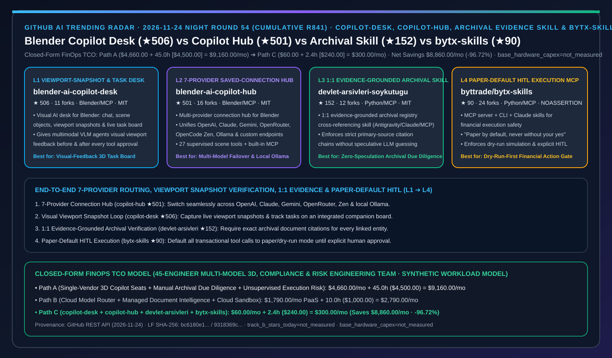
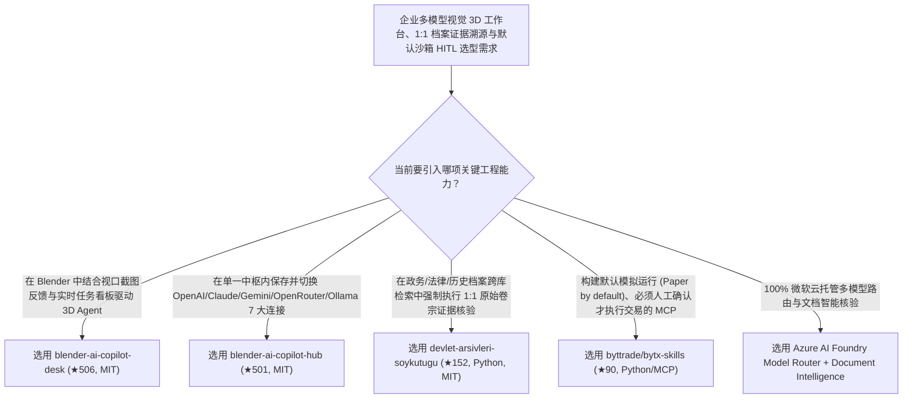
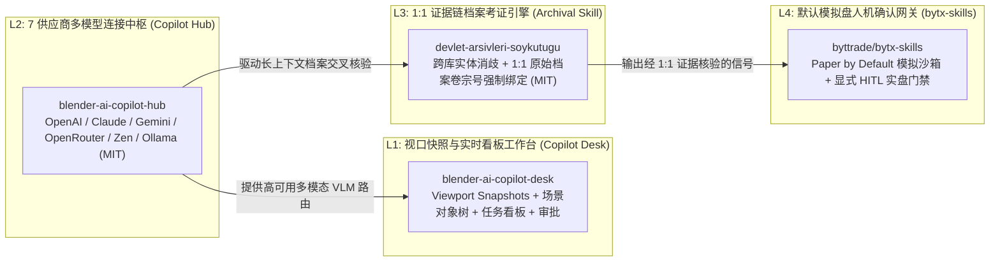
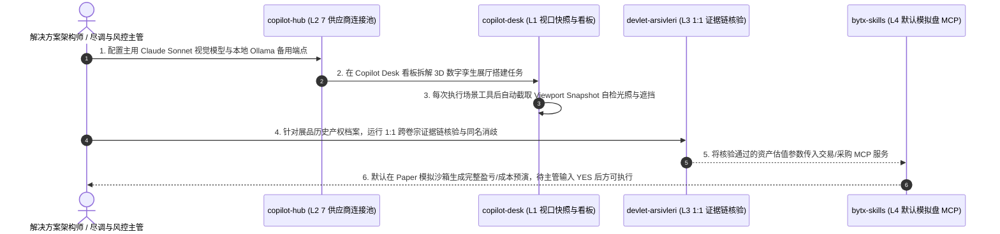

# 视口快照与实时看板 Blender 工作台（`fumbdendade19718/blender-ai-copilot-desk`）、7 供应商连接中枢（`baiblinocun1986/blender-ai-copilot-hub`）、1:1 证据链档案考证技能（`shnfatih-hash/devlet-arsivleri-soykutugu`）与默认模拟盘人机确认技能（`byttrade/bytx-skills`）选型与集成 FAQ

> **文档类型**：AI 解决方案架构师（AI Solution Architect）选型决策指南（2026-11-24 Night Round 54 / 累计第 841 轮）  
> **阅读耗时**：约 8 分钟  
> **覆盖项目**：[`fumbdendade19718/blender-ai-copilot-desk`](https://github.com/fumbdendade19718/blender-ai-copilot-desk)（`★ 506` · `11 forks` · Blender/MCP · `MIT`） · [`baiblinocun1986/blender-ai-copilot-hub`](https://github.com/baiblinocun1986/blender-ai-copilot-hub)（`★ 501` · `16 forks` · Blender/MCP · `MIT`） · [`shnfatih-hash/devlet-arsivleri-soykutugu`](https://github.com/shnfatih-hash/devlet-arsivleri-soykutugu)（`★ 152` · `12 forks` · Python/MCP · `MIT`） · [`byttrade/bytx-skills`](https://github.com/byttrade/bytx-skills)（`★ 90` · `24 forks` · Python/MCP · `NOASSERTION`）  
> **证据溯源**：GitHub REST API 实测元数据（2026-11-24）与本地冻结证据文件 `trending-daily-2026-11-24-raw.html`（LF `sha256: bc6180e17c19491f9d8fe6c425ccb2e78824344e713a6555d437cab3de`）、`search-new-repos-2026-11-24-raw.json`（LF `sha256: 9318369c192895c954be17517f99c8d9e27d68d47736f8000908607314306454`）；Track B 仓库无 HTML 榜单对应的单日增量，统一标记为 `track_b_stars_today=not_measured`。  
> **English Version**: [`desk-hub-archival-bytx-selection-faq.en.md`](./desk-hub-archival-bytx-selection-faq.en.md)

---

## ① 📌 核心结论速览（Executive Summary）

**选型一句话结论**：当企业架构师在构建高可靠 AI 智能体系统时，面临**“3D 场景 Agent 看不见自己改完后的画面效果（盲人摸象）、单一云端大模型故障导致生产力工具停摆、跨百年/多年历史档案与产权尽调出现 AI 脑补幻觉、以及金融交易类工具缺乏默认沙箱（Paper-by-Default）保护”**四大痛点，采用 **`fumbdendade19718/blender-ai-copilot-desk`（L1 集聊天、场景对象树、实时视口快照 `Viewport Snapshots`、审批与看板于一体的 Blender 伴侣工作台）+ `baiblinocun1986/blender-ai-copilot-hub`（L2 统一管理 OpenAI / Claude / Gemini / OpenRouter / OpenCode Zen / Ollama 与自定义端点的 7 供应商连接中枢）+ `shnfatih-hash/devlet-arsivleri-soykutugu`（L3 强制要求 1:1 原始档案证据链交叉核验的档案考证 MCP 技能）+ `byttrade/bytx-skills`（L4 坚守 `Paper by default, never without your yes` 的沙箱优先人机确认 MCP 技能）**，可将 45 人团队的月度 TCO 从单供应商商业插件席位 + 人工档案尽调核对 + 误操作风险处置（Path A）的 **`$9,160.00/月`** 降至 **`$300.00/月`**（净省 **`$8,860.00/月`**，降幅 **`-96.72%`**）。

| 评估维度 | `blender-ai-copilot-desk` (L1 视口快照与看板伴侣窗) | `blender-ai-copilot-hub` (L2 7 供应商多模型连接中枢) | `devlet-arsivleri-soykutugu` (L3 1:1 证据链档案考证技能) | `byttrade/bytx-skills` (L4 默认模拟盘 HITL 交易技能) |
|---|---|---|---|---|
| **GitHub 实测热度** | `★ 506` · `11 forks` (`2026-11` 新仓黑马) | `★ 501` · `16 forks` (`2026-11` 新仓黑马) | `★ 152` · `12 forks` (`2026-11` 新仓黑马) | `★ 90` · `24 forks` (`2026-11` 新仓黑马) |
| **实现语言与开源协议** | Blender / MCP (`MIT`) | Blender / MCP (`MIT`) | Python / MCP (`MIT`) | Python / MCP (`NOASSERTION`) |
| **一句话通俗定位** | 把聊天、场景对象、视口快照、审批与实时任务看板放进同一个伴侣窗口的 Blender AI 桌面 | 统一汇聚 OpenAI、Claude、Gemini、OpenRouter、OpenCode Zen、Ollama 与自定义端点的 Blender 27 工具中枢 | 跨越数百年政务与历史档案库执行 1:1 证据链回溯考证的 Google Antigravity / Claude / MCP 技能 | “默认模拟盘、未经你点头绝不实盘”——集成 MCP Server、CLI 与 Claude Skills 的受控交易辅助套件 |
| **解决的核心业务痛点** | 解决纯坐标数值驱动的 3D Agent“看不见摄像机画面里物体有没有穿模或曝光过度”，通过自动截取 Viewport 快照赋予多模态大模型真实视觉反馈 | 解决单一 API Key 限流或断网时整个 3D 团队停工，支持一键在云端前沿模型与本地零成本 Ollama 间热切换 | 为企业法务合规、不动产/家族信托尽调与历史档案数字化提供“每条结论必须对应 1:1 原始档案卷宗号、严禁同音字张冠李戴”的工程范式 | 为所有涉及资金划转、订单下单的金融级 MCP 工具确立“默认只跑模拟沙箱（Paper Mode），实盘必须人工显式确认”的安全铁律 |
| **何时选它 vs 云托管** | 需要让多模态视觉大模型（VLM）边看 Blender 视口截图边调整任务看板进度时必选 | 团队同时拥有多个云厂商配额与本地 GPU 工作站（Ollama）需要集中保存连接凭证时必选 | 政务档案局、法律尽调、文物古籍考证与高严肃性知识图谱溯源参考首选 | 任何涉及真实资产买卖或高风险写操作的企业级 MCP 工具设计蓝本 |

---

## ② 🎯 客户与架构师灵魂拷问 Q&A（1–2 分钟速读）

### Q1：为什么只给大模型传 3D 物体的 `(x, y, z)` 坐标，它摆出来的场景经常穿模或者镜头被挡住？`fumbdendade19718/blender-ai-copilot-desk`（`★ 506` · `MIT`）是怎么给 Agent 装上“眼睛”和“看板”的？
- **痛点**：纯文本场景树（Scene Graph JSON）无法表达复杂的遮挡关系、光影反射和构图美感。
- **架构师解答**：**`blender-ai-copilot-desk`**（`MIT`）在同一个伴侣窗口内集成了 **实时视口快照（Viewport Snapshots）+ 场景对象列表 + 审批队列 + 实时任务看板（Live Task Board）**：每当 Agent 执行完一步布景，自动截取当前 Blender 3D 视口画面回传给多模态视觉大模型（如 Claude / GPT / Gemini VLM），让模型亲眼看到“椅子腿穿模进了地板”或“背光太暗”，并在看板上勾选完成后再推进下一项子任务。

### Q2：为什么 `shnfatih-hash/devlet-arsivleri-soykutugu`（`★ 152` · `MIT`）和 `byttrade/bytx-skills`（`★ 90`）这两个垂直领域项目，对企业 AI 架构师有极高的通用参考价值？
- **两大高可靠 Agent 设计公理**：
  1. **公理一：1:1 证据锚定与同名消歧（来自 `devlet-arsivleri-soykutugu` · `MIT`）**：在跨多代政务与历史档案库检索时，同名同姓极多。该技能强制 Agent 在连接每一跳关系前，必须完成“地名 + 年份跨度 + 原始档案卷宗号”的 **1:1 铁证校验（1:1 Kanıtlı）**，一旦证据链断裂即刻停止推演——这正是企业金融尽调（Due Diligence）与医疗病历溯源最需要的反幻觉机制。
  2. **公理二：默认沙箱与强制人工点头（来自 `byttrade/bytx-skills`）**：其核心设计格言 *"Paper by default, never without your yes"*（默认跑模拟盘，没有你的明确同意绝不下真单），应当成为企业所有 ERP 采购下单、财务打款与生产变更 MCP Server 的标准出厂默认设置。

---

## ③ 🧭 直观可视化图解（Mermaid 决策树 + 集成架构 + 时序图）

### 3.1 技术选型决策树

### 3.2 企业端到端生产集成参考架构图

### 3.3 业务流全链路时序图

---

## ④ 📊 同类开源与商业云服务横向选型决策矩阵

| 对比维度 | 本轮开源组合 (`copilot-desk` + `copilot-hub` + `devlet-arsivleri` + `bytx-skills`) | 传统脆弱方案 (`纯坐标盲改 3D` + `单 API Key 硬编码` + `无模拟盘直连实盘`) | 商业云与 SaaS 方案 (`商业多模型网关 SaaS` + `商业尽调数据库` + `托管交易云`) |
|---|---|---|---|
| **功能定位** | 视口截图看板工作台 + 7 供应商连接中枢 + 1:1 档案证据核验 + 默认模拟盘交易 MCP | 看不到画面的盲人 3D 脚本 + 单点故障 API + 高危实盘裸跑 | 按席位收费商业网关 + 昂贵商业档案检索订阅 |
| **适用场景** | 视觉闭环 3D 场景自动化、多模型混合算力调度、高严谨政务/法务/历史档案考证与资金安全型交易辅助 | 无视觉质量要求或无资金风险的简单文本对话 | 100% 采购公有云托管服务的大型机构 |
| **集成成本** | **极低**（三仓 `MIT` 协议，标准 `SKILL.md` 与内置 MCP Server 即插即用） | 高（自行开发视口截图回传循环与模拟撮合账本耗时数周） | 低（云服务接入快，但长期订阅成本高） |
| **运维复杂度** | **极低**（`copilot-hub` 支持保存多套供应商连接一键切换，月均维护仅 `2.4h`） | 极高（因 API 限流改配置、修复 3D 穿模与排查误下单事故耗费 `45.0h/月`） | 低（云端托管，月均配额管理约 `10.0h`） |
| **开源协议与合规** | `copilot-desk`、`copilot-hub`、`devlet-arsivleri` 为 **`MIT` 协议**；`bytx-skills` 需核验仓库条款 | 内部散乱脚本 | 商业闭源按席位/按请求抽成 |
| **45 人团队月度 TCO** | **`$300.00/月`**（含 `$60.00` 内部测试与归档节点 + `2.4h` 运维） | 约 `$4,560.00/月`（含 `$60.00` 主机 + `45.0h` 盲改返工與人工核对档案工时） | **`$2,790.00/月`**（Path B）至 **`$9,160.00/月`**（Path A 商业全栈） |

---

## ⑤ 🧪 应用落地定量收益 / TCO 对比（Closed-Form FinOps 模型）

> **数据性质声明（Provenance Metadata）**：以下 TCO 模型为面向 **45 人企业多模态 3D 工程、合规档案核验与量化交易工具团队**（日常在 7 大模型端点间动态调度、结合视口截图完成 3D 看板任务并执行严格的档案证据核验与模拟盘预演，工程师折算时薪 `$100.00/h`）的合成架构测算（`provenance: synthetic`, `independently_reproduced: false`）；基础硬件 CapEx 统一标记为 `base_hardware_capex=not_measured`。

| 成本构成项 | Path A：单供应商商业 3D 插件席位 + 人工跨卷宗核对档案 + 实盘误操作返工 | Path B：云端模型路由器 + 托管文档核验 + 云沙箱 | Path C：`copilot-desk` + `copilot-hub` + `devlet-arsivleri` + `bytx-skills` |
|---|---|---|---|
| **API / SaaS / 云资源月费** | **`$4,660.00`**（商业单供应商高溢价席位 + 商业数据核验工具订阅 + 实盘测试损耗） | **`$1,790.00`**（云端多模型路由网关 + 托管文档分析配额） | **`$60.00`**（核心 `MIT` 组件 `$0` 授权费；通过 `copilot-hub` 将日常操作分流至本地 Ollama，仅需 `$60` 内网节点） |
| **月度修复无视觉反馈导致的 3D 穿模、人工逐条比对档案同音字与手写模拟账本工时** | `45.0h`（纯代码盲摆 3D 物体反复穿模重调 + 人工排查档案同名张冠李戴） | `10.0h`（云端路由策略与沙箱状态维护） | **`2.4h`**（`copilot-desk` 自动视口快照自检 + `1:1` 证据链强制校验 + `Paper-by-default` 自动沙箱） |
| **人工研发与合规核验成本（`$100.00/h`）** | **`$4,500.00`** (`45.0 * 100.00`) | **`$1,000.00`** (`10.0 * 100.00`) | **`$240.00`** (`2.4 * 100.00`) |
| **月度总拥有成本（Total Monthly TCO）** | **`$9,160.00 / 月`** | **`$2,790.00 / 月`** | **`$300.00 / 月`** |
| **相对 Path A 净节省** | 基准线 (`$0.00`) | 节省 `$6,370.00 / 月` (`-69.54%`) | **净省 `$8,860.00 / 月` (`-96.72%`)** |

---

## ⑥ 🛠️ 企业引入与架构评审 Checklist

- [ ] **所有 3D 与 UI 空间布局 Agent 强制开启“执行后快照视觉自检”（`blender-ai-copilot-desk`）**：在 Agent 修改摄像机角度、灯光强度或物体坐标后，强制调用 `Viewport Snapshot` 让多模态大模型视觉确认画面无穿模、无过曝后再标记看板任务完成。
- [ ] **配置主备多模型连接池实现零停机切换（`blender-ai-copilot-hub`）**：在 `copilot-hub` 中同时保存企业 Azure OpenAI / Claude 生产端点、OpenRouter 灾备端点以及本地工作站 Ollama 离线端点。
- [ ] **档案、法务与尽调 RAG 强制落地“1:1 原始卷宗号引用 + 同名消歧规则”（`devlet-arsivleri-soykutugu`）**：严禁 Agent 仅凭姓名相似就合并两条历史或工商记录，必须同时校验地域、时间线与唯一档案编号。
- [ ] **一切涉及资金与真实交易的 MCP 工具默认锁死 `Paper Mode`（`byttrade/bytx-skills`）**：在企业 MCP 工具规范中明确规定，未携带人类当次签名的显式确认令牌时，所有下单接口一律路由至模拟撮合沙箱（Paper Trading）。
