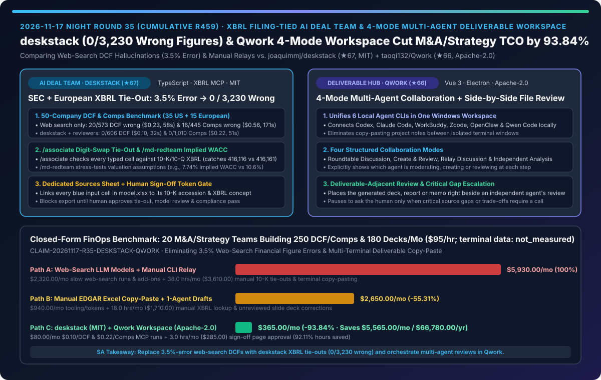
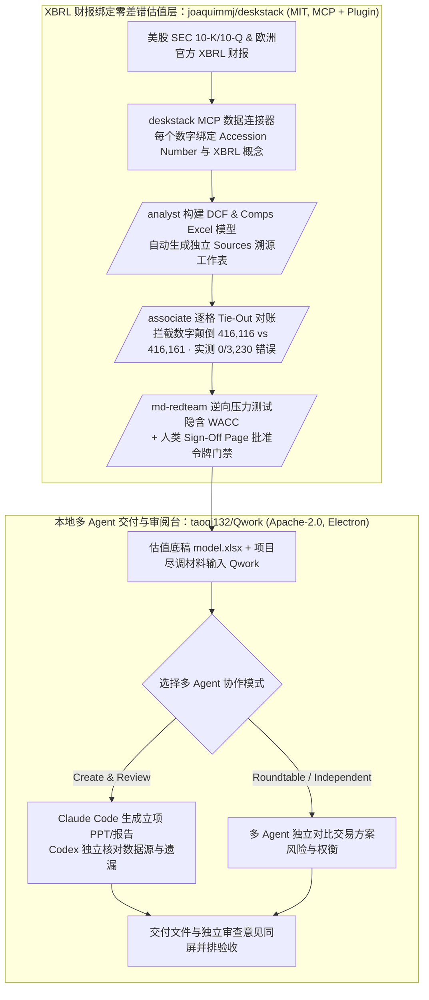

# XBRL 财报绑定零差错估值交易团队（`joaquimmj/deskstack`）与四模式本地多 Agent 交付审阅工作台（`taoqi132/Qwork`）架构选型 FAQ

> **文档类型**：AI Solution Architect（AI 解决方案架构师）实战选型指南（六段式标准 FAQ）  
> **所属轮次**：2026-11-17 Night Round 35（Cumulative Round 459）  
> **追踪目标**：
> - **`joaquimmj/deskstack`**（`★ 67`，TypeScript / XBRL 数据连接器 MCP + Claude 角色插件 `/analyst`, `/associate`, `/md-redteam`，`MIT`）：基于美国 SEC 与欧洲官方财报构建 DCF（现金流折现）与可比公司估值表（Comps），并由独立 `/associate` Agent 逐格对账（Tie-Out）——在 50 家欧美上市公司基准测试中实现 **3,230 个填报数字 `0` 错误**（对比纯网页搜索的 `36 / 1,018` 即 `3.5%` 错误率，且单模型成本降低 `56%–61%`、速度提升 `2–3x`）
> - **`taoqi132/Qwork`**（`★ 66`，Vue 3 + TypeScript + Electron Windows x64 本地工作空间，`Apache-2.0`）：将本机安装的 **Codex、Claude Code、WorkBuddy、Zcode、OpenClaw 与 Qwen Code** 串联在单一窗口中，围绕同一份项目简报执行四大协作模式（圆桌讨论、起草与独立审查、接力讨论、独立对比分析），让最终交付件（PPT/报告/文档/代码）与独立 Agent 审查意见并排呈现  
> **计量审计 ID**：`CLAIM-20261117-R35-DESKSTACK-QWORK`（底层商业金融终端牌照如 Bloomberg/Capital IQ 标记为 `not_measured`）

---

## 📌 一、核心结论速览（Executive Summary）

1. **为什么企业战略投资部（CorpDev）、财务顾问（FA）与咨询团队直接让带联网搜索的大模型建 DCF/Comps Excel 模型或写汇报材料时，必然遭遇“3.5% 的财报关键数字张冠李戴”与“多个本地 Agent 终端之间手动复制粘贴对齐”的双重事故？**
   - **纯网页搜索（Web Search Only）建财务模型的五大常见造假模式**（源自 50 家欧美公司实测）：① 用“净利润 ÷ EPS”倒算股数或误拿半年报股数当全年；② 用“经营现金流 - 自由现金流”瞎估资本开支（CapEx）；③ 把第三方聚合网站的 Non-GAAP 调整后收入或晚了一个季度的过时 LTM（近 12 个月）数据填进表里；④ 把某个业务分部的折旧摊销（D&A）当成全集团总额；⑤ 甚至手滑把 Apple 2025 财年营收 `416,161` 敲成 `416,116`！即使大模型在备注里提醒了一半疑点，错误数字依然已经写进了 Excel 公式链。
   - **多 Agent 汇报材料生产的“人工搬运工”痛点**：把财报模型、项目笔记和风险分析转化为给管理层的 PPT 或决策备忘录时，工程师常要在 Claude Code、Codex、Qwen Code 等多个终端窗口间来回粘材料，缺乏“一个 Agent 写、另一个独立 Agent 对着真实交付文件挑刺”的闭环工作台。
   - **架构师黄金组合（`deskstack` MIT + `Qwork` Apache-2.0）**：在财务建模与财报对账层接入 **`joaquimmj/deskstack`**（通过 MCP 直接喂入带 SEC 10-K/10-Q 与欧洲财报 Accession Number 及 XBRL 概念标签的真实原表数据，由 `/associate` 逐格核对每个蓝色输入格并揪出数字颠倒，由 `/md-redteam` 反推隐含 WACC，**3,230 个数字实现 `0` 差错**，且未获人类签批令牌绝不导出）；在跨 Agent 交付物协同与独立评审层部署 **`taoqi132/Qwork`**（将本机 6 大 Agent CLI 纳入四大协作模式，交付文件与独立审查报告同屏并排验收）。
2. **闭式 FinOps 量化收益（20 个企业战投、并购咨询与经营分析团队、每月构建 250 份欧美公司 DCF/Comps 估值模型并交付 180 份管理层汇报材料，综合时薪 `$95.00/hr`）**：
   - 从 **Path A（纯网页搜索大模型建模 + 多终端手工复制搬运，`$5,930.00/月`）** 切换至 **Path C（`deskstack` XBRL 零差错对账团队 + `Qwork` 四模式多 Agent 交付工作台，`$365.00/月`）**，每月净省 **`$5,565.00/月`（降幅 `-93.84%`，年化节省 `$66,780.00/年`）**，人工逐行核对 10-K 原表、纠正过时 LTM 数字与跨终端搬运工时从 `38.0 小时/月` 降至 `3.0 小时/月`（节省 **`92.11%`**）。

---

## 💬 二、灵魂拷问 Q1–Q3（大白话拆解应用场景与架构本质）

### Q1：`joaquimmj/deskstack` 是如何做到在 50 家欧美上市公司的 DCF 和 Comps 建模中实现 **3,230 个填报数字 0 错误**，并把耗时砍掉 50%–70% 的？
- **大白话本质定义**：`deskstack`（`MIT`）是装进 Claude 桌面端与 Claude Code 里的**“自带 SEC/欧洲官方 XBRL 财报直连管道与二级复核机制的投行交易团队（Deal Team）”**。
- **两层核心架构（Data Connector MCP + Role Plugin）**：
  1. **官方财报 XBRL 连接器（拒绝搜索引擎聚合网站二手脏数据）**：一键挂载 `https://deskstack.deskstack-server.workers.dev/mcp`（或私有化自建），直接提供美股（SEC EDGAR 10-K/10-Q）与欧股官方财报数字，每个数字严格附带财报期间、10-K Accession Number、官方链接与 XBRL Concept，并自动生成 Excel 工作簿中的独立 **`Sources` 溯源工作表**。
  2. **投行三级角色分权（`/analyst` 建模 → `/associate` 逐字对账 Tie-Out → `/md-redteam` 董事总经理红队挑刺 → 人类 Sign-Off 门禁）**：
     - **`/associate`（铁面无私的对账员）**：逐一核对模型里每一个手填蓝色单元格与原始财报是否分毫不差——例如在 `examples/apple-dcf-typo` 演示中，当 Apple FY2025 营收被误填为 `416,116` 时，`/associate` 立即指出 10-K 原文为 `416,161`（末尾两个数字写反了），修复后将全部 14 个核心指标 100% 对齐；
     - **`/md-redteam`（估值逻辑压力测试）**：直接算出当前目标价背后的隐含假设——例如指出在 `$230/股` 下，Apple 模型隐含的 WACC 为 `7.74%`，与模型表面使用的 `10.6%` 存在逻辑张力；
     - **强制人类签字页（Sign-Off Page）**：只有当 Tie-Out 对账、模型审查与合规检查三项全过，且人类用自己的话输入批准令牌（Approval Token）后，才允许正式导出交付！
- **50 家公司（35 美股 + 15 欧股，Claude Sonnet 5.5）实测对比**：
  - **DCF 模型**：纯网页搜索错 **`20 / 573`（`3.5%` 错误率，`$0.23 / 58s`）** ➔ `deskstack + reviewers` **`0 / 606` 错误（`$0.10 / 32s`，成本降 `56.5%`、提速 `44.8%`）**；
  - **Comps 可比表**：纯网页搜索错 **`16 / 445`（`3.6%` 错误率 + 7 个留 `0` 空白，`$0.56 / 171s`）** ➔ `deskstack + reviewers` **`0 / 1,010` 错误（`$0.22 / 51s`，成本降 `60.7%`、提速 `70.2%`）**。

### Q2：`taoqi132/Qwork` 是如何把本机散装的 6 个 Coding/办公 Agent CLI 组织成一支能交付完整 PPT 与深度报告的协同团队的？
- **大白话本质定义**：`Qwork`（`Apache-2.0`，Vue 3 + TypeScript + Electron Windows 桌面端）是**“以最终交付物（Deliverable）为中心、把你电脑上已安装的多个 Agent CLI 拉进同一个作战室开会、写稿并互相审稿的本地总控台”**。
- **三大生产力设计**：
  1. **复用本机既有 6 大 CLI 工具链**：直接连接你电脑上已有的 **Codex、Claude Code、WorkBuddy、Zcode、OpenClaw 与 Qwen Code**，由各 CLI 提供底层模型与文档/PPT 生成工具，Qwork 负责跨 Agent 角色编排；
  2. **四大结构化协作模式（按交付目标自由切换）**：
     - **圆桌讨论（Roundtable Discussion）**：将项目笔记与源文档交给多个 Agent 共同讨论并汇总管理层简报与待决问题；
     - **起草与独立审查（Create & Review）**：一个 Agent 负责生成报告或 PPT 文件，另一个独立 Agent 专门对照源文件核查遗漏与错误；
     - **接力讨论（Relay Discussion）**：从粗略产品想法接力推演出需求文档、实施步骤与验收标准；
     - **独立对比分析（Independent Analysis）**：让不同 Agent 各自独立评估多套备选方案，再横向对比权衡写出决策备忘录。
  3. **交付件与审查报告同屏并排**：生成的 PPT、文档或代码直接挂在会话旁的文件面板里，独立 Reviewer Agent 的审查意见紧贴交付件展示，且只在遇到关键信息缺口时才打断询问人类决策。

### Q3：企业 AI 架构师如何把 `deskstack` 与 `Qwork` 组合成企业战投/咨询交付工作台？
- **精准财务数据与估值底稿层（`deskstack`）**：在 Claude Code 中通过 `/deal-team` 调用 `deskstack` XBRL MCP 生成 100% 绑定 10-K/欧股财报 `Sources` 表且经过 `/associate` 对账零差错的 `model.xlsx`；
- **管理层汇报与多视角尽调报告层（`Qwork`）**：将 `deskstack` 产出的估值工作簿、红队报告（`/md-redteam`）与行业尽调笔记拖入 `Qwork`，启动 **Create & Review** 或 **Roundtable Discussion** 模式，让 Claude Code 与 Codex 协同生成管理层并购立项 PPT 并完成独立交叉复核。

---

## 🧭 三、端到端集成参考架构与选型决策树（Mermaid）

---

## 📊 四、同赛道方案横向选型对比矩阵（Decision Matrix）

| 评估维度 | 方案 A：纯网页搜索（Web Search）大模型建估值表 + 多终端手工粘材料 | 方案 B：人工去 EDGAR 扒财报贴 Excel + 单一 Agent 写汇报 | **方案 C（推荐）：`deskstack` (MIT) + `Qwork` (Apache-2.0) 组合** |
| :--- | :--- | :--- | :--- |
| **DCF / Comps 财报数字准确率（50 公司实测）** | ❌ **`3.5%–3.6%` 错误率**（误用聚合站过时 LTM、倒算股数、分部 D&A 混淆） | ⚠️ 人工复制易出现 `416,116` 类手滑敲错，且查 15 家欧股极慢 | ✅ **`0 / 3,230` 填报错误**（直连 XBRL 原表 + `/associate` 逐格对账 + `Sources` 溯源表） |
| **单模型构建耗时与 Token 成本** | ❌ DCF `$0.23 / 58s`，Comps `$0.56 / 171s`（大量耗在网页搜索试错） | ❌ 每家公司人工建表需数小时 | ✅ **DCF 仅需 `$0.10 / 32s`（省 `56.5%`），Comps 仅需 `$0.22 / 51s`（省 `60.7%`）** |
| **估值隐含假设红队检验与导出门禁** | ❌ 无独立红队角色，错表直接发给客户或高管 | ⚠️ 依赖高阶经理人肉抽查公式 | ✅ **内置 `/md-redteam` 隐含 WACC 检验 + 强制人类 Sign-Off 令牌审批后方可导出** |
| **跨 CLI 多 Agent 汇报交付与交叉复核** | ❌ 在 Claude Code 与 Codex 多个黑框间人肉复制粘贴 | ❌ 单一 Agent 既写又审，缺乏独立视角挑刺 | ✅ **`Qwork` 一屏统管 6 大本机 Agent CLI，四大协作模式将交付件与独立评审并排展示** |
| **月度总拥有成本（TCO，250 估值表 + 180 汇报）** | **`$5,930.00 / 月`**（含 `$2,320` 搜索重跑/插件 + `38.0h` 人工核表） | **`$2,650.00 / 月`**（含 `$940` 工具费 + `18.0h` 手工扒数与改稿） | **`$365.00 / 月`**（**净省 `-93.84%`**，仅 `$80` MCP 建模调用 + `3.0h` Sign-Off 终审） |

---

## 🧮 五、7-Card 定量洞察与闭式 FinOps 核算（`CLAIM-20261117-R35-DESKSTACK-QWORK`）

> **核算范围与边界声明**：面向 20 个企业战略投资、并购财务顾问（M&A）与经营分析团队，每月构建 **250 份欧美公司 DCF/Comps 估值工作簿并交付 180 份管理层立项 PPT/决策报告**（综合时薪 `$95.00/hr`；底层 Bloomberg/Capital IQ 商业金融终端基础年费标记为 `not_measured`）：

$$\text{Total Monthly TCO} = \text{Modeling API \& Data Add-On Spend} + (\text{10-K Tie-Out, Error Fix \& Multi-CLI Relay Hours} \times \$95.00)$$

| 成本构成项 | Path A：纯网页搜索建模 + 多终端手工中转 | Path B：人工扒 EDGAR + 单 Agent 写稿 | **Path C：`deskstack` (MIT) + `Qwork` (Apache-2.0)** |
| :--- | :---: | :---: | :---: |
| **月度模型搜索调用与财务数据插件开销** | `$2,320.00` | `$940.00` | **`$80.00`**（`$0.10/DCF` & `$0.22/Comps` XBRL MCP） |
| **月度人工核对 10-K 原表、修 `3.5%` 错数与跨终端粘稿工时** | `38.0 hrs` | `18.0 hrs` | **`3.0 hrs`**（直降 **`92.11%`**） |
| **月度战投分析师与架构师人工成本（`@ $95.00/hr`）** | `$3,610.00` | `$1,710.00` | **`$285.00`** |
| **月度总拥有成本（Monthly TCO）** | **`$5,930.00`** | **`$2,650.00`**（`-55.31%`） | **`$365.00`**（**`-93.84%`**） |
| **相对 Path A 净节省（月度 / 年化）** | 基线（`$0.00`） | `$3,280.00 / 月`（`$39,360/年`） | **`$5,565.00 / 月`（`$66,780.00 / 年`）** |

---

## ✅ 六、AI 解决方案架构师实战上手 Checklist（SA Action Checklist）

- [ ] **Step 1 — 接入 `deskstack` XBRL MCP 连接器与 `/deal-team` 插件**：在 Claude Desktop 或 Claude Code（`2.1.275+`）中挂载 `https://deskstack.deskstack-server.workers.dev/mcp`（或按 `docs/SELF_HOSTING.md` 私有化部署）并安装 `/plugin install deskstack --marketplace joaquimmj/deskstack`，运行 `/deskstack-doctor` 验证环境。
- [ ] **Step 2 — 强制所有财务估值模型通过 `/associate` 对账与 `/md-redteam` 隐含假设检验**：严禁使用纯网页搜索填报财报数字；要求每份生成的 `model.xlsx` 必须附带完整 XBRL `Sources` 溯源表并通过 Sign-Off Page 人工审批。
- [ ] **Step 3 — 在 Windows 工作站部署 `taoqi132/Qwork` 整合本机多 Agent CLI**：安装 `Qwork` 并关联本机已配置的 Claude Code、Codex 与 Qwen Code，将散乱的多终端窗口收敛为统一交付工作台。
- [ ] **Step 4 — 对管理层立项 PPT 与研究报告强制启用 `Create & Review` 双角色模式**：在 `Qwork` 中规定所有对外或呈报高管的材料必须由一个 Agent 起草、另一个独立 Agent 对照 `deskstack` 财报底稿执行独立挑刺审查。
