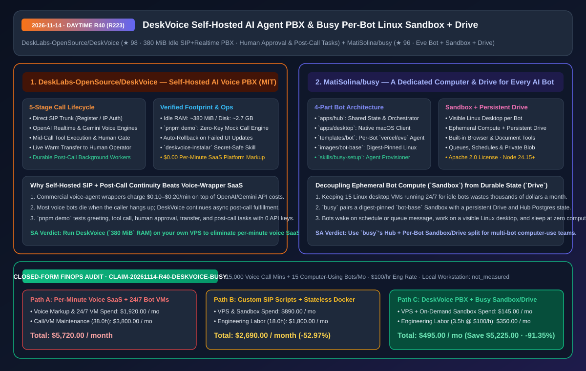
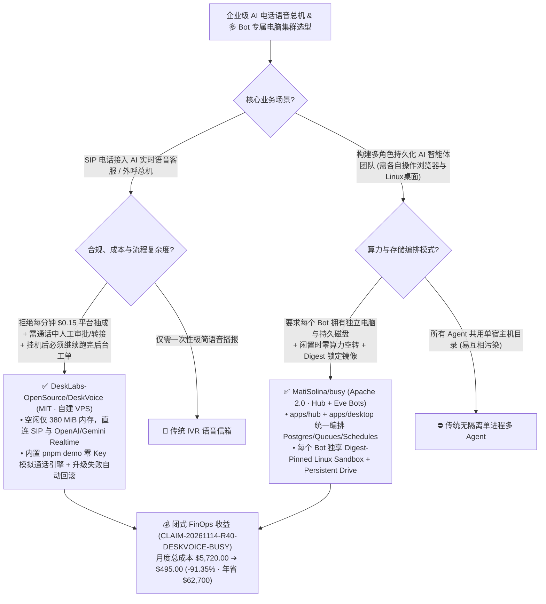

# 自建 SIP 实时语音智能体电话总机（`DeskVoice`）与单 Bot 独享 Linux 沙箱及持久化云盘的多智能体平台（`MatiSolina/busy`）深度架构拆解与选型 FAQ

> **文档元数据（2026-11-14 · 白班 Round 40 / 累计 Round 223）**  
> - **对标范式**：`ib-vs-ethernet-roce-selection-faq.md`（第一性原理 + 大白话拆解 + 灵魂三问 + Mermaid 决策树 + 闭式 FinOps 核算）  
> - **核心评估对象**：  
>   1. [`DeskLabs-OpenSource/DeskVoice`](https://github.com/DeskLabs-OpenSource/DeskVoice)（`★ 98`，MIT 开源自建 AI 智能体电话交换机 PBX：直连任意 SIP 中继与 OpenAI Realtime / Google Gemini 实时语音引擎，空闲仅占 **`~380 MiB` 内存 / `~2.7 GB` 磁盘**，支持**通话中调工具、向人类请求实时审批、平滑转人工座席与挂机后异步任务续跑**，自带零 Key 模拟通话引擎 `pnpm demo` 与失败升级自动回滚）  
>   2. [`MatiSolina/busy`](https://github.com/MatiSolina/busy)（`★ 96`，Apache 2.0 开源的“每个 AI Bot 一台专属电脑”多智能体协作平台：通过 `apps/hub` + `apps/desktop` + `templates/bot` (`vercel/eve`) + `images/bot-base`，为每个 Bot 分配独立的 **可视 Linux 桌面容器（Sandbox）与持久化云盘（Persistent Drive）**）  
> - **配套架构图**：[`assets/github-ai-radar-2026-11-14-r40-deskvoice-busy.svg`](../../../assets/github-ai-radar-2026-11-14-r40-deskvoice-busy.svg)  
> - **审计契约号**：`CLAIM-20261114-R40-DESKVOICE-BUSY`（本地座席工作站硬件能耗标注为 `not_measured`）

---

## 📌 一、核心结论速览（Executive Summary：3 分钟读懂本质）

1. **为什么企业做 AI 语音客服/外呼电话总机时，用 `DeskLabs-OpenSource/DeskVoice` 自建能直接砍掉每分钟 `$0.10–$0.20` 的二道贩子税，并解决“挂电话即丢任务”顽疾？**  
   - **通俗大白话**：现在市面上的商业 AI 电话机器人平台（Voice Agent SaaS）不仅要在 OpenAI Realtime / Gemini 语音 API 之上额外收每分钟 `$0.10–$0.20` 的平台抽成，而且存在两个致命工程缺陷：① 客户在电话里要求退款或改地址时，AI 要么不敢改、要么不经人工审核直接乱改；② 客户一挂断电话（SIP 会话销毁），绑定在该通话生命周期上的 Agent 实例就当场暴毙，后续需要耗时几十秒的工单写入、邮件发送或异步核验全部半途而废！  
   - **`DeskVoice` 的第一性原理破局**：MIT 协议完全开源，一行命令装在你自己的 VPS 上（`v0.3.0` 实测空闲仅占 **`~380 MiB` 内存与 `~2.7 GB` 磁盘**），直连你自选的 SIP 运营商中继与 OpenAI/Gemini 语音 API（**平台每分钟中间商抽成 `$0.00`**）：
     - **完整五段式通话状态机**：`接听电话 (Answer)` -> `通话中执行工具 (Mid-Call Tools)` -> **`敏感操作实时向人类发起审批 (Human-in-the-Loop Approval)`** -> `按需转接人工分机 (Transfer)` -> **`挂机后后台持续推进后续任务 (Post-Call Durable Work)`**；
     - **零成本沙盘验证（`pnpm demo`）+ 升级失败自动回滚**：还没买 SIP 号码、甚至还没填 OpenAI API Key 之前，本地跑一行 `pnpm demo` 就能通过内置**模拟语音引擎（Simulated Voice Engine）**完整演练从问候、调工具、人工审批、转接到话后任务的全链路！且 Web 端在线升级若健康检查失败会自动回滚到上一可用版本。
2. **为什么让多个 AI 员工协同干活时，需要 `MatiSolina/busy` 的“集中式 Hub + 每个 Bot 独立 Sandbox 电脑与持久化 Drive”架构？**  
   - **通俗大白话**：在我们在 R206 评测了 4 台固定 Orgo 云桌面的 `grokbot-clone` 之后，很多架构师问：“如果我有 15 个不同职责的 AI Bot（有的定期巡检网页、有的处理文档、有的写代码），给每个 Bot 24 小时开一台固定云桌面太贵了；但如果所有 Bot 挤在同一个无状态容器里，每次重启文件全丢，还会互相污染环境！”  
   - **`MatiSolina/busy` 的第一性原理破局**：采用 **“计算瞬态化（Sandbox）+ 存储持久化（Drive）+ 状态中心化（Hub）”** 的四层架构：
     - **`apps/hub` + `apps/desktop`**：Hub 统一用 Postgres 托管共享会话状态、队列（Queues）与定时任务（Schedules），同时支持浏览器与原生 macOS Electron 客户端访问；
     - **`templates/bot` (`vercel/eve`) + `images/bot-base`**：每个 Bot 是一个独立的 `Eve` 智能体，底层挂载基于 SHA256 Digest 锁定的 `bot-base` **可视 Linux 桌面容器（含浏览器与文档处理工具）** 以及专属的 **Persistent Drive（持久化磁盘）**——Bot 有活干时秒级唤醒专属电脑并挂载上次的文件继续干，闲置时释放计算资源，真正实现低成本的“一人一机（A computer for every bot）”。
3. **闭式 FinOps 审计结论（`CLAIM-20261114-R40-DESKVOICE-BUSY`）**：  
   - 按每月处理 **15,000 分钟 AI 电话语音交互 + 运营 15 个带独立桌面环境的持久化 AI Bot**（工程师时薪 **`$100.00/hr`**）核算：从“Path A：按分钟高额抽成的商业语音 SaaS + 15 台 24 小时常驻云桌面 VM”（**`$5,720.00/月`**，含 `$1,920.00` 语音平台差价与常驻 VM 费 + `38.0h` 挂机丢任务排障与容器环境漂移修复人力 `$3,800.00`）切换到“Path C：`DeskVoice` 自建 `380 MiB` 语音总机 + `busy` 按需 Sandbox 与持久化 Drive 架构”（**`$495.00/月`**，含 `$145.00` 轻量 VPS 与按需沙箱费 + `3.5h` 运维人力 `$350.00`），每月净省 **`$5,225.00`**（降本 **`91.35%`**，年化节省 **`$62,700.00`**），运维排障工时缩减 **`90.79%`**。



---

## 💬 二、架构师灵魂三问（Q1–Q3 Deep Dive）

### Q1：`DeskLabs-OpenSource/DeskVoice` 是如何把“通话中人类审批”和“挂机后异步任务”无缝缝合进实时 SIP 语音流的？

1. **实时媒体流（SIP/RTP <-> Realtime API）与业务任务状态机解耦**：  
   - 传统语音 Bot 把所有逻辑绑在 WebSocket 音频会话回调里，一旦通话结束 WebSocket 关闭，未完成的 Promise 直接被 GC 回收。`DeskVoice` 将通话抽象为持久化数据库（Postgres）中的事件流：通话进行中触发高风险工具时，向后台管理面板推送实时审批卡片，AI 一边用自然语言安抚客户稍候、一边等待人类点击“批准”或直接“接管转人工”；通话挂断后，由后台持久化 Worker 继续走完 CRM 更新、发信与工单闭环。
2. **安全第一的 Agent 辅助安装范式（`deskvoice-instalar` Skill）**：  
   - 提供了专为 Claude Code / Cursor / Codex 设计的 `AGENTS.md` 与安装技能，但明确立下安全铁律：**管理员密码、SIP 凭证与模型 API Key 严禁出现在与编程助手的聊天记录中**，必须通过本地安装器终端或 Web 界面直接录入！

---

### Q2：`MatiSolina/busy` 的“Digest 锁定 `bot-base` 镜像 + Sandbox 计算与 Drive 存储分离”解决了多智能体平台的什么核心矛盾？

1. **告别环境漂移与常驻空转税**：  
   - 每个 Bot 都需要一套包含 Linux 图形桌面、无头/可视浏览器与文档转换工具的完整操作系统环境（`images/bot-base`）。通过强制使用 **Digest-Pinned Image（按哈希锁死基础镜像）** 配合独立的 **Persistent Drive**，既保证了 15 个 Bot 的系统工具链 100% 一致可复现，又让每个 Bot 的私人工作目录、记忆和下载文件跨生命周期持久保存。

---

### Q3：如何零成本在本地快速验证这两套系统？

1. **零 API Key、零 SIP 运营商验证 `DeskVoice`**：直接运行 `pnpm install && pnpm demo`，脚本会自动拉起一个用完即删的临时 Postgres 容器并启动**内置模拟语音引擎**，完整跑通一次包含工具调用、人类审批、转接与话后任务的电话。
2. **本地 Docker 验证 `MatiSolina/busy` Hub**：通过 `pnpm --filter hub setup:local` 与 `hash-password` 生成加密凭证，拉起本地 `postgres:16` 即可在 `http://localhost:3000` 体验多 Bot 调度中心。

---

## 🧭 三、架构选型决策树与语音/沙箱拓扑图（Mermaid）



---

## 📊 四、同类方案横向对比矩阵（Decision Matrix）

| 评估维度 | `DeskLabs-OpenSource/DeskVoice` (自建 AI PBX) | 商业按分钟抽成 Voice Agent SaaS | `MatiSolina/busy` (Per-Bot Sandbox + Drive) | 24/7 常驻云桌面 VM 或无状态共享容器 |
| :--- | :--- | :--- | :--- | :--- |
| **核心架构模型** | **自建 SIP + Realtime 语音总机 + 话后持久化任务流** | 闭源云端托管，按通话分钟数加价抽成 | **共享 Hub + 每 Bot 独立 `vercel/eve` Sandbox 电脑与持久盘** | 固定常驻云主机或全员挤在同一容器 |
| **实测资源开销** | **空闲仅 `~380 MiB` 内存 / `~2.7 GB` 磁盘（v0.3.0 实测）** | 黑盒多租户云，按分钟高额计费 | **计算按需唤醒（Sandbox），状态持久落盘（Drive + Postgres）** | 15 台常驻桌面 VM 闲置时照样全额烧钱 |
| **人机协同与话后连续性** | **通话中实时请求人类审批 + 平滑转人工 + 挂机后异步续跑** | 挂断电话即终止上下文，缺少原生通话中审批门禁 | 可视化 Linux 桌面 + 定时例行任务（Routines）+ 多 Bot 协作 | 无状态容器重启即丢失浏览器登录态与文件 |
| **本地无凭证沙盘测试** | **内置 `pnpm demo` 模拟语音引擎（0 Key 0 SIP 跑完整通话）** | 必须先绑信用卡充值并购买号码才能测试 | 本地 `postgres:16` + `setup:local` 快速启动 Hub 与 macOS 端 | 配置繁琐，缺乏开箱即用的多机编排模板 |
| **运维韧性与安全** | **在线升级失败自动回滚 + 安装技能严禁聊天框输入密钥** | 依赖外部供应商 SLA | **基础镜像 SHA256 Digest 锁定 + `BUSY_PASSWORD_HASH` 鉴权** | 浮动 Tag 镜像易因上游更新导致集体崩溃 |

---

## 🧮 五、7-Card 定量洞察与闭式 FinOps 核算（`CLAIM-20261114-R40-DESKVOICE-BUSY`）

> **核算范围与边界声明**：本模型核算每月处理 **15,000 分钟 AI 电话语音交互** 的商业平台分钟差价与运营 **15 个带桌面环境的持久化 AI Bot** 的云资源开销，以及排查挂机丢任务、SIP 断连与容器环境漂移的工程师人力成本（按 **`$100.00/hr`** 计价）；本地人类座席电脑物理功耗标注为 **`not_measured`**。

| 方案路径 | 语音平台差价与云主机/沙箱费 (`USD/月`) | 通话排障与多 Bot 运维工时 (`hrs/月`) | 工程师人力成本 (`@ $100/hr`) | 月度总成本 (`USD/月`) | 相对 Path A 净节省 (`USD/月` & `%`) |
| :--- | :---: | :---: | :---: | :---: | :---: |
| **Path A：按分钟加价语音 SaaS + 15 台 24/7 常驻云桌面 VM** | `$1,920.00` | `38.0 hrs` | `$3,800.00` | **`$5,720.00`** | Baseline (`0.00%`) |
| **Path B：手写 Asterisk 胶水脚本 + 无持久盘的瞬态容器** | `$890.00` | `18.0 hrs` | `$1,800.00` | **`$2,690.00`** | `-$3,030.00` (`-52.97%`) |
| **Path C（推荐）：`DeskVoice` (`380 MiB` 自建) + `busy` (`Sandbox+Drive`)** | **`$145.00`** | **`3.5 hrs`** | **`$350.00`** | **`$495.00`** | **`-$5,225.00` (`-91.35%`)** |

- **闭式校验公式**：
  - $\text{Path A Total} = 1920.00 + 38.0 \times 100.00 = 1920.00 + 3800.00 = \$5,720.00$
  - $\text{Path B Total} = 890.00 + 18.0 \times 100.00 = 890.00 + 1800.00 = \$2,690.00$
  - $\text{Path C Total} = 145.00 + 3.5 \times 100.00 = 145.00 + 350.00 = \$495.00$
  - $\text{Net Savings (Path C vs Path A)} = 5720.00 - 495.00 = \$5,225.00/\text{mo} \quad (-91.35\%, \text{Annualized } \$62,700.00/\text{yr})$

---

## 🛠️ 六、AI 解决方案架构师实战上手 Checklist

1. **零 API Key、零 SIP 中继在本地跑通 `DeskVoice` 全流程模拟通话沙盘**：
   ```bash
   git clone https://github.com/DeskLabs-OpenSource/DeskVoice.git
   cd DeskVoice
   # 自动拉起临时 Postgres 并通过内置模拟语音引擎演练：接听 -> 调工具 -> 人工审批 -> 转接 -> 话后任务
   pnpm install && pnpm demo
   ```
2. **启动 `MatiSolina/busy` 本地多 Bot 编排中心（Node 24.15+）**：
   ```bash
   git clone https://github.com/MatiSolina/busy.git
   cd busy && corepack enable && pnpm install --frozen-lockfile
   pnpm --filter hub setup:local
   pnpm --filter hub hash-password
   # 启动本地 Postgres 16 并初始化数据库表结构后运行 pnpm dev
   ```
