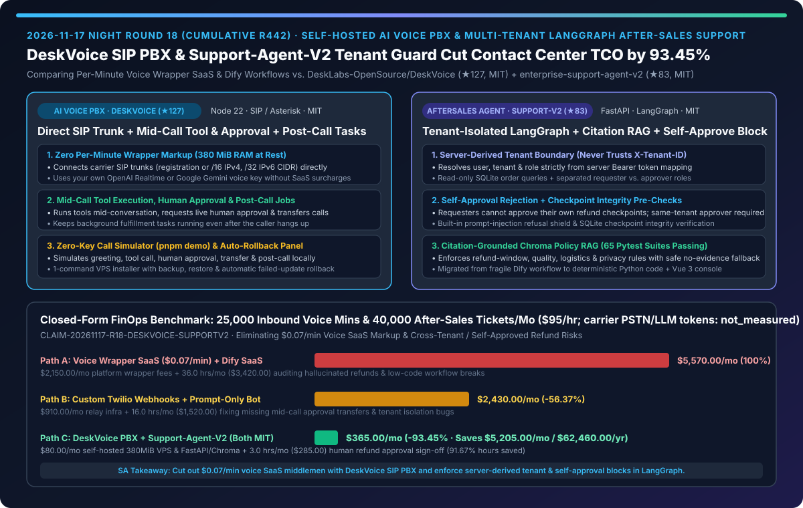
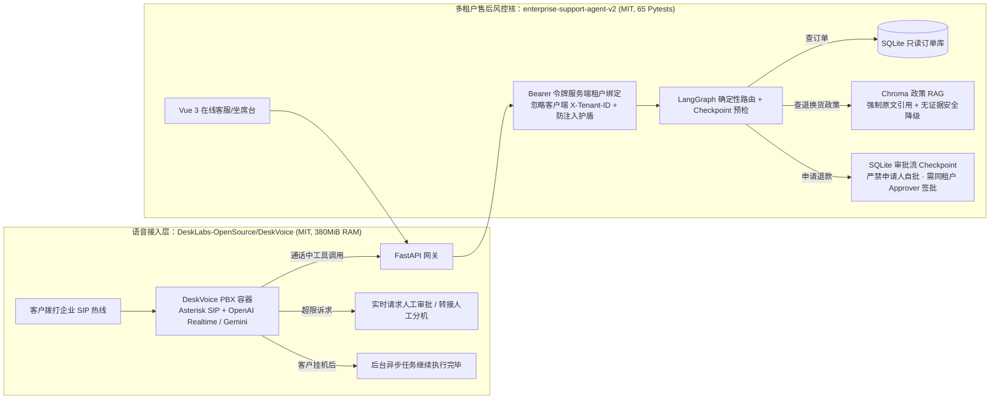

# 私有化 SIP 语音客服总机（`DeskLabs-OpenSource/DeskVoice`）与多租户权限隔离售后 LangGraph 客服系统（`KaelLee335/enterprise-support-agent-v2`）架构选型 FAQ

> **文档类型**：AI Solution Architect（AI 解决方案架构师）实战选型指南（六段式标准 FAQ）  
> **所属轮次**：2026-11-17 Night Round 18（Cumulative Round 442）  
> **追踪目标**：
> - **`DeskLabs-OpenSource/DeskVoice`**（`★ 127`，Node 22 / SIP / Asterisk / OpenAI Realtime & Gemini / Docker，`MIT`）：可一键私有化部署在企业自有 VPS 上的开源 AI 语音电话交换机（PBX），支持直接对接运营商 SIP 中继、通话中调工具、实时请求人工审批、转接人工座席以及挂机后继续异步跑完后台工单任务（静息内存仅 `~380 MiB`）
> - **`KaelLee335/enterprise-support-agent-v2`**（`★ 83`，Python 3.12 / FastAPI / SQLite / LangChain RAG / Chroma / LangGraph / Vue 3，`MIT`）：从 Dify 低代码工作流迁移至确定性代码实现的企业售后客服全栈参考架构（65 项 Pytest 通过），内置服务端租户身份绑定（绝不信任客户端 `X-Tenant-ID`）、有据可查的政策 RAG（无证据安全降级）、SQLite 只读订单与**严禁自批（Self-Approval Rejection）**的退款双人审批流  
> **计量审计 ID**：`CLAIM-20261117-R18-DESKVOICE-SUPPORTV2`（基础运营商 PSTN 话费与底层大模型实时音频 Token 原价直付标记为 `not_measured`）

---

## 📌 一、核心结论速览（Executive Summary）

1. **为什么企业在落地“AI 电话语音客服 + 售后退换货智能体”时，用商业语音封装平台（Vapi / Bland / Retell）配低代码拖拽画布（Dify）会在规模化阶段撞上成本与风控高墙？**
   - **痛点一（每分钟 `$0.05–$0.09` 的商业语音中间商抽成 + 挂机即断）**：商业 AI 语音 SaaS 在运营商 SIP 话费与 OpenAI/Gemini 语音 Token 之外，额外按分钟收取高昂的平台通道费（2.5 万分钟/月光平台差价就高达 `$1,750/月`），且通话一旦挂断后续任务容易丢失。
   - **痛点二（低代码画布难做硬核租户隔离、退换货政策幻觉与越权自批）**：用无状态低代码工作流搭建售后客服时，极易出现客户端伪造 `X-Tenant-ID` 越权查他人订单、大模型无证据瞎编“支持无理由全额退”政策、或同一个角色既发起退款又自己批准退款的内控漏洞。
   - **架构师黄金组合（`DeskVoice` + `enterprise-support-agent-v2`，双 `MIT`）**：前端语音接入层部署 **`DeskLabs-OpenSource/DeskVoice`**（直接绑定企业 SIP 中继与自有 OpenAI Realtime / Gemini 密钥，抹平中间商按分钟加价，支持通话中调工具、呼叫人工审批、转接与挂机后异步作业，静息仅占 `380 MiB` 内存）；后端售后履约与文本工单层采用 **`KaelLee335/enterprise-support-agent-v2`**（从 Dify 演进为 FastAPI + LangGraph 确定性状态机 + Chroma 政策证据 RAG + SQLite Checkpoint 完整性预检 + 强制“申请人与审批人角色分离”）。
2. **闭式 FinOps 量化收益（月均 25,000 分钟呼入语音客服 + 40,000 次多租户售后查单与退款审批工单，工程师综合时薪 `$95.00/hr`）**：
   - 从 **Path A（商业语音封装 SaaS `$0.07/min` 差价 + 低代码工作流托管席位，`$5,570.00/月`）** 切换至 **Path C（`DeskVoice` 私有化 SIP 总机 + `enterprise-support-agent-v2` 多租户 LangGraph 售后底座，`$365.00/月`）**，每月净省 **`$5,205.00/月`（降幅 `-93.45%`，年化节省 `$62,460.00/年`）**，越权漏洞修复、错误退款追回与低代码排障工时从 `36.0 小时/月` 降至 `3.0 小时/月`（节省 **`91.67%`**）。

---

## 💬 二、灵魂拷问 Q1–Q3（大白话拆解应用场景与架构本质）

### Q1：`DeskLabs-OpenSource/DeskVoice` 是什么？它和直接调 OpenAI Realtime API 或购买商业 AI 外呼 SaaS 有什么核心区别？
- **大白话本质定义**：`DeskVoice` 是装在企业自己服务器（VPS）上的**“开源 AI 程控电话交换机（PBX）”**。你只需要一条命令安装（静息仅占 `~380 MiB` 内存、`~2.7 GB` 磁盘，支持 x86_64 与 arm64），在网页后台配好运营商的 SIP 中继号码（支持账号注册或 IP 白名单 `/16` IPv4、`/32` IPv6）和 OpenAI Realtime / Google Gemini 密钥，就能立即接听真实客户来电。
- **四大企业级实战特性**：
  1. **零中间商按分钟抽成**：直接连接你的运营商 SIP 与大模型 API，省掉商业语音 Agent 平台每分钟 `$0.05–$0.09` 的通道溢价；
  2. **边聊边办 + 实时请示人类 + 挂机后继续干活**：Agent 在和客户通话过程中实时调用后台业务工具；遇到高风险请求（如超额赔付）可在通话中向人类主管发起审批或平滑转接人工分机；**即使客户挂断电话，未跑完的后台工单任务仍会继续异步执行完毕**；
  3. **零密钥/零运营商本地模拟器（`pnpm demo`）**：无需真实 SIP 线路和 API Key，本地一条 `pnpm demo` 即可完整模拟“问候 → 调工具 → 请求人工审批 → 转接 → 挂机后任务”全流程；
  4. **生产级自愈安装器**：Web 面板支持一键备份、恢复，且升级失败时自动回滚（Automatic Rollback）至上一可用版本。

### Q2：为什么 `KaelLee335/enterprise-support-agent-v2` 的作者要把售后 Agent 从 Dify 低代码画布迁移回 FastAPI + LangGraph 纯代码架构？
- **低代码画布在企业售后深水区的三大痛点**：当售后场景涉及**多租户数据边界**、**严格退款时限/质量证据核验**以及**财务内控职责分离（SoD）**时，拖拽式工作流很难做单元测试、很难防客户端 Header 伪造，也无法对状态机 Checkpoint 做加密完整性预检。
- **`enterprise-support-agent-v2` 的四大硬核内控设计（全量 65 项 Pytest 自动化验证通过）**：
  1. **服务端强制租户绑定（绝不信任 `X-Tenant-ID`）**：服务端严格从 `Authorization: Bearer <token>` 解析用户、所属租户（如 `demo-a` vs `legacy-demo`）与角色，彻底杜绝通过篡改请求头跨租户查他人订单；
  2. **申请人与审批人强制分离（Self-Approval Rejection）**：订单表强制设为只读；当发起退款申请写入 SQLite Checkpoint 后，**发起人自己绝对无法调用审批接口通过自己的退款单**，必须由同租户下具备审批人角色（`approver`）的另一账号完成批准或驳回；
  3. **有据可查的政策 RAG 与无证据安全降级（Chroma + Qwen）**：针对退款时限、质量问题、物流异常和隐私边界检索政策条款，强制附带政策来源引用与原文证据；若检索无匹配证据则触发安全降级拒答，绝不胡乱承诺赔偿；
  4. **提示词注入护盾与 Checkpoint 完整性预检**：内置 Prompt Injection 拒答规则、SQLite Checkpoint 完整性预检、5 章源码导读与故障案例库（Fault Case Library）。

### Q3：企业 AI 架构师如何把 `DeskVoice` 与 `enterprise-support-agent-v2` 集成为全渠道（电话 + 在线）售后客服中心？
- **语音入口层（`DeskVoice`）**：接听 400/SIP 客服热线，通过实时语音引擎提取客户诉求，并将工具调用（Tool Call）转发给后端的 `enterprise-support-agent-v2` FastAPI 接口（`/orders/{order_id}`、`/chat`）；
- **统一业务与风控底座（`enterprise-support-agent-v2` + Vue 3 坐席台）**：由 LangGraph 统一执行租户隔离校验、Chroma 政策 RAG 核验与退款 Checkpoint 挂起；当需要主管审批时，同时推送到 `DeskVoice` 话务台与 Vue 3 售后审批中心，由独立审批人一键签批。

---

## 🧭 三、端到端集成参考架构与选型决策树（Mermaid）

---

## 📊 四、同赛道方案横向选型对比矩阵（Decision Matrix）

| 评估维度 | 方案 A：商业语音 Agent SaaS（`$0.07/min` 差价）+ Dify 低代码工作流 | 方案 B：自写 Twilio 裸 Webhook + 单纯 Prompt 客服 Bot | **方案 C（推荐）：`DeskVoice` + `enterprise-support-agent-v2`（双 MIT）** |
| :--- | :--- | :--- | :--- |
| **语音通道费率与私有化控制力** | ❌ 除运营商与模型费外，额外收取 `$0.05–$0.09/分钟` 平台抽成 | ⚠️ 需自行维护复杂 WebSocket 音频流与重连逻辑 | ✅ **自有 VPS 一键部署（静息 `380 MiB` 内存），直连 SIP 中继与模型 API，`$0` 平台抽成** |
| **通话中人工协同与挂机后任务续航** | ⚠️ 挂机即销毁会话上下文，通话中穿插人工审批配置繁琐 | ❌ 挂机即断开进程，无内置模拟器（需烧真钱调号测试） | ✅ **原生支持通话中调工具、请求人工审批、转接分机及挂机后异步任务，内置 `pnpm demo` 零成本模拟** |
| **多租户隔离与防自批财务内控（SoD）** | ⚠️ 低代码画布常直接透传客户端 Header，缺乏细粒度自批拦截 | ❌ 靠 Prompt 软约束，极易被提示词注入诱导越权退款 | ✅ **服务端强制解析租户、只读订单查询、Checkpoint 完整性预检与强制拒绝申请人自批** |
| **售后政策问答准确性与可测试性** | ⚠️ 缺乏代码级契约测试，工作流改动后易发生隐性退化 | ❌ 容易无证据乱承诺退换货时限 | ✅ **Chroma 政策引用强制对齐 + 无证据安全降级 + 65 项 Pytest 自动化回归套件** |
| **月度总拥有成本（TCO，2.5 万分钟 + 4 万工单/月）** | **`$5,570.00 / 月`**（含 `$2,150` 平台差价 + `36.0h` 越权与幻觉排障） | **`$2,430.00 / 月`**（含 `$910` 中继设施 + `16.0h` 手工维护） | **`$365.00 / 月`**（**净省 `-93.45%`**，仅 `$80` VPS 容器 + `3.0h` 独立退款审批） |

---

## 🧮 五、7-Card 定量洞察与闭式 FinOps 核算（`CLAIM-20261117-R18-DESKVOICE-SUPPORTV2`）

> **核算范围与边界声明**：面向每月处理 **25,000 分钟呼入语音客服与 40,000 次多租户售后查单/退款工单**的企业服务团队（工程师综合时薪 `$95.00/hr`；底层电信运营商 PSTN 通话费与 OpenAI/Gemini 原生音频 Token 按量直付部分标记为 `not_measured`）：

$$\text{Total Monthly TCO} = \text{Voice/Workflow Platform Spend} + (\text{Audit, Escalation \& Maintenance Hours} \times \$95.00)$$

| 成本构成项 | Path A：商业语音封装 SaaS + Dify 托管席位 | Path B：自写 Twilio Webhook + 裸 Prompt Bot | **Path C：`DeskVoice` + `support-agent-v2` 组合（MIT）** |
| :--- | :---: | :---: | :---: |
| **月度语音平台抽成 / 私有化 VPS 与容器宿主机费** | `$2,150.00` | `$910.00` | **`$80.00`** |
| **月度错误退款追回、租户越权审计与排障工时** | `36.0 hrs` | `16.0 hrs` | **`3.0 hrs`**（直降 **`91.67%`**） |
| **月度工程师与主管人工成本（`@ $95.00/hr`）** | `$3,420.00` | `$1,520.00` | **`$285.00`** |
| **月度总拥有成本（Monthly TCO）** | **`$5,570.00`** | **`$2,430.00`**（`-56.37%`） | **`$365.00`**（**`-93.45%`**） |
| **相对 Path A 净节省（月度 / 年化）** | 基线（`$0.00`） | `$3,140.00 / 月`（`$37,680/年`） | **`$5,205.00 / 月`（`$62,460.00 / 年`）** |

---

## ✅ 六、AI 解决方案架构师实战上手 Checklist（SA Action Checklist）

- [ ] **Step 1 — 本地运行 `DeskVoice` 零密钥模拟器验证语音全链路**：克隆 `DeskLabs-OpenSource/DeskVoice` 并执行 `pnpm install && pnpm demo`，在不配置运营商 SIP 与 AI Key 的情况下完整跑通“问候 → 工具调用 → 人工审批 → 转接 → 挂机后异步任务”。
- [ ] **Step 2 — 在自有 VPS（8GB / 4 vCPU）一键部署 `DeskVoice` 并接入 SIP 中继**：运行 `bash install/install.sh`，在 Web 面板配置运营商 SIP 号码（或 `/16` IPv4 CIDR 白名单）与 OpenAI Realtime / Gemini 密钥，并验证面板自动备份与升级回滚。
- [ ] **Step 3 — 部署 `enterprise-support-agent-v2` 固化多租户与防自批边界**：使用 `uv sync --locked --extra dev` 拉起 FastAPI + LangGraph 后端，接入企业真实 IAM/JWT 替换演示 Bearer Token，确保租户 ID 100% 由服务端令牌推导且订单查询库保持只读权限。
- [ ] **Step 4 — 运行 65 项 Pytest 验收套件并对接退款双人审批台**：将企业售后政策入库 Chroma 向量库，运行全量 `pytest` 验证无证据安全降级、提示词注入拦截与“申请人不可自批”规则。
