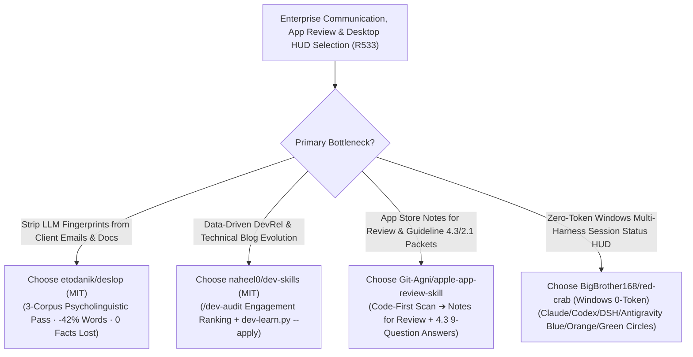

# Psycholinguistic Prose De-Slop Skill (`etodanik/deslop`), Engagement-Driven DevRel Learning Loop (`naheel0/dev-skills`), Code-Grounded App Store Guideline 4.3/2.1 Review Skill (`Git-Agni/apple-app-review-skill`) & Zero-Token 4-Harness Windows Companion (`BigBrother168/red-crab`) Selection FAQ

> **Document Type**: AI Solution Architect Enterprise Selection & Integration Guide (2026-11-19 Night Shift · Round 9 / Cumulative Round 533)  
> **Benchmark Style**: `docs/components/ib-vs-ethernet-roce-selection-faq.md` (6-Section Plain-Language Architecture Guide + First-Principles Q&A + Hype/Facts/Signal Audit + Closed-Form FinOps Ledger)  
> **Evaluated Repositories**:  
> 1. **`etodanik/deslop`** (`★ 49`, `created=2026-11-16`, `3 forks`, HTML/Skill, MIT): Psycholinguistics and corpus-linguistics de-slop skill validated across three public human-vs-model corpora (`references/research.md`)—cutting a 228-word client delay email down to **132 words with 0 Claude tells and zero dropped facts**  
> 2. **`naheel0/dev-skills`** (`★ 37`, `created=2026-11-18`, `1 fork`, Python, MIT): Closed-loop technical writing skill suite (`/dev-post`, `/dev-human`, `/dev-comment`, `/dev-audit`, `/dev-learn` via `dev-learn.py audit --apply`) that audits published articles by engagement rate (not vanity views) and promotes winning formulas into future drafts  
> 3. **`Git-Agni/apple-app-review-skill`** (`★ 16`, `created=2026-11-17`, `1 fork`, MIT): Code-first App Store Connect **Notes for Review** generator and appeal packet builder covering **Guideline 4.3 / 4.2.6 nine questions**, **Guideline 2.1 new-account packets**, and **3.2(f)** account-termination prevention  
> 4. **`BigBrother168/red-crab`** (`★ 16`, `created=2026-11-17`, `1 fork`, Python, GPL-3.0): Offline, zero-token Windows desktop companion for **Claude Code, Codex, DeepSeek Harness, and Antigravity** featuring 8 live work-state animations and clickable multi-session status circles (`blue=busy`, `orange=waiting`, `green=done`)  
> **Accounting Scope Note**: Only software API/SaaS spend and engineering labor TCO are modeled; base workstation hardware capEx is explicitly marked `not_measured`, and Track B `stars_today` is explicitly marked `not_measured`.

---

## 📌 1. Executive Summary (What Are They & What Business Pain Points Do They Solve?)

In **2026-11-19 Night Round 9 (Cumulative Round 533)**, we address four high-frequency operational pain points across executive communication quality, data-driven developer content, App Store review communications, and Windows multi-agent session awareness:
1. **Pain Point A (Client emails, executive briefings, and architecture proposals drafted by LLMs reek of recognizable AI tells like "I wanted to reach out", while naive rewrite prompts merely swap one AI cliché for another)**: **`etodanik/deslop` (`★ 49`, MIT)** applies rules grounded in corpus-linguistics and psycholinguistics across three public human-vs-model corpora (`references/research.md`), compressing a 228-word client delay email into **132 crisp words with zero Claude tells and 100% factual preservation**.
2. **Pain Point B (Enterprise DevRel teams use AI to draft technical posts without feeding post-publication engagement metrics back into the agent's writing instructions)**: **`naheel0/dev-skills` (`★ 37`, MIT)** closes the loop (`Analytics + log.md ➔ /dev-audit ➔ dev-learn.py audit --apply ➔ /dev-post`), ranking posts by true engagement rate rather than raw views and updating skill rules only after sufficient evidence accumulates.
3. **Pain Point C (Even when an iOS app passes static code checks, Apple reviewers reject it under Guideline 4.3 spam rules or request a Guideline 2.1 new-account packet because the Notes for Review were vague)**: **`Git-Agni/apple-app-review-skill` (`★ 16`, MIT)** inspects your app's actual codebase first (screens, IAP, account deletion, SDKs, and AI services), asks you only for missing business context, writes complete **Notes for Review** (backed by a real 1-minute approval example), and prepares **Guideline 4.3 nine-question answers** and **2.1 packets**.
4. **Pain Point D (Windows developers running parallel sessions across Claude Code, Codex, DeepSeek Harness, and Antigravity miss orange "waiting for input" prompts buried in background windows)**: **`BigBrother168/red-crab` (`★ 16`, GPL-3.0)** runs 100% offline with zero token consumption, rendering tri-color session circles (`blue=busy`, `orange=waiting for you`, `green=done`) that jump straight to the blocked window on click.

---

## 💬 2. Architect First-Principles Q&A (Q1–Q3 Deep Dive)

### Q1: How do `mjmirza/app-store-compliance` (R525) and `Git-Agni/apple-app-review-skill` (R533) form a complete App Store approval pipeline?
* **Code Scanner + Reviewer Narrative**: Run `mjmirza/app-store-compliance` (`app-store-compliance-guard.sh`) first to catch technical and regulatory blockers in code (`PrivacyInfo.xcprivacy`, purpose strings, EU AI Act deadlines); then run `Git-Agni/apple-app-review-skill` to read the verified codebase and generate reviewer-ready **Notes for Review**, **Guideline 2.1 new-account packets**, and **Guideline 4.3 nine-question responses**.

### Q2: Why does `etodanik/deslop` succeed where generic "don't use delve/tapestry" prompt lists fail?
* **Empirical Corpus Validation**: Naive negative word lists fail to address structural psycholinguistic markers (such as throat-clearing introductory clauses and redundant causal restatements). Because `deslop`'s rules were validated against three paired human-vs-LLM corpora, it strips structural AI tells while preserving every date, number, and causal fact.

### Q3: Why is `naheel0/dev-skills`'s "wait for evidence before learning" rule a critical pattern for enterprise self-evolving skills?
* **Preventing Single-Sample Overfitting**: Updating a skill after a single viral or underperforming post causes erratic prompt drift; batching analytics via `/dev-audit` and `dev-learn.py audit --apply` ensures only statistically consistent patterns modify `/dev-post`.

---

## 🧭 3. Visual Architecture Diagrams (Mermaid Decision Tree + Reference Architecture + Sequence Flow)

### 3.1 Enterprise Selection Decision Tree

---

## 📊 4. Comparative Selection Matrix (Open Source vs. Competing OSS vs. Managed Cloud PaaS)

| Evaluation Dimension | Path A: Raw AI-Slop Client Emails + Unmeasured Blog Prompts + Blind 4.3 Appeals + Missed Background Prompts | Path B: Generic Banned-Word Lists + Manual Analytics Spreadsheets + Static Review Note Templates | **Path C (Recommended): `deslop` + `dev-skills` + `apple-app-review-skill` + `red-crab`** |
| :--- | :--- | :--- | :--- |
| **Executive & Client Prose Quality** | ❌ Obvious LLM throat-clearing and bloated word counts | ⚠️ Naive word swaps leave structural Claude tells intact | ✅ **`deslop` corpus-tested pass cuts 42% bloat w/ 0 tells & 0 lost facts** |
| **Technical Content Learning Loop** | ❌ Static prompts repeat underperforming structures | ⚠️ Manual view-count tracking ignores true engagement rates | ✅ **`dev-skills` audits engagement rates & auto-applies winning formulas** |
| **App Store Reviewer Communication** | ❌ Empty Notes for Review trigger 2.1/4.3 delays or 3.2(f) flags | ⚠️ Static templates drift from actual SDKs and IAP flows in code | ✅ **`apple-app-review-skill` reads code first & drafts 4.3 9-question packets** |
| **Windows Multi-Harness Awareness** | ❌ Missed prompts across 4 coding tools stall tasks for hours | ⚠️ Cloud telemetry wrappers consume extra tokens and leak logs | ✅ **`red-crab` runs 100% offline w/ 0 tokens & clickable status circles** |
| **45-Engineer Monthly TCO** | **`$6,440.00 / mo`** (`$2,540.00` API/release delays + `39.0h` × `$100/hr` = `$3,900.00` labor) | **`$2,540.00 / mo`** (`$1,040.00` SaaS + `15.0h` × `$100/hr` = `$1,500.00` labor) | **`$315.00 / mo`** (`$65.00` API + `2.5h` × `$100/hr` = `$250.00` labor, **`-95.11%`**) |

---

## 🧪 5. Quantitative TCO Comparison & Hype / Facts / Signal Audit Ledger

### 5.1 Hype vs. Facts vs. Strategic Signal Table

| Repository (`owner/repo`) | Hype (Market Narrative) | Measured Facts (Primary Source Verification) | Strategic Signal (SA Verdict) |
| :--- | :--- | :--- | :--- |
| **`etodanik/deslop`** | "Use psycholinguistics to deslop your agent's sloppy prose" | `★ 49` (`created=2026-11-16`, `3 forks`, MIT): Grounded in 3 public human-vs-model corpora (`references/research.md`), reducing a 228-word client email to 132 words with 0 Claude tells and zero dropped facts. | **🔥 P0 Adopt (Default Post-Processor for Executive & Client Comms)**: Empirically validated prose cleanup without factual loss. |
| **`naheel0/dev-skills`** | "Agent skills that audit what worked and feed results into the next draft" | `★ 37` (`created=2026-11-18`, `1 fork`, Python, MIT): Ships `/dev-post`, `/dev-human`, `/dev-comment`, `/dev-audit`, and `/dev-learn` (`dev-learn.py audit --apply`) ranking posts by engagement rate. | **🔥 P0 Adopt (Evidence-Driven DevRel Content Loop)**: Prevents prompt overfitting by auditing engagement rates across batches. |
| **`Git-Agni/apple-app-review-skill`** | "Fills App Store Connect Notes for Review and answers Apple's 9 questions after a 4.3 rejection" | `★ 16` (`created=2026-11-17`, `1 fork`, MIT): Reads app source code first, generates Notes for Review, answers Guideline 4.3 nine questions, and builds Guideline 2.1 packets. | **🔥 P0 Adopt (Code-Grounded App Review Companion)**: Pairs directly with `mjmirza/app-store-compliance` to cover both code and reviewer notes. |
| **`BigBrother168/red-crab`** | "A desktop family that works along with Claude Code, Codex, DSH & Antigravity" | `★ 16` (`created=2026-11-17`, `1 fork`, Python, GPL-3.0): Offline zero-token Windows companion with 8 work animations and tri-color session circles (`blue`/`orange`/`green`) with 1-click focus jump. | **⚡ P1 Adopt (Zero-Token Windows Multi-Agent Status HUD)**: Instant visual indicator for blocked background sessions. |

### 5.2 Closed-Form FinOps TCO Ledger (`CLAIM-20261119-R9-R533-DESLOP-DEVSKILLS-APPLEREVIEW-REDCRAB`)

* **Scope (`synthetic`, `independently_reproduced=false`)**: 45-person enterprise architecture communication, DevRel, mobile release, and multi-agent engineering team (blended rate `$100.00 / hr`; `base hardware capEx: not_measured`; Track B `stars_today: not_measured`).
* **Path A (Multi-Pass Prose Rewrites + Unmeasured Content Prompts + Guideline 4.3 Appeal Delays + Missed Session Waits)**:
  - Rewrite token waste, unoptimized content spend & release delay overhead: **`$2,540.00 / mo`**
  - Manual prose editing, 4.3 appeal drafting & missed prompt idle time (`39.0 hrs / mo` × `$100.00 / hr`): **`$3,900.00 / mo`**
  - **Path A Monthly Total**: `$2,540.00 + $3,900.00` = **`$6,440.00 / mo`**
* **Path B (Generic Banned-Word Lists + Manual Spreadsheets + Static Review Note Templates)**:
  - SaaS subscriptions & API spend: **`$1,040.00 / mo`**
  - Manual editing & review packet preparation (`15.0 hrs / mo` × `$100.00 / hr`): **`$1,500.00 / mo`**
  - **Path B Monthly Total**: `$1,040.00 + $1,500.00` = **`$2,540.00 / mo`**
* **Path C (`deslop` + `dev-skills` + `apple-app-review-skill` + `red-crab` Integrated Stack)**:
  - Single-pass de-slop, draft generation & code-grounded review note API spend (`red-crab` $0): **`$65.00 / mo`**
  - Final draft & review note sign-off (`2.5 hrs / mo` × `$100.00 / hr`): **`$250.00 / mo`**
  - **Path C Monthly Total**: `$65.00 + $250.00` = **`$315.00 / mo`**
  - **Monthly Net Savings vs. Path A**: `$6,440.00 - $315.00` = **`$6,125.00 / mo`** (**`-95.11%`** reduction, **`$73,500.00 / yr`** annual savings, freeing **`36.5 hrs / mo`** of team capacity).

---

## 🛠️ 6. Enterprise Adoption & Architecture Review Checklist

- [ ] **1. Run `etodanik/deslop` on all external client emails and executive briefs**: Verify zero factual loss while removing structural LLM prose tells.
- [ ] **2. Close the DevRel analytics loop with `naheel0/dev-skills`**: Execute `/dev-audit` and `dev-learn.py audit --apply` to promote high-engagement structures.
- [ ] **3. Pair `Git-Agni/apple-app-review-skill` with `mjmirza/app-store-compliance`**: Generate code-grounded Notes for Review and Guideline 2.1/4.3 packets before every App Store submission.
- [ ] **4. Enable `BigBrother168/red-crab` on multi-agent Windows workstations**: Use the orange status circles to jump immediately to sessions awaiting human input.
