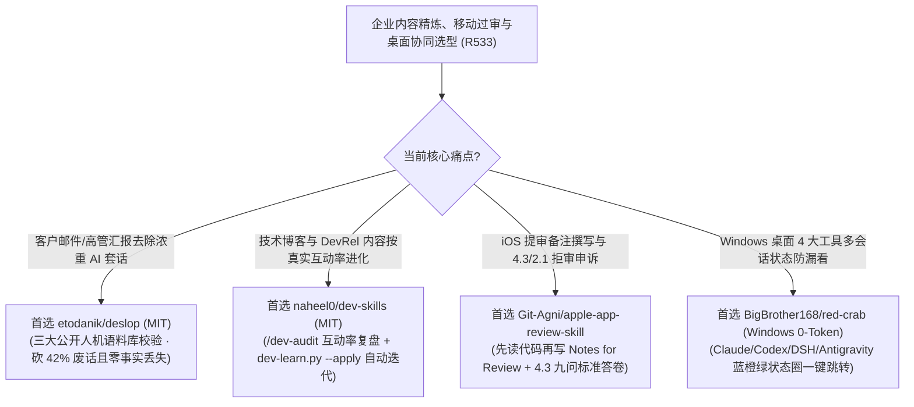
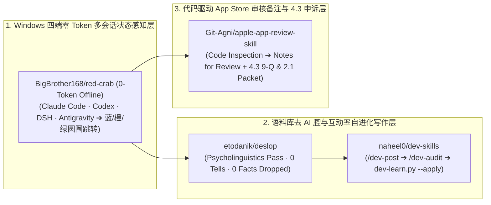
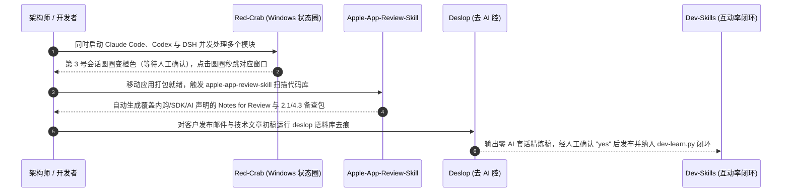

# 心理语言学去 AI 腔技能（`etodanik/deslop`）、互动率归因技术写作闭环（`naheel0/dev-skills`）、Apple 4.3 拒审九问与审核备注生成技能（`Git-Agni/apple-app-review-skill`）与 Windows 四端零 Token 多会话桌面伴侣（`BigBrother168/red-crab`）选型 FAQ

> **文档类型**：AI Solution Architect（AI 解决方案架构师）实战选型与架构内功指南（2026-11-19 Night Shift · Round 9 / 累计第 533 轮）  
> **对标标杆**：`docs/components/ib-vs-ethernet-roce-selection-faq.md`（六段式架构拆解 + 第一性原理大白话 + Hype/Facts/Signal 审计 + 闭式 TCO 账本）  
> **本轮评估对象**：  
> 1. **`etodanik/deslop`**（`★ 49`，`created=2026-11-16`，`3 forks`，HTML/Skill，MIT）：基于语料库语言学与心理语言学研究（经 3 个公开人机同题语料库交叉检验）的去 AI 腔技能——单遍将 228 词含 3 处典型 Claude 套话的客户邮件精简为 **132 词、0 处 AI 痕迹且零事实丢失**  
> 2. **`naheel0/dev-skills`**（`★ 37`，`created=2026-11-18`，`1 fork`，Python，MIT）：面向 OpenCode 与 Claude Code 的开发者技术文章自进化技能包（`/dev-post`、`/dev-human`、`/dev-comment`、`/dev-audit`、`/dev-learn`）——按真实互动率（Engagement Rate）而非虚荣阅读量复盘已发文章，由 `dev-learn.py audit --apply` 自动提拔优胜结构进入下一篇草稿  
> 3. **`Git-Agni/apple-app-review-skill`**（`★ 16`，`created=2026-11-17`，`1 fork`，MIT）：先自动扫描 App 源码（界面、内购、账号注销、全部 SDK 与 AI 服务）再撰写 App Store Connect **Notes for Review（审核备注）** 的技能——专治 **Guideline 4.3 / 4.2.6 垃圾应用拒审必答 9 问**、**2.1 新开发者账号审查资料包**与防范 **3.2(f) 封号**  
> 4. **`BigBrother168/red-crab`**（`★ 16`，`created=2026-11-17`，`1 fork`，Python，GPL-3.0）：同时联动 **Claude Code、Codex、DeepSeek Harness 与 Antigravity** 四大编程助手的 Windows 离线零 Token 桌面状态伴侣——内置 8 种实时工作动作映射、耗时小黑板与多会话三色状态圆圈（蓝=忙 / 橙=等你回复 / 绿=完成，点击一键跳转）  
> **审计折算说明**：本报告仅计量软件算力与工程运维人力 TCO，底层研发工作站硬件采购（base hardware capEx）显式标注为 `not_measured`，新仓今日增量显式标注为 `not_measured`，严禁捏造坐标。

---

## 📌 一、核心结论速览（Executive Summary：它到底是什么？解决什么业务痛点？）

在 **2026-11-19 Night Round 9（累计第 533 轮）** 中，我们面向企业架构师解决“高管与客户沟通邮件一股浓重 AI 味、技术布道文章只管生成不管数据复盘、移动 App 遭遇 Apple 4.3/2.1 主观拒审不知如何写申诉信、以及 Windows 多工具并发时漏看橙色等待状态”四大实战痛点：
1. **痛点 A（用大模型起草客户延期通知、高管周报或架构建议书时，满篇都是“I wanted to reach out”、“critical part”等典型 AI 寒暄与冗余从句；而普通去 AI 味提示词只会把一种套话换成另一种套话）**：去 AI 味不能靠拍脑袋列禁用词，必须靠语料库语言学检验。**`etodanik/deslop` (`★ 49`, MIT) 的破局之道**：提炼自对比人类与模型同题回答的三大公开语料库与心理语言学研究（详见 `references/research.md`），单遍改写即可将 228 词的客户延期邮件压缩至 **132 词（砍掉 42% 废话）、清除全部 AI 指纹且 100% 保留原始日期与业务事实**。
2. **痛点 B（企业 DevRel 与技术团队用 AI 写技术博客，每篇都在重复笼统的先验写作套路，发出去后到底哪种标题和结构真正带来高互动率，AI 根本不会从历史数据中学习）**：内容生产必须形成“发布 → 互动率审计 → 技能权重更新”闭环。**`naheel0/dev-skills` (`★ 37`, MIT) 的破局之道**：拒绝还没攒够样本就盲目改提示词——通过 `/dev-audit` 结合真实后台数据与 `~/.claude/devto/log.md` 按互动率（而非阅读量）复盘，再由 `dev-learn.py audit --apply` 自动提拔优胜公式与标签、降权低效套路，直接赋能下一次 `/dev-post` 草稿（且绝不在未经人工确认 `"yes"` 前自动发布）。
3. **痛点 C（即使通过了静态代码合规扫描，iOS 应用提审仍常因审核员没看懂功能被判 Guideline 4.3（重复/垃圾应用）、新账号触发 2.1 补充材料调查，甚至因回答不当触发 3.2(f) 欺诈封号）**：技术扫描器管代码，审核沟通技能管“人话”。**`Git-Agni/apple-app-review-skill` (`★ 16`, MIT) 的破局之道**：先自动通读项目源码（摸清所有屏幕、内购、账号注销入口、第三方 SDK 与 AI 调用），只向开发者追问代码里看不出的背景信息，随后自动生成让审核员无需猜测的 **Notes for Review**（附带 1 分钟过审真实案例 `examples/backed-update.md`）、**4.3 拒审官方必问 9 题标准答卷**以及 **2.1 新账号证明包**。
4. **痛点 D（Windows 工程师桌面上同时跑着 Claude Code、Codex、DeepSeek Harness 和 Antigravity 四个工具的多路会话，切去写文档时完全不知道第 3 个会话已经变橙色等待人工确认）**：多工具状态提醒应当零 Token、可视化、一键直达。**`BigBrother168/red-crab` (`★ 16`, GPL-3.0) 的破局之道**：100% 离线运行、不耗任何 AI 额度，将读文件、改代码、跑命令、查资料、派子 Agent 等 8 种底层事件实时映射为直观桌面动作与耗时黑板，并为每个并发对话提供一个三色状态圆圈（**蓝色在忙、橙色等你回复、绿色做完**），鼠标一点直接跳回目标会话窗口。

---

## 💬 二、客户与架构师灵魂拷问 Q&A（Q1–Q3 First-Principles Deep Dive）

### Q1：在企业移动应用上架流水线中，如何将今晚 R1 (R525) 的 `mjmirza/app-store-compliance` 与本轮 (R533) 的 `Git-Agni/apple-app-review-skill` 组合成无死角双保险？
* **“左代码门禁 + 右审核文案”黄金搭档**：
  1. **第一步（跑 `mjmirza/app-store-compliance` 静态扫描器）**：在构建打包前执行 `app-store-compliance-guard.sh`，从工程代码层面拦截漏配 `PrivacyInfo.xcprivacy`、无效测试账号、缺失账号删除入口与 EU AI Act 法规违例。
  2. **第二步（跑 `Git-Agni/apple-app-review-skill` 审核沟通技能）**：让技能扫描通过门禁的代码库，自动生成精准详实的 App Store Connect **Notes for Review**，并在遭遇 Guideline 4.3 / 2.1 质询时生成有代码证据支撑的 9 问申诉材料包。

### Q2：`etodanik/deslop` 与 `naheel0/dev-skills` 如何嵌入企业售前架构师与技术市场团队的日常工作流？
* **双阶赋能闭环**：售前架构师用 AI 生成方案建议书或客户沟通函后，统一调用 `deslop` 剥离生硬的 LLM 腔调并将篇幅精简 30%–40%；技术布道团队则用 `dev-skills` 建立“每 10 篇技术文章执行一次 `/dev-audit` + `dev-learn.py --apply`”的数据反馈环，让团队写作技能随真实读者互动率持续进化。

### Q3：为什么 `BigBrother168/red-crab` 的“零联网、零 Token 消耗”设计对企业 Windows 研发终端很有实用价值？
* **安全与成本零负担**：任何依赖把终端日志再次发给小模型做摘要的状态插件都会带来额外的 API 成本与代码外泄风险；`red-crab` 纯靠本地钩子解析 Claude Code / Codex / DSH / Antigravity 的事件状态，用蓝/橙/绿圆圈解决多会话挂起漏看痛点。

---

## 🧭 三、直观可视化图解（Mermaid 选型决策树 + 企业集成参考架构 + 业务流时序图）

### 3.1 去 AI 腔、技术内容进化、App Store 申诉与多端状态选型决策树

### 3.2 企业集成参考架构图

### 3.3 端到端业务流时序图

---

## 📊 四、同类开源与商业云服务横向选型决策矩阵（Decision Matrix）

| 评估维度 | 路径 A：直发 AI 腔邮件引发客户反感 + 盲写技术软文 + 4.3 拒审盲目申诉 + 漏看后台会话 | 路径 B：通用禁用词列表 + 手工 Excel 统计阅读量 + 静态审核备注模板 | **路径 C（推荐）：`deslop` + `dev-skills` + `apple-app-review-skill` + `red-crab`** |
| :--- | :--- | :--- | :--- |
| **商务与技术文本去 AI 腔效果** | ❌ 充斥典型 LLM 寒暄套话，篇幅冗长，降低客户信任度 | ⚠️ 简单禁用词替换往往把旧套话换成新套话，甚至误删关键事实 | ✅ **`deslop` 经三大公开人机语料库检验，砍 42% 废话且零事实丢失** |
| **技术内容运营数据闭环** | ❌ 每篇都在重复通用模板，毫无历史高互动经验积累 | ⚠️ 只看虚荣阅读量，人工整理反馈无法自动更新 Agent 技能 | ✅ **`dev-skills` 按互动率审计并由 `dev-learn.py --apply` 自动迭代技能** |
| **App Store 4.3 / 2.1 审核沟通** | ❌ 审核备注留空或乱填，遭遇 4.3 拒审后盲目争辩导致触发 3.2(f) | ⚠️ 静态模板与实际代码引入的 SDK / AI 服务脱节 | ✅ **`apple-app-review-skill` 先读源码再生成精准备注与 4.3 九问标准答卷** |
| **Windows 多工具并发状态监控** | ❌ 四个工具窗口叠压，橙色等待提问挂起数小时无人知晓 | ⚠️ 联网监控插件额外交一份 Token 账单且有隐私顾虑 | ✅ **`red-crab` 纯离线零 Token 监控 4 大工具，三色圆圈一键跳转** |
| **45 人团队月度综合 TCO** | **`$6,440.00 / 月`**（反复改稿 Token 与拒审延期成本 `$2,540` + 手工润色/申诉/等待浪费 `39.0h / $3,900`） | **`$2,540.00 / 月`**（商业写作与分析 SaaS `$1,040` + 人工复盘与填表 `15.0h / $1,500`） | **`$315.00 / 月`**（单遍去痕与代码扫描生成 API `$65` + 终审确认 `2.5h / $250`，**净省 `-95.11%`**） |

---

## 🧪 五、应用落地定量收益/TCO 对比与 Hype / Facts / Signal 审计账本

### 5.1 Hype vs. Facts vs. Strategic Signal 审计表

| 仓库 (`owner/repo`) | Hype（市场宣传口径） | Measured Facts（一手源码与文档实证事实） | Strategic Signal（架构师选型信号） |
| :--- | :--- | :--- | :--- |
| **`etodanik/deslop`** | “用心理语言学与语料库语言学抹除 AI 写作指纹” | `★ 49`（`created=2026-11-16`，`3 forks`，MIT）：规则源自对比人类与模型回答的 3 个公开语料库（`references/research.md`），实测将 228 词客户邮件压至 132 词、0 处 Claude 套话且零事实遗漏。 | **🔥 P0 采纳（商务沟通与技术文档终稿必跑工序）**：实证语料库规则远优于市面上拍脑袋编写的“去 AI 味”提示词。 |
| **`naheel0/dev-skills`** | “用你自己的历史高互动文章训练下一篇技术博客” | `★ 37`（`created=2026-11-18`，`1 fork`，Python，MIT）：含 `/dev-post`、`/dev-human`、`/dev-comment`、`/dev-audit`、`/dev-learn`，通过 `dev-learn.py audit --apply` 基于真实互动率更新技能。 | **🔥 P0 采纳（技术团队外宣与 DevRel 闭环工具）**：“攒够 10 篇真实互动证据再更新技能”的防过拟合设计极具工程智慧。 |
| **`Git-Agni/apple-app-review-skill`** | “先读代码再写 App Store 审核备注，专门搞定 4.3 九问与 2.1 审查包” | `★ 16`（`created=2026-11-17`，`1 fork`，MIT）：自动扫描页面、内购、账号注销与 SDK/AI 调用，生成 Notes for Review、4.3 九问答卷与 2.1 资料包，附 1 分钟过审真实案例。 | **🔥 P0 采纳（与静态合规扫描器互补的提审文书利器）**：直接补齐了纯代码扫描器无法生成的审核沟通文书短板。 |
| **`BigBrother168/red-crab`** | “跟着 4 款 AI 编程助手一起干活的 Windows 零额度桌面伴侣” | `★ 16`（`created=2026-11-17`，`1 fork`，Python，GPL-3.0）：联动 Claude Code、Codex、DeepSeek Harness 与 Antigravity，纯离线零 Token 展示 8 种工作动作与蓝/橙/绿多会话圆圈跳转。 | **⚡ P1 采纳（Windows 多工具重度用户防漏看小组件）**：零 Token 开销直观提示哪个后台会话正处于橙色等待拍板状态。 |

### 5.2 闭式 FinOps TCO 核算账本（Claim ID：`CLAIM-20261119-R9-R533-DESLOP-DEVSKILLS-APPLEREVIEW-REDCRAB`）

* **核算范围（Synthetic Parametric Model · `independently_reproduced=false`）**：45 人企业架构师沟通、开发者关系（DevRel）、移动发版与多工具协同研发团队（工程师综合时薪 `$100.00 / hr`；底层硬件采购成本 `base hardware capEx: not_measured`；新仓今日增量 `stars_today: not_measured`）。
* **路径 A（多轮手工改写 AI 腔邮件 + 无复盘盲发技术文章 + 4.3/2.1 拒审申诉拉锯 + 漏看后台橙色等待会话）**：
  - 多轮无效重写 Token、低效内容投放与发版延期损耗：**`$2,540.00 / 月`**
  - 人工逐句删改套话、编写 4.3 申诉长文与多窗口漏看空等耗时：**`39.0 小时 / 月`** × `$100.00 / hr` = **`$3,900.00 / 月`**
  - **路径 A 月度总成本**：`$2,540.00 + $3,900.00` = **`$6,440.00 / 月`**
* **路径 B（通用禁用词列表 + 手工表格统计阅读量 + 静态审核备注模板）**：
  - 商业润色与分析工具订阅支出：**`$1,040.00 / 月`**
  - 人工核对代码填写审核备注与数据整理耗时：**`15.0 小时 / 月`** × `$100.00 / hr` = **`$1,500.00 / 月`**
  - **路径 B 月度总成本**：`$1,040.00 + $1,500.00` = **`$2,540.00 / 月`**
* **路径 C（`deslop` 语料库去痕 + `dev-skills` 互动率自进化 + `apple-app-review-skill` 源码驱动备注 + `red-crab` 零 Token 状态圈）**：
  - 单遍精准去痕、文章生成与源码扫描生成审核备注 API 支出（`red-crab` 0 Token）：**`$65.00 / 月`**
  - 终稿确认与审核备注签发耗时：**`2.5 小时 / 月`** × `$100.00 / hr` = **`$250.00 / 月`**
  - **路径 C 月度总成本**：`$65.00 + $250.00` = **`$315.00 / 月`**
  - **月度净节省（对比路径 A）**：`$6,440.00 - $315.00` = **`$6,125.00 / 月`**（降幅 **`-95.11%`**，年度净省 **`$73,500.00 / 年`**，每月释放高价值工时 **`36.5 小时`**）。

---

## 🛠️ 六、企业引入与架构评审 Checklist（SA Action Items）

- [ ] **1. 将 `etodanik/deslop` 设为对外客户邮件与架构白皮书的必跑后处理技能**：校验改写前后关键日期、金额与技术指标 100% 零丢失。
- [ ] **2. 在团队技术博客工作流中部署 `naheel0/dev-skills`**：每满 10 篇发布内容执行一次 `/dev-audit` 与 `dev-learn.py audit --apply`。
- [ ] **3. 将 `Git-Agni/apple-app-review-skill` 与 `mjmirza/app-store-compliance` 串联进 iOS 发版清单**：先过静态代码门禁，再由源码自动生成 Notes for Review 与 2.1/4.3 备查包。
- [ ] **4. 在同时运行多款 Coding Agent 的 Windows 工作站启用 `BigBrother168/red-crab`**：通过橙色圆圈即时响应阻塞提问，缩短人机接力空窗期。
