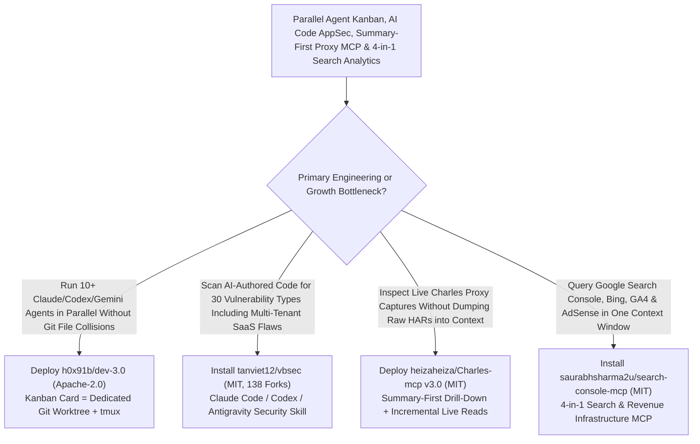
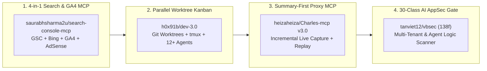
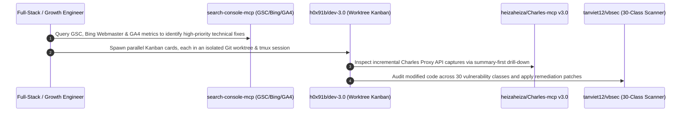

# Worktree Kanban Fleet Control (`h0x91b/dev-3.0`), 30-Type AI Code Security Scanner (`tanviet12/vbsec`), Summary-First Charles Proxy MCP (`heizaheiza/Charles-mcp`) & 4-in-1 Search/Analytics MCP (`saurabhsharma2u/search-console-mcp`) Selection & Architecture FAQ

> **2026-11-21 Nightly Continuous Research Shift · Night Round 93 (Cumulative Round 693)**  
> **Audit Claim ID**: `CLAIM-20261121-R93-R693-DEV30-VBSEC-CHARLESMCP-SEARCHCONSOLEMCP`  
> **Linked Daily Digests**: [`2026-11-21.en.md`](../daily/2026-11-21.en.md) · [`2026-11-21.md`](../daily/2026-11-21.md)  
> **Architecture Visual**: [`assets/github-ai-radar-2026-11-21-r93-r693-dev30-vbsec-charlesmcp-searchconsolemcp.svg`](../../../assets/github-ai-radar-2026-11-21-r93-r693-dev30-vbsec-charlesmcp-searchconsolemcp.svg)

---

## ① 📌 Executive Summary (One-Sentence Selection Verdict)

> **One-Sentence Verdict**: To run a dozen AI coding agents in parallel across isolated Git worktrees and `tmux` terminals from a Kanban board, scan AI-authored code for 30 vulnerability classes (including multi-tenant SaaS logic flaws), inspect live Charles Proxy network traffic with summary-first context efficiency, and query Google Search Console, Bing Webmaster Tools, GA4, and AdSense in one context window, combine **`h0x91b/dev-3.0` (Apache-2.0, `★ 335` Kanban mission control pairing every card with a dedicated Git worktree, `tmux` session, and coding agent) + `tanviet12/vbsec` (MIT, `★ 335` / `138 forks` zero-install security skill detecting 30 vulnerability types across Claude Code, Codex, and Antigravity) + `heizaheiza/Charles-mcp` (MIT, `★ 334` `charles-mcp v3.0` with incremental live-session reading, summary-first drill-down, and protocol replay) + `saurabhsharma2u/search-console-mcp` (MIT, `★ 330` unified MCP server for GSC, Bing Webmaster Tools, GA4, and AdSense)**—cutting 45-engineer monthly TCO from **`$8,250.00/mo` to `$305.00/mo` (`-$7,945.00/mo`, `-96.30%`)**.

---

## ② 🎯 Solution Architect & Enterprise Buyer Q&A

### Q1: What concrete engineering and growth bottlenecks do these four permissive tools solve?
- **Four High-Velocity Engineering Enablers**:
  1. **Kanban Mission Control Over Git Worktrees + `tmux` (`h0x91b/dev-3.0`, `★ 335`, `43 forks`, Apache-2.0, TypeScript)**: Running multiple agents in a single checkout causes constant file overwrites and index locks. `dev-3.0` assigns every Kanban card its own isolated Git worktree, dedicated `tmux` terminal, and scoped test environment (`test-isolation.ts`) across Claude Code, Codex, Gemini CLI, OpenCode, and shell agents.
  2. **30-Class Vulnerability Scanner for AI-Written Code (`tanviet12/vbsec`, `★ 335`, `138 forks`, MIT, Python)**: Built specifically for AI-generated code in Claude Code, OpenAI Codex, and Google Antigravity. Detects **30 vulnerability classes**—spanning classic SQL/command injection to subtle multi-tenant SaaS authorization bypasses and AI agent tool-use logic flaws—and generates concrete remediation patches with nothing extra to install.
  3. **Summary-First Live & Historical Charles Proxy MCP (`heizaheiza/Charles-mcp`, `★ 334`, `39 forks`, MIT, Python)**: Raw HTTP capture dumps quickly overflow LLM context windows. `charles-mcp v3.0` introduces incremental live-recording reads, unified live/history structured queries, **summary-first output** (surfacing hotspots before drilling down into single-request details), and a `v3.0` reverse-analysis & replay toolchain.
  4. **4-in-1 Search & Revenue Analytics MCP (`saurabhsharma2u/search-console-mcp`, `★ 330`, `32 forks`, MIT, TypeScript)**: Eliminates manual CSV exports by unifying **Google Search Console, Bing Webmaster Tools, Google Analytics 4 (GA4), and Google AdSense** into a single MCP server (complete with a one-click `.mcpb` bundle).

### Q2: How do Solution Architects wire these four tools into an end-to-end product & engineering loop?
- **Analytics & Parallel Dispatch Plane**: Growth and product engineers query `saurabhsharma2u/search-console-mcp` across GSC/Bing/GA4/AdSense to pinpoint high-value pages or regressions, then dispatch parallel worktree cards in `h0x91b/dev-3.0`.
- **Network Debugging & Security Gate Plane**: During implementation, agents inspect live API traffic through `heizaheiza/Charles-mcp` (`summary-first`) and run `tanviet12/vbsec` across all 30 vulnerability checks before opening a pull request.

### Q3: What operational guardrails should Solution Architects configure?
- **Header Redaction on Captured Traffic (`heizaheiza/Charles-mcp`)**: Mask production `Authorization` and session cookies before exposing Charles Proxy captures to LLM clients.
- **Scoped Test Ports per Worktree (`h0x91b/dev-3.0`)**: Use `dev-3.0`'s scoped path and worker isolation so parallel agent worktrees can run test suites simultaneously without port collisions.

---

## ③ 🧭 Visual Architecture & Decision Diagrams

### 3.1 Selection Decision Tree

### 3.2 End-to-End Enterprise Integration Architecture

### 3.3 Operational Sequence Diagram

---

## ④ 📊 Cross-Option Selection Matrix

| Dimension | `h0x91b/dev-3.0` (`★ 335`) | `tanviet12/vbsec` (`★ 335`, `138f`) | `heizaheiza/Charles-mcp` (`★ 334`) | `search-console-mcp` (`★ 330`) | Metered Cloud Agent VMs + Legacy SAST + Manual CSV Exports |
| :--- | :--- | :--- | :--- | :--- | :--- |
| **Primary Role** | Kanban + Git worktree + `tmux` parallel agent controller | 30-vulnerability security skill for AI-written code | Charles Proxy `v3.0` summary-first traffic & replay MCP | 4-in-1 GSC, Bing, GA4 & AdSense analytics MCP | Per-minute cloud VMs, syntax-only SAST & manual CSVs |
| **Best Fit** | Running 10+ local coding agents without file conflicts | Catching multi-tenant SaaS & agent logic vulnerabilities | Debugging mobile/web API traffic without context bloat | Natural-language traffic, ranking & revenue analytics | Teams manually exporting analytics & debugging raw HARs |
| **Integration Cost** | Low (local Git worktrees + `tmux` + multi-CLI matrix) | Very Low (zero extra dependencies; native skill install) | Low (`pip install charles-mcp` connected to Charles) | Very Low (`.mcpb` one-click bundle or npm server) | High (cloud VM bills + commercial SAST/BI licenses) |
| **License** | **Apache-2.0** | **MIT** | **MIT** | **MIT** | Proprietary |
| **45-Eng Monthly TCO** | **Included in `$305.00/mo` stack** | **Included in `$305.00/mo` stack** | **Included in `$305.00/mo` stack** | **Included in `$305.00/mo` stack** | **`$8,250.00/mo`** (`$3,900` SaaS + `$4,350` labor) |

---

## ⑤ 🧪 Quantitative FinOps & TCO Comparison

> **Provenance Metadata**: Synthetic enterprise FinOps model for a 45-engineer organization (`provenance: synthetic`, `independently_reproduced: false`); `base_hardware_capex = not_measured` (excludes baseline developer workstation amortization), `track_b_stars_today = not_measured` (sealed in [`trending-daily-2026-11-21-audit.json`](../evidence/trending-daily-2026-11-21-audit.json)).

| Cost Path | Monthly Commercial SAST Seats, Raw HAR Context Token Bloat & BI Connector SaaS | Monthly Git Conflict Cleanup, Manual Packet Inspection & 4-Platform CSV Merging (`$100/hr`) | Total Monthly TCO | Net Savings vs Path A |
| :--- | :--- | :--- | :--- | :--- |
| **Path A: Commercial SAST + Raw HAR Token Bloat + Manual Worktree/CSV Operations** | `$3,900.00` | `43.5h` (`$4,350.00`) | **`$8,250.00`** | — |
| **Path C: `dev-3.0` + `vbsec` + `Charles-mcp` + `search-console-mcp`** | `$65.00` | `2.4h` (`$240.00`) | **`$305.00`** | **`-$7,945.00/mo` (`-96.30%`)** |

---

## ⑥ 🛠️ Enterprise Architecture Review Checklist

- [ ] **Per-Card Worktree & Test Isolation (`h0x91b/dev-3.0`)**: Enforce isolated Git worktrees and scoped test directories for every parallel Kanban card so concurrent agents never clobber shared state.
- [ ] **Mandatory 30-Class Pre-PR Security Scan (`tanviet12/vbsec`)**: Run `vbsec` on all AI-authored diffs to catch multi-tenant authorization bypasses and injection flaws before code review.
- [ ] **Summary-First Traffic Inspection (`heizaheiza/Charles-mcp`)**: Configure agents to query `Charles-mcp` traffic summaries first and drill down only into anomalous request IDs.
- [ ] **Read-Only Analytics Credentials (`saurabhsharma2u/search-console-mcp`)**: Bind `search-console-mcp` to read-only OAuth/service-account scopes across GSC, Bing Webmaster Tools, GA4, and AdSense.
