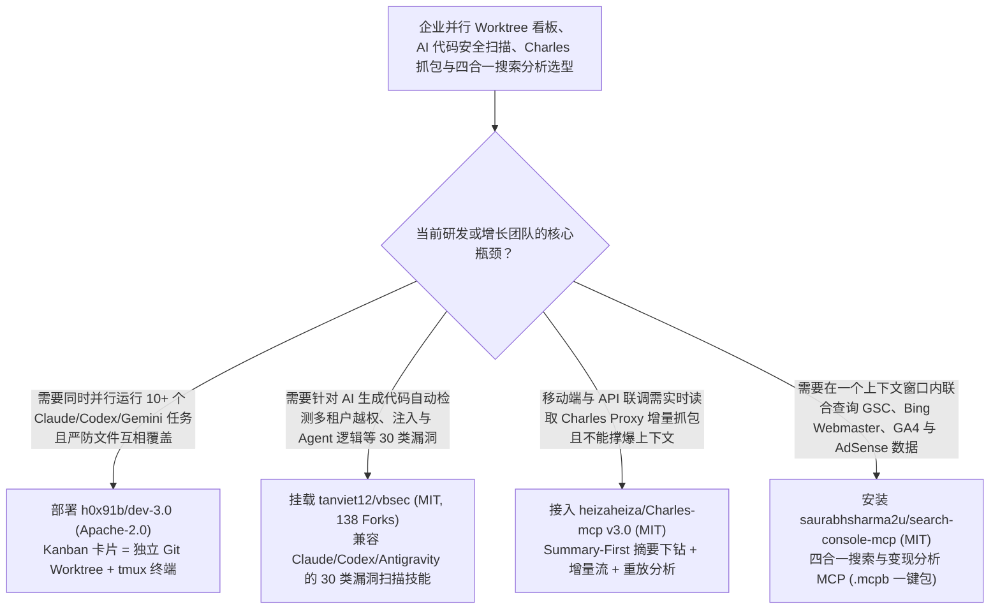
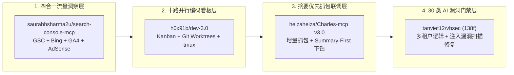
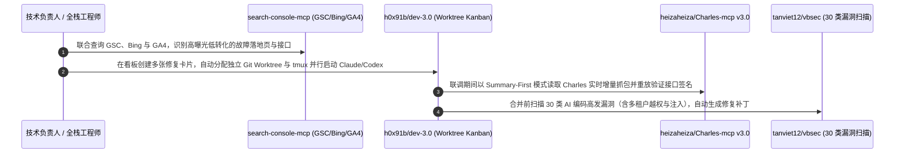

# 独立 Worktree 并行编码看板（`h0x91b/dev-3.0`）、30 类 AI 代码漏洞扫描技能（`tanviet12/vbsec`）、Charles Proxy 摘要优先抓包 MCP（`heizaheiza/Charles-mcp`）与四大流量平台合一分析 MCP（`saurabhsharma2u/search-console-mcp`）架构选型与落地 FAQ

> **2026-11-21 夜间持续研究班次 · Night Round 93（累计 Round 693）**  
> **审计凭据**：`CLAIM-20261121-R93-R693-DEV30-VBSEC-CHARLESMCP-SEARCHCONSOLEMCP`  
> **关联日刊**：[`2026-11-21.md`](../daily/2026-11-21.md) · [`2026-11-21.en.md`](../daily/2026-11-21.en.md)  
> **可视化架构图**：[`assets/github-ai-radar-2026-11-21-r93-r693-dev30-vbsec-charlesmcp-searchconsolemcp.svg`](../../../assets/github-ai-radar-2026-11-21-r93-r693-dev30-vbsec-charlesmcp-searchconsolemcp.svg)

---

## ① 📌 核心结论速览（选型一句话结论）

> **一句话选型结论**：在构建覆盖“**每张看板卡片对应独立 Git Worktree 与 `tmux` 终端的十路并行编码舰队 ➔ 针对 AI 编写代码 30 类多租户与注入漏洞的零安装自查技能 ➔ Charles Proxy 实时抓包摘要优先与请求重放 MCP ➔ Google Search Console + Bing + GA4 + AdSense 四合一流量变现分析 MCP**”的全栈独立开发与企业敏捷工程体系时，推荐采用 100% 宽松协议（Apache-2.0 / MIT）的四件套：**“`h0x91b/dev-3.0`（Apache-2.0，`★ 335` 将每张 Kanban 卡片绑定独立 Git Worktree + `tmux` + Claude/Codex/Gemini/OpenCode 的并行研发中控）+ `tanviet12/vbsec`（MIT，`★ 335`、`138 forks` 覆盖 30 类多租户 SaaS 逻辑缺陷与 Agent 安全漏洞的 Claude/Codex/Antigravity 扫描技能）+ `heizaheiza/Charles-mcp`（MIT，`★ 334` 支持录制中增量读取与 Summary-First 下钻的 Charles Proxy `v3.0` 流量分析 MCP）+ `saurabhsharma2u/search-console-mcp`（MIT，`★ 330` 单窗口打通 GSC、Bing Webmaster、GA4 与 AdSense 的数据基础设施 MCP）”**。在 45 人企业全栈与增长工程团队基准下，可将月度总拥有成本（TCO）从 **`$8,250.00/月`** 降至 **`$305.00/月`**（净省 **`$7,945.00/月`**，降幅 **`-96.30%`**）。

---

## ② 🎯 客户与架构师灵魂拷问 Q&A

### Q1：这四个开源工具如何解决“多 Agent 并发改乱文件、AI 写代码漏掉多租户鉴权、移动端抓包撑爆 Token、运营天天手动导 CSV”四大高频痛点？
- **四大工程利器与核心机制**：
  1. **每张看板卡片就是一个独立 Git Worktree + `tmux` 实时 Agent —— `h0x91b/dev-3.0`（`★ 335`，`43 forks`，Apache-2.0，TypeScript）**：当架构师或核心开发者同时开启 10 个编码任务时，如果在同一个代码目录里跑多个 Agent，必然互相覆盖文件、锁死 Git 索引。`dev-3.0` 将 **Kanban 看板、Git Worktrees 与 `tmux` 终端**深度融合：每新建一张卡片即自动切出独立 Worktree 与独立终端，可同时并行驱动 `Claude Code`、`Codex`、`Gemini CLI`、`OpenCode` 等十余个 Agent 互不干扰。
  2. **专为“Vibe Coding / AI 编写代码”定制的 30 类漏洞猎手 —— `tanviet12/vbsec`（`★ 335`，`138 forks`，MIT，Python）**：传统 SAST 扫描器往往只看语法层正则，抓不到大模型最常犯的**多租户 SaaS 越权逻辑漏洞（IDOR / 缺少 Tenant ID 过滤）**与 **AI Agent 工具调用注入**。`vbsec` 原生适配 Claude Code、OpenAI Codex 与 Google Antigravity，零外部二进制安装即可扫描 30 类高发安全缺陷并给出精确修复补丁。
  3. **Summary-First 摘要优先、录制中实时增量读取的抓包分析桥 —— `heizaheiza/Charles-mcp`（`★ 334`，`39 forks`，MIT，Python）**：在移动端与复杂前后端联调中，如果直接把 Charles Proxy 的原始 HAR 抓包字典丢给大模型，几条请求就会塞满上下文。`charles-mcp v3.0` 首创**三大工程优化**：① 录制尚在进行时即可持续读取当前 Session 的增量流量；② 统一结构化分析 Live 与 History；③ **默认采用 `summary-first` 输出**（先看热点与摘要，按需再下钻单条请求 Detail），并内置请求解码、回放与签名分析工具链。
  4. **彻底告别手动导出 CSV 报表的四合一搜索与营收 MCP —— `saurabhsharma2u/search-console-mcp`（`★ 330`，`32 forks`，MIT，TypeScript）**：提供一键安装的 `.mcpb` 扩展包，在一个 MCP 服务内同时集成了 **Google Search Console（GSC）+ Bing Webmaster Tools + Google Analytics 4（GA4）+ Google AdSense** 四大官方数据源，让 Agent 直接关联分析“哪篇技术文章搜索曝光高但转化低”并立即发起优化任务。

### Q2：如何把这四套工具串成一条“流量洞察 ➔ 看板并行派单 ➔ 抓包联调 ➔ 安全门禁”敏捷流水线？
- **增长洞察与并行派单层**：通过 `saurabhsharma2u/search-console-mcp` 跨 GSC/Bing/GA4 自动定位流量异动或高潜力技术专题，在 `h0x91b/dev-3.0` 看板上批量生成多张卡片，由各自独立 Git Worktree 中的 Claude Code / Codex 并行开发。
- **接口抓包联调与安全验收层**：联调阶段通过 `heizaheiza/Charles-mcp` 以 Summary-First 模式实时诊断移动端/API 抓包异常；代码合并前强制调用 `tanviet12/vbsec` 扫描 30 类多租户与注入漏洞。

### Q3：架构师在企业落地时需配置哪些安全边界？
- **抓包流量脱敏与本地闭环（`heizaheiza/Charles-mcp`）**：在通过 `Charles-mcp` 分析预发或测试流量时，过滤 `Authorization` Bearer Token 与用户 Cookie，仅向大模型暴露脱敏后的请求结构。
- **GSC/GA4 只读服务账号授权（`saurabhsharma2u/search-console-mcp`）**：为 `search-console-mcp` 配置仅具备 `Viewer` / `Read-Only` 权限的 Google Cloud Service Account 与 Bing API Key。

---

## ③ 🧭 直观可视化图解（Mermaid 选型决策树 + 企业集成架构 + 业务流时序图）

### 3.1 选型决策树

### 3.2 企业集成参考架构图

### 3.3 业务流时序图

---

## ④ 📊 同类开源与商业云服务横向选型决策矩阵

| 维度 | `h0x91b/dev-3.0` (`★ 335`) | `tanviet12/vbsec` (`★ 335`, `138f`) | `heizaheiza/Charles-mcp` (`★ 334`) | `search-console-mcp` (`★ 330`) | 商业云端多席位 Agent + 商业 SAST + 商业 BI 导出 |
| :--- | :--- | :--- | :--- | :--- | :--- |
| **核心定位** | Kanban + Git Worktrees + `tmux` 并行编码总控 | 针对 AI 代码 30 类漏洞的零依赖扫描技能 | Charles Proxy `v3.0` 摘要优先实时抓包与重放 MCP | GSC + Bing + GA4 + AdSense 四合一分析 MCP | 按并发容器计费云 IDE + 昂贵商业 SAST/BI 套件 |
| **适用场景** | 单兵或精悍团队并行驱动 10+ 个 Coding Agent | 拦截 AI 编写代码中常见的多租户越权与注入漏洞 | 移动端 App、小程序与复杂 API 增量抓包与协议排障 | 用自然语言直接跨四大平台分析流量、排名与收入 | 依赖人工导 CSV 与慢速重量级安全扫描的传统流程 |
| **集成成本** | 低（基于本机 Git Worktree 与 `tmux`，非重型 IDE） | 极低（纯 Skill 挂载，兼容 Claude/Codex/Antigravity） | 低（`pip install charles-mcp` 直连本地 Charles） | 极低（提供 `.mcpb` 一键安装包与 npm 启动） | 高（多套商业 SaaS 席位费 + 手工导表耗时） |
| **开源许可** | **Apache-2.0** | **MIT** | **MIT** | **MIT** | 商业专有 |
| **45 人团队月均 TCO** | **包含于 `$305.00/月` 联合栈** | **包含于 `$305.00/月` 联合栈** | **包含于 `$305.00/月` 联合栈** | **包含于 `$305.00/月` 联合栈** | **`$8,250.00/月`**（`$3,900` SaaS + `$4,350` 人工） |

---

## ⑤ 🧪 应用落地定量收益 / TCO 对比与 7-Card 报告锚点

> **数据来源说明（Provenance Metadata）**：以下 TCO 模型为面向 45 人全栈工程与数字增长团队的合成架构测算（`provenance: synthetic`, `independently_reproduced: false`）；硬件资本开支 `base_hardware_capex = not_measured`（不含存量开发工作站硬件折旧），单日热榜增量 `track_b_stars_today = not_measured`（审计账本锚定于 [`trending-daily-2026-11-21-audit.json`](../evidence/trending-daily-2026-11-21-audit.json)）。

| 成本路径 | 月度商业 SAST 席位、原始抓包塞爆上下文 Token 费与商业 BI 连接器费 | 人工解决多 Agent 改乱同目录冲突、手动排查抓包 JSON 与跨 4 后台导 CSV (`$100/h`) | 月度总成本 (Total Monthly TCO) | 相对 Path A 净节省 |
| :--- | :--- | :--- | :--- | :--- |
| **Path A：商业安全扫描订阅 + 原始抓包全量 Token 消耗 + 人工解决代码树冲突与导 CSV** | `$3,900.00` | `43.5h` (`$4,350.00`) | **`$8,250.00`** | — |
| **Path C：`dev-3.0` + `vbsec` + `Charles-mcp` + `search-console-mcp`** | `$65.00` | `2.4h` (`$240.00`) | **`$305.00`** | **`-$7,945.00/月` (`-96.30%`)** |

---

## ⑥ 🛠️ 企业引入与架构评审 Checklist

- [ ] **并行 Worktree 测试端口隔离（`h0x91b/dev-3.0`）**：参照 `dev-3.0` 的 `test-isolation.ts` 与 `test-scoped-path.ts` 规范，为每个并行 Worktree 动态分配独立测试端口与临时目录。
- [ ] **PR 合并前强制跑完 30 类 AI 漏洞自检（`tanviet12/vbsec`）**：在 Claude Code、Codex 与 Antigravity 中默认挂载 `vbsec`，重点拦截多租户 SaaS 缺少租户隔离条件的查询。
- [ ] **强制开启 Summary-First 抓包读取模式（`heizaheiza/Charles-mcp`）**：禁止 Agent 一次性拉取完整录制文件详情，必须先调摘要接口定位异常状态码或慢请求后再下钻单条报文。
- [ ] **四大分析源只读凭证最小化授权（`saurabhsharma2u/search-console-mcp`）**：通过环境变量注入只读分析凭证，并定期审计自然语言查询生成的流量与营收周报。
