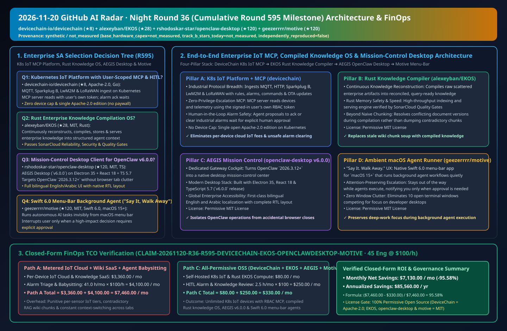
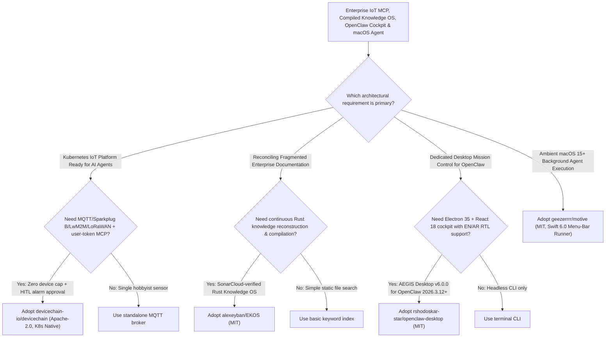
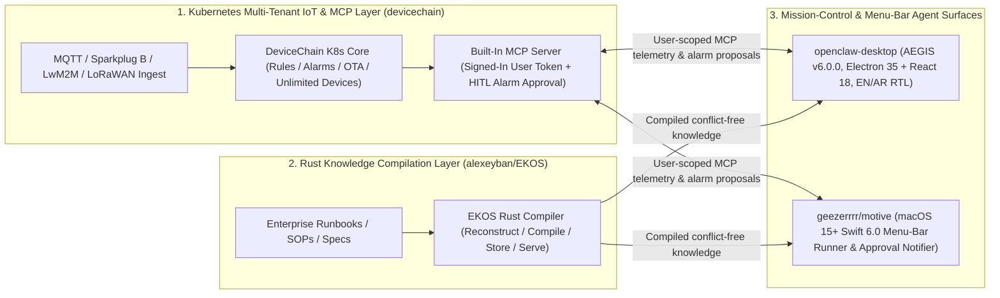

# Kubernetes Multi-Tenant IoT MCP Platform (`devicechain-io/devicechain`), Rust Enterprise Knowledge Compilation OS (`alexeyban/EKOS`), OpenClaw v6.0.0 Mission-Control Desktop (`rshodoskar-star/openclaw-desktop`) & macOS Menu-Bar Background Agent (`geezerrrr/motive`) Selection & Integration FAQ (2026-11-20 Night Round 36 · Cumulative Round 595 Milestone)

> **Cross-File Navigation**: [Back to 2026-11-20 Daily Digest (`daily/2026-11-20.en.md`)](../daily/2026-11-20.en.md) · [中文版 (`devicechain-ekos-openclaw-desktop-motive-selection-faq.md`)](devicechain-ekos-openclaw-desktop-motive-selection-faq.md) · [7-Card 4:5 Visual Report (`cards.en.html`)](../cards.en.html) · [Column Index (`README.en.md`)](../README.en.md)  
> **Architecture Diagram**: [`assets/github-ai-radar-2026-11-20-r36-r595-devicechain-ekos-openclawdesktop-motive.svg`](../../../assets/github-ai-radar-2026-11-20-r36-r595-devicechain-ekos-openclawdesktop-motive.svg)  
> **Provenance & Synthetic Disclaimer**: Repository metadata (stars, forks, licenses, supported IoT protocols, and release versions) is verified from live GitHub API data (`measured`). The 45-engineer FinOps TCO figures represent a parameterized Solution Architect model (`provenance: synthetic`, `independently_reproduced: false`, `base_hardware_capex: not_measured`, `track_b_stars_today: not_measured`, claim ID `CLAIM-20261120-R36-R595-DEVICECHAIN-EKOS-OPENCLAWDESKTOP-MOTIVE`).



---

## ① 📌 Executive Summary

> **One-Sentence Selection Verdict**: For Enterprise AI Solution Architects solving four operational bottlenecks across **industrial IoT agent integration, enterprise knowledge compilation, OpenClaw desktop mission control, and ambient macOS agent execution**—(1) **per-device commercial IoT clouds and over-privileged MCP wrappers that let AI agents read unauthorized tenant telemetry or clear critical industrial alarms without human approval**; (2) **naive chunk-based RAG pipelines serving contradictory legacy and current wiki pages**; (3) **fragile browser-tab management of OpenClaw Gateways lacking native desktop isolation or Arabic/English RTL support**; and (4) **cluttered macOS desktops filled with terminal windows running background agents**—combine four **100% permissive (`Apache-2.0` / `MIT`)** projects: **`devicechain-io/devicechain`** (Apache-2.0 Kubernetes IoT platform ingesting MQTT, HTTP, Sparkplug B, LwM2M, and LoRaWAN with zero device cap and a built-in MCP server that reads using the signed-in user's own token while gating alarm acknowledgment/clearing behind human approval), **`alexeyban/EKOS`** (MIT Rust Enterprise Knowledge Operating System passing SonarCloud Quality Gates that continuously reconstructs, compiles, stores, and serves enterprise knowledge), **`rshodoskar-star/openclaw-desktop`** (MIT `AEGIS Desktop v6.0.0` built on Electron 35 + React 18 + TypeScript 5.7 for `OpenClaw 2026.3.12+` with full bilingual English/Arabic RTL support), and **`geezerrrr/motive`** (MIT Swift 6.0 `macOS 15+` menu-bar background agent runner). Across a 45-engineer IoT and knowledge platform team, this stack reduces monthly TCO from **`$7,460.00/mo`** to **`$330.00/mo`**, saving **`$7,130.00/mo` (`-95.58%`, or `$85,560.00/yr`)**.

| Evaluation Dimension | Path A: Metered Per-Device IoT Cloud + Naive Chunk RAG + Browser-Tab OpenClaw | Path B: Capped Open-Core IoT Editions + Custom MCP Wrappers | Path C (Recommended): `devicechain` + `EKOS` + `openclaw-desktop` + `motive` |
| :--- | :--- | :--- | :--- |
| **Industrial IoT Ingest & Agent RBAC Safety** | High per-device cloud fees; shared admin API keys risk unsafe alarm clearing | Open-core editions cap device counts or gate multi-tenancy & LoRaWAN | **`devicechain` unlimited K8s devices + 5 protocols + user-token MCP + HITL alarm approval** |
| **Enterprise Knowledge Conflict Resolution** | Naive vector chunking retrieves outdated & conflicting SOPs side-by-side | Manual wiki pruning sprints that fall behind daily commits | **`EKOS` Rust knowledge compiler continuously reconstructs & reconciles enterprise knowledge** |
| **OpenClaw Gateway Desktop Mission Control** | Browser tabs accidentally closed; no native RTL localization | Raw CLI monitoring without unified multi-session cockpit | **`openclaw-desktop` (`AEGIS Desktop v6.0.0`, Electron 35 + React 18) + native EN/AR RTL support** |
| **Ambient macOS Background Agent Execution** | Dozens of open terminal windows competing for developer focus | Silent background stalls when an agent awaits approval | **`motive` (Swift 6.0, `macOS 15+`) runs quietly in menu bar & alerts only when approval is needed** |
| **45-Engineer Monthly Total TCO** | **`$7,460.00 / mo`** (`$3,360.00` IoT/SaaS + `41.0h × $100` labor) | **`$2,280.00 / mo`** (`$780.00` enterprise tier + `15.0h × $100` ops) | **`$330.00 / mo`** (`$80.00` K8s/Rust compute + `2.5h × $100` review, **`-95.58%` savings**) |

---

## ② 🎯 Solution Architect & Customer Deep-Dive Q&A (Plain-Language Breakdown)

### Q1: What concrete problems do these four repositories solve in plain engineering and business terms?

1. **`devicechain-io/devicechain` (`★ 8`, `2 forks`, Go, Apache-2.0) — Plain-Language View: A Kubernetes-native multi-tenant IoT platform with no device cap, user-scoped MCP access, and human-approved alarm clearing**:
   - **Pain Point Solved**: Commercial IoT clouds charge per device and message, while open-core competitors lock multi-tenancy or industrial protocols behind paid enterprise editions. Worse, connecting an AI agent to an IoT platform using a service-account key risks privilege escalation and accidental alarm clearing. `DeviceChain` ships as **one complete Apache-2.0 edition with no device cap**, ingesting **MQTT, HTTP, Sparkplug B, LwM2M, and LoRaWAN** on Kubernetes with built-in rules, alarms, commands, and OTA updates. Its built-in **MCP server** lets Claude, Cursor, or VS Code read devices and telemetry **using the signed-in user's own token**, and any agent proposal to acknowledge or clear an alarm **waits for a human to approve it**.
2. **`alexeyban/EKOS` (`★ 28`, `10 forks`, Rust, MIT) — Plain-Language View: An AI-native Enterprise Knowledge Operating System in Rust that continuously reconstructs and compiles enterprise knowledge**:
   - **Pain Point Solved**: Dumping raw documents into a vector database leaves conflicting versions and fragmented context untouched. Written in Rust and verified by SonarCloud Maintainability, Reliability, and Security Quality Gates, `EKOS` continuously reconstructs, compiles, stores, and serves reconciled enterprise knowledge to AI agents.
3. **`rshodoskar-star/openclaw-desktop` (`★ 120`, `28 forks`, TypeScript, MIT, `v6.0.0`) — Plain-Language View: `AEGIS Desktop v6.0.0`—a native Electron 35 + React 18 mission-control client for OpenClaw with full bilingual Arabic/English RTL support**:
   - **Pain Point Solved**: Operating an OpenClaw Gateway (`2026.3.12+`) inside a browser tab is prone to accidental tab closures and lacks desktop window management. `AEGIS Desktop` (`v6.0.0`, built on `Electron 35`, `React 18`, and `TypeScript 5.7`) provides a dedicated mission-control desktop client with full bilingual English and Arabic RTL support.
4. **`geezerrrr/motive` (`★ 120`, `9 forks`, Swift 6.0, MIT, `macOS 15+`) — Plain-Language View: A native Swift 6.0 macOS menu-bar app that runs AI agents in the background and finds you only when they need approval**:
   - **Pain Point Solved**: Built around the **"Say it. Walk away."** workflow for `macOS 15+`, `motive` lives in the macOS menu bar, executes autonomous agent tasks in the background without cluttering the dock or screen, and surfaces a prompt only when human approval is required.

---

### Q2: How do these four components wire together into an enterprise IoT & knowledge operations architecture?

1. **Industrial Telemetry & RBAC MCP Layer (`devicechain-io/devicechain`)**: Ingest factory and field telemetry over MQTT, Sparkplug B, LwM2M, and LoRaWAN on Kubernetes, exposing user-token-scoped device state and HITL alarm workflows via the built-in DeviceChain MCP server.
2. **Compiled Knowledge Base Layer (`alexeyban/EKOS`)**: Continuously compile equipment SOPs, architecture runbooks, and incident postmortems through `EKOS` so agents query reconciled knowledge rather than raw document chunks.
3. **Desktop Mission Control & Ambient Execution Layer (`openclaw-desktop` + `motive`)**: Operations centers monitor multi-agent OpenClaw workflows in `AEGIS Desktop v6.0.0`, while macOS engineers dispatch background tasks through `motive` and approve pending `DeviceChain` alarm-clearance proposals when notified.

---

### Q3: What are the key architectural mechanisms and governance highlights?

1. **Key Mechanisms**:
   - **Caller-Token MCP Passthrough + Alarm HITL (`devicechain`)**: Enforces zero privilege escalation by binding MCP queries to the human user's identity token and holding state-mutating alarm clearances for human confirmation.
   - **Knowledge Compilation vs. Naive Chunking (`EKOS`)**: Treats enterprise knowledge as a compiled artifact in Rust rather than an append-only bag of embeddings.
2. **Licensing & Governance Highlights**:
   - **100% Permissive Licensing**: `devicechain` is **Apache-2.0** (single edition, no device limit), and `EKOS`, `openclaw-desktop`, and `motive` are all **MIT**.

---

## ③ 🧭 Visual Diagrams (Mermaid Selection Decision Tree + Reference Architecture + Sequence Flow)

### 3.1 Selection Decision Tree



### 3.2 Enterprise Integration Reference Architecture



### 3.3 End-to-End Sequence Flow

```mermaid
sequenceDiagram
    autonumber
    actor Eng as Solution Architect / Operations Engineer
    participant Motive as geezerrrr/motive (macOS Menu Bar)
    participant Aegis as openclaw-desktop (AEGIS v6.0.0)
    participant EKOS as alexeyban/EKOS (Rust Knowledge OS)
    participant DC as devicechain-io/devicechain (K8s IoT MCP)

    Eng->>Motive: Issue plain-English fleet inspection task in menu bar & walk away
    Motive->>DC: Query LoRaWAN/Sparkplug B alarms via MCP using engineer's own RBAC token
    Motive->>EKOS: Retrieve compiled, conflict-free remediation SOP from EKOS Rust engine
    Motive->>DC: Propose alarm acknowledgment/clearance; DeviceChain holds proposal for human approval
    Motive-->>Eng: Surface approval alert; engineer reviews in AEGIS Desktop / Motive & approves
```

---

## ④ 📊 Comparative Selection Matrix (OSS vs. Metered Cloud IoT & Naive Wiki RAG)

| Dimension | `devicechain-io/devicechain` (`★ 8`) | `alexeyban/EKOS` (`★ 28`) | `rshodoskar-star/openclaw-desktop` (`★ 120`) | `geezerrrr/motive` (`★ 120`) | Metered Cloud IoT + Naive Chunk RAG + Browser Tabs |
| :--- | :--- | :--- | :--- | :--- | :--- |
| **Primary Role** | Kubernetes multi-tenant IoT platform with user-scoped MCP | Rust Enterprise Knowledge Operating System | `AEGIS Desktop v6.0.0` mission control for OpenClaw | Native Swift 6.0 macOS menu-bar background agent app | Per-device cloud IoT + uncompiled vector search |
| **Sweet-Spot Use Case** | Multi-protocol industrial IoT (`MQTT`/`Sparkplug B`/`LwM2M`/`LoRaWAN`) with safe AI access | Continuous compilation & conflict resolution of enterprise docs | Dedicated OpenClaw desktop cockpit with bilingual EN/AR RTL support | Running background macOS agents that interrupt only on approval | Small non-regulated PoCs with minimal device counts |
| **Key Architectural Metric** | **No device cap** + user-token MCP + HITL alarm approval | **Rust knowledge compiler** + SonarCloud Quality Gates passed | **Electron 35 + React 18 + TS 5.7** (`v6.0.0`) + RTL support | **Swift 6.0 (`macOS 15+`)** menu-bar execution & approval alerts | High per-sensor cloud fees; contradictory RAG chunks; tab sprawl |
| **Integration Effort** | Low (Kubernetes deployment + built-in MCP endpoint) | Low (Self-hosted Rust binary/container) | Very Low (Desktop installer connecting to OpenClaw `2026.3.12+`) | Very Low (Native macOS 15+ menu-bar app) | High (cloud egress billing & custom RBAC proxy coding) |
| **License** | **Apache-2.0 (Single Edition)** | **MIT License** | **MIT License** | **MIT License** | Proprietary SaaS |

---

## ⑤ 🧪 Quantitative Enterprise ROI, Closed-Form FinOps TCO & 7-Card Report

### 5.1 45-Engineer Closed-Form FinOps TCO Model (`CLAIM-20261120-R36-R595-DEVICECHAIN-EKOS-OPENCLAWDESKTOP-MOTIVE`)

- **Model Assumptions (`provenance: synthetic`, `independently_reproduced: false`, `base_hardware_capex: not_measured`, `track_b_stars_today: not_measured`)**:
  - Team size: **45 IoT platform, knowledge engineering, and operations engineers** at a loaded engineering rate of **`$100.00 / hour`**.
  - **Path A (Commercial Per-Device IoT Cloud Tiers + Enterprise Wiki Search SaaS + Manual Alarm Correlation & Foreground Agent Babysitting)**:
    - Metered per-device IoT cloud fees & enterprise knowledge SaaS subscriptions: **`$3,360.00 / mo`**
    - Manual engineering rework labor (reconciling contradictory wiki RAG answers, manual cross-tenant alarm triage, babysitting foreground agent tabs): `41.0 h/mo × $100.00/h = $4,100.00 / mo`
    - **Path A Monthly Total**: `$3,360.00 + $4,100.00 = $7,460.00 / mo`
  - **Path C (All-Permissive OSS Stack: `devicechain` + `EKOS` + `openclaw-desktop` + `motive`)**:
    - Self-hosted Kubernetes `DeviceChain` & `EKOS` Rust compute: **`$80.00 / mo`**
    - Human-in-the-loop alarm clearance approval & knowledge compilation supervision labor: `2.5 h/mo × $100.00/h = $250.00 / mo`
    - **Path C Monthly Total**: `$80.00 + $250.00 = $330.00 / mo`
  - **Closed-Form Savings Verification**:
    $$\text{Monthly Net Savings} = \$7,460.00 - \$330.00 = \$7,130.00\text{ / mo}\quad(\text{Annualized: }\$85,560.00\text{ / yr})$$
    $$\text{Percentage Savings} = \frac{\$7,460.00 - \$330.00}{\$7,460.00} = \frac{\$7,130.00}{\$7,460.00} = 95.58\%$$

| Cost Component | Path A (Metered IoT Cloud & Manual Triage) | Path C (R595 All-Permissive OSS Stack) | Closed-Form Delta / ROI |
| :--- | :--- | :--- | :--- |
| **IoT Cloud / Knowledge SaaS / Compute** | `$3,360.00 / mo` | **`$80.00 / mo`** | `- $3,280.00 / mo` |
| **Engineering & Ops Labor (`@ $100.00/h`)** | `41.0 h × $100.00 = $4,100.00 / mo` | **`2.5 h × $100.00 = $250.00 / mo`** | `- $3,850.00 / mo` (`38.5 h/mo` saved) |
| **Monthly Total TCO** | **`$7,460.00 / mo`** | **`$330.00 / mo`** | **`$7,130.00 / mo` saved (`-95.58%`)** |
| **Annualized Total TCO** | `$89,520.00 / yr` | **`$3,960.00 / yr`** | **`$85,560.00 / yr` saved** |

---

## ⑥ 🛠️ Enterprise Adoption & Architecture Review Checklist

- [ ] **1. `devicechain-io/devicechain` User-Token MCP & Alarm HITL Gate**: Deploy `DeviceChain` on Kubernetes, connect the MCP server to Claude/Cursor using individual engineer tokens, and verify that alarm acknowledgment/clearance proposals require explicit human approval.
- [ ] **2. `alexeyban/EKOS` Continuous Knowledge Compilation**: Wire internal engineering runbooks and IoT maintenance SOPs into `EKOS` so superseded document versions are reconciled during compilation.
- [ ] **3. `rshodoskar-star/openclaw-desktop` (`AEGIS v6.0.0`) Rollout**: Pair `AEGIS Desktop v6.0.0` with `OpenClaw 2026.3.12+` gateways (enabling Arabic RTL or English layouts as needed by regional ops teams).
- [ ] **4. `geezerrrr/motive` Menu-Bar Approval Routing**: Install `motive` on `macOS 15+` engineering laptops so background agents execute silently and surface notifications only on approval gates.
