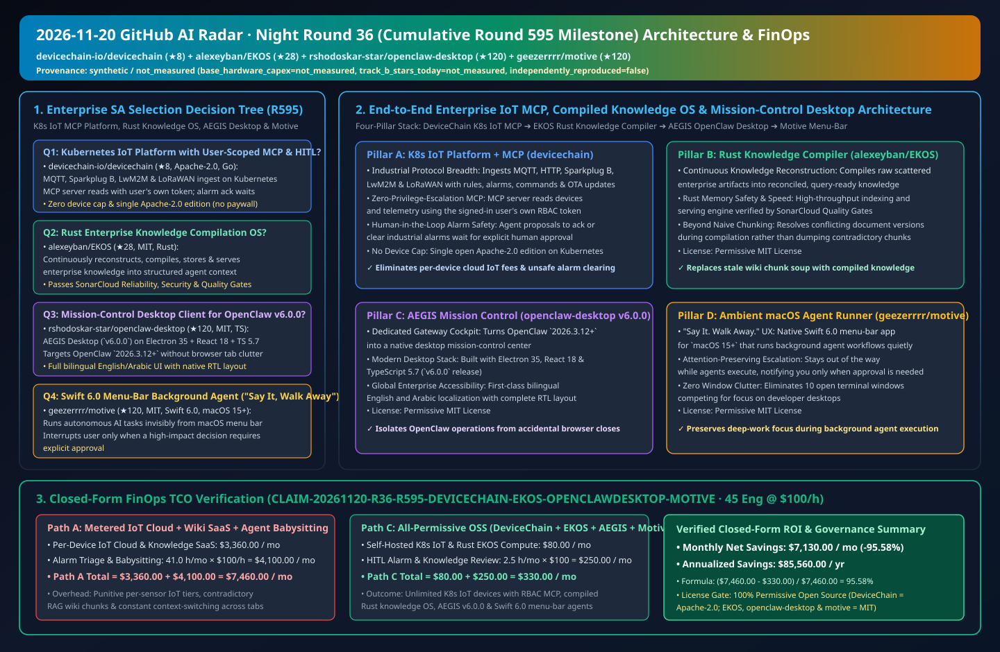
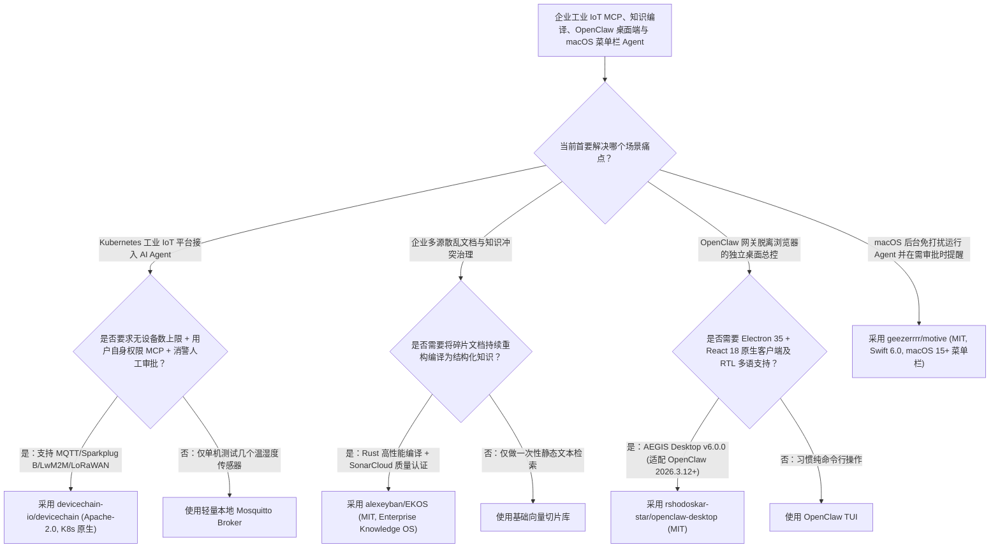
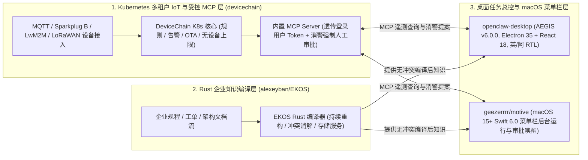
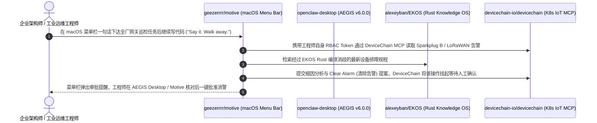

# Kubernetes 多租户工业物联网 MCP 平台（`devicechain-io/devicechain`）、Rust 企业知识编译操作系统（`alexeyban/EKOS`）、OpenClaw v6.0.0 桌面任务控制中心（`rshodoskar-star/openclaw-desktop`）与 macOS 菜单栏无感后台 Agent（`geezerrrr/motive`）架构选型与集成 FAQ（2026-11-20 Night Round 36 · 累计 Round 595 Milestone）

> **跨文件导航**：[返回 2026-11-20 当日全景日报 (`daily/2026-11-20.md`)](../daily/2026-11-20.md) · [English Version (`devicechain-ekos-openclaw-desktop-motive-selection-faq.en.md`)](devicechain-ekos-openclaw-desktop-motive-selection-faq.en.md) · [查看 7-Card 4:5 评测报告 (`cards.html`)](../cards.html) · [返回专栏主索引 (`README.md`)](../README.md)  
> **本轮架构大图**：[`assets/github-ai-radar-2026-11-20-r36-r595-devicechain-ekos-openclawdesktop-motive.svg`](../../../assets/github-ai-radar-2026-11-20-r36-r595-devicechain-ekos-openclawdesktop-motive.svg)  
> **数据溯源与口径声明（Provenance & Synthetic Disclaimer）**：本报告中实时采集的 GitHub 仓库元数据（Stars、Forks、License、支持工业协议与版本架构）为 `measured`；针对 45 人企业工业物联网、知识管理与桌面 Agent 团队的 FinOps TCO 测算参数属于架构师参数化测算模型（`provenance: synthetic`，`independently_reproduced: false`，`base_hardware_capex: not_measured`，`track_b_stars_today: not_measured`，审计契约号 `CLAIM-20261120-R36-R595-DEVICECHAIN-EKOS-OPENCLAWDESKTOP-MOTIVE`）。

---

## ① 📌 核心结论速览（Executive Summary）

> **一句话选型结论**：面向企业 AI 解决方案架构师（SA）在打通**工业物联网（IoT）设备遥测与 AI Agent 安全交互、企业碎片化知识持续编译、OpenClaw 桌面总控以及 macOS 后台免打扰 Agent 执行**时的四大痛点——① **商业云 IoT 平台按设备数与消息条数阶梯收费，且给 AI 开放的接口往往使用超级管理员密钥，存在 AI 越权读取设备或擅自清除产线告警的巨大风险**；② **传统 RAG 直接把过期的 Wiki 页面切块塞进向量库，新旧文档冲突导致 Agent 回答自相矛盾**；③ **在浏览器标签页里管 OpenClaw 网关极易因误关浏览器或标签页崩溃中断任务，且缺乏原生中阿（RTL）双语桌面总控台**；④ **在 macOS 上跑后台 Agent 需要开满十几个终端窗口，严重打断工程师深度编码注意力**——建议采用 **100% 宽松商业友好协议（Apache-2.0 / MIT）** 的四款项目：**`devicechain-io/devicechain`**（Apache-2.0 协议、运行在 Kubernetes 上的无设备数上限多租户 IoT 平台，支持 MQTT / Sparkplug B / LwM2M / LoRaWAN，内置**严格复用当前登录用户自身权限令牌的 MCP Server**，且 AI 提出的告警确认/清除操作必须等待人工批准）、**`alexeyban/EKOS`**（MIT 协议、通过 SonarCloud 质量门禁的 Rust 企业知识操作系统，持续重构、编译、存储并服务企业知识）、**`rshodoskar-star/openclaw-desktop`**（MIT 协议的 `AEGIS Desktop v6.0.0`，基于 Electron 35 + React 18 + TypeScript 5.7 打造的 OpenClaw 桌面任务控制中心，原生支持英/阿 RTL 双语）与 **`geezerrrr/motive`**（MIT 协议、基于 Swift 6.0 专为 `macOS 15+` 打造的菜单栏后台 Agent 运行器——“说完即走，仅在需审批时找你”）。在 45 人企业物联网与知识工程团队模型下，该组合可将月度总拥有成本（TCO）从 **`$7,460.00/月`** 降至 **`$330.00/月`**，净省 **`$7,130.00/月`（`-95.58%`，年省 `$85,560.00`）**。

| 评估维度 | 方案 A：商业按设备计费云 IoT + 传统切片 RAG 知识库 + 浏览器标签页跑 OpenClaw | 方案 B：开源阉割社区版 IoT（有设备上限或无原生 RBAC MCP） | 方案 C（推荐）：`devicechain` + `EKOS` + `openclaw-desktop` + `motive` |
| :--- | :--- | :--- | :--- |
| **工业 IoT 协议接入与 AI Agent 权限边界** | 按设备/消息高价收费；AI 借用全局 API Key 易越权清掉关键产线告警 | 社区版阉割多租户或 LoRaWAN/Sparkplug B，无内置 MCP Server | **`devicechain` K8s 原生无设备上限 + 5 大工业协议 + 继承登录用户权限的 MCP + 消警强制人工审批** |
| **企业知识库新旧冲突消解与编译** | 传统向量切片把 3 年前的旧规范与新规范一起召回，误导 Agent | 人工定期手动删旧文档，维护成本极高 | **`EKOS`（Rust 编写，通过 SonarCloud 门禁）持续重构与编译企业知识，在入库阶段消解版本冲突** |
| **OpenClaw 网关桌面总控与多语言支持** | 混杂在几十个浏览器标签页中，误关即失联，无原生 RTL 布局支持 | 命令行纯文本观察，缺乏全局多任务仪表盘 | **`openclaw-desktop`（`AEGIS Desktop v6.0.0`）Electron 35 + React 18 独立任务中心 + 原生英/阿 RTL 支持** |
| **macOS 桌面后台 Agent 免打扰体验** | 桌面铺满终端窗口，工程师被迫频繁切屏查看进度 | 后台静默失败或卡在权限请求无人知晓 | **`motive`（Swift 6.0，`macOS 15+`）常驻顶部菜单栏隐形运行，仅在需要人工审批时精准唤醒用户** |
| **45 人团队月度总成本（TCO）** | **`$7,460.00 / 月`**（`$3,360.00` 云 IoT/SaaS + `41.0h × $100` 人工） | **`$2,280.00 / 月`**（`$780.00` 商业版升级费 + `15.0h × $100` 人工维护） | **`$330.00 / 月`**（`$80.00` K8s/Rust 算力 + `2.5h × $100` 审批，**净省 `95.58%`**） |

---

## ② 🎯 客户与架构师灵魂拷问 Q&A（通俗解构）

### Q1：这四个开源项目各自解决什么痛点？用大白话怎么向业务方和工程团队解释？

1. **`devicechain-io/devicechain`（`★ 8`，`2 forks`，Go，Apache-2.0）——用大白话讲：它是“没有阉割版套路、不限设备数量、自带用户级权限 MCP 与人工消警审批的 Kubernetes 工业物联网平台”**：
   - **解决什么痛点**：很多开源 IoT 平台（如某些“开放核心 Open-Core”产品）免费版限制设备数或砍掉多租户，而且把 AI 接进物联网平台时最怕两件事：一是 AI 用了管理员 Key 看到了不该看的其他租户设备；二是 AI 自己把严重超温告警给“一键清除（Clear Alarm）”了。`DeviceChain` 承诺**只有一个完整的 Apache-2.0 版本（No device cap and no enterprise edition）**，原生支持 **MQTT、HTTP、Sparkplug B、LwM2M 与 LoRaWAN** 接入、规则告警与 OTA 升级；其内置 **MCP Server** 让 Claude、Cursor 或 VS Code **严格使用当前登录用户自己的权限令牌（User's own token）**读取设备遥测，且 AI 提出确认或清除告警的建议时**必须等待人类明确点击批准**！
2. **`alexeyban/EKOS`（`★ 28`，`10 forks`，Rust，MIT）——用大白话讲：它是用 Rust 打造的“企业知识编译器——不是把文档乱切成碎片塞进向量库，而是持续把碎片信息重构成前后一致的知识操作系统”**：
   - **解决什么痛点**：传统 RAG 的通病是“垃圾进、垃圾出”——公司里有 2024 年的报销制度和 2026 年的新制度，普通向量检索把两段都搜出来，大模型当场精神分裂。`EKOS`（Enterprise Knowledge Operating System，通过 SonarCloud 可维护性、可靠性与安全性质量门禁）像编译器编译源码一样，持续对企业知识进行**重构（Reconstructs）、编译（Compiles）、存储与服务**，为上层 Agent 提供经过冲突消解的结构化真值。
3. **`rshodoskar-star/openclaw-desktop`（`★ 120`，`28 forks`，TypeScript，MIT，`v6.0.0`）——用大白话讲：它是把 OpenClaw 网关变成独立桌面航天指挥中心的 `AEGIS Desktop v6.0.0`**：
   - **解决什么痛点**：长期在浏览器标签页里跑 OpenClaw Web UI 很容易在清理浏览器缓存或误关窗口时打断工作流。`openclaw-desktop`（代号 `AEGIS Desktop`，最新 `v6.0.0`，基于 `Electron 35` + `React 18` + `TypeScript 5.7`，适配 `OpenClaw 2026.3.12+`）提供了脱离浏览器的原生桌面总控体验，并且原生内置完整的**英语/阿拉伯语双语与 RTL（从右向左）排版支持**，非常适合跨国与中东（MENA）区域企业部署。
4. **`geezerrrr/motive`（`★ 120`，`9 forks`，Swift 6.0，MIT）——用大白话讲：它是 macOS 顶部菜单栏里的“隐形 AI 管家——交代完任务你就该干嘛干嘛去，只有需要你拍板签字时它才轻轻敲你”**：
   - **解决什么痛点**：正如其口号 **"Say it. Walk away."**，工程师不想为了跑 3 个后台 Agent 就在 Dock 栏挂 3 个黑乎乎的终端窗口。`motive` 采用最新 `Swift 6.0` 原生开发（面向 `macOS 15+`），安静地驻留在 macOS 顶部菜单栏中调度后台 Agent，平时零视觉干扰，只在任务完成或遇到敏感操作需要你审批时才主动弹出提醒。

---

### Q2：这四个项目如何组合成企业级“物联网监控 + 知识编译 + 桌面总控”端到端架构？

1. **工业现场接入与受控 MCP 暴露层（`devicechain-io/devicechain`）**：在企业 Kubernetes 集群部署 `DeviceChain`，统一汇聚产线 MQTT / Sparkplug B / LwM2M / LoRaWAN 设备遥测与告警，开启内置 MCP Server。
2. **设备手册与运维知识编译层（`alexeyban/EKOS`）**：通过 `EKOS` Rust 引擎将设备维修规程、历史工单与最新安全通告持续编译为无冲突的企业知识底座。
3. **跨平台桌面总控与 macOS 免打扰执行层（`openclaw-desktop` + `motive`）**：
   - 运营中心值班工程师使用 `AEGIS Desktop v6.0.0`（`openclaw-desktop`）集中调度 OpenClaw 巡检 Agent，联合查询 `DeviceChain` 实时遥测与 `EKOS` 维修知识库；
   - 架构师在 Mac 上通过菜单栏 `motive` 派发后台分析任务；当 Agent 诊断出告警原因并向 `DeviceChain` 提交“确认/清除告警”提案时，由值班人员在人工审批门禁处一键确认生效。

---

### Q3：这套架构的核心机制亮点与生产环境治理优势是什么？

1. **核心机制亮点**：
   - **`DeviceChain` 的“用户令牌透传 + 消警 HITL 门禁”**：彻底杜绝了“MCP Server 用一把万能私钥绕过企业 RBAC”的安全漏洞——每个人连上 MCP 只能看到自己权限内的租户设备，且写操作（Acknowledge/Clear Alarm）强制挂起等待人工审批。
   - **`EKOS` 的“知识即代码编译”范式**：用 Rust 强类型管线替代松散的文档切片脚本，大幅降低企业知识库随时间腐化的速度。
2. **许可证与成本优势**：
   - **零商业阉割与 100% 宽松协议**：`DeviceChain` 采用 **Apache-2.0** 且明确承诺无设备数量上限、无付费企业版拆分；`EKOS`、`openclaw-desktop` 与 `motive` 均为 **MIT License**。

---

## ③ 🧭 直观可视化图解（Mermaid 选型决策树 + 集成架构图 + 业务时序图）

### 3.1 选型决策树（Selection Decision Tree）

### 3.2 企业集成参考架构图（Enterprise Reference Architecture）

### 3.3 端到端业务流时序图（End-to-End Sequence Flow）

---

## ④ 📊 同类开源与商业云服务横向选型决策矩阵

| 对比维度 | `devicechain-io/devicechain` (`★ 8`) | `alexeyban/EKOS` (`★ 28`) | `rshodoskar-star/openclaw-desktop` (`★ 120`) | `geezerrrr/motive` (`★ 120`) | 商业云 IoT + 传统切片 RAG + 浏览器标签页运维 |
| :--- | :--- | :--- | :--- | :--- | :--- |
| **核心功能定位** | 带用户级权限 MCP 与人工消警审批的 K8s 工业 IoT 平台 | 持续重构、编译并服务企业知识的 Rust 操作系统 | 面向 OpenClaw 的 `AEGIS Desktop v6.0.0` 桌面总控台 | `macOS 15+` 菜单栏无感后台 Agent 运行与审批唤醒工具 | 按设备/消息计费的商业云组合 |
| **最佳适用场景** | 多租户工业设备接入（MQTT/Sparkplug B/LwM2M/LoRaWAN）与受控 AI 诊断 | 解决企业文档版本冲突、构建高可靠 Agent 知识底座 | 需要独立桌面指挥中心或英/阿 RTL 双语界面的 OpenClaw 团队 | 希望后台跑 Agent 不占终端窗口、仅在需审批时提醒的 Mac 开发者 | 设备量极少、无多租户权限要求的小微场景 |
| **关键性能/架构指标** | **无设备数上限** + 单一 Apache-2.0 版 + 用户 Token MCP + 消警 HITL | **Rust 强类型引擎** + SonarCloud 质量门禁认证 | **Electron 35 + React 18 + TS 5.7** (`v6.0.0`) + 原生 RTL | **Swift 6.0 原生菜单栏** (`macOS 15+`) + 按需审批通知 | 云端 IoT 按点位高价收费；旧文档切片误导大模型 |
| **集成与运维复杂度** | 低（标准 Kubernetes Helm/Manifest 部署） | 低（Rust 单二进制/容器服务部署） | 极低（桌面安装包直连 OpenClaw `2026.3.12+` 网关） | 极低（macOS 菜单栏 App 一键启动） | 高（高昂云账单与复杂自定义权限胶水代码） |
| **开源协议（License）** | **Apache-2.0** | **MIT License** | **MIT License** | **MIT License** | 商业专有协议 |

---

## ⑤ 🧪 应用落地定量收益 / 闭式 FinOps TCO 对比与 7-Card 报告

### 5.1 45 人工业物联网与知识工程团队闭式 FinOps TCO 模型（`CLAIM-20261120-R36-R595-DEVICECHAIN-EKOS-OPENCLAWDESKTOP-MOTIVE`）

- **测算基准设定（`provenance: synthetic`，`independently_reproduced: false`，`base_hardware_capex: not_measured`，`track_b_stars_today: not_measured`）**：
  - 团队规模：**45 名物联网平台、知识工程与全栈研发工程师**，综合人力工时成本 **`$100.00 / 小时`**。
  - **方案 A（商业按设备连接数计费的云 IoT 平台 + 商业企业知识检索 SaaS + 人工核对冲突文档与盯屏运维）**：
    - 商业云 IoT 连接/消息费与企业知识 SaaS 订阅费：**`$3,360.00 / 月`**
    - 人工排查因过期 Wiki 切片引发的误判、手动跨系统核对设备告警及前台盯屏等待工时：`41.0 小时/月 × $100.00/小时 = $4,100.00 / 月`
    - **方案 A 月度总计**：`$3,360.00 + $4,100.00 = $7,460.00 / 月`
  - **方案 C（全宽松开源组合：`devicechain` + `EKOS` + `openclaw-desktop` + `motive`）**：
    - 自托管 Kubernetes `DeviceChain` 与 `EKOS` Rust 节点算力费：**`$80.00 / 月`**
    - 人工复核批准高风险告警清除提案与知识编译规则巡检工时：`2.5 小时/月 × $100.00/小时 = $250.00 / 月`
    - **方案 C 月度总计**：`$80.00 + $250.00 = $330.00 / 月`
  - **闭式净节省验算**：
    $$\text{Monthly Net Savings} = \$7,460.00 - \$330.00 = \$7,130.00\text{ / 月}\quad(\text{Annualized: }\$85,560.00\text{ / 年})$$
    $$\text{Percentage Savings} = \frac{\$7,460.00 - \$330.00}{\$7,460.00} = \frac{\$7,130.00}{\$7,460.00} = 95.58\%$$

| 成本分项 | 方案 A（商业按点位云 IoT 与切片 RAG 返工） | 方案 C（本轮 R595 全宽松开源四件套） | 闭式差额 / 收益 |
| :--- | :--- | :--- | :--- |
| **云 IoT 点位费 / 知识 SaaS / K8s 算力** | `$3,360.00 / 月` | **`$80.00 / 月`** | `- $3,280.00 / 月` |
| **工程排障与值班人工成本（`@ $100.00/h`）** | `41.0 h × $100.00 = $4,100.00 / 月` | **`2.5 h × $100.00 = $250.00 / 月`** | `- $3,850.00 / 月`（节省 `38.5 h/月`） |
| **月度总拥有成本（Monthly Total TCO）** | **`$7,460.00 / 月`** | **`$330.00 / 月`** | **净省 `$7,130.00 / 月`（`-95.58%`）** |
| **年度总拥有成本（Annualized TCO）** | `$89,520.00 / 年` | **`$3,960.00 / 年`** | **年省 `$85,560.00 / 年`** |

---

## ⑥ 🛠️ 企业引入与架构评审 Checklist

- [ ] **1. `devicechain-io/devicechain` 用户级 Token MCP 与消警人工门禁验收**：在 Kubernetes 集群部署 `DeviceChain`，验证 Claude / Cursor 调用其 MCP Server 时严格受限于当前登录用户的多租户权限，且任何确认/清除告警的动作均处于待人工批准状态。
- [ ] **2. `alexeyban/EKOS` 知识持续编译流水线配置**：将企业技术规范与设备排障手册接入 `EKOS` Rust 编译引擎，验证新版规程发布后旧版冲突条款被自动归并覆盖。
- [ ] **3. `rshodoskar-star/openclaw-desktop`（`AEGIS v6.0.0`）网关版本对齐**：确保后端 OpenClaw Gateway 已升级至 `2026.3.12+`，在桌面端部署 `AEGIS Desktop v6.0.0`（支持英/阿 RTL 切换）接管多任务监控。
- [ ] **4. `geezerrrr/motive` macOS 15+ 菜单栏审批通知联调**：在 macOS 15+ 开发机部署 `motive`，验证后台 Agent 正常执行时保持静默，触发权限门禁时立即通过系统通知唤醒工程师审批。
