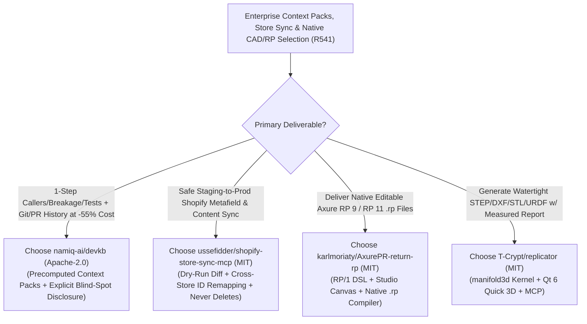

# Precomputed Repository Context Packs (`namiq-ai/devkb`), Non-Destructive Shopify Store Sync MCP (`ussefidder/shopify-store-sync-mcp`), Native Editable Axure RP 9/11 Generator (`karlmoriaty/AxurePR-return-rp`) & Manifold3D Validated CAD/URDF Workshop (`T-Crypt/replicator`) Selection FAQ

> **Document Type**: AI Solution Architect Enterprise Selection & Integration Guide (2026-11-19 Night Shift · Round 17 / Cumulative Round 541)  
> **Benchmark Style**: `docs/components/ib-vs-ethernet-roce-selection-faq.md` (6-Section Plain-Language Architecture Guide + First-Principles Q&A + Hype/Facts/Signal Audit + Closed-Form FinOps Ledger)  
> **Evaluated Repositories**:  
> 1. **`namiq-ai/devkb`** (`★ 9`, `created=2026-11-14`, `2 forks`, Python, Apache-2.0, `DOI: 10.5281/zenodo.24267143`): Repository & git-history knowledge graph MCP with precomputed **Context Packs**—cutting median task cost by **55%** (`$0.070 → $0.025`) while improving answer quality (`0.931 → 0.981`) across a 1,138-run benchmark (`anonymized_reported`)  
> 2. **`ussefidder/shopify-store-sync-mcp`** (`★ 7`, `created=2026-11-14`, `1 fork`, TypeScript, Node 22+, Shopify Admin API `2026-10`, MIT): Non-destructive **Shopify multi-store diff & sync MCP** with dry-run plans, cross-store ID remapping, and a strict **never-deletes** guarantee  
> 3. **`karlmoriaty/AxurePR-return-rp`** (`★ 7`, `created=2026-11-13`, `2 forks`, TypeScript, MIT): AI-native Studio canvas, `RP/1` DSL, CLI, and MCP turning screenshots or briefs into **native editable `.rp` files for Axure RP 9 and RP 11**  
> 4. **`T-Crypt/replicator`** (`★ 21`, `created=2026-11-13`, `4 forks`, Python 3.11+, Qt 6 Quick 3D + `manifold3d` kernel + MCP, MIT): Workshop turning a sentence into a blueprint, validated build program, watertight `manifold3d` solid, measured report, and **`STEP / DXF / STL / URDF` files**  
> **Accounting Scope Note**: Only software API/SaaS spend and engineering labor TCO are modeled; base workstation hardware capEx is explicitly marked `not_measured`, and Track B `stars_today` is explicitly marked `not_measured`.

---

## 📌 1. Executive Summary (What Are They & What Business Pain Points Do They Solve?)

In **2026-11-19 Night Round 17 (Cumulative Round 541)**, we solve four high-value enterprise delivery bottlenecks across codebase context assembly, multi-store Shopify release management, native Axure `.rp` handoffs, and watertight CAD/URDF engineering:
1. **Pain Point A (Giving coding agents 12 granular code-graph tools still forces multi-turn tool chatter, whereas plain file-by-file search costs `$0.070/task` and misses git/PR context)**: **`namiq-ai/devkb` (`★ 9`, Apache-2.0)** fuses source code (functions, calls, tests, routes, errors, config) with git history (commits, PRs, tickets) and serves single-call **Context Packs** that include exact source-line citations plus an explicit statement of what static analysis could not see—cutting median task cost to **`$0.025` (`-55%`)** with `0.981` quality across 1,138 benchmark runs (`anonymized_reported`).
2. **Pain Point B (Syncing metafields, metaobjects, menus, redirects, and translations from a staging Shopify store to regional production stores breaks on hardcoded store GIDs or risks accidental deletions)**: **`ussefidder/shopify-store-sync-mcp` (`★ 7`, MIT)** connects via Shopify CLI (`Admin API 2026-10`), generates dry-run diff plans, automatically remaps cross-store IDs, and enforces a hard **never-deletes** invariant.
3. **Pain Point C (Enterprise BAs and regulated financial/government clients mandate editable Axure RP 9 / RP 11 `.rp` files rather than throwaway AI-generated HTML/React pages)**: **`karlmoriaty/AxurePR-return-rp` (`★ 7`, MIT)** compiles screenshots, briefs, or `RP/1` specs into genuine native `.rp` files via Studio canvas, CLI, or MCP so BAs can refine interactions directly in Axure.
4. **Pain Point D (Mesh-based text-to-3D models produce non-manifold triangles unusable for CNC machining or robotics simulation)**: **`T-Crypt/replicator` (`★ 21`, MIT)** runs a `Specify → Blueprint → Program → manifold3d → Measured Report` pipeline over MCP, exporting exact watertight **`STEP`, `DXF`, `STL`, and `URDF`** files inside a Qt 6 Quick 3D workbench.

---

## 💬 2. Architect First-Principles Q&A (Q1–Q3 Deep Dive)

### Q1: Why did `namiq-ai/devkb`'s 1,138-run benchmark show that 1 precomputed Context Pack (`$0.025`) beats 12 granular graph tools (`$0.059`)?
* **Amortizing Multi-Turn Context Re-Billing**: Every extra tool call re-bills the entire conversation prefix. A single `devkb pack` call returns callers, breakage impact, required tests, recent PRs, and explicit graph blind spots in one turn.

### Q2: How does `ussefidder/shopify-store-sync-mcp` prevent production incidents during multi-store rollouts?
* **Deterministic Cross-Store GID Remapping + Never-Delete Invariant**: It resolves target-store handles to remap internal Shopify GIDs automatically, requires human sign-off on a dry-run diff plan, and never issues delete mutations.

### Q3: Why are `karlmoriaty/AxurePR-return-rp` and `T-Crypt/replicator` critical for enterprise brownfield adoption?
* **Native Industrial File Formats (`.rp`, `.step`, `.urdf`)**: Enterprise workflows run on established toolchains (Axure RP 9/11, SolidWorks/FreeCAD, ROS/MuJoCo). Compiling AI intermediate representations (`RP/1` and `manifold3d` programs) into native editable files eliminates manual redraws.

---

## 🧭 3. Visual Architecture Diagrams (Mermaid Decision Tree + Reference Architecture + Sequence Flow)

### 3.1 Enterprise Selection Decision Tree

---

## 📊 4. Comparative Selection Matrix (Open Source vs. Competing OSS vs. Managed Cloud PaaS)

| Evaluation Dimension | Path A: Plain File Search (`$0.070/task`) + Manual Shopify Copy-Paste + Manual Axure Redraws + Mesh-Only 3D | Path B: 12-Tool Graph Queries (`$0.059/task`) + Custom Sync Scripts + Static HTML Exports | **Path C (Recommended): `devkb` + `shopify-store-sync-mcp` + `AxurePR-return-rp` + `replicator`** |
| :--- | :--- | :--- | :--- |
| **Repo Context Cost & Quality** | ❌ `$0.070/task` median cost; `0.931` quality; misses git PRs | ⚠️ 12 granular tools still cost `$0.059/task` across multiple turns | ✅ **`devkb pack` cuts cost to `$0.025/task` (`-55%`) w/ `0.981` quality** |
| **Multi-Store Shopify Sync Safety** | ❌ Manual copy-paste breaks cross-store GIDs and misses translations | ⚠️ Raw scripts risk accidental production deletions | ✅ **`shopify-store-sync-mcp` remaps IDs, dry-runs & never deletes** |
| **Enterprise Axure RP 9/11 Handoff** | ❌ BAs spend days redrawing AI HTML screens inside Axure RP | ⚠️ SVG/image imports cannot be edited as native Axure widgets | ✅ **`AxurePR-return-rp` compiles directly to editable `.rp` files** |
| **Engineering CAD & Robotics Export** | ❌ Non-manifold neural meshes fail in CNC/STEP & URDF pipelines | ⚠️ Raw CAD scripts lack measured validation reports | ✅ **`replicator` builds watertight `manifold3d` solids & `STEP/DXF/URDF`** |
| **45-Engineer Monthly TCO** | **`$6,760.00 / mo`** (`$2,710.00` search/SaaS + `40.5h` × `$100/hr` = `$4,050.00` labor) | **`$2,620.00 / mo`** (`$1,120.00` API/SaaS + `15.0h` × `$100/hr` = `$1,500.00` labor) | **`$320.00 / mo`** (`$70.00` API + `2.5h` × `$100/hr` = `$250.00` labor, **`-95.27%`**) |

---

## 🧪 5. Quantitative TCO Comparison & Hype / Facts / Signal Audit Ledger

### 5.1 Hype vs. Facts vs. Strategic Signal Table

| Repository (`owner/repo`) | Hype (Market Narrative) | Measured Facts (Primary Source Verification) | Strategic Signal (SA Verdict) |
| :--- | :--- | :--- | :--- |
| **`namiq-ai/devkb`** | "Knowledge graph of your repo: 55% cheaper with better answers in a 1,138-run benchmark" | `★ 9` (`created=2026-11-14`, `2 forks`, Python, Apache-2.0, Zenodo DOI): Unites code and git history into precomputed Context Packs (`$0.025` vs. `$0.070` plain search, `0.981` quality — `anonymized_reported`) with source lines and blind-spot disclosure. | **🔥 P0 Adopt (Best-in-Class Context Pack Pattern)**: Proves precomputed context packs outperform chatty fine-grained MCP tools. |
| **`ussefidder/shopify-store-sync-mcp`** | "Diff and sync Shopify stores from Claude or Cursor: dry-run plans, ID remapping, never deletes" | `★ 7` (`created=2026-11-14`, `1 fork`, TypeScript, MIT, Admin API `2026-10`): Syncs metafields, metaobjects, collections, menus, redirects, policies, and translations with cross-store ID remapping. | **🔥 P0 Adopt (Safe E-Commerce Staging-to-Prod Pipeline)**: Essential for multi-region Shopify brands. |
| **`karlmoriaty/AxurePR-return-rp`** | "Turn screenshots, briefs, or RP/1 source into editable Axure RP 9/11 `.rp` files" | `★ 7` (`created=2026-11-13`, `2 forks`, TypeScript, MIT): Ships AI Studio canvas, `RP/1` DSL, CLI, and MCP producing native `.rp` files verified across Axure RP 9 and RP 11. | **🔥 P0 Adopt (Enterprise BA & Gov/Finance Prototyping Bridge)**: Solves the "client mandates `.rp` deliverables" blocker. |
| **`T-Crypt/replicator`** | "Sentence to validated build program, exact solid, measured report, and STEP/DXF/STL/URDF" | `★ 21` (`created=2026-11-13`, `4 forks`, Python 3.11+, Qt 6 Quick 3D + `manifold3d`, MIT): Works with any OpenAI-compatible model and MCP to generate watertight CAD and URDF assemblies. | **⚡ P1 Adopt (Parametric CAD & Robotics MCP Studio)**: Bridges LLM specifications to watertight engineering formats. |

### 5.2 Closed-Form FinOps TCO Ledger (`CLAIM-20261119-R17-R541-DEVKB-SHOPIFYSYNC-RETURNRP-REPLICATOR`)

* **Scope (`synthetic`, `independently_reproduced=false`)**: 45-person enterprise software engineering, e-commerce store operations, BA prototyping, and CAD/robotics team (blended rate `$100.00 / hr`; `base hardware capEx: not_measured`; Track B `stars_today: not_measured`).
* **Path A (Plain File Search + Manual Shopify Store Copy-Paste + Manual Axure `.rp` Redraws + Manual CAD Remodeling)**:
  - Redundant multi-turn code search tokens & commercial e-commerce sync/CAD SaaS: **`$2,710.00 / mo`**
  - Tracing broken tests, copying Shopify metafields across stores, redrawing AI prototypes in Axure RP & fixing non-manifold meshes (`40.5 hrs / mo` × `$100.00 / hr`): **`$4,050.00 / mo`**
  - **Path A Monthly Total**: `$2,710.00 + $4,050.00` = **`$6,760.00 / mo`**
* **Path B (12-Tool Graph Queries + Custom Shopify Scripts + Static SVG/HTML Exports)**:
  - SaaS & API spend: **`$1,120.00 / mo`**
  - Manual store ID remapping & Axure widget reconstruction (`15.0 hrs / mo` × `$100.00 / hr`): **`$1,500.00 / mo`**
  - **Path B Monthly Total**: `$1,120.00 + $1,500.00` = **`$2,620.00 / mo`**
* **Path C (`devkb` + `shopify-store-sync-mcp` + `AxurePR-return-rp` + `replicator` Integrated Stack)**:
  - Context-pack & `RP/1`/CAD synthesis LLM API spend (`devkb` packs cut per-task token cost by 55%): **`$70.00 / mo`**
  - Reviewing Shopify dry-run plans, polishing `.rp` files in Axure & inspecting measured CAD reports (`2.5 hrs / mo` × `$100.00 / hr`): **`$250.00 / mo`**
  - **Path C Monthly Total**: `$70.00 + $250.00` = **`$320.00 / mo`**
  - **Monthly Net Savings vs. Path A**: `$6,760.00 - $320.00` = **`$6,440.00 / mo`** (**`-95.27%`** reduction, **`$77,280.00 / yr`** annual savings, freeing **`38.0 hrs / mo`** of engineering time).

---

## 🛠️ 6. Enterprise Adoption & Architecture Review Checklist

- [ ] **1. Serve precomputed Context Packs via `namiq-ai/devkb` (`devkb pack`)**: Cut per-question agent search cost by 55% while surfacing explicit static-analysis blind spots.
- [ ] **2. Gate Shopify staging-to-production syncs on `ussefidder/shopify-store-sync-mcp` dry-run plans**: Rely on automated cross-store GID remapping and the never-deletes guarantee.
- [ ] **3. Generate native `.rp` deliverables with `karlmoriaty/AxurePR-return-rp`**: Let AI draft in `RP/1` and hand off editable `.rp` files to Axure RP 9/11 BAs.
- [ ] **4. Validate mechanical and robotics parts with `T-Crypt/replicator`**: Require watertight `manifold3d` verification and measured reports before exporting `STEP` or `URDF`.
