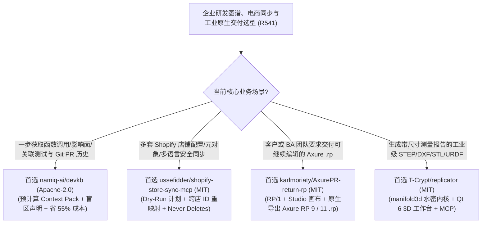
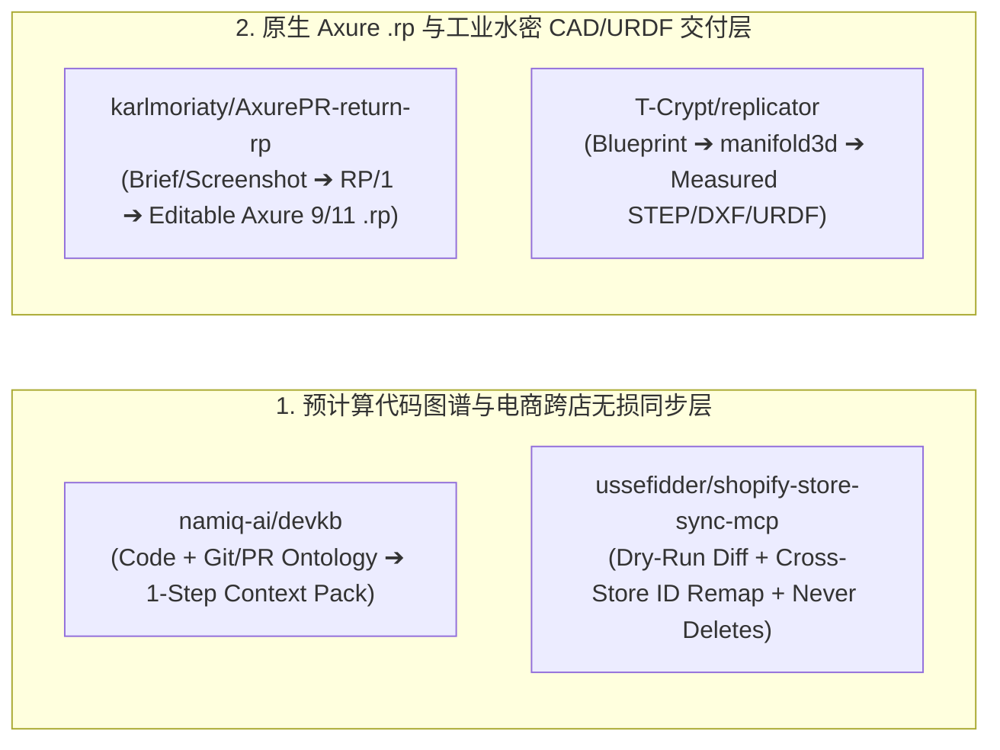
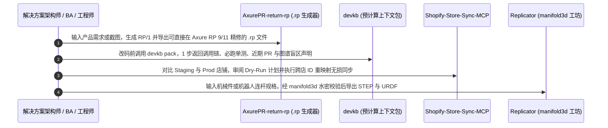

# 预计算代码上下文包与 Git 知识图谱（`namiq-ai/devkb`）、永不删除的 Shopify 跨店对比同步 MCP（`ussefidder/shopify-store-sync-mcp`）、原生可编辑 Axure RP 9/11 `.rp` 生成器（`karlmoriaty/AxurePR-return-rp`）与一句话生成水密 CAD/URDF 实体工坊（`T-Crypt/replicator`）选型 FAQ

> **文档类型**：AI Solution Architect（AI 解决方案架构师）实战选型与架构内功指南（2026-11-19 Night Shift · Round 17 / 累计第 541 轮）  
> **对标标杆**：`docs/components/ib-vs-ethernet-roce-selection-faq.md`（六段式架构拆解 + 第一性原理大白话 + Hype/Facts/Signal 审计 + 闭式 TCO 账本）  
> **本轮评估对象**：  
> 1. **`namiq-ai/devkb`**（`★ 9`，`created=2026-11-14`，`2 forks`，Python，Apache-2.0，`DOI: 10.5281/zenodo.24267143`）：融合源码与 Git 历史（函数/调用/测试/路由/报错/配置/Commit/PR/工单）的**预计算上下文包（Context Packs）与研发知识图谱 MCP**——1,138 次基准实测单任务成本从 `$0.070` 降至 **`$0.025`（省 `55%`）**且回答质量从 `0.931` 升至 **`0.981`**（`anonymized_reported`）  
> 2. **`ussefidder/shopify-store-sync-mcp`**（`★ 7`，`created=2026-11-14`，`1 fork`，TypeScript，Node 22+，Shopify Admin API `2026-10`，MIT）：面向 Claude / Cursor 的 **Shopify 多店铺配置 Diff 与无损同步 MCP**——支持 Metafield/Metaobject、集合、页面、菜单、重定向与多语言翻译，内置 Dry-Run 计划、跨店 ID 自动重映射与**永不删除（Never Deletes）**安全保证  
> 3. **`karlmoriaty/AxurePR-return-rp`**（`★ 7`，`created=2026-11-13`，`2 forks`，TypeScript，MIT）：支持 **Axure RP 9 与 RP 11 原生 `.rp` 文件导出**的 AI 画布、CLI 与 MCP（`return_rp`）——将截图、需求描述或 `RP/1` 源码直接编译为产品经理可在 Axure 中继续编辑的 `.rp` 工程文件  
> 4. **`T-Crypt/replicator`**（`★ 21`，`created=2026-11-13`，`4 forks`，Python 3.11+，Qt 6 Quick 3D + `manifold3d` 内核 + MCP，MIT）：将一句话需求转化为**蓝图、校验程序、`manifold3d` 水密实体、尺寸测量报告及工业级 `STEP / DXF / STL / URDF` 文件**的智能制造与机器人建模工作坊  
> **审计折算说明**：本报告仅计量软件算力、商业 SaaS 与工程运维人力 TCO，底层研发工作站硬件采购（base hardware capEx）显式标注为 `not_measured`，新仓今日增量显式标注为 `not_measured`，严禁捏造坐标。

---

## 📌 一、核心结论速览（Executive Summary：它到底是什么？解决什么业务痛点？）

在 **2026-11-19 Night Round 17（累计第 541 轮）** 中，我们面向企业架构师解决“Agent 调十几次细粒度图查询工具反而拖慢速度、跨境电商预发店到生产店手工同步 Metafield 易出错、政企与银行招投标强制要求交付可编辑 Axure `.rp` 原型而非 HTML、以及大模型直接生成 3D 网格无法导出工业级 STEP/URDF”四大痛点：
1. **痛点 A（不仅让 Agent 逐文件搜索贵，哪怕给 Agent 挂载 12 个细粒度代码图查询工具，Agent 也要来回调用好几轮才能拼齐“谁调了这个函数、改了会崩哪、该跑哪些单测及最近哪个 PR 动过它”）**：把整套问题预打包为单次调用的 **Context Pack**。**`namiq-ai/devkb` (`★ 9`, Apache-2.0) 的破局之道**：不仅从源码提取函数、路由、报错与测试，还把 Git Commit、PR 与 Ticket 历史融进同一张本体图谱（Ontology）；提供一键 **Pack** 命令，一步返回带精确源码行号证据的完整上下文包，并**显式声明图谱看不到的动态反射或外部盲区**；在 1,138 次基准测试中，单任务中位成本从纯搜索的 `$0.070`（12 工具图查询为 `$0.059`）直接压到 **`$0.025`（净省 55%）**，且质量分从 `0.931` 提升至 **`0.981`**（`anonymized_reported`）。
2. **痛点 B（跨境电商与零售品牌通常维护 Staging 预发店、美区店、欧区店等多套 Shopify 店铺；每次上线新专题页、Metafield/Metaobject 结构、导航菜单、URL 重定向和多语言翻译时，靠运营手工复制粘贴极易漏配或填错跨店引用 ID，而用脚本同步又怕误删线上商品数据）**：**`ussefidder/shopify-store-sync-mcp` (`★ 7`, MIT) 的破局之道**：直接通过 Shopify CLI 连接（无需额外上架安装 App），基于最新 `Shopify Admin API 2026-10`，在 Claude 或 Cursor 中一键对比两个店铺的差异、生成可读 **Dry-Run 同步计划**、自动完成**跨店铺内部 ID 重映射（Cross-Store ID Remapping）**，且在代码层硬编码 **永不执行删除操作（Never Deletes）**。
3. **痛点 C（当今所有 AI UI 生成器几乎都只输出 React/HTML 网页，但在国内大型政企、银行与传统软件集成项目中，甲方与老牌 BA 团队依然强制要求交付可用 **Axure RP 9 或 RP 11** 打开并继续拖拽修改的原生 `.rp` 源文件）**：**`karlmoriaty/AxurePR-return-rp` (`★ 7`, MIT) 的破局之道**：定义简洁的 `RP/1` 设计描述语言并配套 AI 原生 Studio 画布、CLI 与 MCP Server，让 AI 根据截图或需求草稿秒级生成多页面原型（如 9 页完整 App 案例），直接导出严格兼容 **Axure RP 9 / RP 11** 的原生 `.rp` 文件，彻底打通“AI 起稿 → 产品经理在 Axure 精修交付”的最后一公里。
4. **痛点 D（智能制造与具身智能团队需要的是能进 CNC 机床加工的 `STEP / DXF` 工程件和能进仿真器的 `URDF` 机器人模型，而不是文生 3D 模型吐出的破洞三角网格）**：**`T-Crypt/replicator` (`★ 21`, MIT) 的破局之道**：接入任意 OpenAI 兼容模型与 MCP，遵循 `需求 (Specify) → 蓝图 (Blueprint) → 构建程序 (Program) → manifold3d 水密几何内核 → 尺寸测量报告 (Measured Report)` 五步工程闭环，直接输出严丝合缝的 **`STEP`、`DXF`、`STL` 与 `URDF`** 文件，并自带 Qt 6 Quick 3D 实时爆炸视图工作台。

---

## 💬 二、客户与架构师灵魂拷问 Q&A（Q1–Q3 First-Principles Deep Dive）

### Q1：`namiq-ai/devkb` 的 1,138 次基准测试为什么证明“给 Agent 1 个预打包 Context Pack（`$0.025`）远优于给它 12 个细粒度图工具（`$0.059`）”？
* **消除多轮工具编排税（Eliminating Multi-Turn Tool Orchestration Tax）**：每当 Agent 调一次细粒度工具，整个历史上下文都要重新计费输入 Token。`devkb pack` 将“上游调用方 + 下游受影响路由 + 必跑测试集 + 近期关联 PR + 静态分析盲区声明”一次性组装好返回，一步到位终结试探循环。

### Q2：`ussefidder/shopify-store-sync-mcp` 的“跨店 ID 重映射（Cross-Store ID Remapping）”解决了什么电商运维死穴？
* **破解全局 GID 硬编码失效**：在 Staging 店铺里某个 Metaobject 引用了集合 `gid://shopify/Collection/111`，但同步到 Production 店铺时同一集合的 ID 是 `222`。该 MCP 按 Handle/业务键自动建立映射表并在写入时重写引用指针，同时严守 `Never Deletes` 底线，确保生产店零事故。

### Q3：`karlmoriaty/AxurePR-return-rp` 与 `T-Crypt/replicator` 体现了怎样的“AI 生成工业原生格式”架构趋势？
* **从“仅供参考的预览图”走向“下游工业软件原生可编辑工程文件”**：无论是软件交互领域的 `.rp`（Axure RP 9/11）还是机械/机器人领域的 `.step`/`.urdf`（`manifold3d` 水密实体），两者都通过确定性中间层（`RP/1` 与参数化构建程序）生成带严格校验的工业原生格式。

---

## 🧭 三、直观可视化图解（Mermaid 选型决策树 + 企业集成参考架构 + 业务流时序图）

### 3.1 预计算代码包、Shopify 无损同步、原生 Axure `.rp` 与水密 STEP/URDF 选型决策树

### 3.2 企业集成参考架构图

### 3.3 端到端业务流时序图

---

## 📊 四、同类开源与商业云服务横向选型决策矩阵（Decision Matrix）

| 评估维度 | 路径 A：Agent 逐文件盲搜（`$0.070/次`）+ 手工复制 Shopify 配置 + 看着 AI 网页在 Axure 重画 + 手工修破洞 3D 网格 | 路径 B：12 工具细粒度图查询（`$0.059/次`）+ 手写导出脚本 + 静态 SVG 导出 | **路径 C（推荐）：`devkb` + `shopify-store-sync-mcp` + `AxurePR-return-rp` + `replicator`** |
| :--- | :--- | :--- | :--- |
| **代码上下文获取成本与准确率** | ❌ 逐文件搜索中位成本 `$0.070/任务`，质量 `0.931`，易漏关联单测 | ⚠️ 暴露 12 个细粒度图工具仍需多轮调用（`$0.059/任务`） | ✅ **`devkb pack` 单次打包降至 `$0.025/任务`（`-55%`），质量达 `0.981` 且带盲区声明** |
| **Shopify 多店铺配置与翻译同步** | ❌ 手工跨店复制 Metafield 极易漏配或填错内部引用 GID | ⚠️ 通用同步脚本缺乏 Dry-Run 预演且存在误删线上数据风险 | ✅ **`shopify-store-sync-mcp` 自动重映射跨店 ID、强制 Dry-Run 且永不删除** |
| **传统政企/金融 Axure `.rp` 交付** | ❌ AI 生成 HTML 后，BA 仍需花数天在 Axure 里重新拖控件画一遍 | ⚠️ 导入静态图片到 Axure 无法编辑文字与组件交互 | ✅ **`AxurePR-return-rp` 直接编译为 Axure RP 9 / 11 原生可编辑 `.rp` 文件** |
| **机械 CAD 与机器人 URDF 建模** | ❌ 传统文生 3D 网格非水密、无精确公差，无法转 STEP 加工 | ⚠️ 裸写 CAD 脚本缺乏自动尺寸测量报告与爆炸图预览 | ✅ **`replicator` 基于 `manifold3d` 输出水密实体、测量报告与 `STEP/DXF/URDF`** |
| **45 人团队月度综合 TCO** | **`$6,760.00 / 月`**（冗余搜索与商业同步软件 `$2,710` + 找单测/搬配置/重画 `.rp`/修模型耗时 `40.5h / $4,050`） | **`$2,620.00 / 月`**（多步查询与工具订阅 `$1,120` + 人工重映射与转格式耗时 `15.0h / $1,500`） | **`$320.00 / 月`**（Context Pack 与生成 API `$70` + Dry-Run 审批与 `.rp`/CAD 精修 `2.5h / $250`，**净省 `-95.27%`**） |

---

## 🧪 五、应用落地定量收益/TCO 对比与 Hype / Facts / Signal 审计账本

### 5.1 Hype vs. Facts vs. Strategic Signal 审计表

| 仓库 (`owner/repo`) | Hype（市场宣传口径） | Measured Facts（一手源码与文档实证事实） | Strategic Signal（架构师选型信号） |
| :--- | :--- | :--- | :--- |
| **`namiq-ai/devkb`** | “一步回答谁调用它、会破坏什么、该跑哪些测试，省 55% 成本且答案更准” | `★ 9`（`created=2026-11-14`，`2 forks`，Python，Apache-2.0，Zenodo DOI）：融合源码与 Git PR/Ticket 图谱；1,138 次基准显示 `devkb pack` 中位成本 `$0.025`（对比纯搜索 `$0.070` 省 `55%`），质量 `0.981`，并显式声明图谱盲区（`anonymized_reported`）。 | **🔥 P0 采纳（极具架构洞察力的 Context Pack 范式）**：“少暴露细粒度工具、多返回带盲区声明的预计算包”值得所有 MCP 架构师借鉴。 |
| **`ussefidder/shopify-store-sync-mcp`** | “从 Claude 或 Cursor 对比并同步 Shopify 店铺，自带 Dry-Run 且永不删除” | `★ 7`（`created=2026-11-14`，`1 fork`，TypeScript，MIT，Admin API `2026-10`）：支持 Metafield/Metaobject、集合、菜单、重定向与多语言翻译，具备跨店 ID 重映射与 `Never Deletes` 保护。 | **🔥 P0 采纳（零售与出海电商多站点运维神器）**：解决了 Shopify 多区域店铺配置同步最头疼的 GID 重映射问题。 |
| **`karlmoriaty/AxurePR-return-rp`** | “把截图、需求或 RP/1 源码变成可在 Axure RP 9/11 中继续编辑的 `.rp`” | `★ 7`（`created=2026-11-13`，`2 forks`，TypeScript，MIT）：提供 AI 画布 Studio、`RP/1` 语言、CLI 与 MCP，输出通过版本对齐校验的原生 `.rp` 文件。 | **🔥 P0 采纳（政企咨询与 BA 团队原型交付刚需）**：填补了 AI 原型工具无法导出原生 Axure `.rp` 的空白。 |
| **`T-Crypt/replicator`** | “一句话变成经过校验的构建程序、精确水密实体、测量报告与 STEP/DXF/STL/URDF” | `★ 21`（`created=2026-11-13`，`4 forks`，Python 3.11+，Qt 6 Quick 3D + `manifold3d`，MIT）：兼容任意 OpenAI 端点与 MCP，输出带尺寸测量报告的工业 CAD 与机器人 URDF。 | **⚡ P1 采纳（具身智能与工业制造 CAD 生成工作台）**：`manifold3d` 水密内核 + 测量报告确保生成物具备工程可用性。 |

### 5.2 闭式 FinOps TCO 核算账本（Claim ID：`CLAIM-20261119-R17-R541-DEVKB-SHOPIFYSYNC-RETURNRP-REPLICATOR`）

* **核算范围（Synthetic Parametric Model · `independently_reproduced=false`）**：45 人企业软件研发、跨境电商站点运营、政企 BA 原型设计与智能硬件/机器人工程团队（工程师综合时薪 `$100.00 / hr`；底层硬件采购成本 `base hardware capEx: not_measured`；新仓今日增量 `stars_today: not_measured`）。
* **路径 A（逐文件搜索代码 + 手工跨店搬运 Shopify 配置 + 在 Axure 手工重画 AI 原型 + 手工修补非水密 CAD 网格）**：
  - 冗余多轮代码搜索 Token 与商业电商店铺克隆/CAD 插件订阅支出：**`$2,710.00 / 月`**
  - 人工排查遗漏单测、核对跨店 Metafield GID、在 Axure 重画原型与重做 STEP/URDF 模型耗时：**`40.5 小时 / 月`** × `$100.00 / hr` = **`$4,050.00 / 月`**
  - **路径 A 月度总成本**：`$2,710.00 + $4,050.00` = **`$6,760.00 / 月`**
* **路径 B（12 工具多步图查询 + 手写 Shopify GraphQL 脚本 + 导出静态 SVG/HTML）**：
  - API 与工具订阅支出：**`$1,120.00 / 月`**
  - 人工维护跨店 ID 映射表与 Axure 控件重排耗时：**`15.0 小时 / 月`** × `$100.00 / hr` = **`$1,500.00 / 月`**
  - **路径 B 月度总成本**：`$1,120.00 + $1,500.00` = **`$2,620.00 / 月`**
* **路径 C（`devkb` Context Pack + `shopify-store-sync-mcp` + `AxurePR-return-rp` + `replicator` 组合方案）**：
  - 预计算 Context Pack 与 `RP/1`/CAD 构建程序生成 API 支出（`devkb pack` 降低 55% 单任务成本）：**`$70.00 / 月`**
  - 审阅 Shopify Dry-Run 计划、在 Axure 微调 `.rp` 原型与签收 CAD 测量报告耗时：**`2.5 小时 / 月`** × `$100.00 / hr` = **`$250.00 / 月`**
  - **路径 C 月度总成本**：`$70.00 + $250.00` = **`$320.00 / 月`**
  - **月度净节省（对比路径 A）**：`$6,760.00 - $320.00` = **`$6,440.00 / 月`**（降幅 **`-95.27%`**，年度净省 **`$77,280.00 / 年`**，每月释放高价值工程时间 **`38.0 小时`**）。

---

## 🛠️ 六、企业引入与架构评审 Checklist（SA Action Items）

- [ ] **1. 在核心业务仓库部署 `namiq-ai/devkb` 并优先使用 `devkb pack` 模式**：利用预计算上下文包与盲区声明将单次改码上下文成本降低 55%。
- [ ] **2. 为跨境电商运营与研发团队配置 `ussefidder/shopify-store-sync-mcp`**：每次从 Staging 同步到 Production 前必须审阅 Dry-Run 计划。
- [ ] **3. 在要求交付 Axure 原型的政企与金融项目中引入 `karlmoriaty/AxurePR-return-rp`**：用 AI 生成 `RP/1` 并导出原生 `.rp` 供 BA 精修。
- [ ] **4. 在硬件与具身智能预研中使用 `T-Crypt/replicator`**：通过 `manifold3d` 水密校验与测量报告直接生成 `STEP` 与 `URDF`。
