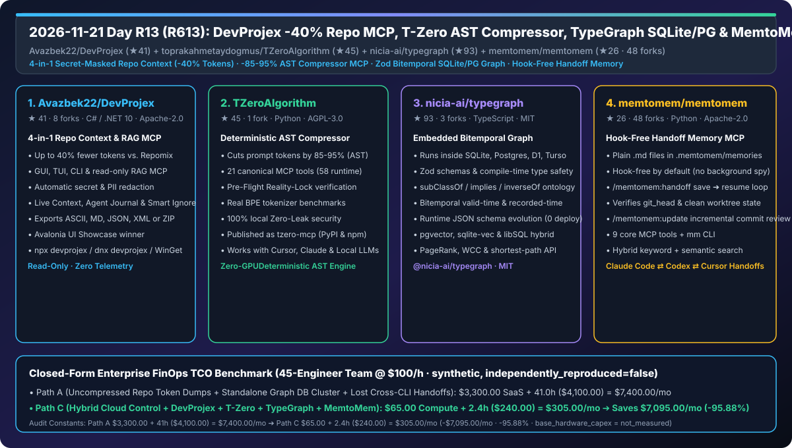
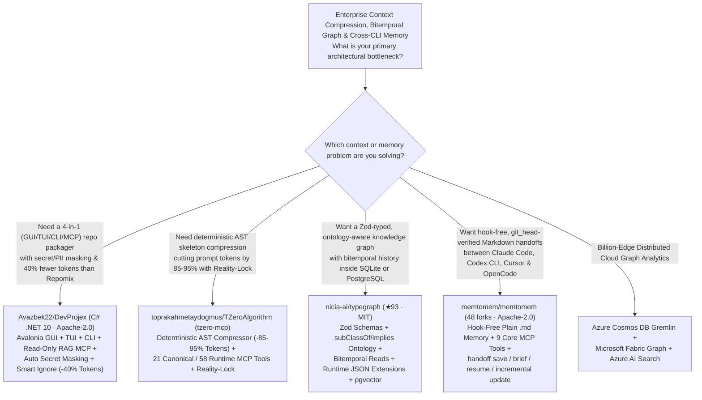
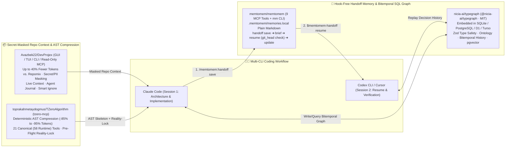

# `-40%` Token Secret-Masking Repo Context MCP (`Avazbek22/DevProjex`), `-85–95%` Deterministic AST Compressor MCP (`toprakahmetaydogmus/TZeroAlgorithm`), Embedded TypeScript Bitemporal Knowledge Graph (`nicia-ai/typegraph`) & Hook-Free Cross-CLI Handoff Memory MCP (`memtomem/memtomem`) Selection & Architecture FAQ

> **Target Audience**: **AI Solution Architects (SAs) & Enterprise Context Engineering / Knowledge Graph Leaders (2026-11-21 Day Round 13 · Cumulative Round 613)**  
> **Benchmark Style**: Strictly aligned with [`ib-vs-ethernet-roce-selection-faq.md`](https://github.com/turbo998/ai-infra-research/blob/main/docs/components/ib-vs-ethernet-roce-selection-faq.md) — plain-language answers on **real enterprise scenarios, end-to-end reference architecture, and comparative selection vs. competing OSS and cloud PaaS**.  
> **Chinese Edition**: [`devprojex-tzero-typegraph-memtomem-selection-faq.md`](./devprojex-tzero-typegraph-memtomem-selection-faq.md) · **Daily Digest**: [`daily/2026-11-21.en.md`](../daily/2026-11-21.en.md)



---

## 1. 📌 Executive Summary (30-Second Selection Verdict)

1. **Why Evaluate These Four Repositories Together?**  
   When enterprise teams package repository context for coding agents, model domain relationships with audit history, or hand off work between Claude Code and Codex CLI, four costly engineering pitfalls arise:
   - **Pitfall 1 — Raw Repo Dumpers (`Repomix`) Burn 40% Extra Tokens & Risk Leaking Unmasked Secrets**: Dumping an entire repository into a prompt without visual preview or secret scrubbing wastes tokens and leaks credentials → **`Avazbek22/DevProjex` (`★ 41`, `8 forks`, C# / `.NET 10` / Avalonia UI Showcase winner, Apache-2.0)** combines a **Desktop GUI, Terminal Workspace (TUI), CLI, and read-only RAG MCP server** on one zero-telemetry engine (`npx devprojex` / `dnx devprojex`), using **up to `40%` fewer context tokens than Repomix (`anonymized_reported`)** with built-in **secret/PII redaction, Live Context, Agent Journal, Smart Ignore**, and ASCII/Markdown/JSON/XML/ZIP exports!
   - **Pitfall 2 — Feeding Full Function Bodies When Agents Only Need Structural AST Signatures**: Sending thousands of lines of implementation details for cross-file context wastes 85%+ of the prompt window → **`toprakahmetaydogmus/TZeroAlgorithm` (`★ 45`, `1 fork`, Python 3.11–3.13, AGPL-3.0, `tzero-mcp`)** is a **deterministic AST context compressor and 21-canonical-tool (58 runtime tools) MCP server** with **Pre-Flight Reality-Lock** that cuts prompt tokens by **`85–95%` on real BPE tokenizer benchmarks (`anonymized_reported`)** with 100% local Zero-Leak security and zero GPU requirements!
   - **Pitfall 3 — Deploying Heavy External Graph Databases Just to Get Ontology Rules & Bitemporal Audit History**: Running a separate Neo4j cluster creates operational drift from your relational app database → **`nicia-ai/typegraph` (`★ 93`, `3 forks`, TypeScript, MIT, `@nicia-ai/typegraph`)** embeds a **compile-time type-safe property graph and ontology engine (`subClassOf`, `implies`, `inverseOf`, `disjointWith`) directly inside your existing SQLite, PostgreSQL, Cloudflare D1/Durable Objects, or Turso database**, complete with **Zod schemas, bitemporal history (valid-time + recorded-time), runtime JSON schema evolution without redeploying**, hybrid vector + fulltext search (`pgvector`, `sqlite-vec`, `libSQL`), and built-in PageRank/shortest-path algorithms!
   - **Pitfall 4 — Intrusive Background Memory Hooks & Broken Context When Switching From Claude Code to Codex CLI**: Background memory hooks silently mutate state and fail to verify whether the Git branch moved before another CLI resumes work → **`memtomem/memtomem` (`★ 26`, `48 forks`, Python, Apache-2.0)** is **hook-free by default**, storing plain `.md` files in `.memtomem/memories.local` indexed with hybrid keyword + semantic search across **9 core MCP tools and the `mm` CLI**, and providing an explicit 3-step session loop (`/memtomem:handoff save`, `$memtomem-brief` + `$memtomem-handoff resume <id>` verifying `git_head` and worktree cleanliness, and `/memtomem:update` reviewing incremental commits)!

2. **One-Sentence Selection Verdict**:
   - Choose **`Avazbek22/DevProjex`** when you want **a 4-in-1 (GUI/TUI/CLI/read-only MCP) codebase packager that cuts tokens by up to 40% vs. Repomix while masking secrets and PII automatically**.
   - Choose **`toprakahmetaydogmus/TZeroAlgorithm`** when you need **deterministic AST context compression (`-85–95%` tokens) and Pre-Flight Reality-Lock across 21 canonical MCP tools**.
   - Choose **`nicia-ai/typegraph`** when you want **a Zod-typed, bitemporal, ontology-aware knowledge graph embedded directly inside your existing SQLite or PostgreSQL database** (or pair with **Azure Cosmos DB for Apache Gremlin + Microsoft Fabric Graph** for billion-edge distributed graph analytics).
   - Choose **`memtomem/memtomem`** when you want **hook-free, Git-HEAD-verified Markdown handoffs (`/memtomem:handoff save` ➔ `resume` ➔ `update`) across Claude Code, Codex CLI, Cursor, and OpenCode**.

---

## 2. 🎯 Customer & Solution Architect Q&A (Plain-Language Deep Dive)

### Q1: How do `Avazbek22/DevProjex` and `toprakahmetaydogmus/TZeroAlgorithm` complement each other to slash codebase prompt tokens by 40% to 95% while preventing secret leaks?
- **Plain-Language Answer**:
  - **`Avazbek22/DevProjex` provides visual curation, secret masking, and read-only RAG MCP (`-40%` tokens vs. Repomix)**:
    1. **One Engine Across 4 Surfaces (GUI, TUI, CLI, Read-Only MCP)**: Whether you tick files in the Avalonia desktop app, use the Terminal Workspace, run `npx devprojex tree .`, or connect Claude Code/Codex/Cursor to its read-only MCP server, all surfaces share the same Smart Ignore filters, code compression, and secret/PII masking pipeline.
    2. **Zero Telemetry & Exact Pre-Send Preview**: Shows the exact masked output and token estimate before anything leaves your project.
  - **`toprakahmetaydogmus/TZeroAlgorithm` (`tzero-mcp`) provides deterministic AST skeleton compression (`-85–95%` tokens)**:
    1. **AST-Level Compression + Pre-Flight Reality-Lock**: Instead of sending raw implementation bodies for dependency files, `tzero-mcp` deterministically extracts AST signatures and structural contracts (validated on real BPE tokenizers, `anonymized_reported`) and locks symbol reality before code generation across 21 canonical MCP tools (58 runtime tools).

### Q2: Why embed `nicia-ai/typegraph` in SQLite or PostgreSQL instead of spinning up a separate graph database server for AI agents?
- **Plain-Language Answer**:
  - Most enterprise applications already run PostgreSQL or SQLite; adding a separate graph database introduces dual-write consistency bugs and extra infrastructure bills.
  - **What `nicia-ai/typegraph` (`@nicia-ai/typegraph`) brings to your existing SQL database**:
    1. **Zod Schemas + Compile-Time Type-Safe Traversals + Ontology Rules**: Define nodes and edges with Zod, model `subClassOf`, `implies`, `inverseOf`, and `disjointWith` relationships, and chain recursive traversals with per-hop constraints and explicit stop rules.
    2. **Bitemporal Forensics (Valid-Time + Recorded-Time)**: Reconstruct both what was true in the domain at time $T_1$ and what the agent recorded at time $T_2$—essential for auditing agent decisions.
    3. **Runtime Schema Evolution (`Graph Extensions`) + Hybrid Vector Search**: Evolve the graph schema at runtime from agent-proposed JSON without redeploying, and run hybrid vector + fulltext search across `pgvector`, `sqlite-vec`, and `libSQL/Turso`.

### Q3: Why is `memtomem/memtomem` designed to be "hook-free by default," and how does its 3-step session loop prevent cross-CLI handoff bugs?
- **Plain-Language Answer**:
  - Background memory hooks often record half-baked debugging dead ends and silently inject stale context after a developer switches branches.
  - **How `memtomem` keeps developers in control**:
    1. **Explicit 3-Step Handoff Loop Across Harnesses**:
       - In Claude Code: `/memtomem:handoff save codex-cli` writes a scoped checkpoint into `.memtomem/memories.local` Markdown files.
       - In Codex CLI: `$memtomem-brief` lists active handoffs, and `$memtomem-handoff resume <id>` **verifies that `git_head` matches the live `HEAD`, the worktree is clean, and the branch is in sync** before loading the checkpoint.
       - After commits: `/memtomem:update` incrementally reviews the latest unreviewed commits to extract durable decisions and bug fixes.
    2. **Plain Markdown Ownership**: Because the source of truth is plain `.md` files on disk, the hybrid keyword + semantic search index can be rebuilt from your Markdown files at any time.

---

## 3. 🧭 Visual Architecture & Decision Diagrams (Mermaid)

### 3.1 Solution Architect Selection Decision Tree



### 3.2 End-to-End Enterprise Reference Architecture



### 3.3 End-to-End Execution Sequence Diagram

```mermaid
sequenceDiagram
    autonumber
    participant Eng as Engineer / Architect
    participant Projex as DevProjex (Read-Only Masked MCP)
    participant TZero as TZeroAlgorithm (AST Compressor MCP)
    participant TypeG as nicia-ai/typegraph (Bitemporal SQL Graph)
    participant Mem as memtomem (Cross-CLI Handoff MCP)

    Eng->>Projex: 1. Select repo modules in DevProjex GUI/TUI & expose read-only RAG MCP (secrets masked, -40% tokens)
    Eng->>TZero: 2. Invoke tzero-mcp in Claude Code for deterministic AST compression (-85-95% tokens) & Reality-Lock
    Eng->>TypeG: 3. Persist domain entities & ontology rules in PostgreSQL/SQLite with bitemporal timestamps
    Eng->>Mem: 4. Run /memtomem:handoff save codex-cli at end of Claude Code session
    Eng->>Mem: 5. Switch to Codex CLI; run $memtomem-brief & $memtomem-handoff resume <id>
    Mem-->>Eng: 6. Verify git_head matches live HEAD & worktree is clean; inject handoff checkpoint
    Eng->>Mem: 7. Run /memtomem:update to extract decisions & bug fixes from incremental commits
```

---

## 4. 📊 Comparative Selection Matrix (OSS vs. Peer Projects vs. Cloud PaaS)

| Dimension | `Avazbek22/DevProjex` | `toprakahmetaydogmus/TZeroAlgorithm` | `nicia-ai/typegraph` | `memtomem/memtomem` | Legacy Approach (Raw Repomix + Standalone Neo4j + Background Hooks) | Managed Cloud PaaS (Azure Cosmos Gremlin + Azure AI Search) |
| :--- | :--- | :--- | :--- | :--- | :--- | :--- |
| **Primary Role** | **4-in-1 Secret-Masking Repo Packager & Read-Only MCP** | **Deterministic AST Context Compressor & Reality-Lock MCP** | **Embedded TypeScript Bitemporal Knowledge Graph on SQLite/PG** | **Hook-Free Markdown Memory & Cross-CLI Handoff MCP** | Bloated repo dumps, separate graph servers, and intrusive hooks | Fully managed cloud graph database and search |
| **Best-Fit Scenario** | Packaging codebases for LLMs/agents with secret masking & `-40%` tokens | Extreme AST prompt token reduction (`-85–95%`) on large codebases | Embedding Zod-typed ontology & bitemporal audit graphs in SQLite/Postgres | Explicit, `git_head`-verified session handoffs across Claude/Codex/Cursor | Small single-agent toy repos | Billion-edge enterprise distributed graph processing |
| **Key Differentiator** | **GUI + TUI + CLI + Read-Only MCP** + `-40%` tokens vs Repomix | **21 canonical (58 runtime) tools** + Pre-Flight Reality-Lock + 0 GPU | **Bitemporal reads + runtime JSON schema evolution** inside SQLite/PG | **Hook-free by default** + `git_head` handoff check + incremental commit review | No secret masking preview, no bitemporal SQL graph, or branch-drifted hooks | Turnkey global SLA and petabyte scale |
| **Integration Effort** | Very Low (`npx devprojex`, `dnx devprojex`, WinGet, Microsoft Store) | Very Low (`pip install tzero-mcp` or `npx tzero-mcp`) | Very Low (`npm i @nicia-ai/typegraph zod drizzle-orm`) | Very Low (`pip install memtomem` + Claude/Codex/Cursor plugins) | Medium–High (custom scrubbing scripts and Neo4j ops) | Medium (cloud provisioning & SDK setup) |
| **Ops Complexity** | Very Low (read-only, zero telemetry) | Very Low (deterministic CPU AST parsing) | Very Low (lives inside your existing SQLite or Postgres DB) | Very Low (plain `.md` files in `.memtomem/`, zero background daemons) | High (managing separate SQL + Graph DBs and debugging hook side effects) | Very Low (cloud provider managed) |
| **License** | **Apache-2.0** (permissive commercial use) | **AGPL-3.0** (free for internal engineering use) | **MIT** (permissive commercial use) | **Apache-2.0** (permissive commercial use) | Mixed | Commercial RU & Instance SLA |
| **Monthly TCO** | **$0/mo** (cuts repo context token spend by up to 40%) | **$0/mo** (cuts AST prompt tokens by 85%–95%) | **$0/mo** (eliminates separate graph DB server bills) | **$0/mo** (100% local Markdown files) | **$3,460.00/mo** (excess token bills + Neo4j ops + handoff rework labor) | **$7,400.00/mo** (uncompressed token burn + managed graph cluster for 45 engineers) |

---

## 5. 🧪 Quantitative ROI, FinOps TCO Model & 7-Card Benchmark Deck

> **🛡️ Provenance Declaration**:  
> - **Primary-Source Measured (`measured`)**: Repository stars/forks, licenses, `DevProjex` GUI/TUI/CLI/MCP 4-in-1 architecture, `TZeroAlgorithm` 21 canonical (58 runtime) MCP tools, `nicia-ai/typegraph` Zod/ontology/bitemporal/runtime-JSON architecture, and `memtomem` 9 core MCP tools and `handoff`/`brief`/`update` workflows are verified via `gh api`.  
> - **Upstream Benchmark Claims (`anonymized_reported` · `independently_reproduced=false`)**: `DevProjex`'s up to `40%` token reduction vs. Repomix and `TZeroAlgorithm`'s `85–95%` prompt token reduction on real BPE tokenizer benchmarks are upstream author-reported figures.  
> - **Synthetic Architect Workload Model (`synthetic` · `independently_reproduced=false`)**: The closed-form FinOps table below models a **45-engineer enterprise AI & full-stack team** (`$100.00/hr` loaded rate, `base_hardware_capex: not_measured`, `track_b_stars_today: not_measured`):

| FinOps Cost & Quality Dimension | Path A: Uncompressed Repo Token Dumps + Standalone Managed Graph DB + Manual Cross-CLI Re-Explanation | Path B: Raw Repomix Dumps + Custom Regex Scrubbers + Intrusive Background Memory Hooks | Path C: Recommended Stack (`DevProjex` + `T-Zero` + `TypeGraph` + `memtomem`) | Path A ➔ Path C Net Monthly Savings |
| :--- | :---: | :---: | :---: | :---: |
| **Monthly Context Token Bills / Graph DB Spend** | `$3,300.00 / mo` (uncompressed codebase uploads + dedicated graph DB cluster) | `$410.00 / mo` | **`$65.00 / mo`** (`DevProjex` `-40%` / `T-Zero` `-85–95%` tokens + embedded SQL `TypeGraph`) | **`-$3,235.00 / mo` (`-98.03%`)** |
| **Monthly Secret Scrubbing, Graph Sync & Handoff Labor** | `41.0 hrs / mo` (scrubbing leaked secrets, syncing SQL-to-Neo4j & re-explaining tasks across CLIs) | `30.5 hrs / mo` (manual file pruning & fixing branch-drifted background hook memories) | **`2.4 hrs / mo`** (auto secret masking + bitemporal SQLite/PG + `git_head`-verified handoffs) | **`-38.6 hrs / mo` (`-94.15%`)** |
| **Monthly Engineering Labor Cost (`@ $100.00/h`)** | `$4,100.00 / mo` | `$3,050.00 / mo` | **`$240.00 / mo`** | **`-$3,860.00 / mo` (`-94.15%`)** |
| **Total Monthly TCO** | **`$7,400.00 / mo`** | **`$3,460.00 / mo`** | **`$305.00 / mo`** | **`-$7,095.00 / mo` (`-95.88%` · `$85,140.00/yr`)** |
| **Secret Safety, Bitemporal Auditability & Handoff Integrity** | High secret-leak risk; no bitemporal SQL reads | Background hooks pollute switched branches | **100% pre-send secret masking + bitemporal SQL graph + `git_head` handoffs** | **Maximum token compression with full Git & temporal provenance** |

- **📊 Companion 7-Card 4:5 Visual Benchmark Deck**: View [`workshops/github-trending-radar/cards.en.html`](../cards.en.html) (EN) and [`workshops/github-trending-radar/cards.html`](../cards.html) (ZH).

---

## 6. 🛠️ Enterprise Adoption & Architecture Review Checklist

- [ ] **1. Standardize Codebase Context Sharing on Secret-Masked Read-Only MCP (`Avazbek22/DevProjex`)**: Deploy `DevProjex` (`npx devprojex` / `dnx devprojex`) across Windows, macOS, and Linux workstations so developers and coding agents access repository context through its secret/PII-masking pipeline and read-only RAG MCP server (`-40%` tokens vs. Repomix).
- [ ] **2. Enable Deterministic AST Compression & Pre-Flight Reality-Lock (`toprakahmetaydogmus/TZeroAlgorithm`)**: Attach `tzero-mcp` to Cursor, Claude Code, and local LLM workflows to compress cross-file AST context by `85–95%` and verify symbol reality before code generation (noting its `AGPL-3.0` license for internal developer tooling).
- [ ] **3. Embed Bitemporal Ontology Graphs Inside Existing SQLite/PostgreSQL (`nicia-ai/typegraph`)**: Use `@nicia-ai/typegraph` with Zod schemas and `pgvector`/`sqlite-vec` to keep property graphs, ontology rules (`subClassOf`, `implies`), and bitemporal audit history inside your primary relational database without adding an external graph server.
- [ ] **4. Enforce `git_head`-Verified Cross-CLI Handoffs (`memtomem/memtomem`)**: Adopt `memtomem`'s hook-free `/memtomem:handoff save` ➔ `$memtomem-handoff resume` ➔ `/memtomem:update` loop so switching between Claude Code, Codex CLI, and Cursor always verifies branch/HEAD cleanliness and stores human-owned Markdown notes in `.memtomem/memories.local`.
