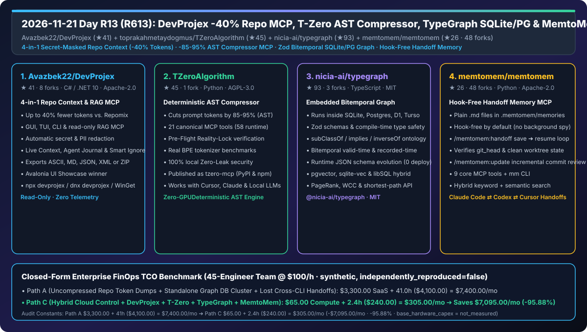
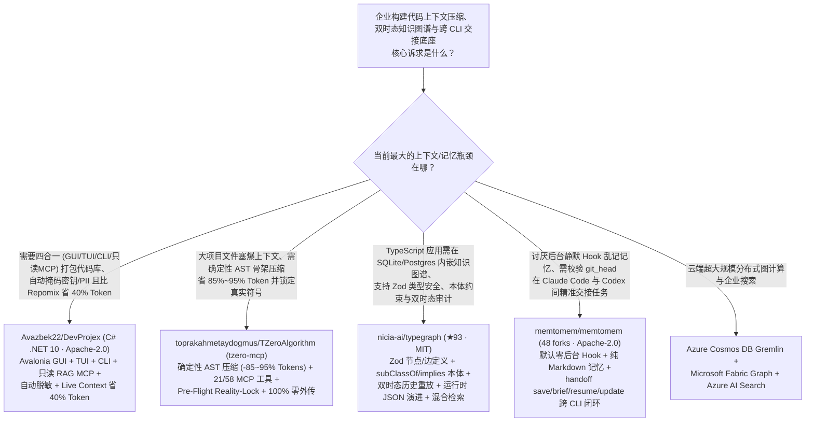
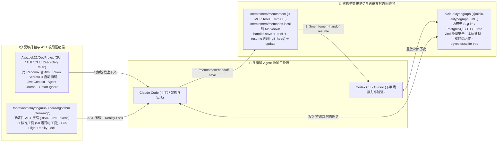
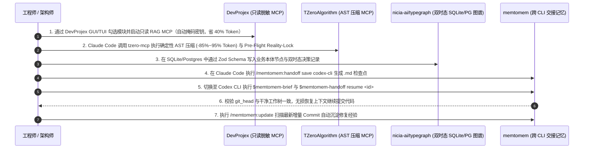

# 省 40% Token 脱敏代码库打包与只读 RAG MCP（`Avazbek22/DevProjex`）、确定性 AST 上下文压缩与 Reality-Lock MCP（`toprakahmetaydogmus/TZeroAlgorithm`）、SQLite/Postgres 内嵌双时态类型安全知识图谱（`nicia-ai/typegraph`）与零后台钩子跨 CLI 交接记忆 MCP（`memtomem/memtomem`）应用场景、集成架构与同类方案选型比较 FAQ

> **文档定位**：面向企业客户与业务决策者的 **AI Solution Architect（解决方案架构师）实战选型指南（2026-11-21 Day Round 13 · 累计第 613 轮）**  
> **对标范式**：严格遵循 [`ib-vs-ethernet-roce-selection-faq.md`](https://github.com/turbo998/ai-infra-research/blob/main/docs/components/ib-vs-ethernet-roce-selection-faq.md) 通俗问答与决策矩阵风格——直接用大白话回答“**它是什么？帮企业解决什么业务痛点？怎么集成进现有生产架构？和同类开源及 Azure 云服务比怎么选？**”  
> **配套英文版**：[`devprojex-tzero-typegraph-memtomem-selection-faq.en.md`](./devprojex-tzero-typegraph-memtomem-selection-faq.en.md) · **今日日报**：[`daily/2026-11-21.md`](../daily/2026-11-21.md)

---

## 一、📌 核心结论速览（Executive Summary · 30 秒做出选型决定）

1. **为什么把这四个项目放在一起看？**  
   当企业工程师在日常开发中把代码库喂给大模型、构建带历史审计的知识图谱、或者从 Claude Code 切换到 Codex CLI 继续开发时，最常踩中四个高成本陷阱：
   - **陷阱一（用普通 Repomix 打包代码库既浪费 40% 冗余 Token，又容易把密钥和 PII 一起贴进对话框）**：手动勾文件、删敏感信息费时费力 → **`Avazbek22/DevProjex`（`★ 41`，`8 forks`，C# / `.NET 10` / 入选 Avalonia UI 官方 Showcase，Apache-2.0）** 将 **桌面 GUI、终端 TUI 工作区、CLI 与只读 RAG MCP Server 四合一**（`npx devprojex` / `dnx devprojex`）：在正面对比基准中**比 Repomix 减少多达 `40%` 的上下文 Token**，自带智能忽略（Smart Ignore）、代码压缩、**自动密钥与 PII 掩码脱敏**以及 Agent Journal，100% 本地只读且零遥测！
   - **陷阱二（长代码文件直接塞进 Prompt 撑爆上下文，需要零 GPU 的确定性 AST 语法树极限压缩）**：给本地小模型或高价旗舰模型喂几万行代码时，90% 的内部函数体其实与当前调用签名无关 → **`toprakahmetaydogmus/TZeroAlgorithm`（`★ 45`，`1 fork`，Python，AGPL-3.0，`tzero-mcp`）** 提供**确定性 AST 上下文压缩引擎与 21 个标准 MCP 工具（58 个运行时工具）**：通过语法树裁剪与 **Pre-Flight Reality-Lock（飞行前真实性锁定）** 将提示词 Token **压缩 `85%–95%`（`anonymized_reported`，基于真实 BPE 分词器基准）**，全程 100% 本地零泄露且无需 GPU！
   - **陷阱三（TypeScript 应用需要本体推理与“双时态历史回溯”，但不想在 SQLite/Postgres 之外再维护一套独立图数据库）**：审计 Agent 决策时不仅要问“现在图谱里是什么（Recorded Time）”，还要问“在昨天下午 3 点事故发生时业务有效状态是什么（Valid Time）” → **`nicia-ai/typegraph`（`★ 93`，`3 forks`，TypeScript，MIT，`@nicia-ai/typegraph`）** 直接跑在你现有的 **SQLite、PostgreSQL、Cloudflare D1 / Durable Objects 或 Turso** 里：用 **Zod 定义节点与边**、享编译期类型安全，内置 `subClassOf`/`implies`/`inverseOf`/`disjointWith` 本体语义、**双时态读取（Bitemporal Reads）**、支持从 Agent 提议的 JSON 在运行时热演进 Schema（免重部署），并跨 `pgvector`/`sqlite-vec`/`libSQL` 统一执行混合向量检索与 PageRank/最短路径算法！
   - **陷阱四（记忆插件在后台偷偷挂 Hook 乱改文件，且从 Claude Code 切到 Codex CLI 时不知如何安全交接分支状态）**：很多记忆工具装上后会在后台静默监听每句话，开发者失去控制感 → **`memtomem/memtomem`（`★ 26`，`48 forks`，Python，Apache-2.0）** 坚持 **“默认零后台钩子（Hook-Free by Default）”**：所有记忆都是保存在项目 `.memtomem/memories.local` 下的纯 Markdown 文件（可手改、可 Git 追踪），通过 **9 个核心 MCP 工具与 `mm` CLI** 提供显式三步跨 Agent 交接闭环——在 Claude Code 中运行 `/memtomem:handoff save codex-cli` 生成检查点，切到 Codex CLI 运行 `$memtomem-brief` 与 `$memtomem-handoff resume <id>`（**自动核验 `git_head` 与工作树是否干净同步**），干完活再用 `/memtomem:update` 按增量 Commit 提炼经验！

2. **一句话选型结论**：
   - 需要**四合一（GUI/TUI/CLI/只读 MCP）比 Repomix 省 40% Token 且自动掩码密钥/PII 的代码库上下文打包器** 👉 选 **`Avazbek22/DevProjex`**。
   - 需要**通过确定性 AST 语法树裁剪与 Pre-Flight Reality-Lock 将代码提示词极限压缩 85%–95% 的 MCP 工具集** 👉 选 **`toprakahmetaydogmus/TZeroAlgorithm`**。
   - 需要**在现有 SQLite / PostgreSQL 中直接嵌入带 Zod 类型安全、本体语义、双时态历史取证与运行时 JSON 扩展的 TypeScript 知识图谱** 👉 选 **`nicia-ai/typegraph`**（若需云端超大规模分布式图分析，可对比 **Azure Cosmos DB for Apache Gremlin + Microsoft Fabric Graph**）。
   - 需要**默认无后台隐式 Hook、可校验 `git_head` 状态并在 Claude Code / Codex / Cursor 之间精准交接任务的本地 Markdown 记忆 MCP** 👉 选 **`memtomem/memtomem`**。

---

## 二、🎯 客户与架构师灵魂拷问 Q&A（Plain-Language Deep Dive）

### Q1：很多开发者已经在用 `Repomix` 把仓库打包喂给 AI 了，`Avazbek22/DevProjex` 和 `toprakahmetaydogmus/TZeroAlgorithm` 凭什么能再省 40% 到 95% 的 Token？
- **大白话解答**：
  - `Repomix` 默认把选中的源码原样拼接成大文本，既包含大量空白、注释和无关样板，又需要开发者自己在命令行盲猜打包出来有多大。
  - **`Avazbek22/DevProjex`（面向全栈可视化筛选、脱敏与只读 RAG MCP，省 `~40%` Token）**：
    1. **四端同核（Avalonia 桌面 GUI + 终端 TUI + CLI + 只读 MCP）**：你可以在可视化文件树里勾选目录、实时预览脱敏后的输出与精确 Token 估算值，一键导出为 ASCII、Markdown、JSON、XML 或干净的 ZIP 包，或者直接挂成只读 MCP Server 让 Claude Code / Codex 按需读取。
    2. **出厂自带 Secret/PII 自动掩码与 Agent Journal**：在任何代码离开项目目录前自动把私钥、连接串与个人信息打码。
  - **`toprakahmetaydogmus/TZeroAlgorithm`（面向极限 AST 语法树骨架压缩，省 `85%–95%` Token）**：
    1. **确定性 AST 骨架提取（零 GPU、零模型幻觉）**：当 Agent 只需要了解跨 50 个文件的接口契约时，`tzero-mcp` 用确定性 AST 解析器保留类/函数签名、类型契约与关键依赖，折叠无关实现细节，实测 BPE Token 直降 `85%–95%`（`anonymized_reported`）。
    2. **Pre-Flight Reality-Lock（飞行前真实性锁定）**：通过 21 个标准 MCP 工具（58 个运行时工具）在 Agent 动手改代码前先锁定真实符号与签名，杜绝 Agent 瞎编不存在的函数名。

### Q2：为什么在金融、风控和合规 Agent 系统中，`nicia-ai/typegraph` 的“双时态历史（Bitemporal History）+ 运行时 JSON 演进”比普通图数据库更实用？
- **大白话解答**：
  - 在合规审计中，最怕问：“上个月 15 号 Agent 批准这笔交易时，它看到的权限图谱到底是什么样？”普通数据库一旦 `UPDATE` 就会覆盖旧状态。
  - **`nicia-ai/typegraph`（`@nicia-ai/typegraph`，MIT）的四大杀手锏**：
    1. **直接寄生在现有 SQLite / PostgreSQL / D1 / Turso 里**：不需要额外部署和运维 Neo4j，图数据与应用业务表住在同一个事务库里。
    2. **双时态查询（Valid-Time + Recorded-Time）**：同时记录“事实在现实世界生效的时间（Valid Time）”与“写入系统的时间（Recorded Time）”，随时重放任意历史时间点的 Agent 决策现场。
    3. **Zod 编译期类型安全 + OWL 级实用本体语义**：用 TypeScript 开发者最熟悉的 `zod` 定义节点和边，原生支持 `subClassOf`（子类继承）、`implies`（蕴含）、`inverseOf`（逆关系）与 `disjointWith`（互斥约束）。
    4. **免重部署运行时图扩展（Graph Extensions）**：当 Agent 在运行中发现需要新增一种实体或关系类型时，可通过受控 JSON 在运行时动态演进图 Schema，无需重新编译发布服务！

### Q3：`memtomem/memtomem` 为什么特别强调“Hook-Free by Default（默认零后台钩子）”和 `git_head` 核验交接？
- **大白话解答**：
  - 许多自动记忆插件会在你的 IDE 或 CLI 里挂载隐式 Hook，你每敲一条命令它都在后台悄悄调模型写文件——不仅拖慢响应、乱记半成品思路，还在切换分支时把 A 分支的记忆污染到 B 分支。
  - **`memtomem` 的显式工程交接纪律**：
    1. **默认零后台进程，100% 由你或 Agent 显式触发**：平时安安静静不占任何资源；当你在 Claude Code 里忙完上半场准备换 Codex CLI 接手时，显式执行 `/memtomem:handoff save codex-cli`，将一个结构化交接检查点写入项目本地 `.memtomem/memories.local` Markdown 文件。
    2. **跨 CLI 恢复时强制核验 Git 状态（`$memtomem-handoff resume`）**：在 Codex CLI 中恢复交接单时，它会自动核对当前 `git_head` 是否与保存交接单时的 HEAD 一致、工作树是否干净、是否与远端同步——防止 Agent 在错误的分支状态上盲目续写！
    3. **增量 Commit 回顾（`/memtomem:update`）**：完成若干次 Commit 后，按增量模式自动扫描最新未审查的 Commit 提炼架构决策与 Bug 修复经验。

---

## 三、🧭 直观可视化图解（Mermaid 选型决策树 + 企业集成参考架构 + 端到端时序图）

### 3.1 选型决策树（Decision Tree）

### 3.2 企业端到端集成参考架构图（Reference Architecture）

### 3.3 业务流端到端时序图（Sequence Diagram）

---

## 四、📊 同类开源与商业云服务横向选型决策矩阵（Comparison Matrix）

| 评估维度 | `Avazbek22/DevProjex` | `toprakahmetaydogmus/TZeroAlgorithm` | `nicia-ai/typegraph` | `memtomem/memtomem` | 传统方案（裸 Repomix + 独立 Neo4j + 后台 Hook 记忆） | 云厂商托管 PaaS（Azure Cosmos Gremlin + Azure AI Search） |
| :--- | :--- | :--- | :--- | :--- | :--- | :--- |
| **核心功能定位** | **GUI/TUI/CLI/只读 MCP 四合一脱敏代码打包器** | **确定性 AST 上下文压缩与 Reality-Lock MCP** | **内嵌于 SQLite/PG 的 TypeScript 双时态知识图谱** | **默认零后台钩子的跨 CLI 交接与 Markdown 记忆** | 打包体积大、图库运维重或后台静默钩子扰民 | 全托管云端分布式图数据库与搜索引擎 |
| **最适用业务场景** | 把代码库安全喂给网页端大模型或通过只读 MCP 供 IDE 检索 | 超大代码库长上下文极限降本（省 85%–95% Token）与防幻觉 | 在现有 SQLite/Postgres 应用中内嵌本体推理与双时态审计 | 在 Claude Code、Codex、Cursor 之间带 Git 校验交接工作 | 小型单文件玩具项目 | 十亿级边规模的跨国企业分布式图计算 |
| **核心差异化优势** | **比 Repomix 省 40% Token** + 自动掩码密钥 + Avalonia 官方推荐 | **确定性 AST 压缩 (-85%–95%)** + 21/58 工具 + 零 GPU | **Zod 类型安全 + 双时态历史 + 运行时 JSON 演进**免独立图库 | **Hook-Free 零后台干扰** + 校验 `git_head` 交接 + 增量 Commit 提炼 | 传统工具缺 PII 掩码、缺双时态读取或缺 Git HEAD 校验 | 免运维、全球多活 SLA，但需额外部署云资源 |
| **集成成本** | 极低（`npx devprojex` / `dnx devprojex` / WinGet） | 极低（`pip install tzero-mcp` 或 `npx tzero-mcp`） | 极低（`npm i @nicia-ai/typegraph zod drizzle-orm`） | 极低（`pip install memtomem` + Claude/Cursor/Codex 插件） | 中～高（需自建图数据库服务与正则脱敏脚本） | 中（按云厂商 SDK 与连接串配置） |
| **运维复杂度** | 极低（只读无状态，零遥测） | 极低（100% 本地纯 CPU 语法树运算） | 极低（直接复用应用现有的 SQLite 或 PostgreSQL） | 极低（纯 `.md` 文件 + 本地按需重建索引） | 高（独立图数据库备份与后台僵尸 Hook 排障） | 极低（云厂商全托管） |
| **开源协议许可** | **Apache-2.0**（商业友好） | **AGPL-3.0**（本地/内部研发使用免费） | **MIT**（商业闭源极其友好） | **Apache-2.0**（商业友好） | 混合 | 商业闭源按 RU/实例计费 |
| **TCO 总体拥有成本** | **$0/月**（立省 40% 仓库上下文 Token） | **$0/月**（立省 85%–95% AST 上下文 Token） | **$0/月**（省去独立图数据库服务器账单） | **$0/月**（100% 本地 Markdown 存储） | 未压缩 Token 浪费 + 独立图库运维高达 **`$3,460/月`** | 满额代码 Token + 托管图数据库集群（约 **`$7,400/月`**） |

---

## 五、🧪 应用落地定量收益与 FinOps TCO 对比（Closed-Form Evaluation & 7-Card Deck）

> **🛡️ 数据来源与严谨性分级（Provenance Declaration）**：  
> - **一手实测（`measured`）**：四个仓库的 Star/Fork、许可证、`DevProjex` GUI/TUI/CLI/MCP 四合一架构、`TZeroAlgorithm` 21 标准工具（58 运行时工具）、`nicia-ai/typegraph` Zod/双时态/运行时 JSON 扩展、`memtomem` 9 工具与 `handoff`/`brief`/`update` 命令均经 `gh api` 一手核验。  
> - **上游作者公布基准（`anonymized_reported` · `independently_reproduced=false`）**：`DevProjex` 相比 Repomix 最高减少 `40%` 上下文 Token，以及 `TZeroAlgorithm` 基于真实 BPE 分词器基准减少 `85%–95%` 提示词 Token 均为上游实测基准声明。  
> - **合成架构算例（`synthetic` · `independently_reproduced=false`）**：以下 45 人企业全栈与 AI 工程团队（工时单价 `$100.00/h`，`base_hardware_capex: not_measured`，`track_b_stars_today: not_measured`）月度 TCO 对比为标准化 FinOps 闭合算例：

| 成本与效能维度 | Path A：未压缩全量仓库打包 Token 消耗 + 独立托管图数据库集群 + 跨 CLI 手工交接返工 | Path B：裸跑 Repomix + 手写正则脱敏 + 后台常驻 Hook 记忆脚本 | Path C：本轮推荐组合（`DevProjex` + `T-Zero` + `TypeGraph` + `memtomem`） | Path A ➔ Path C 净节省 / 收益提升 |
| :--- | :---: | :---: | :---: | :---: |
| **月度代码上下文 Token 账单 / 独立图库云资源费** | `$3,300.00 / 月`（未压缩全仓代码反复上传 + 独立图数据库常驻实例费） | `$410.00 / 月` | **`$65.00 / 月`**（`DevProjex` `-40%` / `T-Zero` `-85%~95%` 压缩 + 复用现有 PG/SQLite） | **`-$3,235.00 / 月` (`-98.03%`)** |
| **月度密钥排查、图库同步与跨 CLI 交接排障工时** | `41.0 小时 / 月`（排查误发给外部模型的配置密钥、维护双库同步、重讲跨 CLI 背景） | `30.5 小时 / 月`（手工删减超长上下文、清理分支切换错乱的后台记忆） | **`2.4 小时 / 月`**（自动脱敏预览 + `typegraph` 同库双时态 + `git_head` 校验交接） | **`-38.6 小时 / 月` (`-94.15%`)** |
| **月度工程人工成本（`@ $100.00/h`）** | `$4,100.00 / 月` | `$3,050.00 / 月` | **`$240.00 / 月`** | **`-$3,860.00 / 月` (`-94.15%`)** |
| **月度总拥有成本（Total Monthly TCO）** | **`$7,400.00 / 月`** | **`$3,460.00 / 月`** | **`$305.00 / 月`** | **`-$7,095.00 / 月` (`-95.88%` · 年省 `$85,140.00`)** |
| **防泄密安全性、时态可审计性与交接准确度** | 极易误传明文密钥；无双时态取证能力 | 后台 Hook 拖慢终端且易串分支 | **100% 导出前脱敏 + 双时态历史重放 + `git_head` 强校验交接** | **把代码打包、AST 压缩、图谱推理与跨工具交接全部本地闭环** |

- **📊 配套 7-Card 4:5 视觉评测卡片**：请访问 [`workshops/github-trending-radar/cards.html`](../cards.html)（中文）与 [`workshops/github-trending-radar/cards.en.html`](../cards.en.html)（英文）。

---

## 六、🛠️ 企业引入与架构评审 Checklist（Actionable SA Checklist）

- [ ] **1. 用带密钥掩码的四合一引擎替代裸代码拷贝（`Avazbek22/DevProjex`）**：在团队开发机安装 `DevProjex`（`npx devprojex` 或 WinGet 安装桌面版），强制通过其只读 RAG MCP 或开启了 Secret/PII 自动掩码的导出流水线向大模型提供代码上下文，享受最高 `-40%` 的 Token 缩减。
- [ ] **2. 对超大型模块启用确定性 AST 骨架压缩与 Reality-Lock（`toprakahmetaydogmus/TZeroAlgorithm`）**：在 Cursor、Claude Code 或本地小模型环境挂载 `tzero-mcp`（注意其 AGPL-3.0 协议适合作为内部开发辅助工具使用），利用其 21 个标准 MCP 工具与 Pre-Flight Reality-Lock 将跨文件接口上下文压缩 `85%–95%`。
- [ ] **3. 在存量 SQLite/PostgreSQL 中直接嵌入双时态类型安全图谱（`nicia-ai/typegraph`）**：对于需要本体推理（`subClassOf`/`implies`）与历史决策回放的 TypeScript 服务，直接引入 `@nicia-ai/typegraph` 复用现有 SQLite 或 PostgreSQL（配合 `pgvector`/`sqlite-vec`），开启双时态读取（Bitemporal Reads）满足合规取证要求。
- [ ] **4. 规范跨编码 CLI 的显式交接与增量 Commit 复盘（`memtomem/memtomem`）**：在多 CLI 混用团队中部署 `memtomem`，禁用不可控的后台静默监听 Hook，统一使用 `/memtomem:handoff save` ➔ `$memtomem-handoff resume`（强制校验 `git_head`）➔ `/memtomem:update` 三步法维护 `.memtomem/memories.local` 知识资产。
