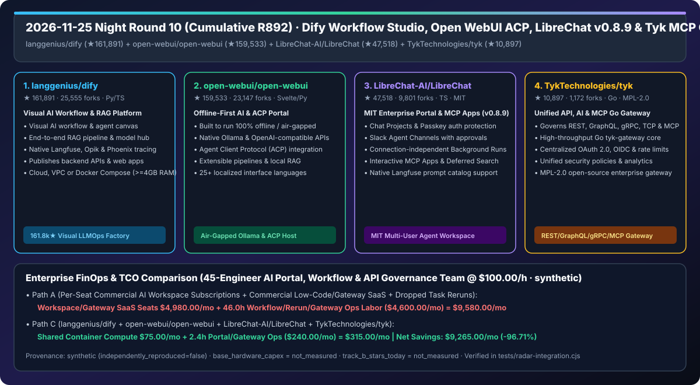
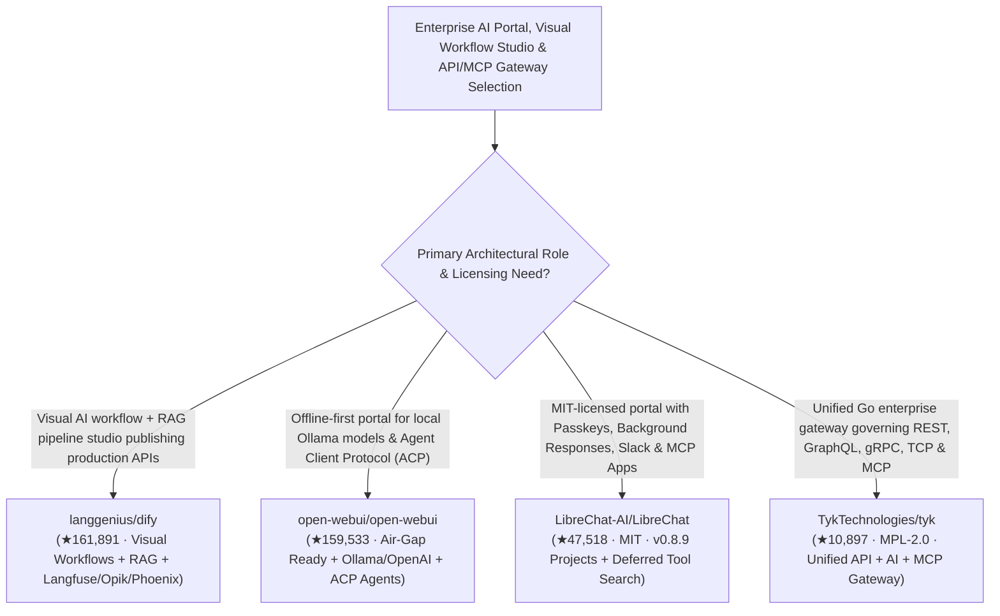
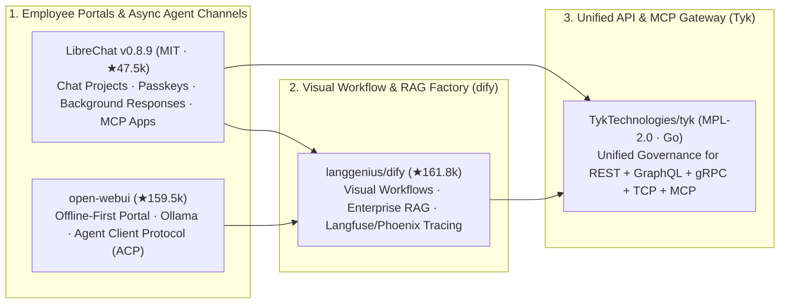
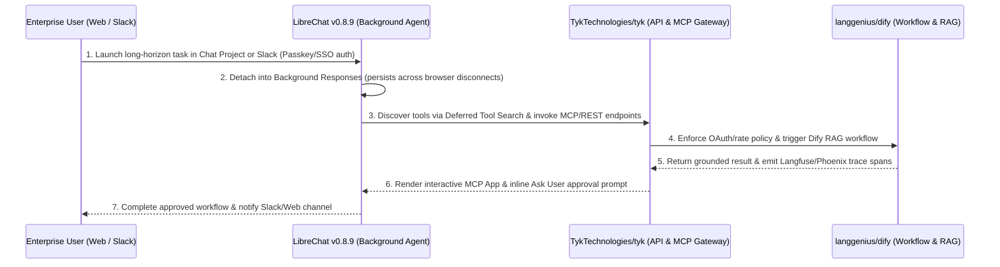

# 161k-Star AI Workflow & RAG Studio (`langgenius/dify`), Offline-First ACP AI Portal (`open-webui/open-webui`), MIT Multi-Tenant Portal with MCP Apps & Background Responses (`LibreChat-AI/LibreChat`) & Unified REST/GraphQL/gRPC/MCP Go Gateway (`TykTechnologies/tyk`) Selection & Integration Architecture FAQ

> **Document Type**: Enterprise AI Solution Architect Selection Decision Guide (GitHub Trending AI Radar — 2026-11-25 Night Round 10 / Cumulative Round 892)
> **Covered Repositories**: [`langgenius/dify`](https://github.com/langgenius/dify) (`★ 161,891`, `25,555 forks`: open-source LLM application development platform combining visual AI workflows, RAG pipelines, agent capabilities, model management, and native observability integrations [Langfuse, Opik, Arize Phoenix]) · [`open-webui/open-webui`](https://github.com/open-webui/open-webui) (`★ 159,533`, `23,147 forks`: extensible, offline-first self-hosted AI portal supporting Ollama, OpenAI-compatible APIs, and **Agent Client Protocol (`ACP`)** agents across 25+ languages) · [`LibreChat-AI/LibreChat`](https://github.com/LibreChat-AI/LibreChat) (`★ 47,518`, `9,801 forks`, `MIT`: enterprise multi-user AI portal `v0.8.9` featuring **Chat Projects, Passkey authentication, Slack Agent Channels with approvals, Background Responses, SDK-backed Agents, Interactive MCP Apps, Deferred Tool Search, and Langfuse prompt integration**) · [`TykTechnologies/tyk`](https://github.com/TykTechnologies/tyk) (`★ 10,897`, `1,172 forks`, `MPL-2.0`: enterprise Go API and AI Gateway [`tykio/tyk-gateway`] unifying **REST, GraphQL, TCP, gRPC, and Model Context Protocol (`MCP`)**)
> **Core Enterprise Scenario**: Resolving the **Enterprise AI Portal & Low-Code Workflow Builder dilemma (`Dify` vs. `Open WebUI` vs. `LibreChat`) while unifying legacy REST/GraphQL/gRPC APIs and MCP servers behind a single enterprise Go gateway (`Tyk`)**.

---

## 1. 📌 Executive Summary (One-Line Selection Verdict)

1. **Need a visual low-code studio for product and engineering teams to author multi-step AI workflows and RAG pipelines and publish them as backend APIs** ➔ Choose **[`langgenius/dify`](https://github.com/langgenius/dify) (`★ 161,891`, `25,555 forks`)**.
   - **Plain-English Mechanism**: Combines visual DAG workflow authoring, RAG ingestion, agent tool calling, and native Langfuse/Opik/Arize Phoenix observability in a self-hostable Docker Compose stack (`>= 2 Core`, `>= 4 GiB RAM`).
2. **Need an offline-capable, turnkey employee AI portal that connects local Ollama/vLLM models and external agents over the Agent Client Protocol (`ACP`)** ➔ Choose **[`open-webui/open-webui`](https://github.com/open-webui/open-webui) (`★ 159,533`, `23,147 forks`)**.
   - **Plain-English Mechanism**: Runs 100% offline in air-gapped environments, uniting local Ollama models, OpenAI-compatible gateways, and ACP-compliant agents behind a familiar multilingual interface.
3. **Need a permissive `MIT`-licensed enterprise portal with Passkeys, Slack Agent Channels, connection-independent Background Responses, Interactive MCP Apps, and Deferred Tool Search** ➔ Choose **[`LibreChat-AI/LibreChat`](https://github.com/LibreChat-AI/LibreChat) (`★ 47,518`, `9,801 forks`, `MIT`)**.
   - **Plain-English Mechanism**: `LibreChat v0.8.9` adds **Chat Projects** (shared instructions/files), **Background Responses** (long-running agent runs that survive browser disconnects), **Deferred Tool Search** (preventing MCP schema bloat), **MCP Apps**, and native **Langfuse prompt** catalog integration under a clean `MIT` license.
4. **Need a single battle-tested Go gateway (`MPL-2.0`) to govern legacy REST, GraphQL, gRPC, and TCP microservices alongside new Model Context Protocol (`MCP`) traffic** ➔ Choose **[`TykTechnologies/tyk`](https://github.com/TykTechnologies/tyk) (`★ 10,897`, `1,172 forks`, `MPL-2.0`)**.
   - **Plain-English Mechanism**: Extends `tyk-gateway` to treat MCP as a first-class protocol alongside REST, GraphQL, and gRPC, enforcing unified OAuth/OIDC policies, rate limits, and audit analytics.

---

## 2. 🎯 Architect & Customer Deep-Dive Q&A

### Q1: How do `Dify`, `Open WebUI`, `LibreChat`, and `Tyk` compare against commercial per-seat suites (e.g., M365 Copilot + Copilot Studio + Commercial API Gateways)?

- **Four-Component Enterprise Architecture (Path C)**:
  1. **MIT Enterprise Agent Workspace ➔ `LibreChat-AI/LibreChat`**: Primary employee & Slack portal with Passkeys, Background Responses, MCP Apps, and Deferred Tool Search.
  2. **Offline & ACP Agent Workspace ➔ `open-webui/open-webui`**: Air-gapped local model and Agent Client Protocol (`ACP`) host.
  3. **Visual Workflow & RAG BaaS Factory ➔ `langgenius/dify`**: Visual authoring of multi-step business workflows and RAG APIs with Langfuse/Phoenix tracing.
  4. **Unified API & MCP Ingress Gateway ➔ `TykTechnologies/tyk`**: Single Go gateway securing REST, GraphQL, gRPC, and MCP endpoints.
- **When to choose Commercial Per-Seat SaaS vs. Path C?**
  - Choose **M365 Copilot + Copilot Studio** when users primarily work inside desktop Word/PowerPoint/Excel sidebars and per-seat SaaS budgets are pre-approved.
  - Choose **Path C** when scaling AI access to hundreds or thousands of employees on usage-based tokens (avoiding `$30/user/mo` fixed seat taxes), requiring `MIT` white-label freedom (`LibreChat`), or enforcing VPC/air-gapped data residency.

### Q2: How do these four platforms integrate end-to-end?

1. **Employee & Slack Interaction Plane (`LibreChat v0.8.9` + `Open WebUI`)**:
   - Employees collaborate in `LibreChat` Chat Projects or Slack Agent Channels (using Background Responses for long tasks) or use `Open WebUI` for offline Ollama and ACP agent sessions.
2. **Visual Workflow & RAG Execution Plane (`langgenius/dify`)**:
   - Domain-specific RAG and multi-step business automations authored in `Dify` are exposed as internal services and traced in Langfuse/Phoenix.
3. **Unified Protocol Governance (`TykTechnologies/tyk`)**:
   - `Tyk Gateway` sits in front of `Dify` APIs, internal gRPC/REST microservices, and MCP servers, enforcing unified authentication and rate limits.

### Q3: What are the key licensing and architectural guardrails?

- **Architect Redlines**:
  1. **Match portal selection to branding/licensing requirements**: Use `MIT`-licensed `LibreChat` when white-labeling or embedding a custom-branded portal into commercial products, while respecting the branding clauses of `Dify` and `Open WebUI`.
  2. **Enable Deferred Tool Search in `LibreChat v0.8.9`**: Always enable Deferred Tool Search when connecting large enterprise MCP catalogs through `Tyk` so tool schemas are loaded on demand.

---

## 3. 🧭 Visual Architecture Diagrams (Mermaid Decision Tree + Architecture + Sequence)

### 3.1 Architect Selection Decision Tree

### 3.2 End-to-End Enterprise Integration Architecture

### 3.3 End-to-End Execution Sequence

---

## 4. 📊 Horizontal Selection Matrix

| Dimension | `langgenius/dify` (`★ 161,891`) | `open-webui/open-webui` (`★ 159,533`) | `LibreChat-AI/LibreChat` (`★ 47,518`) | `TykTechnologies/tyk` (`★ 10,897`) | Per-Seat Commercial AI Workspace & Gateway SaaS (Path A) | Unmanaged Single-User Chat Scripts (Path B) |
| :--- | :--- | :--- | :--- | :--- | :--- | :--- |
| **Primary Role** | Visual AI workflow & RAG app factory | Offline-first AI portal & ACP host | `MIT` enterprise portal & MCP Apps host | Unified REST/GraphQL/gRPC/MCP Go gateway | High-cost per-user/month SaaS subscriptions | Disconnected basic chat UIs |
| **Key Differentiator** | **Visual Workflow + RAG + native Langfuse/Opik/Phoenix** | **100% offline capable + native ACP agent support** | **`MIT` license + Background Responses + Deferred Tool Search** | **Governs REST, GraphQL, gRPC & MCP in 1 Go binary** | Zero hosting ops, but expensive fixed seat fees | Dropped browser connections kill runs; no unified MCP gateway |
| **License** | Open-Source (with branding terms) | Open-Source (with branding terms) | **`MIT`** | **`MPL-2.0`** | Proprietary SaaS | Ad-hoc |
| **Monthly TCO (45-Eng Team)** | **`$315.00/mo` combined** (`$75.00` compute + `2.4h` ops) | Included in `$315.00/mo` stack | Included in `$315.00/mo` stack | Included in `$315.00/mo` stack | **`$9,580.00/mo`** (`$4,980.00` commercial workspace/gateway seats + `46.0h` ops) | `~$3,260.00/mo` (dropped long-running tasks & custom auth maintenance) |

---

## 5. 🧪 Quantitative FinOps & TCO Comparison (45-Person Enterprise Team)

> **📊 Provenance & Closed-Form Schema**:
> - **provenance**: `synthetic` (`independently_reproduced = false`; `base_hardware_capex = not_measured`; `track_b_stars_today = not_measured`).
> - **Closed-Form Formula**:
>   - **Path A (Per-Seat Commercial AI Workspace Subscriptions + Commercial Low-Code/Gateway SaaS + Dropped Long-Task Reruns & Manual Workflow Glue)**: **`$4,980.00`** monthly SaaS seat and gateway fees + **`46.0h × $100.00/h = $4,600.00`** engineering/ops labor = **`$9,580.00/mo`**.
>   - **Path C (`langgenius/dify` + `open-webui/open-webui` + `LibreChat-AI/LibreChat` + `TykTechnologies/tyk` Stack)**: **`$75.00`** shared container compute + **`2.4h × $100.00/h = $240.00`** portal/gateway maintenance = **`$315.00/mo`**.
>   - **Net Savings vs. Path A**: **`-$9,265.00/mo`** (**`96.71%`** TCO reduction).

| Evaluation Path | Commercial Seats / Gateway & Compute Cost | Workflow Glue, Rerun & Ops Labor (`$100/h`) | Monthly Total TCO | Net Savings vs. Path A | Key Architectural Outcome |
| :--- | :---: | :---: | :---: | :---: | :--- |
| **Path A: Per-Seat Commercial AI Portal + Low-Code SaaS + Commercial Gateway** | `$4,980.00` | `46.0h` (`$4,600.00`) | **`$9,580.00`** | Baseline | Expensive fixed per-user seat fees; vendor lock-in |
| **Path B: Basic Custom Chat UI + Unmanaged Endpoints** | `$1,460.00` | `18.0h` (`$1,800.00`) | **`$3,260.00`** | `-$6,320.00` (`-65.97%`) | Browser disconnects lose long runs; no visual workflow studio or MCP gateway |
| **Path C: `dify` + `open-webui` + `LibreChat` + `tyk`** | **`$75.00`** | **`2.4h` (`$240.00`)** | **`$315.00`** | **`-$9,265.00` (`-96.71%`)** | **161k★ workflow studio + offline ACP + `MIT` Background Responses + Go MCP gateway** |

- 🔗 **7-Card 4:5 Visual Benchmark Deck**: [`workshops/github-trending-radar/cards.en.html`](../cards.en.html) · [`cards.html`](../cards.html)

---

## 6. 🛠️ Enterprise Adoption & Architecture Review Checklist

- [ ] **Align Portal Choice with Licensing Requirements**: Use `MIT`-licensed `LibreChat` when custom white-labeling is required, and pair with `Dify` for visual workflow authoring and `Open WebUI` for offline/ACP deployments.
- [ ] **Enable Background Responses & Deferred Tool Search in `LibreChat v0.8.9`**: Prevent lost work on long agent runs and keep initial tool-schema token overhead minimal.
- [ ] **Wire `Dify` to Self-Hosted Langfuse/Phoenix**: Enable native observability callbacks across all published `Dify` workflows and RAG pipelines.
- [ ] **Unify REST/gRPC & MCP Security in `Tyk`**: Route all external and internal tool/API traffic through `TykTechnologies/tyk` with centralized OAuth/OIDC and rate limiting.
