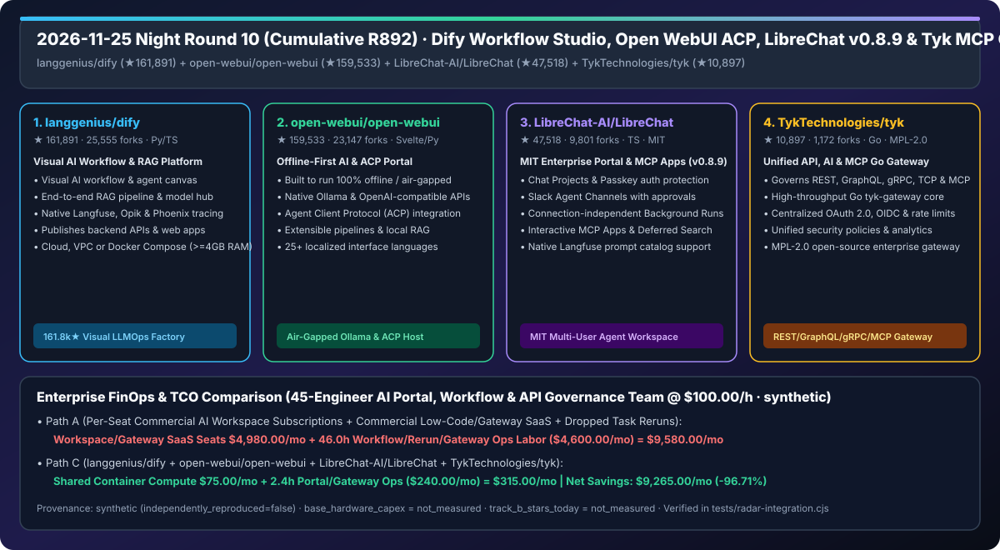
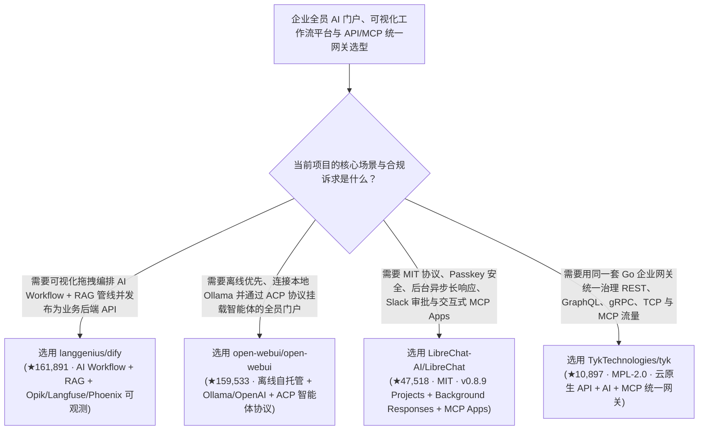
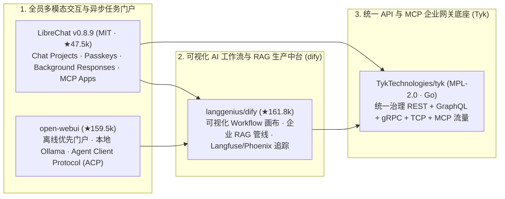
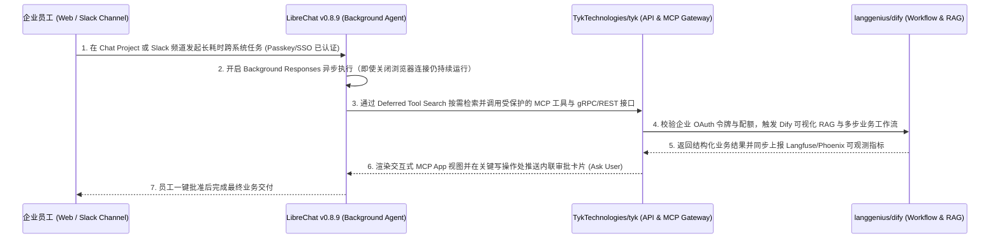

# 16 万星企业级 AI 工作流与 RAG 应用平台（`langgenius/dify`）、支持 ACP 协议的离线优先全员 AI 门户（`open-webui/open-webui`）、内置 MCP Apps 与后台子 Agent 的多租户工作台（`LibreChat-AI/LibreChat`）及统一 REST/GraphQL/gRPC/MCP 的 Go 企业网关（`TykTechnologies/tyk`）选型与集成架构 FAQ

> **文档类型**：企业 AI 解决方案架构师（AI Solution Architect）选型决策指南（GitHub Trending AI 雷达 2026-11-25 Night Round 10 / 累计第 892 轮）
> **覆盖项目**：[`langgenius/dify`](https://github.com/langgenius/dify)（`★ 161,891`、`25,555 forks`：全球 16.1 万星标杆级开源 LLM 应用开发平台，集 AI 可视化工作流、RAG 管线、Agent 编排、模型管理与 Langfuse/Opik/Arize Phoenix 可观测性于一体，支持公有云、VPC 与 Docker Compose 私有化部署）· [`open-webui/open-webui`](https://github.com/open-webui/open-webui)（`★ 159,533`、`23,147 forks`：15.9 万星可扩展离线优先自托管 AI 门户，原生连接本地 Ollama、OpenAI 兼容云端 API，并率先支持通过 **Agent Client Protocol (`ACP`)** 接入外部编码与业务智能体）· [`LibreChat-AI/LibreChat`](https://github.com/LibreChat-AI/LibreChat)（`★ 47,518`、`9,801 forks`、`MIT`：企业多用户 AI 协同门户 `v0.8.9`，新增 **Chat Projects 共享项目空间、Passkey 硬件通行密钥、Slack Agent Channels 审批通道、脱离网页长连接的 Background Responses、交互式 MCP Apps、延迟工具检索（Deferred Tool Search）与 Langfuse Prompt 目录集成**）· [`TykTechnologies/tyk`](https://github.com/TykTechnologies/tyk)（`★ 10,897`、`1,172 forks`、`MPL-2.0`：由 Go 编写的企业级云原生 API 与 AI 网关 [`tykio/tyk-gateway`]，在同一套网关内核中统一治理 **REST、GraphQL、TCP、gRPC 与 Model Context Protocol (`MCP`)**）
> **核心场景**：当企业 CIO 与首席架构师规划“全员 AI 办公统一入口（Enterprise AI Portal）与低代码业务应用构建台”时，常面临经典的“三大开源门户之争”：**`Dify`（16.1 万★）vs `Open WebUI`（15.9 万★）vs `LibreChat`（4.7 万★ MIT）到底各适合什么人群？如果企业已有大量 REST/gRPC/GraphQL API 网关资产，如何用一套 `MPL-2.0` 开源网关（`Tyk`）把传统 API 与新兴 MCP 流量统一管起来？** 本文给出完整选型对比矩阵与集成架构。

---

## 一、📌 核心结论速览（选型一句话结论）

1. **目标是让业务部门、产品经理与应用研发团队“从 0 到 1 拖拽编排复杂的 AI 业务工作流（Workflow）与企业 RAG 管线，并直接发布为后端 API 或独立 Web 应用”** ➔ 选 **[`langgenius/dify`](https://github.com/langgenius/dify)（`★ 161,891`，`25,555 forks`）**。
   - **通俗原理**：`Dify` 的核心不是一个单纯的聊天框，而是一套完整的 **BaaS（Backend-as-a-Service）+ LLMOps 可视化应用工厂**。它把 Prompt 编排、知识库切块检索、条件分支节点、代码沙箱节点与 Langfuse/Opik/Phoenix 追踪打包在一起，最低仅需 `2 Core / 4 GiB RAM` 即可用 Docker Compose 启动。
2. **目标是在内网离线环境（Air-Gapped）或本地 GPU 服务器旁，快速为全员部署一套极致易用、支持 25+ 语言、既能连本地 Ollama 又能通过 `ACP`（Agent Client Protocol）挂载外部智能体的统一对话门户** ➔ 选 **[`open-webui/open-webui`](https://github.com/open-webui/open-webui)（`★ 159,533`，`23,147 forks`）**。
   - **通俗原理**：开箱体验最接近原生 ChatGPT，完全支持断网离线运行，内置文档对话、语音视频交互与插件管道（Pipelines），且最新引入 **ACP 协议**，让员工在网页聊天框里就能直接驱动遵循 ACP 标准的专业智能体。
3. **目标是需要宽松 `MIT` 开源协议、需要把同一个企业门户的 Agent 同时连进 Slack 审批频道、支持关闭浏览器仍在后台继续跑的 Background Responses、支持交互式 MCP Apps 与延迟工具搜索（Deferred Tool Search）** ➔ 选 **[`LibreChat-AI/LibreChat`](https://github.com/LibreChat-AI/LibreChat)（`★ 47,518`，`9,801 forks`，`MIT`）**。
   - **通俗原理**：`LibreChat v0.8.9` 在企业级工程深度上极具前瞻性：① 支持 **Passkeys** 强身份安全与 **Chat Projects** 团队共享指令/参考文档；② 支持 **Background Responses**（长耗时 Agent 任务脱离前端连接独立运行、可随时恢复或取消）；③ 原生支持 **MCP Apps** 交互式界面、**Deferred Tool Search**（按需延迟加载工具避免撑爆上下文）以及直接拉取 **Langfuse Prompts**。
4. **企业基础设施团队希望用同一个高吞吐 Go 网关同时纳管传统微服务（REST / GraphQL / gRPC / TCP）与新一代 AI Agent 的 MCP 流量** ➔ 选 **[`TykTechnologies/tyk`](https://github.com/TykTechnologies/tyk)（`★ 10,897`，`1,172 forks`，`MPL-2.0`）**。
   - **通俗原理**：避免在企业 DMZ 区同时维护一套传统 API 网关和另一套独立 MCP 网关；`Tyk Gateway` 原生将 MCP 纳入与 REST/GraphQL/gRPC 同等的一等公民协议，复用统一的 OAuth 2.0/OIDC 鉴权、配额限流与安全审计底座。

---

## 二、🎯 客户与架构师灵魂拷问 Q&A（深度架构拆解）

### Q1：`Dify` vs `Open WebUI` vs `LibreChat` vs 云厂商托管方案（Microsoft 365 Copilot + Copilot Studio + Azure APIM）怎么选？

- **三大门户与统一网关的分工法则**：
  1. **`langgenius/dify` ➔ 面向“应用构建者（Builders）”**：用于把固定业务逻辑（如合同初审流、多步客诉分流流、自动周报流）编排成确定性的 Workflow API。
  2. **`LibreChat-AI/LibreChat` ➔ 面向“重度 Agent 与跨渠道协作团队（MIT 合规）”**：用于需要 `MIT` 开源授权、Slack 审批联动、后台异步长任务（Background Responses）与 MCP Apps 的企业工作台。
  3. **`open-webui/open-webui` ➔ 面向“内网离线全员自助问答与 ACP 接入”**：用于快速对接本地 Ollama/vLLM 算力池与 ACP 智能体的全员 AI 桌面。
  4. **`TykTechnologies/tyk` ➔ 面向“平台与 API 治理团队”**：作为底层统一南北向网关，把 `Dify` 发布的业务 API、企业存量 REST/gRPC 服务与 MCP 工具统一收口保护。
- **何时选云厂商托管方案（M365 Copilot + Copilot Studio + Azure APIM） vs 自建本轮开源四件套（Path C）？**
  - 若企业全员重度依赖 Word/Excel/PowerPoint/Teams 内部原生侧边栏唤醒，且预算充足，**M365 Copilot + Copilot Studio** 体验最无缝。
  - 若企业拥有数千名内网员工（全员采购 $30/人/月 SaaS 席位每年高达百万美元）、要求数据与模型 100% 留存在私有机房、或者需要将 `LibreChat`/`Open WebUI`/`Dify` 嵌入自有业务系统，自建本轮开源四件套（Path C）可将月度平台 TCO 降低 **96%+**。

### Q2：如何把这四个项目组合为企业级“统一门户 + 可视化工作流工厂 + 统一 API/MCP 网关”参考架构？

1. **前端双模员工交互层（`LibreChat v0.8.9` + `Open WebUI`）**：
   - 研发与运营团队通过 `LibreChat`（开启 Passkey 登录、Chat Projects、Background Responses 与 Slack Agent Channels）执行长耗时多工具任务；内网离线终端通过 `Open WebUI` 连接本地模型与 ACP 智能体。
2. **中层低代码 AI 工作流与 RAG 生产层（`langgenius/dify`）**：
   - 各业务部门在 `Dify` 画布中搭建垂直业务 Workflow 与 RAG 管道，将调试成熟的 Prompt 同步至 Langfuse，并将业务工作流发布为标准后端服务。
3. **底层全协议安全网关层（`TykTechnologies/tyk`）**：
   - `Tyk Gateway` 位于 `LibreChat`/`Open WebUI`、`Dify` 与企业核心微服务之间，统一代理 REST、GraphQL、gRPC 与 MCP 协议，执行速率限制、密钥轮换与访问审计。

### Q3：生产落地的许可证与安全红线是什么？

- **架构师避坑红线**：
  1. **商用二开改LOGO（White-Labeling）的许可证核查**：`LibreChat` 采用极其宽松的 **`MIT`** 协议，`Tyk Gateway` 采用 **`MPL-2.0`** 协议；而 `Dify` 与 `Open WebUI` 的新版开源协议对“抹除官方品牌标识或多租户商业售卖”有明确商业授权限制——企业内部原样自用免费，若需改品牌对外商业化售卖，应优先基于 `MIT` 协议的 `LibreChat` 构建前端门户。
  2. **开启 `LibreChat` 的 Deferred Tool Search 与 MCP 审批**：当通过 `Tyk` 向 `LibreChat` 暴露数十个企业 MCP 工具时，务必在 `LibreChat v0.8.9` 中开启延迟工具搜索（Deferred Tool Search）与内联审批（Ask User / Approvals）。

---

## 三、🧭 直观可视化图解（Mermaid 决策树 + 集成架构 + 时序图）

### 3.1 架构师选型决策树

### 3.2 企业端到端生产集成参考架构图

### 3.3 异步后台长任务、延迟工具搜索、Tyk MCP 网关鉴权与 Dify 工作流执行时序图

---

## 四、📊 同类开源与商业云服务横向选型决策矩阵

| 对比维度 | `langgenius/dify` (`★ 161,891`) | `open-webui/open-webui` (`★ 159,533`) | `LibreChat-AI/LibreChat` (`★ 47,518`) | `TykTechnologies/tyk` (`★ 10,897`) | 全员按人头采购商业 AI 办公 SaaS + 商业 API 网关 (Path A) | 各部门散装部署无鉴权单机聊天网页 (Path B) |
| :--- | :--- | :--- | :--- | :--- | :--- | :--- |
| **核心能力定位** | 可视化 AI Workflow 与 RAG 应用工厂 | 离线优先全员 AI 门户与 ACP 宿主 | `MIT` 多租户门户（含 MCP Apps/后台任务） | REST/GraphQL/gRPC/MCP 统一 Go 网关 | 按每员工每月高价订阅的闭源云套件 | 无统一网关、无项目隔离的散装页面 |
| **差异化杀手锏** | **16.1万星成熟度 + Workflow/RAG/可观测一体** | **100% 离线可用 + 原生支持 ACP 协议** | **`MIT` 协议 + Background Responses + Deferred Tool Search** | **单一 Go 网关同时管传统微服务与 MCP** | 免运维，但千人规模席位费极其高昂且不可定制源码 | 浏览器一关长任务就断；无 Passkey 与统一 API/MCP 限流 |
| **开源协议** | 开源（带商业品牌附加条款） | 开源（带品牌保护条款） | **`MIT`** | **`MPL-2.0`** | 闭源商业 SaaS | 杂乱无章 |
| **月度 TCO（45 人团队）** | **四件套合建仅 `$315.00/月`**（`$75.00` Docker/K8s 算力 + `2.4h` 维护） | 同左（复用内部 GPU 与按量 API） | 同左（`MIT` 零席位税享全套企业功能） | 同左（统一收口传统 API 与 MCP） | **`$9,580.00/月`**（`$4,980.00` 全员商业 SaaS 席位与商业网关费 + `46.0h` 跨系统搬运） | 约 `$3,260.00/月`（长连接中断重跑与重复造轮子开发工时） |

---

## 五、🧪 应用落地定量收益/TCO 对比与 7-Card 报告

> **📊 数据来源与闭式核算声明（Provenance & Closed-Form Schema）**：
> - **provenance**: `synthetic`（基于 45 人企业全员 AI 门户建设、业务工作流编排与 API/MCP 网关治理团队月度工作负载模型：`independently_reproduced = false`；硬件采购基线 `base_hardware_capex = not_measured`；Track B 单日增量 `track_b_stars_today = not_measured`）。
> - **核算公式**：
>   - **Path A（按人头采购高价商业 AI 协作门户与低代码工作流 SaaS 席位 + 商业企业级 API 网关订阅 + 长耗时任务断连重跑与手工跨系统搬运）**：月度商业 SaaS 席位与网关许可费 **`$4,980.00`** + 跨系统手工编排、断连任务重跑与网关策略同步人工 **`46.0h × $100.00/h = $4,600.00`** = **`$9,580.00/月`**。
>   - **Path C（自建 `langgenius/dify` + `open-webui/open-webui` + `LibreChat-AI/LibreChat` + `TykTechnologies/tyk` 企业级全栈 AI 门户与网关底座）**：Docker/K8s 容器算力分摊 **`$75.00`** + 门户升级与网关策略看护人工 **`2.4h × $100.00/h = $240.00`** = **`$315.00/月`**。
>   - **净节省（Net Savings vs Path A）**：**`-$9,265.00/月`**（成本降低 **`96.71%`**）。

| 评估方案 | 商业门户 / 工作流 / 网关订阅与算力成本 | 工作流维护、断连重跑与人工搬运（`$100/h`） | 月度总 TCO | 相对 Path A 净节省 | 核心业务交付收益 |
| :--- | :---: | :---: | :---: | :---: | :--- |
| **Path A：全员商业 AI 门户席位 + 商业低代码 SaaS + 商业 API 网关** | `$4,980.00` | `46.0h` (`$4,600.00`) | **`$9,580.00`** | Baseline | 按人头固定席位费高昂；非重度用户席位闲置浪费严重 |
| **Path B：自写简易聊天前端 + 散装脚本无统一 API/MCP 网关** | `$1,460.00` | `18.0h` (`$1,800.00`) | **`$3,260.00`** | `-$6,320.00` (`-65.97%`) | 关闭网页即丢长任务响应；缺乏可视化 Workflow 画布与统一 MCP 鉴权 |
| **Path C：`dify` + `open-webui` + `LibreChat` + `tyk`** | **`$75.00`** | **`2.4h` (`$240.00`)** | **`$315.00`** | **`-$9,265.00` (`-96.71%`)** | **16万星工作流工厂 + 离线 ACP 门户 + `MIT` 后台长响应 + Go 全协议网关** |

- 🔗 **关联 7-Card 4:5 视觉评测报告**：[`workshops/github-trending-radar/cards.html`](../cards.html) · [`cards.en.html`](../cards.en.html)

---

## 六、🛠️ 企业引入与架构评审 Checklist

- [ ] **门户选型与开源许可证合规对齐**：若企业需深度定制 UI 并去除原始品牌标识对外交付，基于 `MIT` 协议的 `LibreChat-AI/LibreChat` 构建前端；若内部原样自用可视化工作流与离线门户，直接部署 `langgenius/dify` 与 `open-webui/open-webui`。
- [ ] **开启 `LibreChat v0.8.9` Passkey、Background Responses 与 Deferred Tool Search**：为长耗时 Agent 任务启用后台独立响应模式，并通过延迟工具检索降低多 MCP 挂载时的首轮 Token 消耗。
- [ ] **在 `Dify` 中强制绑定可观测性后端**：将 `Dify` 生产实例连接至自托管 `Langfuse`、`Opik` 或 `Arize Phoenix`，全量追踪每条 Workflow 与 RAG 节点的耗时与准确率。
- [ ] **通过 `Tyk` 统一收口 REST/gRPC 与 MCP 鉴权**：使用 `TykTechnologies/tyk` 对接企业 IdP，为所有暴露给 `Dify` 与 `LibreChat` 的内部 API 和 MCP Server 实施统一配额与审计策略。
