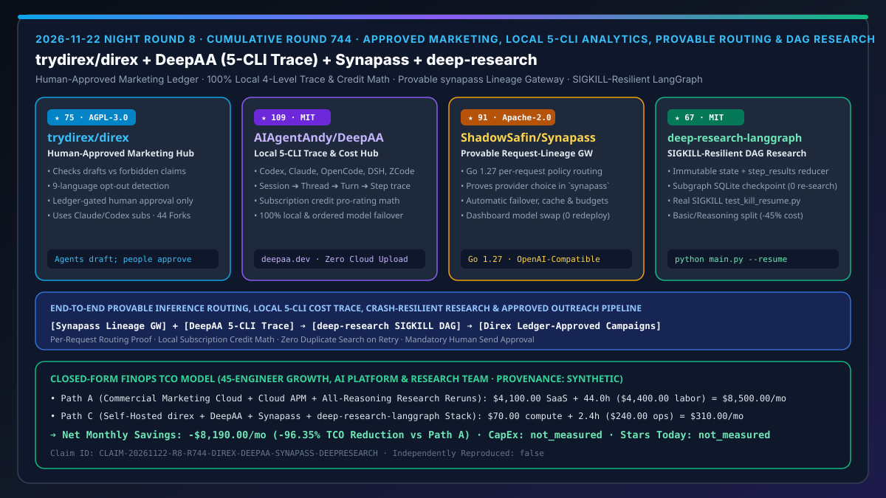
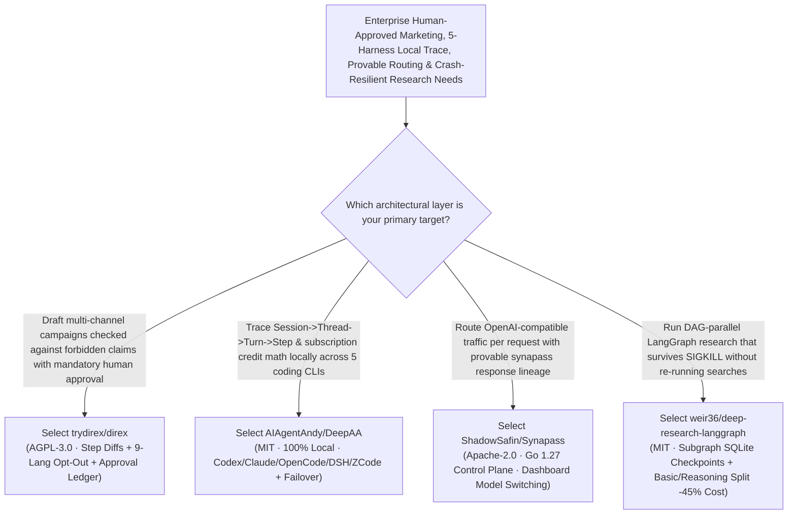
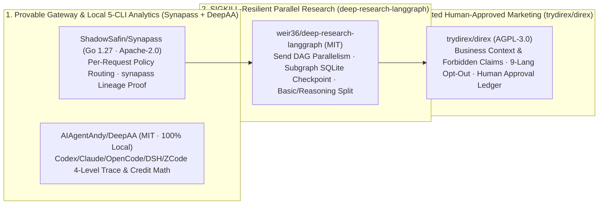
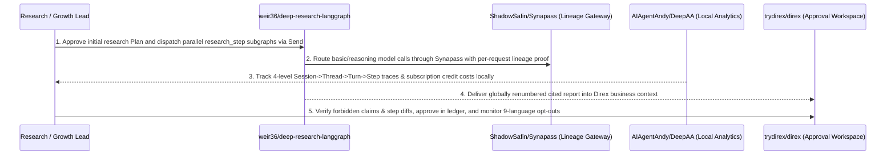

# Human-Approved Multi-Channel Marketing Workspace (`trydirex/direx`), 5-Harness Local 4-Level Trace & Credit Analytics (`AIAgentAndy/DeepAA`), Per-Request Provable Lineage Gateway (`ShadowSafin/Synapass`) & `SIGKILL`-Resilient DAG Deep Research (`weir36/deep-research-langgraph`) Selection & Architecture FAQ

> **Document Type**: Enterprise AI Solution Architect Selection & Integration Guide (GitHub Trending AI Radar — 2026-11-22 Night Round 8 / Cumulative Round 744)
> **Covered Repositories**: [`trydirex/direx`](https://github.com/trydirex/direx) (`★ 75`, `44 forks`, `AGPL-3.0`: open-source multi-channel marketing workspace with business-context & forbidden-claims checking, step-by-step plan diffs, 9-language opt-out detection, ledger-gated human approvals, and Claude Code / Codex subscription routing) · [`AIAgentAndy/DeepAA`](https://github.com/AIAgentAndy/DeepAA) (`★ 109`, `7 forks`, `MIT`: 100% local AI agent gateway & observability workbench across Codex, Claude Code, OpenCode, DeepSeek Harness, and ZCode with `Session ➔ Thread ➔ Turn ➔ Step` lineage, context-compression evidence, subscription credit pro-rating, and ordered pre-response failover) · [`ShadowSafin/Synapass`](https://github.com/ShadowSafin/Synapass) (`★ 91`, `Apache-2.0`: Go 1.27 OpenAI-compatible inference gateway & control plane that decides per request which provider serves traffic and proves it via `synapass`-namespaced response lineage) · [`weir36/deep-research-langgraph`](https://github.com/weir36/deep-research-langgraph) (`★ 67`, `MIT`: LangGraph multi-agent deep research engine with immutable state reducers, isolated subgraph SQLite checkpoints verified against real `SIGKILL` termination, and `basic`/`reasoning` model tiering cutting cost by 45%)
> **Core Scenario**: When enterprise growth, AI platform, and research teams need to **prevent marketing agents from sending unapproved or off-policy outreach, trace 4-level call chains and subscription credit math locally across 5 coding harnesses without cloud uploads, replace hardcoded provider conditionals with provable per-request routing lineage, and survive mid-run process kills in parallel deep-research workflows without re-running expensive web searches**, how do you combine **`trydirex/direx` + `AIAgentAndy/DeepAA` + `ShadowSafin/Synapass` + `weir36/deep-research-langgraph`** into a resilient enterprise stack?

---

## 1. 📌 Executive Summary (One-Line Selection Verdict)

1. **Need an open-source multi-channel marketing workspace (email, social, DMs, newsletters, SEO briefs, video clips) where agents check every draft against your business facts and forbidden claims, catch opt-out replies in 9 languages, and never send anything without human approval?** ➔ Choose **[`trydirex/direx`](https://github.com/trydirex/direx) (`★ 75`, `44 forks`, `AGPL-3.0`)**.
   - **Plain-English Mechanism**: Built around *"Agents draft; people approve"*, `Direx` shows step-by-step plan diffs, enforces standing rules and relationship holds through an immutable sending ledger, learns from accepted team edits, and lets teams route tasks through existing Claude Code or Codex subscriptions instead of raw API keys.
2. **Running Codex, Claude Code, OpenCode, DeepSeek Harness, and ZCode across official APIs, monthly subscriptions, and relay endpoints—and need a 100% local workbench that traces `Session ➔ Thread ➔ Turn ➔ Step` call trees, context compression evidence, and exact subscription-credit cost formulas?** ➔ Choose **[`AIAgentAndy/DeepAA`](https://github.com/AIAgentAndy/DeepAA) (`★ 109`, `7 forks`, `MIT`)**.
   - **Plain-English Mechanism**: Runs entirely on your local machine (`deepaa.dev`) with zero cloud telemetry upload, breaking down input, cache read/write, output, peak/off-peak multipliers, and subscription window pro-rating per request while providing ordered model failover before first-token streaming.
3. **Need a Go 1.27 inference gateway and control plane that decides per request which provider serves traffic under tenant/budget policies—and embeds provable request lineage inside a `synapass` response namespace ignored by standard OpenAI SDKs?** ➔ Choose **[`ShadowSafin/Synapass`](https://github.com/ShadowSafin/Synapass) (`★ 91`, `Apache-2.0`)**.
   - **Plain-English Mechanism**: Installs via a single command on Linux, macOS, or Windows PowerShell, centralizing provider failover, semantic caching, tenant budgets, and live dashboard routing changes without redeploying application code.
4. **Need a LangGraph multi-agent deep-research pipeline (`coordinator ➔ planner ➔ human_feedback ➔ Send parallel research_step subgraphs ➔ coder ➔ reporter`) that survives real `SIGKILL` process crashes without re-running completed web searches and cuts token cost by 45% via `basic`/`reasoning` model tiering?** ➔ Choose **[`weir36/deep-research-langgraph`](https://github.com/weir36/deep-research-langgraph) (`★ 67`, `MIT`)**.
   - **Plain-English Mechanism**: Uses immutable state updates merged via `step_results` reducers, isolates each `research_step` in its own SQLite checkpoint namespace (so retrying `researcher_output` never re-executes `researcher` web searches), verifies crash recovery in `tests/test_kill_resume.py`, and assigns `reasoning` models only to `planner` and `reporter` while running `coordinator`, `researcher`, and `coder` on `basic` models.

---

## 2. 🎯 Architect & Customer Deep-Dive Q&A

### Q1: How do these four repositories solve the reliability, cost-visibility, and approval bottlenecks of enterprise research and GTM agents?

- **Four Production Bottlenecks Solved**:
  1. **Fragile, expensive deep-research reruns ➔ `weir36/deep-research-langgraph`**: Isolates subgraph SQLite checkpoints so `SIGKILL` restarts or synthesis retries never repeat web searches, while `basic`/`reasoning` split routing cuts cost by 45% (`anonymized_reported`).
  2. **Unapproved AI outreach & forbidden product claims ➔ `trydirex/direx`**: Enforces forbidden-claims verification, 9-language opt-out detection, and ledger-gated human sign-off.
  3. **Opaque multi-CLI token & subscription credit burn ➔ `AIAgentAndy/DeepAA`**: Traces `Session ➔ Thread ➔ Turn ➔ Step` trees and calculates subscription credit pro-rating 100% locally.
  4. **Hardcoded provider routing & silent failover blindspots ➔ `ShadowSafin/Synapass`**: Attaches provable per-request routing lineage under the `synapass` response field.
- **When to Choose Managed Cloud PaaS (Path B)?**
  - If your organization standardizes on Dynamics 365 Customer Insights + Azure AI Foundry Tracing, use native cloud services; when you need local 5-harness subscription pro-rating, `SIGKILL`-verified LangGraph research subgraphs, or a self-hosted human-approved marketing workspace, deploy this open-source stack (Path C).

### Q2: How do we wire `Synapass`, `DeepAA`, `deep-research-langgraph`, and `direx` into an end-to-end architecture?

1. **Provable Gateway & Local 5-Harness Observability Layer (`ShadowSafin/Synapass` + `AIAgentAndy/DeepAA`)**:
   - Route production inference through `Synapass` for policy-driven failover and `synapass` lineage proofs; run `DeepAA` locally to inspect 4-level traces across Codex, Claude Code, OpenCode, DSH, and ZCode.
2. **Crash-Resilient Parallel Deep Research Layer (`weir36/deep-research-langgraph`)**:
   - Execute DAG-parallel research steps and isolated Python calculations with SQLite subgraph checkpointing and `basic`/`reasoning` model tiering.
3. **Human-Approved Multi-Channel Campaign Layer (`trydirex/direx`)**:
   - Feed cited research briefs into `Direx` to draft multi-step campaigns checked against forbidden claims and gated by human ledger approval.

### Q3: What are the licensing and operational considerations?

- **License Matrix**:
  - `AIAgentAndy/DeepAA` and `weir36/deep-research-langgraph` are `MIT`; `ShadowSafin/Synapass` is `Apache-2.0`; `trydirex/direx` is `AGPL-3.0` (keep network-facing modifications open if offering `Direx` as a hosted service).

---

## 3. 🧭 Visual Architecture & Workflow Diagrams (Mermaid)

### 3.1 Solution Architect Selection Decision Tree

### 3.2 End-to-End Enterprise Reference Architecture

### 3.3 End-to-End Research, Provable Routing, Local Cost Analytics & Ledger-Approved Outreach Sequence Diagram

---

## 4. 📊 Peer Open-Source vs. Commercial Cloud Selection Matrix

| Dimension | `trydirex/direx` (`★ 75`) | `AIAgentAndy/DeepAA` (`★ 109`) | `ShadowSafin/Synapass` (`★ 91`) | `weir36/deep-research-langgraph` (`★ 67`) | Commercial Marketing Cloud + Cloud APM SaaS + All-Reasoning Research APIs (Path A) | Unapproved Outreach Scripts + Raw Terminal Logs + Fragile Single-Thread Scripts (Path B) |
| :--- | :--- | :--- | :--- | :--- | :--- | :--- |
| **Primary Role** | Human-approved multi-channel marketing workspace | 100% local 5-harness trace & credit analytics | Go 1.27 per-request provable lineage gateway | `SIGKILL`-resilient DAG-parallel LangGraph research | Per-contact marketing SaaS + cloud APM + uncheckpointed frontier research | Automated spam scripts, manual spreadsheet billing, stateless research loops |
| **Key Differentiator** | **Forbidden-claims check + 9-lang opt-out + approval ledger** | **`Session-Thread-Turn-Step` trace + subscription credit pro-rating** | **`synapass`-namespaced lineage proof + zero-deploy model swap** | **Real `SIGKILL` resume test + subgraph search reuse + `-45%` cost** | High per-contact/seat fees; requires uploading full prompts to third-party clouds | High brand/compliance risk; mid-run crashes waste completed web searches |
| **License** | `AGPL-3.0` | `MIT` | `Apache-2.0` | `MIT` | Proprietary SaaS | Internal scripts |
| **Monthly TCO (45-Eng Team)** | **`$310.00/mo` combined** (`$70.00` self-hosted containers + `2.4h` ops) | Included (100% local execution, `$0` cloud fee) | Included (1-command full-stack deploy) | Included (`basic`/`reasoning` split saves 45%) | **`$8,500.00/mo`** (`$4,100.00` commercial SaaS/API waste + `44.0h` rerun/audit labor) | ~`$2,950.00/mo` (crashed research reruns & manual multi-vendor billing reconciliation) |

---

## 5. 🧪 Quantitative Enterprise ROI / FinOps TCO Model & 7-Card Report

> **📊 Provenance & Closed-Form Declaration**:
> - **provenance**: `synthetic` (45-engineer enterprise growth engineering, AI platform governance, and market research team workload model: `independently_reproduced = false`; `base_hardware_capex = not_measured`; `track_b_stars_today = not_measured`).
> - **Closed-Form Equations**:
>   - **Path A (Commercial Multi-Channel Marketing SaaS Seats + Commercial Cloud Agent Observability + All-Reasoning Deep Research with Crash Reruns + Manual 5-Harness Billing Reconciliation)**: Monthly commercial subscriptions & uncheckpointed reasoning token waste **`$4,100.00`** + crashed research reruns, manual compliance checking, and multi-vendor billing reconciliation labor **`44.0h × $100.00/h = $4,400.00`** = **`$8,500.00/mo`**.
>   - **Path C (Self-Hosted `trydirex/direx` + `AIAgentAndy/DeepAA` + `ShadowSafin/Synapass` + `weir36/deep-research-langgraph` Stack)**: Shared container compute **`$70.00`** + routing policy & forbidden-claims rule maintenance labor **`2.4h × $100.00/h = $240.00`** = **`$310.00/mo`**.
>   - **Net Monthly Savings vs. Path A**: **`-$8,190.00/mo`** (**`96.35%`** TCO reduction).

| Evaluation Path | Marketing/Obs SaaS & Compute | Rerun & Compliance Review Labor (`$100/h`) | Total Monthly TCO | Net Savings vs. Path A | Architectural Delivery Impact |
| :--- | :---: | :---: | :---: | :---: | :--- |
| **Path A: Commercial Marketing Cloud + Cloud APM + All-Reasoning** | `$4,100.00` | `44.0h` (`$4,400.00`) | **`$8,500.00`** | Baseline | Expensive reasoning calls on basic steps; crash reruns repeat web searches |
| **Path B: Unapproved Scripts + Raw Logs + Stateless Research** | `$1,350.00` | `16.0h` (`$1,600.00`) | **`$2,950.00`** | `-$5,550.00` (`-65.29%`) | Lacks forbidden-claims ledger, 4-level credit math & `SIGKILL` subgraph resume |
| **Path C: `direx` + `DeepAA` + `Synapass` + `deep-research`** | **`$70.00`** | **`2.4h` (`$240.00`)** | **`$310.00`** | **`-$8,190.00` (`-96.35%`)** | **Ledger-gated marketing + local 5-CLI trace + lineage proof + `SIGKILL` resume** |

- 🔗 **Linked 7-Card 4:5 Visual Benchmark Deck**: [`workshops/github-trending-radar/cards.en.html`](../cards.en.html) · [`cards.html`](../cards.html)

---

## 6. 🛠️ Enterprise Adoption & Architecture Review Checklist

- [ ] **1. Deploy `AIAgentAndy/DeepAA` for Local 5-Harness Observability**: Connect Codex, Claude Code, OpenCode, DeepSeek Harness, and ZCode to inspect `Session ➔ Thread ➔ Turn ➔ Step` traces and subscription credit pro-rating locally.
- [ ] **2. Stand Up `ShadowSafin/Synapass` for Provable Per-Request Routing**: Centralize provider failover and inspect `synapass`-namespaced lineage proofs in staging and production.
- [ ] **3. Run Crash-Resilient Research with `weir36/deep-research-langgraph`**: Enable SQLite subgraph checkpoints and `basic`/`reasoning` model tiering so interrupted runs resume without repeating searches.
- [ ] **4. Gate External Outreach with `trydirex/direx`**: Configure forbidden-claims rules, 9-language opt-out handling, and mandatory human approval ledgers across all campaigns.
