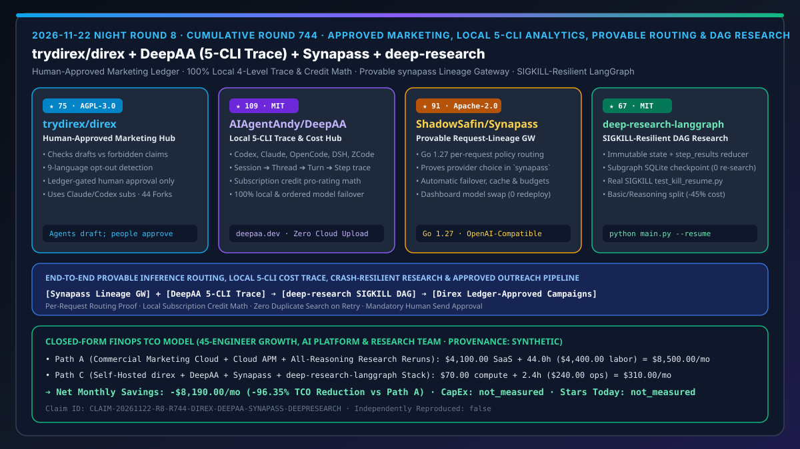
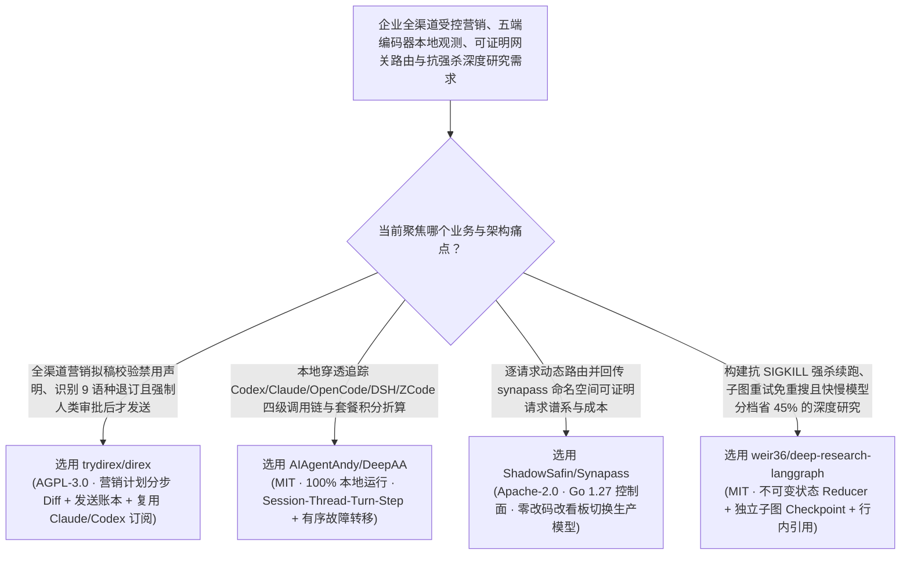
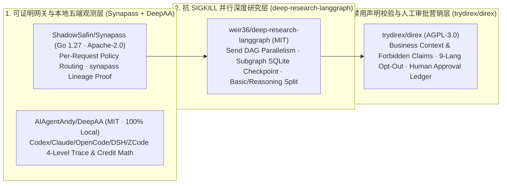
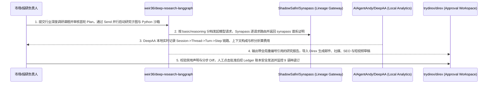

# 人工审批门禁全渠道营销工作台（`trydirex/direx`）、五端编码器本地四级调用链与积分折算工作台（`AIAgentAndy/DeepAA`）、逐请求可证明路由谱系网关（`ShadowSafin/Synapass`）与抗 SIGKILL 强杀恢复并行研究引擎（`weir36/deep-research-langgraph`）选型与集成架构 FAQ

> **文档类型**：企业 AI 解决方案架构师（AI Solution Architect）选型决策指南（GitHub Trending AI 雷达 2026-11-22 Night Round 8 / 累计第 744 轮）
> **覆盖项目**：[`trydirex/direx`](https://github.com/trydirex/direx)（`★ 75`、`44 forks`、`AGPL-3.0`，开源全渠道营销工作台，涵盖企业事实与禁用声明校验、分步 Diff 营销计划、9 语种退订识别、邮件预热与强制人工审批账本发送，并支持直接复用 Claude Code / Codex 订阅配额）· [`AIAgentAndy/DeepAA`](https://github.com/AIAgentAndy/DeepAA)（`★ 109`、`7 forks`、`MIT`，100% 本地运行的 AI Agent 网关与可观测工作台，集成 Codex、Claude Code、OpenCode、DeepSeek Harness、ZCode 五大编码器，提供 `Session ➔ Thread ➔ Turn ➔ Step` 四级追踪、上下文压缩证据、高峰/闲时与套餐积分折算公式及模型级有序故障转移）· [`ShadowSafin/Synapass`](https://github.com/ShadowSafin/Synapass)（`★ 91`、`Apache-2.0`，基于 Go 1.27 的逐请求策略路由与控制面网关，在兼容标准 OpenAI SDK 的同时通过 `synapass` 命名空间字段返回完整可证明请求谱系）· [`weir36/deep-research-langgraph`](https://github.com/weir36/deep-research-langgraph)（`★ 67`、`MIT`，基于 LangGraph 重构的抗 `SIGKILL` 强杀恢复多 Agent 深度研究引擎，采用不可变状态 + Reducer 合并、子图独立检查点免重复搜索与 `basic`/`reasoning` 分档路由省 45% 成本）
> **核心场景**：当企业增长团队、AI 平台与投研部门面临**“AI 营销自动化胡乱对外发信夸大承诺引发品牌公关灾难、5 种主流编码器混用官方订阅与中转站导致无法穿透查看每一步上下文构成与真实折算成本、生产应用硬编码 `if model == ...` 缺乏逐请求路由证明、以及长耗时 Deep Research 任务中途崩溃就要从头重新搜索烧钱”**四大痛点时，如何组合**`trydirex/direx` + `AIAgentAndy/DeepAA` + `ShadowSafin/Synapass` + `weir36/deep-research-langgraph`** 构建一套可观测、可恢复、严守审批底线的企业 AI 栈？

---

## 一、📌 核心结论速览（选型一句话结论）

1. **想用 AI 自动化生成邮件序列、社媒帖子、Newsletter、SEO 简报与短视频切片，但要求严格校验“绝对禁止夸大的业务声明（Forbidden Claims）”、支持 9 种语言自动识别退订回复，且绝不允许任何未经人类审批确认的内容发出去** ➔ 选 **[`trydirex/direx`](https://github.com/trydirex/direx)（`★ 75`，`44 forks`，`AGPL-3.0`）**。
   - **通俗原理**：恪守 **“Agents draft; people approve（智能体只管拟稿，人类拍板才发送）”** 铁律。计划变更会按步骤展示 Diff，所有外发动作必须穿过不可篡改的发送账本（Ledger）与关系冻结保护（Relationship Holds），且支持直接挂载团队现有的 Claude Code 或 Codex 订阅席位代替按量 API Key。
2. **同时使用 Codex、Claude Code、OpenCode、DeepSeek Harness、ZCode 五种编码器，想在 100% 本地不上传云端的前提下，看清每次任务 `Session ➔ Thread ➔ Turn ➔ Step` 四级调用链、MCP/Skills 注入占比、缓存读写倍率与包月套餐积分折算账单** ➔ 选 **[`AIAgentAndy/DeepAA`](https://github.com/AIAgentAndy/DeepAA)（`★ 109`，`7 forks`，`MIT`）**。
   - **通俗原理**：把官方 API、包月套餐订阅与第三方中转站统一收拢到本地工作台。它不仅能展示每一步上下文膨胀与压缩证据，还按照各家供应商的积分折算公式（或套餐窗口周期比例）精准还原每笔请求的真实成本，并支持在首包返回前按有序备份链无缝故障转移。
3. **想把硬编码在各个业务微服务里的模型选择与 `429` 重试逻辑抽离到统一的 Go 1.27 控制面，要求网关逐请求动态决策由哪家供应商响应，并在返回 JSON 的 `synapass` 扩展字段中附带完整可验证路由谱系（Request Lineage）** ➔ 选 **[`ShadowSafin/Synapass`](https://github.com/ShadowSafin/Synapass)（`★ 91`，`Apache-2.0`）**。
   - **通俗原理**：支持 Linux / macOS / Windows PowerShell 一行命令安装全栈（含 Web Dashboard 与桌面端）。业务代码只需改一行 `base_url` 即可接入；标准 OpenAI SDK 会自动忽略新增的 `synapass` 命名空间字段，而审计与调试系统则能直接从该字段读取本次请求命中了哪条策略、是否触发故障转移以及精确耗时与花费。
4. **想搭建一套类似 `deer-flow` 的多 Agent 深度研究系统，但要求进程哪怕在半路被 `SIGKILL` 强行杀掉也能从 SQLite 毫秒级续跑、写作节点报错重试时绝不重新调搜索引擎、且通过 `basic` 与 `reasoning` 模型分档把研究成本砍掉 45%** ➔ 选 **[`weir36/deep-research-langgraph`](https://github.com/weir36/deep-research-langgraph)（`★ 67`，`MIT`）**。
   - **通俗原理**：在架构上做了三项硬核工程改进：① **不可变状态 + `step_results` Reducer 合并**（通过 LangGraph `Send` 并行分发无锁无竞争）；② **子图独立 Checkpoint 命名空间**（`researcher_output` 节点重试时直接复用同子图已落盘的 `researcher` 搜索结果，绝不二次搜索扣费），并附带 `tests/test_kill_resume.py` 真杀进程单测验证；③ **快慢模型分档**（只有 `planner` 与 `reporter` 用昂贵推理模型，其余收集、代码沙箱与分步摘要全部用 `basic` 模型）。

---

## 二、🎯 客户与架构师灵魂拷问 Q&A（深度架构拆解）

### Q1：为什么企业里的“深度投研 Agent”与“全渠道营销 Agent”上线后常因为崩溃重跑和违规乱发被叫停？这四个项目如何解决？

- **四大生产痛点与工程解方**：
  1. **长链路研究任务脆弱且重跑极贵 ➔ `weir36/deep-research-langgraph`**：通过子图级 SQLite Checkpoint 与 `SIGKILL` 恢复测试，保证已完成的外部搜索与 Python 沙箱计算永不重复执行，配合快慢模型混用降低 45% 成本（`anonymized_reported`）。
  2. **营销 Agent 幻觉编造产品承诺或骚扰退订客户 ➔ `trydirex/direx`**：内置禁用声明（Forbidden Claims）自动核对、9 语种退订拦截与强制人工审批账本。
  3. **多编码器黑盒消耗与套餐额度浪费 ➔ `AIAgentAndy/DeepAA`**：本地穿透追踪 5 大编码器的 `Session ➔ Thread ➔ Turn ➔ Step` 上下文构成与套餐积分折算。
  4. **生产网关缺乏逐请求决策证明 ➔ `ShadowSafin/Synapass`**：在响应体 `synapass` 命名空间内嵌可验证路由谱系与策略命中证明。
- **何时直接用云厂商托管方案（Path B）？**
  - 若企业使用 Dynamics 365 Customer Insights / Marketing 与 Azure AI Foundry Tracing，可直接采用微软云原生全套方案；若需本地穿透分析 5 大编码器套餐折算、抗 `SIGKILL` 深度研究子图或复用 Claude/Codex 订阅跑自托管营销工作台，则选择本轮开源组合（Path C）。

### Q2：典型企业级“可证明路由网关 (`Synapass`) + 本地五端编码观测 (`DeepAA`) + 抗强杀并行研究 (`deep-research`) + 人工审批营销交付 (`Direx`)”架构怎么搭？

1. **底层可证明路由与本地可观测层（`ShadowSafin/Synapass` + `AIAgentAndy/DeepAA`）**：
   - 生产应用统一指向 `Synapass` 获取策略路由、故障转移与 `synapass` 谱系回执；研发终端通过 `DeepAA` 监控 5 大编码器的四级调用链与积分折算。
2. **中层抗强杀多 Agent 深度研究层（`weir36/deep-research-langgraph`）**：
   - 接收市场与竞品调研课题，经首轮人工审核 `Plan` 后通过 `Send` 并行调度 `research_step` 子图与 Python 沙箱，生成带全局重编号引用的深度报告。
3. **上层全渠道合规拟稿与人工审批发送层（`trydirex/direx`）**：
   - 将研究成果导入 `Direx` 业务上下文，自动拆解邮件、社媒、SEO 与短视频切片步骤，经禁用声明校验与人工审批后通过发送账本触达客户。

### Q3：这套架构的开源协议与数据合规边界是什么？

- **开源协议分层**：
  - `AIAgentAndy/DeepAA` 与 `weir36/deep-research-langgraph` 为 `MIT`；`ShadowSafin/Synapass` 为 `Apache-2.0`；`trydirex/direx` 采用 `AGPL-3.0`（企业内部自托管作为营销工作台无需开源自身业务数据，但若修改 `Direx` 源码对外提供 SaaS 则需遵循 AGPL-3.0）。

---

## 三、🧭 直观可视化图解（Mermaid 决策树 + 集成架构 + 时序图）

### 3.1 架构师选型决策树

### 3.2 企业端到端生产集成参考架构图

### 3.3 深度研究抗强杀并行执行、可证明网关路由、本地四级成本核算与人工审批全渠道发布时序图

---

## 四、📊 同类开源与商业云服务横向选型决策矩阵

| 对比维度 | `trydirex/direx` (`★ 75`) | `AIAgentAndy/DeepAA` (`★ 109`) | `ShadowSafin/Synapass` (`★ 91`) | `weir36/deep-research-langgraph` (`★ 67`) | 商业营销自动化云 + 商业可观测 SaaS + 商业深度研究订阅 (Path A) | 无审批群发脚本 + 裸看终端日志 + 单线程脆弱研究脚本 (Path B) |
| :--- | :--- | :--- | :--- | :--- | :--- | :--- |
| **核心能力定位** | 人工审批门禁全渠道营销工作台 | 5 大编码器本地四级追踪与积分折算台 | Go 1.27 逐请求可证明路由谱系网关 | 抗 `SIGKILL` 子图检查点并行深度研究 | 按联系人/席位高价计费的商业营销云与云端 APM | 自动群发脚本、手动估账单与单线程无检查点脚本 |
| **核心技术突破** | **禁用声明拦截 + 9 语种退订 + 复用 Claude/Codex 订阅** | **`Session-Thread-Turn-Step` 穿透 + 套餐积分折算公式** | **`synapass` 字段内嵌完整请求谱系证明 + 零发版切模型** | **真 `SIGKILL` 杀进程恢复单测 + 子图重试免重搜 + 省 45% 成本** | 商业营销云按联系人数量阶梯涨价；云端 APM 要求上传完整 Prompt | 无人工门禁易发错信封号；研究脚本中途报错需从头重搜烧钱 |
| **开源协议** | `AGPL-3.0` | `MIT` | `Apache-2.0` | `MIT` | 闭源商业 SaaS | 内部零散脚本 |
| **月度 TCO（45 人团队）** | **组合仅 `$310.00/月`**（`$70.00` 自托管容器 + `2.4h` 维护） | 同左（100% 本地运行零费用） | 同左（单栈一键部署） | 同左（快慢模型混用 + 免重搜省 45%） | **`$8,500.00/月`**（`$4,100.00` 商业营销/观测/研究订阅 + `44.0h` 重跑与对账人工） | 约 `$2,950.00/月`（大量研究中断重跑浪费与人工排查多渠道发送事故工时） |

---

## 五、🧪 应用落地定量收益/TCO 对比与 7-Card 报告

> **📊 数据来源与闭式核算声明（Provenance & Closed-Form Schema）**：
> - **provenance**: `synthetic`（基于 45 人企业增长工程、AI 平台治理与市场投研团队月度工作负载模型：`independently_reproduced = false`；硬件采购基线 `base_hardware_capex = not_measured`；Track B 单日增量 `track_b_stars_today = not_measured`）。
> - **核算公式**：
>   - **Path A（采购商业全渠道营销自动化 SaaS 席位 + 商业云端 Agent 可观测平台 + 全量使用高价推理模型跑深度研究且中途失败全量重搜 + 人工对账 5 种编码器与中转站账单）**：月度商业 SaaS 订阅与全量推理重搜 Token 浪费 **`$4,100.00`** + 失败重跑、多渠道合规审核与手工账单折算人工 **`44.0h × $100.00/h = $4,400.00`** = **`$8,500.00/月`**。
>   - **Path C（自建 `trydirex/direx` + `AIAgentAndy/DeepAA` + `ShadowSafin/Synapass` + `weir36/deep-research-langgraph` 开源栈）**：共享自托管容器算力开销 **`$70.00`** + 路由规则与营销合规词库维护人工 **`2.4h × $100.00/h = $240.00`** = **`$310.00/月`**。
>   - **净节省（Net Savings vs Path A）**：**`-$8,190.00/月`**（成本降低 **`96.35%`**）。

| 评估方案 | 营销/观测 SaaS 与算力成本 | 重跑排障与合规审核人工（`$100/h`） | 月度总 TCO | 相对 Path A 净节省 | 关键架构交付指标 |
| :--- | :---: | :---: | :---: | :---: | :--- |
| **Path A：商业营销云 + 商业 APM + 全量高价模型深度研究** | `$4,100.00` | `44.0h` (`$4,400.00`) | **`$8,500.00`** | Baseline | 全部步骤用高价推理模型且中断需重搜；Prompt 需上传第三方云 |
| **Path B：无门禁群发脚本 + 裸看终端 + 单线程研究脚本** | `$1,350.00` | `16.0h` (`$1,600.00`) | **`$2,950.00`** | `-$5,550.00` (`-65.29%`) | 缺少禁用声明门禁、四级积分折算、`synapass` 谱系证明与抗强杀恢复 |
| **Path C：`direx` + `DeepAA` + `Synapass` + `deep-research`** | **`$70.00`** | **`2.4h` (`$240.00`)** | **`$310.00`** | **`-$8,190.00` (`-96.35%`)** | **人工审批营销账本 + 本地五端四级追踪 + 路由证明 + 抗强杀研究** |

- 🔗 **关联 7-Card 4:5 视觉评测报告**：[`workshops/github-trending-radar/cards.html`](../cards.html) · [`cards.en.html`](../cards.en.html)

---

## 六、🛠️ 企业引入与架构评审 Checklist

- [ ] **1. 在研发终端部署 `AIAgentAndy/DeepAA`**：统一接入 Codex、Claude Code、OpenCode、DeepSeek Harness 与 ZCode，开启本地 `Session ➔ Thread ➔ Turn ➔ Step` 追踪与套餐积分折算。
- [ ] **2. 部署 `ShadowSafin/Synapass` 作为生产应用统一推理控制面**：配置多供应商故障转移并通过响应体 `synapass` 字段留存逐请求路由谱系证明。
- [ ] **3. 引入 `weir36/deep-research-langgraph` 执行高可靠并行投研**：启用 SQLite 子图级 Checkpoint 与 `basic`/`reasoning` 分档路由，确保中断恢复免重复搜索。
- [ ] **4. 使用 `trydirex/direx` 管控全渠道对外营销沟通**：录入企业事实与禁用声明（Forbidden Claims），强制所有邮件与社媒发布经过人工审批账本与 9 语种退订过滤。
