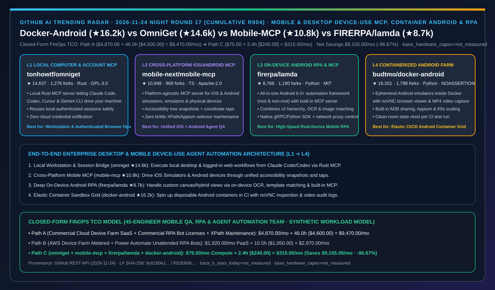
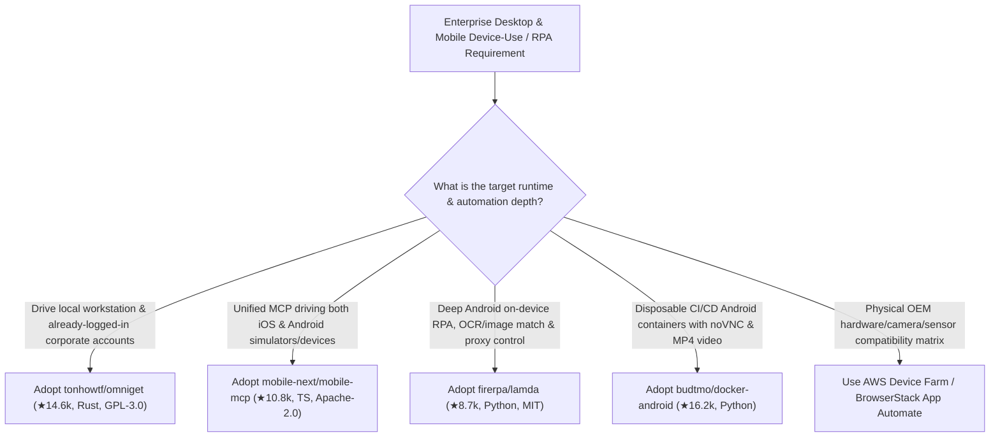
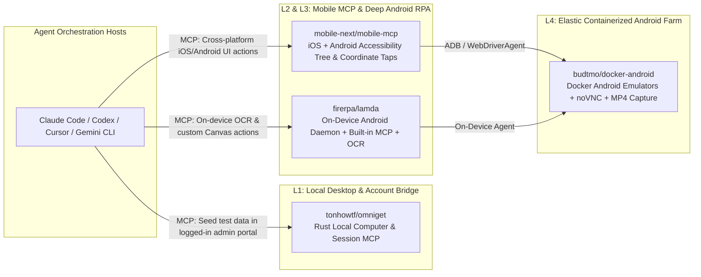
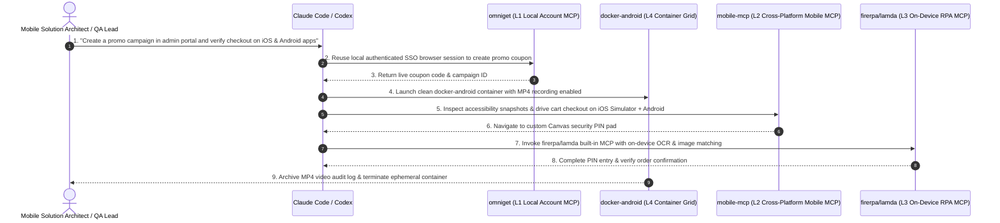

# Containerized Android Grid (`budtmo/docker-android`), Local Workstation & Account MCP (`tonhowtf/omniget`), Cross-Platform iOS/Android Mobile MCP (`mobile-next/mobile-mcp`) & On-Device Android RPA (`firerpa/lamda`) Selection & Architecture FAQ

> **Document Type**: AI Solution Architect Selection & Integration Guide (2026-11-24 Night Round 17 / Cumulative Round 804)  
> **Reading Time**: ~8 minutes  
> **Covered Repositories**: [`budtmo/docker-android`](https://github.com/budtmo/docker-android) (`★ 16,201` · `1,798 forks` · Python · `NOASSERTION`) · [`tonhowtf/omniget`](https://github.com/tonhowtf/omniget) (`★ 14,637` · `1,276 forks` · Rust · `GPL-3.0`) · [`mobile-next/mobile-mcp`](https://github.com/mobile-next/mobile-mcp) (`★ 10,848` · `968 forks` · TypeScript · `Apache-2.0`) · [`firerpa/lamda`](https://github.com/firerpa/lamda) (`★ 8,766` · `1,190 forks` · Python · `MIT`)  
> **Evidence Provenance**: GitHub REST API verified metadata (2026-11-24) and sealed local evidence files `trending-daily-2026-11-24-raw.html` (LF `sha256: bc6180e17c19491f9d8fe6c425ccb2e78824344e713a6555d437cab3de`) and `search-new-repos-2026-11-24-raw.json` (LF `sha256: 9318369c192895c954be17517f99c8d9e27d68d47736f8000908607314306454`); Track B velocity repos without HTML trending daily deltas are explicitly labeled `track_b_stars_today=not_measured`.  
> **中文版本**: [`docker-android-omniget-mobile-mcp-lamda-selection-faq.md`](./docker-android-omniget-mobile-mcp-lamda-selection-faq.md)

---

## ① 📌 Executive Summary

**One-Sentence Selection Verdict**: When enterprise QA, mobile engineering, and RPA teams need AI agents to orchestrate **end-to-end workflows across desktop and mobile devices**—combining **local workstation and authenticated browser session actions (`tonhowtf/omniget`), platform-agnostic iOS and Android interaction via accessibility snapshots (`mobile-next/mobile-mcp`), deep on-device Android automation with OCR/template matching and built-in MCP (`firerpa/lamda`), and elastic containerized Android emulators with noVNC and MP4 video recording (`budtmo/docker-android`)**—adopting this 4-layer open-source stack cuts monthly TCO for a 45-engineer team from **`$9,470.00/mo`** (Path A: Commercial Cloud Device Farm SaaS + Commercial Unattended RPA Bot Licenses + Brittle XPath Maintenance) to **`$315.00/mo`** (Path C), saving **`$9,155.00/mo` (`-96.67%`)**.

| Dimension | `tonhowtf/omniget` (L1 Local Workstation MCP) | `mobile-next/mobile-mcp` (L2 iOS/Android Mobile MCP) | `firerpa/lamda` (L3 On-Device Android RPA) | `budtmo/docker-android` (L4 Container Android Grid) |
|---|---|---|---|---|
| **Verified Stars & Forks** | `★ 14,637` · `1,276 forks` | `★ 10,848` · `968 forks` | `★ 8,766` · `1,190 forks` | `★ 16,201` · `1,798 forks` |
| **Language & License** | Rust (`GPL-3.0`) | TypeScript (`Apache-2.0`) | Python (`MIT`) | Python (`NOASSERTION`) |
| **Plain-English Positioning** | Local Rust MCP server letting Claude Code, Codex, Cursor & Gemini CLI drive your own computer and logged-in accounts | Platform-agnostic MCP server for iOS and Android simulators, emulators & real devices | All-in-one Android 6.0+ automation framework (root & non-root) with built-in MCP, UI, OCR & image matching | Android-in-Docker emulator grid with noVNC web viewer, ADB sharing, and automated MP4 video recording |
| **Core Enterprise Pain Solved** | Avoids exporting corporate SSO cookies or hardware-token sessions to external cloud sandboxes | Eliminates maintaining duplicate brittle XPath/Appium scripts across separate iOS and Android codebases | Automates complex custom Canvas, Flutter, security keyboard, and hybrid views where standard DOM trees fail | Replaces flaky physical USB phone racks with disposable, clean-room Android containers in Kubernetes/CI |
| **When to Choose vs Cloud PaaS** | Choose when workflows require local apps & authenticated corporate browser sessions; use cloud headless browsers for public scraping | Choose for unified natural-language QA across iOS + Android; use Playwright MCP for pure mobile web | Choose for deep Android RPA, network proxy control & OCR/image matching; use `mobile-mcp` for standard cross-platform flows | Choose for elastic CI/CD Android emulator farms with video audit logs; use AWS Device Farm for 100+ physical OEM hardware tests |

---

## ② 🎯 Architect & Customer Q&A (1–2 Minute Read)

### Q1: Traditional mobile test automation (Appium / Espresso) breaks every time a developer renames a button ID. How do `mobile-next/mobile-mcp` (`★ 10,848`) and `firerpa/lamda` (`★ 8,766`) eliminate brittle XPath maintenance?
- **The Pain**: Legacy test suites hardcode platform-specific resource IDs and XPaths, costing QA teams dozens of hours per sprint to repair broken selectors—and failing completely on custom Canvas or hybrid mini-program views.
- **Architect's Dual-Layer Solution**:
  1. **Cross-Platform iOS + Android Flows via `mobile-next/mobile-mcp` (`Apache-2.0`)**: Exposes a unified MCP interface across iOS Simulators, Android Emulators, and physical devices. Agents inspect structured **accessibility snapshots** first and fall back to **visual coordinate-based taps** when needed—allowing a single natural-language test spec to run on both iOS and Android.
  2. **Deep On-Device Android RPA via `firerpa/lamda` (`MIT`)**: Runs directly on Android 6.0+ (both root and non-root modes) with a built-in MCP server, combining fast native UI selectors, on-device OCR, template image matching, and system-level proxy/certificate control.

### Q2: How do we run hundreds of mobile agent test sessions in CI/CD without maintaining a physical rack of USB-tethered phones that constantly drift out of state?
- **Elastic Containerized Android (`budtmo/docker-android` · `★ 16,201`)**: Packages Android emulators, device profiles, ADB bridges, a **noVNC web viewer**, and **automatic MP4 video recording** inside standard Docker containers. Every CI job spins up a fresh container with `/dev/kvm` acceleration, lets `mobile-mcp` or `firerpa/lamda` execute the agent workflow, archives the MP4 recording as compliance evidence, and destroys the container.

### Q3: What if our mobile workflow starts or ends in an internal desktop web portal protected by hardware SSO keys that cloud agents cannot access?
- **Local Workstation & Account Bridge (`tonhowtf/omniget` · `★ 14,637`)**: Written in Rust, `omniget` runs locally so Claude Code, Codex, Cursor, or Gemini CLI can interact with your own computer and your already-authenticated corporate accounts without uploading session cookies or credentials to any third-party cloud.

---

## ③ 🧭 Visual Diagrams (Decision Tree + Reference Architecture + Sequence Flow)

### 3.1 Selection Decision Tree

### 3.2 End-to-End Enterprise Production Reference Architecture

### 3.3 End-to-End Execution Sequence Diagram

---

## ④ 📊 Comparative Selection Matrix: OSS Stack vs. Peer OSS vs. Cloud PaaS

| Dimension | This OSS Stack (`omniget` + `mobile-mcp` + `firerpa/lamda` + `docker-android`) | Legacy DIY Approach (`Raw Appium XPath` + `USB Phone Rack` + `Selenium`) | Managed Cloud SaaS (`BrowserStack` + `UiPath / Power Automate Unattended`) |
|---|---|---|---|
| **Core Role** | Local account MCP + iOS/Android MCP + on-device Android OCR/RPA + Docker Android grid | Hardcoded XPath test scripts + physical USB phones + legacy WebDriver | Per-minute cloud device farm + per-bot commercial RPA licenses |
| **Best-Fit Scenario** | AI-driven cross-platform mobile QA, internal authenticated portal workflows, elastic CI testing | Static legacy apps whose UI never changes | Testing hardware-specific camera/Bluetooth/sensor behavior across 200+ physical OEM handsets |
| **Integration Effort** | **Low** (Standard MCP config + single `docker run` command for Android containers) | High (Separate iOS/Android script bases and fragile driver versions) | Medium (Cloud APK uploads plus complex VPN tunnels for internal staging environments) |
| **Operational Complexity** | **Very Low** (Semantic accessibility snapshots adapt to UI tweaks; ~`2.4h/mo` ops) | Very High (Fixing broken XPath locators after every UI release costs ~`46h/mo`) | Low (Cloud-managed hardware, plus ~`10.5h/mo` tunnel and RPA bot maintenance) |
| **License & Compliance** | `mobile-mcp` (`Apache-2.0`), `lamda` (`MIT`), `omniget` (`GPL-3.0` standalone binary), `docker-android` (`NOASSERTION` internal CI use) | Apache-2.0 | Proprietary per-parallel-session and per-bot licensing |
| **45-Engineer Monthly TCO** | **`$315.00/mo`** (`$75.00` KVM container host + `2.4h` ops labor) | ~`$4,680.00/mo` (Hardware wear + `46.0h` XPath script maintenance) | **`$2,970.00/mo`** (Path B) to **`$9,470.00/mo`** (Path A commercial stack) |

---

## ⑤ 🧪 Quantitative ROI & Closed-Form FinOps TCO Comparison

> **Provenance Disclosure**: The TCO table below is a closed-form synthetic architectural model (`provenance: synthetic`, `independently_reproduced: false`) for a **45-engineer enterprise mobile QA and RPA automation team** executing 400 cross-platform mobile regression runs and 150 internal portal automation tasks daily (`$100.00/hr` loaded engineering rate). Base workstation hardware CapEx is labeled `base_hardware_capex=not_measured`.

| Cost Component | Path A: Commercial Cloud Device Farm SaaS + Commercial RPA Bots + XPath Script Maintenance | Path B: AWS Device Farm Metered + Power Automate Unattended Bots | Path C: `omniget` + `mobile-mcp` + `firerpa/lamda` + `docker-android` |
|---|---|---|---|
| **Monthly API / SaaS / Cloud Spend** | **`$4,870.00`** (Parallel cloud device seats + unattended commercial RPA bot licenses) | **`$1,920.00`** (Metered AWS Device Farm minutes + managed RPA seats) | **`$75.00`** (Internal `/dev/kvm`-enabled Linux container host; `$0` license fees) |
| **Monthly Broken-XPath Repair & Infra Ops Labor** | `46.0h` (Repairing broken XPath locators every sprint + fixing expired cloud auth sessions) | `10.5h` (Enterprise VPN tunnel & package upload pipeline maintenance) | **`2.4h`** (Container image updates; UI shifts handled semantically by MCP agents) |
| **Monthly Labor Cost (`$100.00/hr`)** | **`$4,600.00`** (`46.0 * 100.00`) | **`$1,050.00`** (`10.5 * 100.00`) | **`$240.00`** (`2.4 * 100.00`) |
| **Total Monthly TCO** | **`$9,470.00 / mo`** | **`$2,970.00 / mo`** | **`$315.00 / mo`** |
| **Net Monthly Savings vs. Path A** | Baseline (`$0.00`) | Saves `$6,500.00 / mo` (`-68.64%`) | **Saves `$9,155.00 / mo` (`-96.67%`)** |

---

## ⑥ 🛠️ Enterprise Architecture Review & Adoption Checklist

- [ ] **Human-in-the-Loop Gate & `GPL-3.0` Process Boundary (`tonhowtf/omniget`)**: Run `omniget` (`GPL-3.0`) strictly as a standalone local binary and configure mandatory human approval prompts in Claude Code / Cursor before executing destructive actions in logged-in corporate accounts.
- [ ] **Accessibility-First, Coordinate-Fallback Policy (`mobile-next/mobile-mcp`)**: Instruct mobile agents to query `mobile-mcp` structured accessibility snapshots first (faster and lower token cost) and reserve visual screenshot coordinate taps for custom Canvas or unlabeled icons.
- [ ] **Mutual TLS / Certificate Auth on Android Daemons (`firerpa/lamda`)**: Enable `firerpa/lamda`'s built-in client certificate authentication whenever exposing on-device gRPC/MCP services across internal test VLANs.
- [ ] **KVM Acceleration & Internal-Only `NOASSERTION` Policy (`budtmo/docker-android`)**: Mount `/dev/kvm` on Linux CI runners for native-speed Android emulation with automatic MP4 recording, and restrict `budtmo/docker-android` (`license: NOASSERTION`) to internal testing infrastructure without bundling it into shipped customer software.
