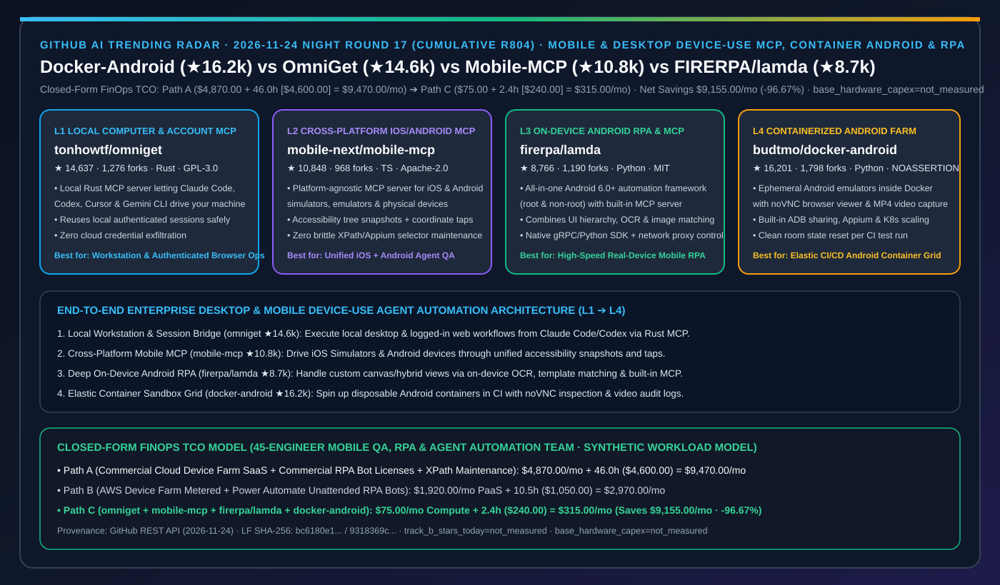
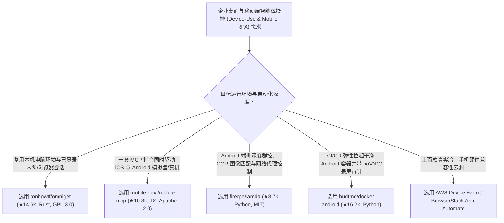
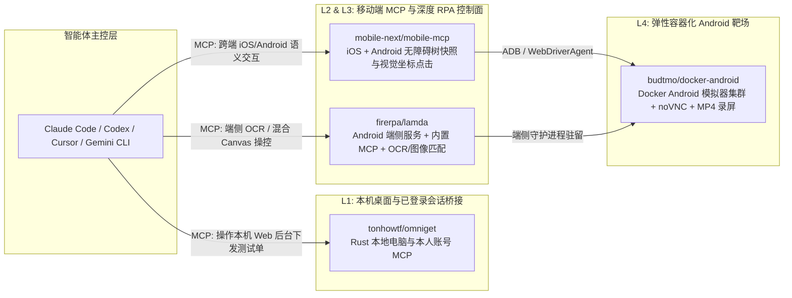
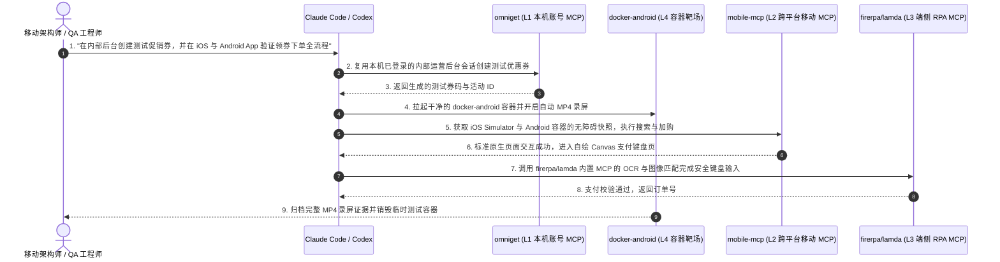

# 容器化 Android 矩阵（`budtmo/docker-android`）、本机与已登录账号直连 MCP（`tonhowtf/omniget`）、跨平台 iOS/Android 移动自动化 MCP（`mobile-next/mobile-mcp`）与设备端全栈 Android RPA 框架（`firerpa/lamda`）选型与集成 FAQ

> **文档类型**：AI 解决方案架构师（AI Solution Architect）选型决策指南（2026-11-24 Night Round 17 / 累计第 804 轮）  
> **阅读耗时**：约 8 分钟  
> **覆盖项目**：[`budtmo/docker-android`](https://github.com/budtmo/docker-android)（`★ 16,201` · `1,798 forks` · Python · `NOASSERTION`） · [`tonhowtf/omniget`](https://github.com/tonhowtf/omniget)（`★ 14,637` · `1,276 forks` · Rust · `GPL-3.0`） · [`mobile-next/mobile-mcp`](https://github.com/mobile-next/mobile-mcp)（`★ 10,848` · `968 forks` · TypeScript · `Apache-2.0`） · [`firerpa/lamda`](https://github.com/firerpa/lamda)（`★ 8,766` · `1,190 forks` · Python · `MIT`）  
> **证据溯源**：GitHub REST API 实测元数据（2026-11-24）与本地冻结证据文件 `trending-daily-2026-11-24-raw.html`（LF `sha256: bc6180e17c19491f9d8fe6c425ccb2e78824344e713a6555d437cab3de`）、`search-new-repos-2026-11-24-raw.json`（LF `sha256: 9318369c192895c954be17517f99c8d9e27d68d47736f8000908607314306454`）；Track B 仓库无 HTML 榜单对应的单日增量，统一标记为 `track_b_stars_today=not_measured`。  
> **English Version**: [`docker-android-omniget-mobile-mcp-lamda-selection-faq.en.md`](./docker-android-omniget-mobile-mcp-lamda-selection-faq.en.md)

---

## ① 📌 核心结论速览（Executive Summary）

**选型一句话结论**：当企业需要让 AI 智能体跨越桌面与移动端边界，完成**“本机电脑与已登录 Web 账号操作（`tonhowtf/omniget`）➔ 跨 iOS 与 Android 的无障碍树统一移动 App 交互（`mobile-next/mobile-mcp`）➔ 真机/非标界面级 OCR 与图像匹配深度 RPA（`firerpa/lamda`）➔ CI/CD 弹性容器化 Android 仿真测试与全程录屏审计（`budtmo/docker-android`）”**时，采用这套四层设备操控（Device-Use & Mobile RPA）开源组合，可将 45 人移动测试与流程自动化团队的月度 TCO 从商业云真机测试场（BrowserStack/SauceLabs）+ 商业 RPA 机器人授权 + 脆弱 XPath 脚本维护（Path A）的 **`$9,470.00/月`** 降至 **`$315.00/月`**（净省 **`$9,155.00/月`**，降幅 **`-96.67%`**）。

| 评估维度 | `tonhowtf/omniget` (L1 本机与账号直连 MCP) | `mobile-next/mobile-mcp` (L2 跨平台移动 MCP) | `firerpa/lamda` (L3 设备端 Android RPA) | `budtmo/docker-android` (L4 容器化 Android 矩阵) |
|---|---|---|---|---|
| **GitHub 实测热度** | `★ 14,637` · `1,276 forks` | `★ 10,848` · `968 forks` | `★ 8,766` · `1,190 forks` | `★ 16,201` · `1,798 forks` |
| **实现语言与开源协议** | Rust (`GPL-3.0`) | TypeScript (`Apache-2.0`) | Python (`MIT`) | Python (`NOASSERTION`) |
| **一句话通俗定位** | 让 Claude Code/Codex/Cursor/Gemini CLI 直接使用本机环境与已登录账号的本地 Rust MCP 服务 | 同时支持 iOS/Android 模拟器与真机、基于无障碍树快照与坐标点击的平台无关移动 MCP | 内置 MCP Server、支持 Root/免 Root 双模式、融合 UI/OCR/图像匹配的 Android 全栈自动化框架 | 封装在 Docker 容器中、自带 noVNC 网页远程查看与 MP4 视频录制的弹性 Android 模拟器方案 |
| **解决的核心业务痛点** | 免除把个人 Cookie/企业 SSO 凭证上传到云端沙箱的安全隐患，直接在本地会话完成跨系统操作 | 消除写两套完全不同的 iOS (XCUITest) 与 Android (UiAutomator) 脚本且 UI 微调即崩溃的痛点 | 攻克混合开发（Flutter/游戏 Canvas/加固金融 App）无标准 DOM 树时的 OCR 与图像识别点击难题 | 解决物理测试机柜易脏数据污染、难以在 Kubernetes / GitHub Actions 中秒级并发拉起与重置的痛点 |
| **何时选它 vs 云托管** | 需复用开发者本机已登录内网系统/浏览器会话时选它；多租户无状态任务用云端无头浏览器 | 需用同一套自然语言指令同时测 iOS 与 Android 原生 App 时选它；纯 Web H5 测试用 Playwright MCP | 深度 Android 设备群控、证书/代理注入与复杂混合界面 RPA 选它；简单跨端冒烟选 `mobile-mcp` | 需自建高并发 CI/CD Android 容器测试集群并留存录屏证据时选它；零运维多机型兼容性用 AWS Device Farm |

---

## ② 🎯 客户与架构师灵魂拷问 Q&A（1–2 分钟速读）

### Q1：传统移动 App 自动化测试（Appium / Espresso）最大的痛点是“开发改一个按钮 ID，几百条 XPath 测试脚本全挂”，`mobile-next/mobile-mcp`（`★ 10,848`）与 `firerpa/lamda`（`★ 8,766`）如何终结这种高昂的脚本维护成本？
- **痛点**：传统脚本强绑定底层控件 ID，每次发版 QA 团队都要花几十个小时修选择器；而面对小程序、游戏 Canvas 或自绘图表时，传统控件树甚至完全拿不到节点。
- **架构师双层解法**：
  1. **常规跨端业务流用 `mobile-next/mobile-mcp`（`Apache-2.0`）**：它将 iOS（Simulator/真机）与 Android（Emulator/真机）抽象为统一的 MCP 接口，优先向大模型提供结构化无障碍快照（Accessibility Snapshot），并在无障碍树缺失时无缝回退到基于多模态视觉截图的坐标点击（Coordinate-based Taps），一套提示词同时跑通双端。
  2. **深水区 Android 专机与复杂 RPA 用 `firerpa/lamda`（`MIT`）**：直接运行在 Android 6.0+ 设备端（支持 Root 与非 Root 模式），自带原生 MCP Server，不仅能操控系统级网络代理、应用安装与证书，还内置高速 OCR 与模板图像匹配引擎，专治各类没有标准控件树的混合视图。

### Q2：如果我们要把移动 Agent 自动化跑进每天几百次的 GitHub Actions / GitLab CI 流水线里，为什么必须搭配 `budtmo/docker-android`（`★ 16,201`）？
- **核心收益**：用几台物理手机插在服务器机柜里跑 CI，经常遇到弹窗残留、账号状态互串、电池鼓包和 USB 断连。`budtmo/docker-android` 将完整的 Android 模拟器（含 Samsung Galaxy / Nexus 等多种设备 Profile）、ADB 端口转发、**noVNC 浏览器实时可视化桌面** 与 **测试全程 MP4 自动录屏** 打包进单个标准 Docker 镜像。每次 PR 触发时，K8s 集群拉起全新干净容器，由 `mobile-mcp` 驱动执行完 AI 验收后自动归档录屏并销毁容器，实现 100% 洁净室隔离。

### Q3：很多企业的老旧 ERP 后台、内部审批系统和企微/钉钉网页版必须先在员工电脑上完成硬件 Key 或扫码登录，云端 Agent 根本进不去，`tonhowtf/omniget`（`★ 14,637`）怎么解决？
- **架构师解答**：`tonhowtf/omniget`（Rust 编写）的设计哲学是 **"Your coding agent, on your own computer and your own accounts"**。它作为运行在员工本机的轻量级 MCP Server，让 Claude Code、Codex、Cursor 或 Gemini CLI 直接在本地可控边界内复用当前电脑已登录的浏览器会话与本地工具，**无需将任何 Cookie、Session Token 或内网凭证导出到第三方云端**。

---

## ③ 🧭 直观可视化图解（Mermaid 决策树 + 集成架构 + 时序图）

### 3.1 技术选型决策树

### 3.2 企业端到端生产集成参考架构图

### 3.3 业务流全链路时序图

---

## ④ 📊 同类开源与商业云服务横向选型决策矩阵

| 对比维度 | 本轮开源组合 (`omniget` + `mobile-mcp` + `firerpa/lamda` + `docker-android`) | 同赛道传统开源方案 (`手写 Appium` + `物理手机插线` + `Selenium`) | 商业云测与商业 RPA (`BrowserStack` + `UiPath / Power Automate Unattended`) |
|---|---|---|---|
| **功能定位** | 本机账号 MCP + iOS/Android 统一 MCP + Android 端侧 OCR/MCP + Docker Android 录屏矩阵 | 硬编码 XPath 测试脚本 + 手工维护物理测试机 + 传统浏览器驱动 | 按并发分钟计费的云真机平台 + 按机器人席位收费的商业 RPA |
| **适用场景** | AI 驱动的跨端 App 端到端验收、内部已登录系统协同操作、高并发容器化移动回归测试 | 界面十年不变的极少数传统遗留应用 | 需要测试 200+ 种真实冷门手机硬件传感器/摄像头的硬件兼容场景 |
| **集成成本** | **低**（标准 MCP 协议即插即用，Docker 一条命令启动 Android 容器） | 高（iOS/Android 双端环境配置繁琐，XPath 编写耗时极长） | 中（云端上传 APK/IPA，但内网穿透与已登录态打通极其复杂） |
| **运维复杂度** | **极低**（语义无障碍树+视觉自适应 UI 改版，月均维护仅 `2.4h`） | 极高（每次 App 改版导致大面积脚本失效，月均修脚本 `46h+`） | 低（硬件由云厂商维护，但处理商业 RPA 流报错仍需 `10.5h/月`） |
| **开源协议与合规** | `mobile-mcp` (`Apache-2.0`)、`lamda` (`MIT`)；`omniget` (`GPL-3.0` 独立本地进程)；`docker-android` (`NOASSERTION` 仅内部测试环境使用) | Apache-2.0 | 商业闭源按并发席位高额收费 |
| **45 人团队月度 TCO** | **`$315.00/月`**（含 `$75.00` KVM 容器节点 + `2.4h` 运维） | 约 `$4,680.00/月`（含设备折旧 + `46.0h` 修补脆弱 XPath 脚本） | **`$2,970.00/月`**（Path B）至 **`$9,470.00/月`**（Path A 商业全栈） |

---

## ⑤ 🧪 应用落地定量收益 / TCO 对比（Closed-Form FinOps 模型）

> **数据性质声明（Provenance Metadata）**：以下 TCO 模型为面向 **45 人企业移动研发、QA 自动化与业务 RPA 团队**（每日运行 400 次跨端 App 回归流与 150 次内部运营系统自动化操作，工程师折算时薪 `$100.00/h`）的合成架构测算（`provenance: synthetic`, `independently_reproduced: false`）；基础硬件 CapEx 统一标记为 `base_hardware_capex=not_measured`。

| 成本构成项 | Path A：商业云真机 SaaS + 商业无人值守 RPA 席位 + 传统 XPath 脚本维护 | Path B：AWS Device Farm 按量计费 + Power Automate 托管机器人 | Path C：`omniget` + `mobile-mcp` + `firerpa/lamda` + `docker-android` |
|---|---|---|---|
| **API / SaaS / 云资源月费** | **`$4,870.00`**（多并发云真机订阅 + 商业无人值守 RPA 机器人许可证） | **`$1,920.00`**（AWS Device Farm 设备分钟费 + 托管 RPA 席位） | **`$75.00`**（开启嵌套虚拟化 `/dev/kvm` 的内部 Linux 裸金属/VM 容器节点） |
| **月度 UI 改版脚本修复与环境排障工时** | `46.0h`（每次 App 发版重定位断裂的 XPath + 处理云端登录态失效） | `10.5h`（内网隧道维护与测试包上传编排） | **`2.4h`**（容器镜像常规更新，UI 微调由 Agent 自动通过无障碍树/OCR 适配） |
| **人工运维成本（`$100.00/h`）** | **`$4,600.00`** (`46.0 * 100.00`) | **`$1,050.00`** (`10.5 * 100.00`) | **`$240.00`** (`2.4 * 100.00`) |
| **月度总拥有成本（Total Monthly TCO）** | **`$9,470.00 / 月`** | **`$2,970.00 / 月`** | **`$315.00 / 月`** |
| **相对 Path A 净节省** | 基准线 (`$0.00`) | 节省 `$6,500.00 / 月` (`-68.64%`) | **净省 `$9,155.00 / 月` (`-96.67%`)** |

---

## ⑥ 🛠️ 企业引入与架构评审 Checklist

- [ ] **本机账号 MCP 最小权限与高危操作确认（`tonhowtf/omniget`）**：鉴于 `omniget` 直接复用开发者本机已登录会话且采用 `GPL-3.0` 协议，必须作为独立本地二进制运行，并在宿主 CLI（Claude Code / Cursor）中对涉及生产数据删除、资金转账或对外群发消息的工具调用开启强制人工确认（Human-in-the-Loop）。
- [ ] **无障碍快照优先与视觉坐标降级策略（`mobile-next/mobile-mcp`）**：在移动测试规范中设定优先调用 `mobile-mcp` 的结构化无障碍树（Accessibility Tree）获取确定性元素语义（省 Token 且速度快），仅在遇到自绘 Canvas、WebView 或缺失 `contentDescription` 的图标时降级使用屏幕截图坐标点击。
- [ ] **端侧 RPA 守护进程 mTLS 证书鉴权（`firerpa/lamda`）**：在测试机或容器内启动 `firerpa/lamda` 服务时，强制启用内置的客户端证书鉴权（Certificate Authentication），严禁在办公网裸开未加密的端侧控制端口。
- [ ] **KVM 硬件加速与 `NOASSERTION` 内部边界管控（`budtmo/docker-android`）**：部署 `docker-android` 的宿主机必须开启 `/dev/kvm` 硬件虚拟化加速并挂载自动 MP4 录屏卷；同时因该仓未声明标准 SPDX 许可证（`NOASSERTION`），仅将其用于企业内部 CI/CD 测试基础设施，不得打包进对外商业交付物。
