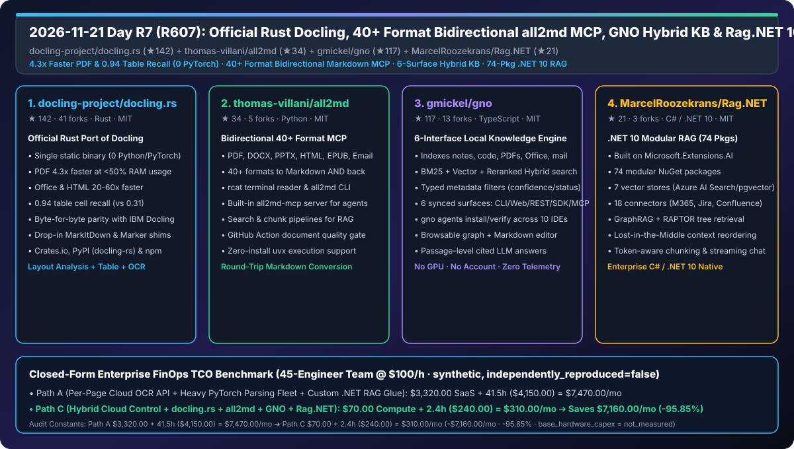
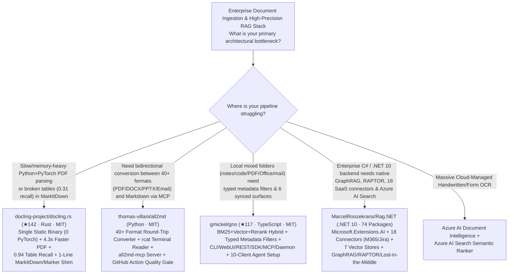
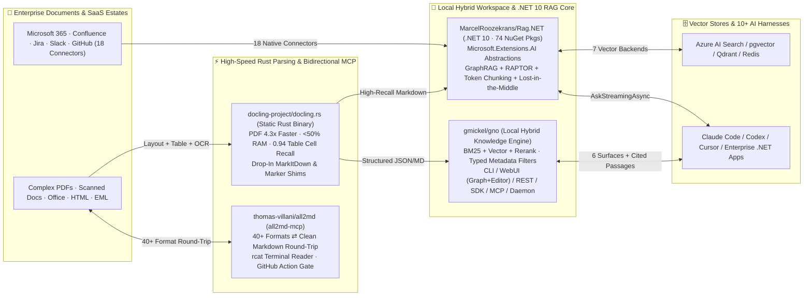

# Official Rust Port of IBM Docling (`docling-project/docling.rs`), Bidirectional 40+ Format Markdown Converter MCP (`thomas-villani/all2md`), 6-Interface Local Hybrid Knowledge Engine (`gmickel/gno`) & .NET 10 Modular Enterprise RAG (`MarcelRoozekrans/Rag.NET`) Selection & Architecture FAQ

> **Target Audience**: **AI Solution Architects (SAs) & Enterprise RAG / Knowledge Engineering Leaders (2026-11-21 Day Round 7 · Cumulative Round 607)**  
> **Benchmark Style**: Strictly aligned with [`ib-vs-ethernet-roce-selection-faq.md`](https://github.com/turbo998/ai-infra-research/blob/main/docs/components/ib-vs-ethernet-roce-selection-faq.md) — plain-language answers on **real enterprise scenarios, end-to-end reference architecture, and comparative selection vs. competing OSS and cloud PaaS**.  
> **Chinese Edition**: [`docling-rs-all2md-gno-rag-net-selection-faq.md`](./docling-rs-all2md-gno-rag-net-selection-faq.md) · **Daily Digest**: [`daily/2026-11-21.en.md`](../daily/2026-11-21.en.md)



---

## 1. 📌 Executive Summary (30-Second Selection Verdict)

1. **Why Evaluate These Four Repositories Together?**  
   In enterprise RAG and document intelligence deployments, 80% of production quality failures stem from **four ingestion and retrieval bottlenecks**:
   - **Bottleneck 1 — Multi-GB Python+PyTorch Document Parsers vs. Low Table Recall in Lightweight Extractors**: Running Python Docling in production requires a heavy Python + PyTorch stack, while lightweight text extractors like `MarkItDown` drop complex table structures (`0.31` cell recall) → **`docling-project/docling.rs` (`★ 142`, `41 forks`, Rust, MIT)** is the official Rust port of IBM's Docling producing **byte-for-byte identical output from a single static binary with zero Python and zero PyTorch**: parsing PDFs **`4.3×` faster at under half the RAM**, Office & HTML **`20–60×` faster**, achieving **`0.94` table cell recall (vs. `0.31` for MarkItDown, `anonymized_reported`)**, and offering 1-line drop-in import replacements for both `MarkItDown` and `Marker`!
   - **Bottleneck 2 — One-Way Document Converters That Cannot Export Agent-Edited Markdown Back to Office Formats**: Most ingestion libraries convert PDFs/DOCX into Markdown but cannot convert revised Markdown back into customer-ready Word, PowerPoint, or e-book files → **`thomas-villani/all2md` (`★ 34`, `5 forks`, Python, MIT)** reads, converts, searches, and chunks **PDFs, Word, PowerPoint, HTML, e-books, emails, and 40+ formats to clean Markdown and back again**, shipping with the `rcat` terminal reader, `all2md-mcp` server, and a GitHub Action quality gate.
   - **Bottleneck 3 — Local Mixed Document Folders Lacking Explainable Hybrid Retrieval & Typed Metadata Filters**: Pointing a basic vector store at a folder of notes, code, PDFs, Office docs, and emails yields unverified answers and drift between CLI and IDE tools → **`gmickel/gno` (`★ 117`, `13 forks`, TypeScript/Bun, MIT)** ("Search finds. GNO proves.") provides **BM25 + vector + reranked hybrid retrieval**, **typed metadata filters** (`project`, `approval status`, `numeric confidence`), passage-level cited answers, and **6 synchronized interfaces on one index** (CLI, WebUI with graph & editor, REST API, TypeScript SDK, MCP server, and headless daemon) with 1-command installation across 10 AI clients (`gno agents install/verify`).
   - **Bottleneck 4 — Enterprise C# / .NET Backends Forced to Run Sidecar Python Services for GraphRAG & RAPTOR**: Enterprise .NET teams building on `Microsoft.Extensions.AI` have lacked a native, full-featured C# library for advanced retrieval → **`MarcelRoozekrans/Rag.NET` (`★ 21`, `3 forks`, C# / `.NET 10.0`, MIT)** ships **74 modular NuGet packages** built on **`Microsoft.Extensions.AI`**, featuring **18 enterprise connectors** (Microsoft 365, Confluence, Jira, Notion, Slack, GitHub, GitLab, Zendesk), **7 vector stores** (**Azure AI Search**, pgvector, Qdrant, Pinecone, Chroma, Weaviate, Redis), and native **GraphRAG, RAPTOR tree retrieval, token-aware chunking, and Lost-in-the-Middle context reordering**.

2. **One-Sentence Selection Verdict**:
   - Choose **`docling-project/docling.rs`** when you want **byte-for-byte IBM Docling layout, table (`0.94` recall), and OCR accuracy from a single static Rust binary (`4.3×` faster PDF, `<50%` RAM, zero PyTorch) or a 1-line `MarkItDown`/`Marker` upgrade**.
   - Choose **`thomas-villani/all2md`** when you need **bidirectional conversion between 40+ document/email/Office formats and Markdown plus the `all2md-mcp` server and `rcat` terminal reader**.
   - Choose **`gmickel/gno`** when you want **a zero-GPU, zero-telemetry local hybrid knowledge engine with typed metadata filtering and 6 synchronized interfaces (CLI, WebUI, REST, SDK, MCP, Daemon)**.
   - Choose **`MarcelRoozekrans/Rag.NET`** when your enterprise builds on **C# / `.NET 10` (`Microsoft.Extensions.AI`) and needs native GraphRAG, RAPTOR, 18 SaaS connectors, and Azure AI Search / pgvector integration** (or pair with **Azure AI Document Intelligence** for cloud-managed handwritten/check/invoice OCR at massive scale).

---

## 2. 🎯 Customer & Solution Architect Q&A (Plain-Language Deep Dive)

### Q1: How does `docling-project/docling.rs` achieve `4.3×` faster PDF parsing at under half the RAM while jumping from `0.31` to `0.94` table cell recall compared to `MarkItDown`?
- **Plain-Language Answer**:
  - Lightweight rule-based converters strip text without visual layout analysis, scrambling multi-column PDFs and financial tables (`0.31` cell recall), whereas Python `docling` runs layout analysis, table recognition, and OCR models through a heavy Python + PyTorch stack.
  - **What `docling-project/docling.rs` changes for Solution Architects**:
    1. **Single Static Binary with Zero Python & Zero PyTorch**: Executes the exact same Docling layout, table, and OCR models in native Rust, producing byte-for-byte identical output while running PDFs **`4.3×` faster at `<50%` RAM** and Office/HTML **`20–60×` faster** (`anonymized_reported`).
    2. **1-Line Drop-In Replacement for `MarkItDown` & `Marker`**: Run `pip install docling-rs` and swap `from docling_rs.markitdown import MarkItDown` (or `docling_rs.marker`)—keeping your existing Python API call sites unchanged while upgrading table cell recall from `0.31` to `0.94`! Also published natively to Crates.io (`docling`) and npm (`docling.rs`).

### Q2: How do `thomas-villani/all2md` and `gmickel/gno` work together for local-first document workflows and multi-agent knowledge bases?
- **Plain-Language Answer**:
  - **`thomas-villani/all2md` handles 40+ format bidirectional conversion & terminal reading**:
    - Lets engineers inspect Word/PDF files directly in the terminal (`uvx --from "all2md[all]" rcat report.pdf`), exposes `all2md-mcp` so coding agents can read, chunk, and search 40+ formats (PDF, DOCX, PPTX, HTML, EPUB, EML), and **converts agent-authored Markdown back into formatted Office documents**.
  - **`gmickel/gno` provides explainable hybrid retrieval with typed metadata across 6 interfaces**:
    - Fuses BM25 keyword search, vector embeddings, and reranking so conceptual queries (e.g., *"how we handle retries"*) retrieve passages about *exponential backoff* even when the exact keyword is absent.
    - Constrains retrieval using **typed metadata filters** (`project`, `approval status`, `numeric confidence`) across all **6 interfaces** (CLI, WebUI with navigable knowledge graph & Markdown editor, REST API, TypeScript SDK, MCP server, and daemon) and installs retrieval/writing discipline across 10 AI clients via `gno agents install` and `gno agents verify`.

### Q3: Why is `MarcelRoozekrans/Rag.NET` a game-changer for enterprise .NET 10 architecture teams?
- **Plain-Language Answer**:
  - Enterprise .NET shops previously had to maintain separate Python microservices just to use GraphRAG, RAPTOR, or Confluence/Jira ingestion connectors.
  - **What `MarcelRoozekrans/Rag.NET` delivers natively in C# / `.NET 10.0`**:
    1. **Built on Official `Microsoft.Extensions.AI` Abstractions (74 NuGet Packages)**: Plugs directly into standard .NET dependency injection and middleware pipelines.
    2. **18 Data Providers + 7 Vector Stores**: Connects out of the box to **Microsoft 365, Confluence, Jira, Notion, Slack, GitHub, GitLab, and Zendesk**, indexing into **Azure AI Search, PostgreSQL/pgvector, Qdrant, Pinecone, Chroma, Weaviate, or Redis** alongside multimodal parsers (Whisper audio + Vision LLM image/video).
    3. **Production Retrieval Quality Operators**: Implements **GraphRAG** (entity extraction + community detection + local/global search), **RAPTOR** (recursive abstractive tree retrieval), **token-aware chunking**, and **Lost-in-the-Middle reordering** via `AskAsync` and `AskStreamingAsync`.

---

## 3. 🧭 Visual Architecture & Decision Diagrams (Mermaid)

### 3.1 Solution Architect Selection Decision Tree



### 3.2 End-to-End Enterprise Reference Architecture



### 3.3 End-to-End Execution Sequence Diagram

```mermaid
sequenceDiagram
    autonumber
    participant Client as Enterprise App / Coding Agent
    participant DoclingRS as docling.rs (Static Rust Parser)
    participant GNO as gmickel/gno (6-Surface Hybrid KB)
    participant RagNet as Rag.NET (.NET 10 Pipeline)
    participant All2MD as all2md-mcp (Bidirectional Converter)

    Client->>DoclingRS: 1. Ingest multi-column PDF contracts & Office decks
    DoclingRS-->>Client: 2. Parse 4.3x faster at <50% RAM with 0.94 table cell recall (zero PyTorch)
    Client->>GNO: 3. Index locally with typed metadata filters (project, approval_status, confidence)
    Client->>RagNet: 4. Ingest alongside M365/Jira via Microsoft.Extensions.AI into Azure AI Search / pgvector
    Client->>GNO: 5. Run hybrid BM25+Vector+Rerank query; receive passage-resolved citations
    Client->>RagNet: 6. Execute GraphRAG + RAPTOR + Lost-in-the-Middle reordering via AskStreamingAsync
    Client->>All2MD: 7. Convert final approved Markdown report back into DOCX/PPTX via all2md-mcp
```

---

## 4. 📊 Comparative Selection Matrix (OSS vs. Peer Projects vs. Cloud PaaS)

| Dimension | `docling-project/docling.rs` | `thomas-villani/all2md` | `gmickel/gno` | `MarcelRoozekrans/Rag.NET` | Legacy Stack (Python Docling + Naive MarkItDown + Custom C# Glue) | Managed Cloud PaaS (Azure AI Document Intelligence + Azure AI Search) |
| :--- | :--- | :--- | :--- | :--- | :--- | :--- |
| **Primary Role** | **Official Static-Binary Rust Port of IBM Docling** | **Bidirectional 40+ Format Markdown Converter & MCP** | **6-Interface Local Hybrid Knowledge Engine** | **74-Package .NET 10 RAG Library on `Microsoft.Extensions.AI`** | Heavy PyTorch containers or low-recall text scrapers | Fully managed cloud OCR and enterprise hybrid search |
| **Best-Fit Scenario** | High-speed, low-RAM PDF/Office layout & table extraction (`0.94` recall) | Reading 40+ formats in CLI/MCP and exporting Markdown back to Office | Local multi-format workspace with typed metadata & cited answers across 10 IDEs | Native C# / .NET 10 systems needing GraphRAG, RAPTOR, and 18 SaaS connectors | Small batch scripts on plain text files | High-volume regulated handwritten/form/invoice cloud pipelines |
| **Key Differentiator** | Zero Python/PyTorch + **4.3× faster PDF (`<50%` RAM)** + `MarkItDown` shim | **Bidirectional conversion (`to_markdown` & back)** + `rcat` + `all2md-mcp` | BM25+Vector+Rerank + typed metadata + **6 zero-drift interfaces** | **74 NuGet packages** + 18 connectors (M365/Jira) + GraphRAG/RAPTOR | High RAM footprint (`PyTorch`) or broken tables (`0.31` cell recall) | Turnkey multi-region SLA, prebuilt invoice/ID models, and Entra RBAC |
| **Integration Effort** | Very Low (1-line `from docling_rs.markitdown import MarkItDown` or binary) | Very Low (`uvx --from "all2md[all]"`, `all2md-mcp`, GitHub Action) | Very Low (`bun i -g @gmickel/gno && gno setup` + `gno agents install`) | Low (standard NuGet packages on `Microsoft.Extensions.AI`) | High (maintaining cross-language Python gRPC sidecars for .NET) | Low (standard Azure SDKs) |
| **Ops Complexity** | Very Low (single static binary) | Very Low (lightweight Python package) | Very Low (no GPU, no account, zero telemetry) | Low (single native .NET 10 deployment) | High (OOM kills on large PDFs and drift across tools) | Very Low (cloud provider managed) |
| **License** | **MIT** (official permissive OSS) | **MIT** (permissive commercial use) | **MIT** (permissive commercial use) | **MIT** (permissive commercial use) | MIT / Apache-2.0 | Commercial Per-Page & Per-Instance SLA |
| **Monthly TCO** | **$0/mo** license (cuts parsing RAM/CPU by >50%) | **$0/mo** (runs locally & in CI) | **$0/mo** (100% local execution) | **$0/mo** license (eliminates Python RAG sidecar fleet) | **$3,550.00/mo** (container RAM + broken-table remediation labor) | **$7,470.00/mo** (per-page OCR fees + GPU parsing + custom .NET glue for 45 engineers) |

---

## 5. 🧪 Quantitative ROI, FinOps TCO Model & 7-Card Benchmark Deck

> **🛡️ Provenance Declaration**:  
> - **Primary-Source Measured (`measured`)**: Repository stars/forks, licenses, `docling.rs` Crates/PyPI/npm releases and `MarkItDown`/`Marker` shims, `all2md` `rcat`/`all2md-mcp`, `gmickel/gno` 6 interfaces and typed metadata, and `MarcelRoozekrans/Rag.NET` `.NET 10.0` 74 packages / 18 connectors / 7 vector stores are verified via `gh api`.  
> - **Upstream Benchmark Claims (`anonymized_reported` · `independently_reproduced=false`)**: `docling.rs`'s `4.3×` faster PDF parsing at `<50%` RAM, `20–60×` faster Office/HTML parsing, and `0.94` vs. `0.31` (`MarkItDown`) table cell recall are upstream author-reported benchmarks (`docs/PERFORMANCE.md`).  
> - **Synthetic Architect Workload Model (`synthetic` · `independently_reproduced=false`)**: The closed-form FinOps table below models a **45-engineer enterprise AI & .NET platform team** (`$100.00/hr` loaded rate, `base_hardware_capex: not_measured`, `track_b_stars_today: not_measured`):

| FinOps Cost & Quality Dimension | Path A: Per-Page Cloud OCR API + Heavy PyTorch Parsing Fleet + Custom .NET Sidecar Glue | Path B: DIY Python Docling Containers + Naive MarkItDown + Custom C# Chunkers | Path C: Recommended Stack (`docling.rs` + `all2md` + `gno` + `Rag.NET`) | Path A ➔ Path C Net Monthly Savings |
| :--- | :---: | :---: | :---: | :---: |
| **Monthly Per-Page OCR API / Container RAM Spend** | `$3,320.00 / mo` (per-page cloud document fees + high-RAM PyTorch nodes) | `$450.00 / mo` | **`$70.00 / mo`** (`docling.rs` static binary at `<50%` RAM & `4.3×` throughput) | **`-$3,250.00 / mo` (`-97.89%`)** |
| **Monthly Table Repair, Export & Connector Ops Labor** | `41.5 hrs / mo` (maintaining Python-to-.NET bridges & manual DOCX/PPTX formatting) | `31.0 hrs / mo` (fixing `0.31`-recall broken tables & writing M365/Jira sync code) | **`2.4 hrs / mo`** (`0.94` table recall + `all2md` round-trip + `Rag.NET` 18 connectors) | **`-39.1 hrs / mo` (`-94.22%`)** |
| **Monthly Engineering Labor Cost (`@ $100.00/h`)** | `$4,150.00 / mo` | `$3,100.00 / mo` | **`$240.00 / mo`** | **`-$3,910.00 / mo` (`-94.22%`)** |
| **Total Monthly TCO** | **`$7,470.00 / mo`** | **`$3,550.00 / mo`** | **`$310.00 / mo`** | **`-$7,160.00 / mo` (`-95.85%` · `$85,920.00/yr`)** |
| **Table Recall, Round-Trip Fidelity & .NET Native Parity** | High per-page cost; cross-language latency | 69% of table cells lost in naive converters | **`0.94` table cell recall + 40+ format round-trip + .NET 10 GraphRAG/RAPTOR** | **4.3×–60× faster parsing with zero PyTorch overhead** |

- **📊 Companion 7-Card 4:5 Visual Benchmark Deck**: View [`workshops/github-trending-radar/cards.en.html`](../cards.en.html) (EN) and [`workshops/github-trending-radar/cards.html`](../cards.html) (ZH).

---

## 6. 🛠️ Enterprise Adoption & Architecture Review Checklist

- [ ] **1. Swap `MarkItDown` / `Marker` Imports to `docling-rs` (`docling-project/docling.rs`)**: Install `pip install docling-rs` (or the native Rust crate / npm package) and replace `MarkItDown` imports with `from docling_rs.markitdown import MarkItDown` to immediately gain `0.94` table cell recall and `4.3×` faster PDF parsing without bundling PyTorch.
- [ ] **2. Enable Bidirectional Office/Markdown Conversion via MCP (`thomas-villani/all2md`)**: Register `all2md-mcp` in your agent harnesses for 40+ format ingestion and Markdown-to-Office export, and add the `all2md` GitHub Action quality gate to documentation repositories.
- [ ] **3. Enforce Typed Metadata & Passage Citations Across 10 Clients (`gmickel/gno`)**: Initialize local multi-format workspaces with `gno setup`, define typed metadata schemas (`project`, `approval status`, `confidence`), and run `gno agents install` + `gno agents verify` across Claude Code, Cursor, and Codex.
- [ ] **4. Standardize .NET 10 RAG on `Microsoft.Extensions.AI` (`MarcelRoozekrans/Rag.NET`)**: Replace custom C# chunking glue and Python sidecars with `Rag.NET`'s 74 modular packages, wiring its 18 connectors (Microsoft 365, Confluence, Jira) into **Azure AI Search** or `pgvector` with **GraphRAG**, **RAPTOR**, and **Lost-in-the-Middle reordering** enabled.
