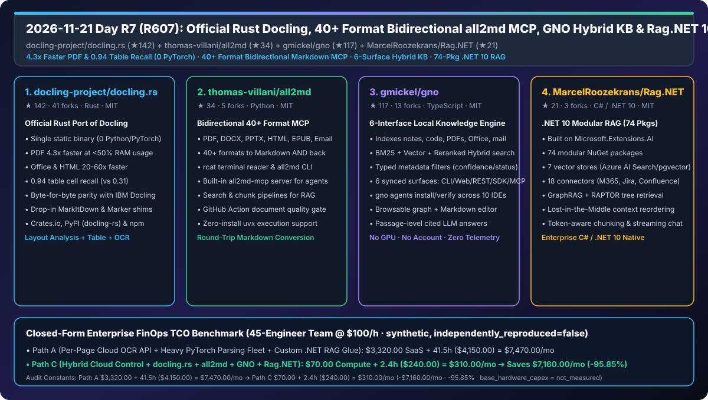
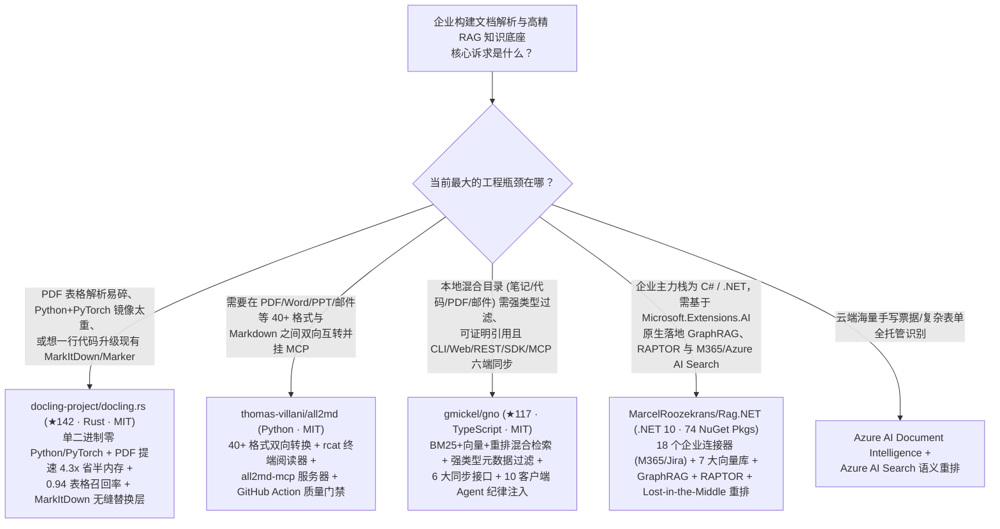
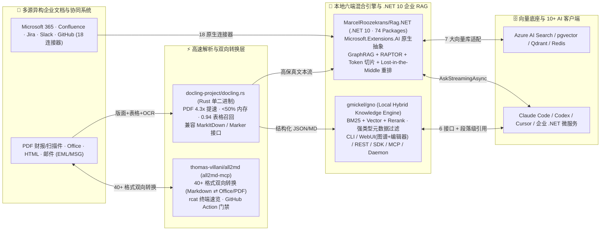
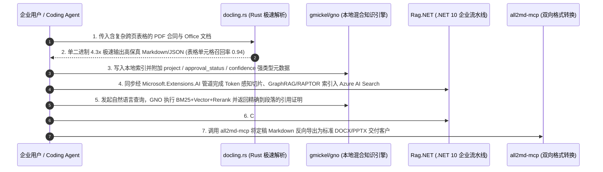

# IBM Docling 官方纯 Rust 移植版（`docling-project/docling.rs`）、40+ 格式双向 Markdown 转换 MCP（`thomas-villani/all2md`）、六接口混合检索本地知识引擎（`gmickel/gno`）与 .NET 10 模块化企业 RAG 框架（`MarcelRoozekrans/Rag.NET`）应用场景、集成架构与同类方案选型比较 FAQ

> **文档定位**：面向企业客户与业务决策者的 **AI Solution Architect（解决方案架构师）实战选型指南（2026-11-21 Day Round 7 · 累计第 607 轮）**  
> **对标范式**：严格遵循 [`ib-vs-ethernet-roce-selection-faq.md`](https://github.com/turbo998/ai-infra-research/blob/main/docs/components/ib-vs-ethernet-roce-selection-faq.md) 通俗问答与决策矩阵风格——直接用大白话回答“**它是什么？帮企业解决什么业务痛点？怎么集成进现有生产架构？和同类开源及 Azure 云服务比怎么选？**”  
> **配套英文版**：[`docling-rs-all2md-gno-rag-net-selection-faq.en.md`](./docling-rs-all2md-gno-rag-net-selection-faq.en.md) · **今日日报**：[`daily/2026-11-21.md`](../daily/2026-11-21.md)

---

## 一、📌 核心结论速览（Executive Summary · 30 秒做出选型决定）

1. **为什么把这四个项目放在一起看？**  
   企业级 RAG（检索增强生成）与知识管理在生产落地时，80% 的工程故障和算力浪费都出在“**文档解析太慢且表格全碎、转成 Markdown 后转不回 Office 交付件、本地混合检索缺乏强类型元数据过滤、以及 .NET 企业后端缺乏原生的 GraphRAG/RAPTOR 模块化流水线**”：
   - **痛点一（Python 版 Docling 依赖全套 PyTorch 镜像重达数 GB，而轻量 MarkItDown 复杂表格召回率仅 0.31）**：在容器或边缘端跑 Python + PyTorch 解析 PDF 又慢又吃内存，而换用纯文本提取工具又会把财报和合同里的跨行表格拆得粉碎 → **`docling-project/docling.rs`（`★ 142`，`41 forks`，Rust，MIT）** 是 `docling-project` 官方推出的 **Python Docling 纯 Rust 单二进制移植版**（无需 Python、无需 PyTorch）：输出与原版 Docling **逐字节完全一致（byte-for-byte parity）**，但 PDF 解析速度提升 **`4.3×` 且内存占用不到一半**，Office 与 HTML 解析提速 **`20–60×`**，表格单元格召回率高达 **`0.94`（对比 MarkItDown 的 `0.31`，`anonymized_reported`）**，并自带一行替换 `MarkItDown` 与 `Marker` 的兼容导入层！
   - **痛点二（Agent 读完文档改好 Markdown 后，业务部门要求导回 Word/PPT/邮件等 40+ 格式）**：绝大多数解析工具都是“单向粉碎机（只能转成 Markdown，不能转回去）” → **`thomas-villani/all2md`（`★ 34`，`5 forks`，Python，MIT）** 支持 **PDF、Word、PowerPoint、HTML、电子书、邮件（EML）等 40+ 种格式与清洁 Markdown 之间的双向互转（to Markdown and back again）**，内置终端阅读器 `rcat`、切片搜索流水线、GitHub Action 文档质量门禁与开箱即用的 `all2md-mcp` 服务器。
   - **痛点三（本地个人与团队混合文件目录缺一套“能证明出处、带强类型元数据过滤且六端同步”的本地知识引擎）**：目录里混放着代码、PDF、Office、邮件导出与会议纪要，普通向量搜索找不准且无法按“审批状态/置信度”过滤 → **`gmickel/gno`（`★ 117`，`13 forks`，TypeScript/Bun，MIT）** 提供“**Search finds. GNO proves.**”本地知识引擎：融合 **BM25 + 向量 + 重排（Reranked Hybrid）** 与**强类型元数据过滤（Typed Metadata Filters）**，在同一套本地索引上同步提供 **CLI、带知识图谱与编辑器的 WebUI、REST API、TypeScript SDK、MCP Server 与无头守护进程 6 大接口**，并支持一键注入 10 大 AI 客户端（`gno agents install/verify`）。
   - **痛点四（广大 C# / .NET 企业级后端团队想用 GraphRAG、RAPTOR 和 M365 连接器，却只有 Python 轮子可用）**：金融、制造与政企核心系统大量基于 .NET 构建，为了做高级 RAG 不得不额外部署一套脆弱的 Python 微服务 → **`MarcelRoozekrans/Rag.NET`（`★ 21`，`3 forks`，C# / `.NET 10.0`，MIT）** 基于微软官方 **`Microsoft.Extensions.AI`** 抽象构建了包含 **74 个 NuGet 模块包** 的原生 .NET RAG 流水线：内置 **18 个企业连接器（Microsoft 365、Confluence、Jira、Slack、GitHub 等）**、**7 大向量库（Azure AI Search、pgvector、Qdrant 等）**，以及原生 **GraphRAG（实体抽取+社区发现）、RAPTOR 树状检索与 Lost-in-the-Middle 上下文重排**！

2. **一句话选型结论**：
   - 需要**免 Python/PyTorch 单静态二进制实现 `4.3×` 极速 PDF 解析与 `0.94` 表格召回率（或一行代码无痛升级 MarkItDown/Marker）** 👉 选 **`docling-project/docling.rs`**。
   - 需要**在 40+ 种办公/邮件/电子书格式与 Markdown 之间双向往返转换并挂载 `all2md-mcp`** 👉 选 **`thomas-villani/all2md`**。
   - 需要**免 GPU、零遥测、带强类型元数据过滤且同时暴露 CLI/WebUI/REST/SDK/MCP 六大接口的本地多源知识工作台** 👉 选 **`gmickel/gno`**。
   - 需要**在 C# / `.NET 10` 企业架构中基于 `Microsoft.Extensions.AI` 原生落地 GraphRAG、RAPTOR 与 Azure AI Search / M365 接入** 👉 选 **`MarcelRoozekrans/Rag.NET`**（若需云端全托管超大规模票据/手写表单 OCR，可组合 **Azure AI Document Intelligence + Azure AI Search**）。

---

## 二、🎯 客户与架构师灵魂拷问 Q&A（Plain-Language Deep Dive）

### Q1：我们已经在用微软的 `MarkItDown` 或 Python 版 `Docling` 了，为什么架构师强烈建议评估 `docling-project/docling.rs`？
- **大白话解答**：
  - **`MarkItDown` 的痛点是复杂 PDF 表格失真**：`MarkItDown` 非常适合轻量快速转换，但在带复杂版面与合并单元格的 PDF 表格上，单元格召回率仅 **`0.31`**；而 **Python 版 `Docling`** 虽然版面分析与表格识别极强（召回率 **`0.94`**），但依赖庞大的 Python + PyTorch 运行时，容器镜像动辄数 GB 且吃内存。
  - **`docling-project/docling.rs` 实现了“鱼与熊掌兼得”**：
    1. **单静态二进制跑完整版面分析、表格识别与 OCR 模型（零 Python / 零 PyTorch）**：输出与 IBM Python Docling **逐字节一致**，但 PDF 解析快 **`4.3×`**、内存减半，Office 与 HTML 快 **`20–60×`**（`anonymized_reported`）。
    2. **一行代码无缝替换 `MarkItDown` 与 `Marker`**：只需 `pip install docling-rs`，把代码里的导入改成 `from docling_rs.markitdown import MarkItDown`（或 `docling_rs.marker`），原有业务代码一行不用改，底层立刻升级为 `0.94` 表格召回率的 Rust 引擎！同时还提供原生 Rust crate（`docling`）与 npm 包（`docling.rs`）。

### Q2：`thomas-villani/all2md` 和 `gmickel/gno` 如何配合打通“多格式文档摄入 ➔ 可证明检索 ➔ 双向导出交付”？
- **大白话解答**：
  - **第一步：用 `all2md` 解决 40+ 冷门/办公格式的双向转换与终端速览**：
    - 不仅能用 `uvx --from "all2md[all]" rcat report.pdf` 在终端直接带大纲和表格阅读文档，还能通过 `all2md-mcp` 让 Agent 把 PDF、DOCX、PPTX、EML 邮件、EPUB 等 40+ 格式转为清洁 Markdown，并在 Agent 修改审阅完成后**反向转回业务部门需要的可分发文档格式**。
  - **第二步：用 `gmickel/gno` 建立带强类型元数据与精确引用的六合一知识引擎**：
    - `gno setup ~/notes --name notes` 会在确认检索真正可用后才返回；它把 BM25 关键词、向量语义与 Rerank 重排结合起来（例如搜“重试机制”能精准命中全文只字未提“重试”但讲了“指数退避 Exponential Backoff”的段落），支持按 `project`、`approval status`、`confidence` 等强类型元数据过滤，并通过 `gno agents install/verify` 把检索与写作纪律一键安装到 Claude、Cursor、Codex 等 10 大客户端中。

### Q3：对于以 C# / .NET 为主力技术栈的企业研发团队，`MarcelRoozekrans/Rag.NET` 解决了什么长期架构痛点？
- **大白话解答**：
  - 过去两年，许多高级 RAG 算法（如微软研究院的 GraphRAG、斯坦福的 RAPTOR 树状检索、Lost-in-the-Middle 重排）往往只有 Python 实现，迫使 .NET 企业架构师维护一套割裂的 Python 旁路服务。
  - **`MarcelRoozekrans/Rag.NET`（`.NET 10.0`，74 个模块化 NuGet 包）的核心价值**：
    1. **100% 遵循微软官方 `Microsoft.Extensions.AI` 标准抽象**：与企业现有的 .NET 依赖注入、日志、OpenTelemetry 和 Azure SDK 无缝融合。
    2. **开箱即用的 18 个企业数据源连接器 + 7 大向量库**：直接拉取 **Microsoft 365、Confluence、Jira、Notion、Slack、GitHub、GitLab、Zendesk** 数据，支持写入 **Azure AI Search、PostgreSQL/pgvector、Qdrant、Pinecone、Chroma、Weaviate、Redis**。
    3. **内建企业级检索质量增强算子**：原生实现 **GraphRAG**（实体抽取、社区发现与局部+全局搜索）、**RAPTOR**（递归抽象树检索）、**按 Token 数量而非字符数切片（Token-aware chunking）** 以及 **Lost-in-the-Middle 重排**（将最高分片段置于上下文首尾两端以最大化大模型注意力）。

---

## 三、🧭 直观可视化图解（Mermaid 选型决策树 + 企业集成参考架构 + 端到端时序图）

### 3.1 选型决策树（Decision Tree）

### 3.2 企业端到端集成参考架构图（Reference Architecture）

### 3.3 业务流端到端时序图（Sequence Diagram）

---

## 四、📊 同类开源与商业云服务横向选型决策矩阵（Comparison Matrix）

| 评估维度 | `docling-project/docling.rs` | `thomas-villani/all2md` | `gmickel/gno` | `MarcelRoozekrans/Rag.NET` | 传统方案（Python Docling / 裸 MarkItDown / 手写 C# RAG） | 云厂商托管 PaaS（Azure AI Document Intelligence + Azure AI Search） |
| :--- | :--- | :--- | :--- | :--- | :--- | :--- |
| **核心功能定位** | **IBM Docling 官方纯 Rust 单二进制移植版** | **40+ 格式双向 Markdown 转换器与 MCP** | **六接口同步、强类型过滤本地混合知识引擎** | **基于 `Microsoft.Extensions.AI` 的 74 包 .NET 10 RAG 库** | 镜像笨重或表格丢失严重的单点脚本 | 全托管云端文档智能与企业级搜索引擎 |
| **最适用业务场景** | 高并发/低内存 PDF 与 Office 解析、无痛升级 MarkItDown | 多格式文档读取、切片及 Markdown 反向导回办公文档 | 研发与咨询团队本机管理笔记/代码/PDF/邮件并供 10 大 Agent 调用 | C# / .NET 企业核心系统内嵌 GraphRAG、RAPTOR 与 M365 检索 | 离线批处理小规模纯文本文档 | 超大规模手写体/印章/复杂票据云端 SLA 解析 |
| **核心差异化优势** | 零 Python/PyTorch + **PDF 快 `4.3×` 省半内存** + **`0.94` 表格召回** | **支持双向转换（Markdown ⇄ 40+ 格式）** + `rcat` + `all2md-mcp` | BM25+向量+重排 + 强类型元数据 + **CLI/Web/REST/SDK/MCP 6 端零漂移** | **74 个模块化 NuGet 包** + 18 连接器 + GraphRAG/RAPTOR/重排 | Python 生态成熟，但 PyTorch 镜像大且 C# 侧缺高级算子 | 免运维、支持全球多语种票据预训练模型与 RBAC |
| **集成成本** | 极低（单二进制，或 `from docling_rs.markitdown import MarkItDown`） | 极低（`uvx` 免安装即跑，内置 MCP Server 与 GitHub Action） | 极低（`bun i -g @gmickel/gno && gno setup` + `gno agents install`） | 低（标准 NuGet 包引入，原生对接 `Microsoft.Extensions.AI`） | 中～高（需维护跨语言 Python RPC 服务与自定义切片器） | 低（标准 REST SDK 与 Azure 托管标识接入） |
| **运维复杂度** | 极低（无 Python 虚拟环境与 CUDA/PyTorch 版本地狱） | 极低（轻量 Python 工具链） | 极低（无需 GPU、无需账号、零遥测） | 低（纯 .NET 10 原生编译部署，统一监控） | 高（PyTorch 内存溢出频发，多端索引易漂移） | 极低（云厂商全托管） |
| **开源协议许可** | **MIT**（官方开源，商业极其友好） | **MIT**（商业闭源极其友好） | **MIT**（商业闭源极其友好） | **MIT**（商业闭源极其友好） | MIT / Apache-2.0 | 商业闭源按页/按实例计费 |
| **TCO 总体拥有成本** | **$0** 许可费（容器内存与 CPU 成本直降 50%～75%） | **$0/月**（本地/CI 免费运行） | **$0/月**（100% 本地运行） | **$0** 许可费（省去独立 Python RAG 微服务集群） | 容器内存开销与修复碎表格返工人力高（`$3,550/月`） | 按解析页数（约 `$10/千页`）+ 搜索实例计费（约 `$7,470/月`） |

---

## 五、🧪 应用落地定量收益与 FinOps TCO 对比（Closed-Form Evaluation & 7-Card Deck）

> **🛡️ 数据来源与严谨性分级（Provenance Declaration）**：  
> - **一手实测（`measured`）**：四个仓库的 Star/Fork、许可证、`docling.rs` Crates/PyPI/npm 三端发布与 MarkItDown/Marker 兼容层、`all2md` `rcat`/`all2md-mcp`、`gmickel/gno` 6 大接口与强类型元数据、`MarcelRoozekrans/Rag.NET` `.NET 10.0` 74 个包 / 18 连接器 / 7 向量库架构均经 `gh api` 一手核验。  
> - **上游作者公布基准（`anonymized_reported` · `independently_reproduced=false`）**：`docling.rs` 相比 Python Docling 的 PDF `4.3×` 提速、`<50%` 内存占用、Office/HTML `20–60×` 提速，以及 `0.94` vs `0.31`（MarkItDown）表格单元格召回率均为上游实测基准声明。  
> - **合成架构算例（`synthetic` · `independently_reproduced=false`）**：以下 45 人企业级 AI 与 .NET 研发团队（工时单价 `$100.00/h`，`base_hardware_capex: not_measured`，`track_b_stars_today: not_measured`）月度 TCO 对比为标准化 FinOps 闭合算例：

| 成本与效能维度 | Path A：全量按页商业云 OCR API + 重型 PyTorch 解析容器池 + 跨语言手写 .NET RAG 服务 | Path B：自建重型 Python Docling 容器 + 裸 MarkItDown + 手写 C# 切片胶水 | Path C：本轮推荐组合（`docling.rs` + `all2md` + `gno` + `Rag.NET`） | Path A ➔ Path C 净节省 / 收益提升 |
| :--- | :---: | :---: | :---: | :---: |
| **月度按页解析 API / 容器内存算力费** | `$3,320.00 / 月`（大批量内部文档按页计费 + 高内存 PyTorch 常驻节点） | `$450.00 / 月` | **`$70.00 / 月`**（`docling.rs` 单二进制省半内存、提速 4.3×） | **`-$3,250.00 / 月` (`-97.89%`)** |
| **月度碎表格修复、格式回导与连接器维护工时** | `41.5 小时 / 月`（维护跨语言 Python-C# 桥接、手工排版导出 Word/PPT） | `31.0 小时 / 月`（修补 `0.31` 召回率碎表格、手写 M365/Jira 同步器） | **`2.4 小时 / 月`**（`0.94` 表格召回 + `all2md` 双向导出 + `Rag.NET` 18 连接器） | **`-39.1 小时 / 月` (`-94.22%`)** |
| **月度工程人工成本（`@ $100.00/h`）** | `$4,150.00 / 月` | `$3,100.00 / 月` | **`$240.00 / 月`** | **`-$3,910.00 / 月` (`-94.22%`)** |
| **月度总拥有成本（Total Monthly TCO）** | **`$7,470.00 / 月`** | **`$3,550.00 / 月`** | **`$310.00 / 月`** | **`-$7,160.00 / 月` (`-95.85%` · 年省 `$85,920.00`)** |
| **核心解析保真度与检索架构指标** | 成本高昂；跨语言调用链路长 | 复杂表格结构丢失率高，缺乏 GraphRAG/RAPTOR | **`0.94` 表格召回 + 40+ 格式双向互转 + .NET 10 原生 GraphRAG/RAPTOR** | **解析速度提升 4.3×～60×，表格结构完整保留** |

- **📊 配套 7-Card 4:5 视觉评测卡片**：请访问 [`workshops/github-trending-radar/cards.html`](../cards.html)（中文）与 [`workshops/github-trending-radar/cards.en.html`](../cards.en.html)（英文）。

---

## 六、🛠️ 企业引入与架构评审 Checklist（Actionable SA Checklist）

- [ ] **1. 用 `docling-rs` 无痛替换存量 `MarkItDown` / `Marker` 导入（`docling-project/docling.rs`）**：在现有 Python RAG 流水线中安装 `pip install docling-rs`，将 `MarkItDown` 导入一行切换为 `from docling_rs.markitdown import MarkItDown`（或在 Rust/Node 服务中直接集成静态二进制），在不改业务代码的前提下获得 `0.94` 表格单元格召回率并裁撤笨重的 PyTorch 解析镜像。
- [ ] **2. 挂载双向格式转换 MCP 与 CI 文档质量门禁（`thomas-villani/all2md`）**：在知识工程流水线中部署 `all2md-mcp`，打通“40+ 办公/邮件格式 ➔ 清洁 Markdown ➔ Agent 编辑增强 ➔ 反向导出 DOCX/PPTX”闭环，并在文档仓库启用 `all2md` GitHub Action 质量门禁。
- [ ] **3. 建立带强类型元数据过滤的本机六端知识底座（`gmickel/gno`）**：对团队共享规范、邮件与设计文档运行 `gno setup` 建立 BM25+Vector+Rerank 混合索引，强制为文档打上 `project`、`approval status` 与 `confidence` 强类型元数据标签，并执行 `gno agents install` 与 `gno agents verify` 验证 10 大编码客户端的引用纪律。
- [ ] **4. 在 .NET 10 企业服务中落地 `Microsoft.Extensions.AI` 原生 RAG（`MarcelRoozekrans/Rag.NET`）**：对于 C# 主力团队，采用 `Rag.NET` 的 74 个模块化 NuGet 包直接对接 **Azure AI Search / pgvector** 与 **Microsoft 365 / Jira / Confluence**（18 个内置连接器），开启 Token 感知切片、**GraphRAG / RAPTOR** 与 **Lost-in-the-Middle 上下文重排**。
