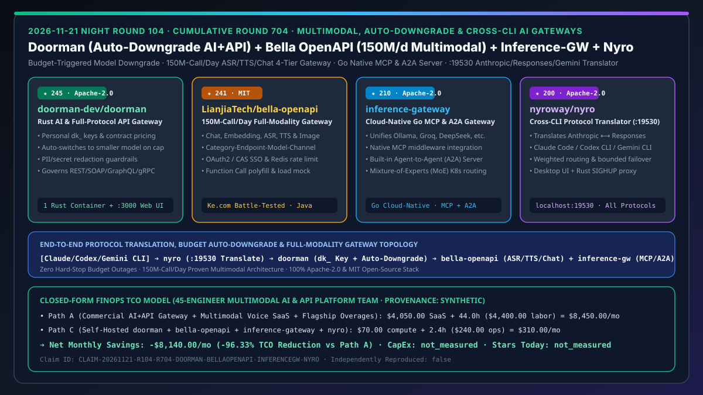
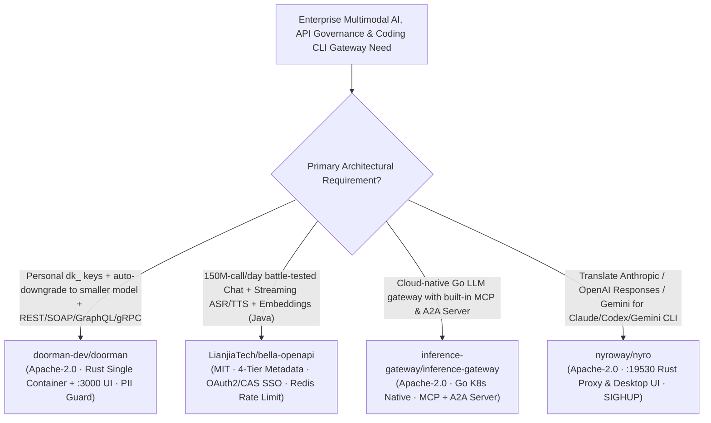
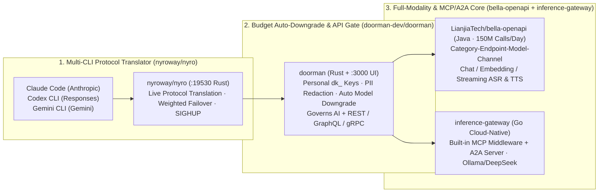
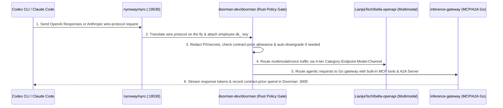

# Auto-Downgrading Rust AI & API Gateway (`doorman-dev/doorman`), 150M-Call/Day Full-Modality OpenAPI Gateway (`LianjiaTech/bella-openapi`), Native MCP/A2A Go Cloud-Native Gateway (`inference-gateway/inference-gateway`) & Cross-CLI Protocol Translator (`nyroway/nyro`) Selection & Architecture FAQ

> **Document Type**: Enterprise AI Solution Architect Selection & Integration Guide (GitHub Trending AI Radar — 2026-11-21 Night Round 104 / Cumulative Round 704)
> **Covered Repositories**: [`doorman-dev/doorman`](https://github.com/doorman-dev/doorman) (`★ 245`, `19 forks`, `Apache-2.0` — Rust AI & REST/SOAP/GraphQL/gRPC gateway with personal `dk_` keys, PII guardrails & automatic model downgrade on budget exhaustion) · [`LianjiaTech/bella-openapi`](https://github.com/LianjiaTech/bella-openapi) (`★ 241`, `47 forks`, `MIT` — Ke.com/Lianjia's battle-tested 150M-call/day Java AI gateway spanning Chat, Embeddings, real-time streaming ASR/TTS, voice dialogue & image generation) · [`inference-gateway/inference-gateway`](https://github.com/inference-gateway/inference-gateway) (`★ 210`, `46 forks`, `Apache-2.0` — cloud-native Go LLM gateway with built-in Model Context Protocol (MCP) & Agent-to-Agent (A2A) Server support) · [`nyroway/nyro`](https://github.com/nyroway/nyro) (`★ 200`, `34 forks`, `Apache-2.0` — Rust desktop & headless AI gateway on `:19530` translating Anthropic, OpenAI Responses & Gemini protocols on the fly)
> **Core Scenario**: How enterprise AI platform architects prevent **hard service outages when employee/team token budgets run out**, unify **real-time streaming ASR/TTS voice, embeddings, and chat at 100M+ daily call scale**, expose **native MCP and A2A endpoints directly inside a Kubernetes Go gateway**, and allow **Claude Code, Codex CLI, and Gemini CLI to share any backend model without protocol lock-in**.

---

## 1. 📌 Executive Summary (One-Line Selection Verdict)

1. **Need a single-container Rust gateway for both AI models and enterprise APIs (`REST`, `SOAP`, `GraphQL`, `gRPC`) that automatically downgrades to a smaller model when a user's dollar/token allowance runs low** ➔ Choose **[`doorman-dev/doorman`](https://github.com/doorman-dev/doorman) (`★ 245`, `Apache-2.0`)**.
   - **Plain-English Mechanism**: Combines an **AI Gateway** and a **full-protocol API Gateway** in one Rust binary with a built-in `:3000` dashboard (running in-memory with encrypted snapshots or on MongoDB + Redis). Employees receive personal `dk_` keys while upstream keys never leave the gateway; allowances in dollars, tokens, or requests per person/group/tier can **warn, block, or automatically switch to a smaller model**, backed by PII/secret redaction guardrails and custom contract-price accounting.
2. **Need a battle-tested (150M calls/day in production at Ke.com/Lianjia) Java AI gateway unifying Chat, Embeddings, real-time streaming ASR, streaming TTS, live voice dialogue, and image generation** ➔ Choose **[`LianjiaTech/bella-openapi`](https://github.com/LianjiaTech/bella-openapi) (`★ 241`, `47 forks`, `MIT`)**.
   - **Plain-English Mechanism**: Organizes enterprise AI capabilities into a 4-tier metadata model (**`Category ➔ Endpoint ➔ Model ➔ Channel`**) supporting both OpenAI ChatCompletion and Anthropic Messages alongside real-time/offline ASR, streaming TTS, and embeddings. Includes OAuth 2.0 / CAS SSO, hierarchical API keys with monthly quota billing, Redis distributed rate limiting, built-in pressure-test mocking, and Function Call polyfills for legacy models.
3. **Need a lightweight cloud-native Go gateway unifying local (`Ollama`) and cloud LLMs with built-in MCP tool integration and an embedded A2A Server** ➔ Choose **[`inference-gateway/inference-gateway`](https://github.com/inference-gateway/inference-gateway) (`★ 210`, `46 forks`, `Apache-2.0`)**.
   - **Plain-English Mechanism**: Unifies Ollama, OpenAI, Groq, Cohere, Anthropic, Cloudflare, and DeepSeek behind one OpenAI-compatible API while providing native **Model Context Protocol (MCP) middleware** and an **Agent-to-Agent (A2A) Server** for Kubernetes Mixture-of-Experts (MoE) and multi-agent routing.
4. **Need on-the-fly protocol translation (`localhost:19530`) so Claude Code (Anthropic protocol), Codex CLI (OpenAI Responses API), and Gemini CLI can run against any model provider with zero code changes** ➔ Choose **[`nyroway/nyro`](https://github.com/nyroway/nyro) (`★ 200`, `34 forks`, `Apache-2.0`)**.
   - **Plain-English Mechanism**: Ships as both a cross-platform desktop app and a standalone Rust server (`nyro-server` / `nyro proxy`). It translates between **Anthropic Messages**, **OpenAI Chat / Stateless Responses**, and **Gemini Chat** wire formats on the fly across OpenAI, Anthropic, Google, DeepSeek, MiniMax, xAI, Zhipu, and Ollama—complete with priority/weighted backend selection, bounded failover, passive health checks, cumulative token quotas, and `SIGHUP` hot reload.

---

## 2. 🎯 Architect & Customer Deep-Dive Q&A

### Q1: How do `doorman`, `bella-openapi`, `inference-gateway`, and `nyro` complement each other across enterprise AI & API topology?

- **Four Distinct Architectural Layers**:
  1. **Budget-Aware Auto-Downgrade & Unified AI+API Governance (`doorman-dev/doorman`)**: Instead of returning HTTP 429 and breaking workflows when an engineer hits their monthly dollar cap, `doorman` automatically switches their `dk_` key to a smaller, cheaper model while also governing `REST`, `SOAP`, `GraphQL`, and `gRPC` APIs with schema validation and sunset dates.
  2. **150M-Call/Day Multimodal Voice (ASR/TTS) & Java Enterprise Integration (`LianjiaTech/bella-openapi`)**: Purpose-built for enterprises running high-volume voice bots (real-time streaming ASR ➔ LLM ➔ streaming TTS), embeddings, and chat with CAS/OAuth2 SSO and a 4-tier `Category-Endpoint-Model-Channel` catalog.
  3. **Kubernetes Native MCP & A2A Routing (`inference-gateway/inference-gateway`)**: Gives Go/K8s platform teams a cloud-native inference proxy that natively speaks MCP and A2A without external sidecars.
  4. **Last-Mile Coding CLI Protocol Translation (`nyroway/nyro`)**: Eliminates protocol lock-in between Claude Code (`Anthropic`), Codex CLI (`OpenAI Responses`), and Gemini CLI (`Gemini`) on `:19530`.
- **When to Choose Managed Cloud Services (Path B)**:
  - If your organization runs 100% on Azure OpenAI + Azure AI Speech and does not need cross-CLI protocol translation or local Ollama/DeepSeek routing, **Azure API Management + Azure AI Speech** provides a turnkey cloud SLA.

### Q2: How do we wire an end-to-end production architecture combining all four gateways?

1. **Developer CLI Protocol Translation Edge (`nyroway/nyro`)**:
   - Point Claude Code, Codex CLI, Gemini CLI, and OpenCode to `http://localhost:19530` so `nyro` translates Anthropic, OpenAI Responses, and Gemini wire protocols seamlessly.
2. **Enterprise `dk_` Allowance, PII Guardrail & Auto-Downgrade Boundary (`doorman-dev/doorman`)**:
   - Route developer and microservice traffic through `doorman` (`:3000` dashboard) to enforce personal `dk_` keys, redact secrets/PII in prompts and responses, apply custom contract pricing, and auto-downgrade over-budget traffic to smaller models while governing REST/GraphQL/gRPC APIs.
3. **Full-Modality Voice/Text/Embedding 4-Tier Hub (`LianjiaTech/bella-openapi`)**:
   - Dispatch real-time voice dialogue, streaming ASR, streaming TTS, embeddings, and chat traffic through `bella-openapi`'s `Category ➔ Endpoint ➔ Model ➔ Channel` router integrated with enterprise CAS/OAuth2 SSO.
4. **Kubernetes MCP & A2A Agent Mesh (`inference-gateway/inference-gateway`)**:
   - Deploy `inference-gateway` inside Kubernetes clusters to unify Ollama, DeepSeek, Groq, and OpenAI behind native MCP tool middleware and A2A Server endpoints.

### Q3: What are the boundaries and trade-offs of this stack?

- **Key Strengths**:
  - **Zero Hard-Stop Budget Outages**: `doorman`'s automatic model downgrade keeps teams productive within strict FinOps caps.
  - **Proven 150M-Call/Day Multimodal Scale**: `bella-openapi` is production-proven across Ke.com's entire real-estate platform.
  - **100% Permissive Open Source (`Apache-2.0` & `MIT`)**: Zero vendor lock-in.
- **Operational Caveats**:
  - `bella-openapi` is a full Java + MySQL + Redis stack suited for central platform teams; lightweight edge or single-binary environments should deploy `doorman`, `nyro`, or `inference-gateway`.

---

## 3. 🧭 Visual Architecture & Decision Diagrams

### 3.1 Solution Architect Selection Decision Tree

### 3.2 End-to-End Enterprise Reference Architecture

### 3.3 Cross-Protocol CLI Request, Budget Auto-Downgrade & Multimodal/A2A Routing Sequence

---

## 4. 📊 Peer Open-Source vs Commercial Cloud Selection Matrix

| Dimension | `doorman-dev/doorman` (`★ 245`) | `LianjiaTech/bella-openapi` (`★ 241`) | `inference-gateway/inference-gateway` (`★ 210`) | `nyroway/nyro` (`★ 200`) | Commercial AI+API Gateway + Voice SaaS (Path A) | Cloud Managed APIM + Speech PaaS (Path B) |
| :--- | :--- | :--- | :--- | :--- | :--- | :--- |
| **Core Role** | Unified Rust AI & REST/SOAP/GraphQL/gRPC gateway | 150M-call/day Java Chat/ASR/TTS/Embedding gateway | Cloud-native Go LLM gateway with MCP & A2A Server | `:19530` Anthropic/Responses/Gemini protocol translator | Proprietary enterprise API gateway + multimodal SaaS | Azure APIM + Azure AI Speech |
| **Differentiator** | **`dk_` keys + auto-downgrade to smaller model + PII guard** | **`Category-Endpoint-Model-Channel` 4-tier multimodal** | **Built-in MCP middleware & A2A Server in Go** | **Run Claude Code, Codex CLI & Gemini CLI on any model** | High per-seat & request markups; hard 429 cutoff on budget | Cloud lock-in; no cross-CLI wire translation |
| **Deployment Footprint** | Single Rust container (in-memory or MongoDB+Redis) | Java + MySQL + Redis + CAS/OAuth2 SSO | Stateless Go binary / K8s Helm chart | Desktop app or headless Rust `nyro-server` (`SIGHUP`) | Vendor-hosted cloud black box | Single public cloud tenant |
| **License** | `Apache-2.0` | `MIT` | `Apache-2.0` | `Apache-2.0` | Proprietary SaaS | Proprietary Cloud PaaS |
| **Monthly TCO (45-Eng Team)** | **`$310.00/mo` combined** (`$70.00` compute + `2.4h` ops) | Included in `$310.00/mo` stack | Included in `$310.00/mo` stack | Included in `$310.00/mo` stack | **`$8,450.00/mo`** (`$4,050.00` SaaS + `44.0h` labor) | `~$2,680.00/mo` (gateway units + speech minutes) |

---

## 5. 🧪 Quantitative ROI / FinOps TCO Model & 7-Card Report

> **📊 Provenance & Closed-Form Audit Declaration**:
> - **Provenance**: `synthetic` (45-engineer enterprise multimodal AI & API platform workload model; `independently_reproduced = false`; `base_hardware_capex = not_measured`; `track_b_stars_today = not_measured`).
> - **Closed-Form Equations**:
>   - **Path A (Commercial Enterprise AI+API Gateway Subscription + Commercial Multimodal Voice Middleware Markup + Unthrottled Flagship Model Spend + Manual Multi-CLI Adapter Maintenance)**: Monthly SaaS & overage spend **`$4,050.00`** + engineering operations labor **`44.0h × $100.00/h = $4,400.00`** = **`$8,450.00/mo`**.
>   - **Path C (Self-Hosted `doorman-dev/doorman` + `LianjiaTech/bella-openapi` + `inference-gateway/inference-gateway` + `nyroway/nyro`)**: Shared container & Redis/DB compute **`$70.00`** + automated policy & channel maintenance **`2.4h × $100.00/h = $240.00`** = **`$310.00/mo`**.
>   - **Net Savings vs Path A**: **`-$8,140.00/mo`** (**`96.33%`** cost reduction).

| Architecture Option | API / SaaS / Compute | Engineering Ops Labor (`$100/h`) | Total Monthly TCO | Net Savings vs Path A | Key Architectural Outcome |
| :--- | :---: | :---: | :---: | :---: | :--- |
| **Path A: Commercial AI+API Gateway + Voice SaaS** | `$4,050.00` | `44.0h` (`$4,400.00`) | **`$8,450.00`** | Baseline | Hard 429 stops when budget hits; no CLI wire translation |
| **Path B: Cloud Managed APIM + Cloud Speech PaaS** | `$1,480.00` | `12.0h` (`$1,200.00`) | **`$2,680.00`** | `-$5,770.00` (`-68.28%`) | Managed cloud SLA, but lacks local Ollama/MCP/A2A & CLI bridge |
| **Path C: `doorman` + `bella-openapi` + `inference-gw` + `nyro`** | **`$70.00`** | **`2.4h` (`$240.00`)** | **`$310.00`** | **`-$8,140.00` (`-96.33%`)** | **Auto model downgrade + 150M/day multimodal + MCP/A2A + 3-CLI translation** |

- 🔗 **7-Card 4:5 Visual Report**: [`workshops/github-trending-radar/cards.en.html`](../cards.en.html) · [`cards.html`](../cards.html)

---

## 6. 🛠️ Enterprise Adoption & Architecture Review Checklist

- [ ] **1. Deploy `doorman-dev/doorman` with `dk_` Keys and Auto-Downgrade Policies**: Issue personal `dk_` keys per engineer/team, configure contract prices, enable PII/secret redaction guardrails, and set budget thresholds to automatically switch to smaller models instead of hard-blocking.
- [ ] **2. Configure `nyroway/nyro` (`:19530`) for Cross-CLI Protocol Translation**: Point Claude Code, Codex CLI, Gemini CLI, and OpenCode to `http://localhost:19530` to translate Anthropic, OpenAI Responses, and Gemini wire formats with weighted failover and `SIGHUP` reload.
- [ ] **3. Structure Multimodal Channels in `LianjiaTech/bella-openapi`**: Map Chat, Embeddings, real-time streaming ASR, streaming TTS, and image generation into the `Category ➔ Endpoint ➔ Model ➔ Channel` hierarchy with CAS/OAuth2 SSO and Redis rate limits.
- [ ] **4. Roll Out `inference-gateway/inference-gateway` for Kubernetes MCP & A2A**: Deploy the Go gateway in Kubernetes to expose unified Ollama/DeepSeek/OpenAI inference alongside built-in MCP tool middleware and A2A Server discovery.
