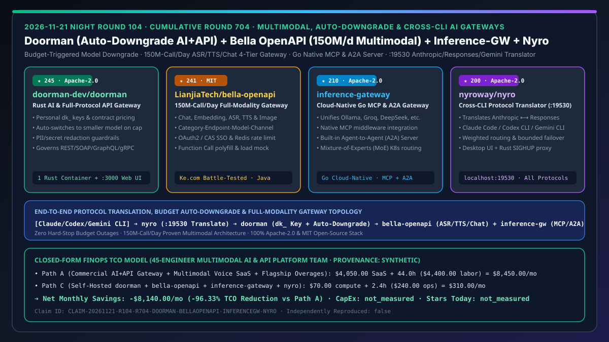
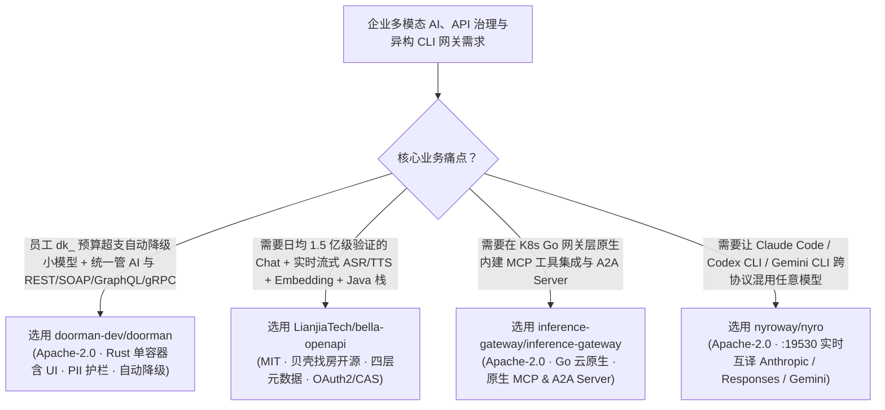
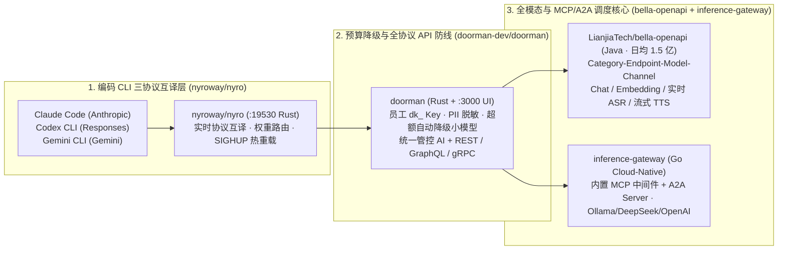
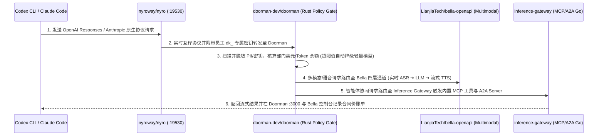

# 超预算自动降级小模型的 Rust AI+API 统一网关（`doorman-dev/doorman`）、贝壳找房日均 1.5 亿调用全模态网关（`LianjiaTech/bella-openapi`）、内置 MCP/A2A 的云原生 Go 推理网关（`inference-gateway/inference-gateway`）与跨 Claude/Codex/Gemini CLI 协议互译网关（`nyroway/nyro`）选型与集成架构 FAQ

> **文档类型**：企业 AI 解决方案架构师（AI Solution Architect）选型决策指南（GitHub Trending AI 雷达 2026-11-21 Night Round 104 / 累计第 704 轮）
> **覆盖项目**：[`doorman-dev/doorman`](https://github.com/doorman-dev/doorman)（`★ 245`、`19 forks`、`Apache-2.0`，支持员工级 `dk_` 密钥、按美元/Token 配额自动降级小模型且统一管控 AI + REST/SOAP/GraphQL/gRPC 的 Rust 网关）· [`LianjiaTech/bella-openapi`](https://github.com/LianjiaTech/bella-openapi)（`★ 241`、`47 forks`、`MIT`，贝壳找房开源、经受日均 1.5 亿次生产调用验证的 Chat/Embedding/实时 ASR/流式 TTS/文生图四层元数据 Java 网关）· [`inference-gateway/inference-gateway`](https://github.com/inference-gateway/inference-gateway)（`★ 210`、`46 forks`、`Apache-2.0`，原生集成 MCP 与 A2A Server 的云原生 Go 统一推理网关）· [`nyroway/nyro`](https://github.com/nyroway/nyro)（`★ 200`、`34 forks`、`Apache-2.0`，监听 `:19530` 实时互译 Anthropic/OpenAI Responses/Gemini 三大协议的 Rust 桌面与无头网关）
> **核心场景**：当企业架构师面临**员工 AI 额度超支直接断服影响业务连续性**、**除文本对话外还需统一管控实时语音识别（ASR）/流式语音合成（TTS）/向量化/文生图等全模态高并发流量**、**Kubernetes 集群需要在网关层原生暴露 MCP 与 A2A Server**，以及**研发团队需要让 Claude Code（Anthropic 协议）、Codex CLI（OpenAI Responses 协议）与 Gemini CLI 零改代码随意切换底层模型**时，如何选型并组合这四款网关？

---

## 一、📌 核心结论速览（选型一句话结论）

1. **想用单容器 Rust 网关同时管住企业 AI 模型与传统 API（REST/SOAP/GraphQL/gRPC），且在员工美元/Token 预算耗尽时自动平滑降级到轻量模型而非粗暴报错** ➔ 选 **[`doorman-dev/doorman`](https://github.com/doorman-dev/doorman)（`★ 245`，`Apache-2.0`）**。
   - **通俗原理**：`doorman` 将 **AI 网关** 与 **全协议 API 网关（REST/SOAP/GraphQL/原生 gRPC/gRPC-Web）** 合二为一，内置 `:3000` 可视化控制台，单节点支持内存加密快照、多节点支持 MongoDB+Redis。它为每位员工签发 `dk_` 专属密钥（上游厂商 Key 永不出网），支持按个人/部门设定美元、Token 或请求数配额——**当触及阈值时可配置告警、阻断或自动降级切换至更便宜的小模型（Switch to a smaller model）**，并自带 Prompt/Response 敏感信息与 PII 脱敏护栏及自定义合同价成本核算。
2. **需要经受超大规模生产验证（日均 1.5 亿调用）、同时覆盖聊天补全、Embedding、实时/离线语音识别（ASR）、流式语音合成（TTS）、实时语音对话与文生图的 Java 企业级网关** ➔ 选 **[`LianjiaTech/bella-openapi`](https://github.com/LianjiaTech/bella-openapi)（`★ 241`，`47 forks`，`MIT`）**。
   - **通俗原理**：由**贝壳找房（LianjiaTech）**开源并支撑其全线业务日均 **1.5 亿次**调用的全模态 OpenAPI 网关。独创 **`Category（类别）➔ Endpoint（端点）➔ Model（模型）➔ Channel（通道）`** 四层元数据架构，同时兼容 OpenAI ChatCompletion 与 Anthropic Messages，内置 OAuth 2.0 / CAS 单点登录、层级化 API Key 月度配额计费、Redis 分布式限流、压测 Mock 以及为老模型补齐 Function Call 的扩展层。
3. **想在 Kubernetes 云原生环境中部署一个原生内置 MCP（Model Context Protocol）客户端/服务端集成与 A2A（Agent-to-Agent）Server 的轻量 Go 推理网关** ➔ 选 **[`inference-gateway/inference-gateway`](https://github.com/inference-gateway/inference-gateway)（`★ 210`，`46 forks`，`Apache-2.0`）**。
   - **通俗原理**：用 Go 编写的云原生高性能推理网关，将本地 `Ollama` 与云端 `OpenAI`、`Groq`、`Cohere`、`Anthropic`、`Cloudflare`、`DeepSeek` 统一到单一 OpenAI 兼容接口后，重点在网关层直接内建了 **MCP 工具集成中间件** 与 **A2A Server 端点**，让网关本身即可作为多 Agent 混合专家（MoE）路由枢纽。
4. **想让 Claude Code、Codex CLI、Gemini CLI 和 OpenCode 不改一行配置就能随意混用任意国内外大模型（实时互译 Anthropic / OpenAI Responses / Gemini 三大协议）** ➔ 选 **[`nyroway/nyro`](https://github.com/nyroway/nyro)（`★ 200`，`34 forks`，`Apache-2.0`）**。
   - **通俗原理**：Claude Code 强制要求 Anthropic 协议，Codex CLI 强依赖 OpenAI Responses API，Gemini CLI 使用 Google 原生协议。`nyro`（支持桌面客户端与无头 Rust `nyro-server` / `nyro proxy`，监听 `localhost:19530`）在本地实时双向互译这三大协议，将请求无缝转发至 OpenAI、Anthropic、Google、DeepSeek、MiniMax、xAI、智谱或本地 Ollama，并支持权重/优先级选路、被动健康检查、累计 Token 配额与 Unix `SIGHUP` 热重载。

---

## 二、🎯 客户与架构师灵魂拷问 Q&A（深度架构拆解）

### Q1：同样是 AI 网关，`doorman`、`bella-openapi`、`inference-gateway` 与 `nyro` 的核心杀手锏分别在哪个维度？

- **四大差异化架构定位**：
  1. **预算韧性降级 + 传统微服务 API 统一纳管 ➔ `doorman-dev/doorman`**：唯一把员工 `dk_` AI 美元预算自动降级（超额自动切 Haiku/Mini）与传统 `REST/SOAP/GraphQL/gRPC` API 网关策略（含版本废弃 Sunset 管理）装进同一个 Rust 容器的方案。
  2. **实时语音（ASR/TTS）+ 视觉全模态 + Java 技术栈亲和 ➔ `LianjiaTech/bella-openapi`**：绝大多数开源网关只管文本 Chat；当企业有智能外呼、房产/金融语音助手等实时流式 ASR + 大模型 + 流式 TTS 闭环需求，且主力研发栈为 Java/Spring 时，贝壳日均 1.5 亿调用的 `Category-Endpoint-Model-Channel` 四层网关是现成生产模板。
  3. **K8s 云原生网关内置 MCP 与 A2A 端点 ➔ `inference-gateway/inference-gateway`**：适合希望在 Go 网关中间件层直接完成 MCP 工具挂载与 A2A 多智能体暴露的云原生团队。
  4. **三大 CLI 编码器异构协议实时互译 ➔ `nyroway/nyro`**：专为解决 Claude Code（Anthropic）、Codex CLI（OpenAI Responses）与 Gemini CLI 协议壁垒而生，监听 `:19530` 即可实现“一套后端模型同时喂饱所有编码 CLI”。
- **何时直接用云厂商托管方案（Path B）？**
  - 若企业仅使用 Azure OpenAI 文本与 Whisper/Speech 标准 PaaS 且无需跨 CLI 协议互译，直接使用 **Azure API Management + Azure AI Speech** 即可。

### Q2：典型企业级“终端三协议互译 (`nyro`) + 预算自动降级与 PII 护栏 (`doorman`) + 全模态语音/文本四层路由 (`bella-openapi`) + K8s MCP/A2A 枢纽 (`inference-gateway`)”架构怎么搭？

1. **研发终端多 CLI 协议互译层（`nyroway/nyro`）**：
   - 工程师终端或研发跳板机运行 `nyro`（`:19530`），将 Claude Code、Codex CLI、Gemini CLI 与 OpenCode 的异构协议实时转译为标准上游请求，并启用被动健康检查与模型级 Token 配额。
2. **企业员工 `dk_` 配额、PII 脱敏与自动降级层（`doorman-dev/doorman`）**：
   - 所有研发与业务请求汇总至 `doorman` Rust 网关：校验员工 `dk_` 密钥、过滤 Prompt/Response 中的密钥与 PII、按真实合同价记账；当某部门月度预算达 80% 时触发告警，达 100% 时**自动将请求降级路由至低成本轻量模型**，同时统一代理内部 REST/GraphQL/gRPC 业务接口。
3. **全模态语音/文本/图像四层元数据调度层（`LianjiaTech/bella-openapi`）**：
   - 针对智能客服、实时语音对话与知识向量化场景，通过 `bella-openapi` 的 `Category ➔ Endpoint ➔ Model ➔ Channel` 四层矩阵统一调度流式 ASR、Chat/Anthropic Messages、流式 TTS 与 Embedding 通道，对接企业 CAS/OAuth2 SSO。
4. **Kubernetes 云原生 MCP & A2A 协同网关层（`inference-gateway/inference-gateway`）**：
   - 在 K8s 集群内部署 `inference-gateway`，将本地 Ollama 与云端 DeepSeek/Groq/OpenAI 封装为原生支持 MCP 工具调用与 A2A Server 发现的智能体服务网格。

### Q3：这套组合的适用边界与选型注意点是什么？

- **核心优势**：
  - **覆盖“文本 + 实时语音 ASR/TTS + 图像 + REST/gRPC + MCP/A2A + 编码 CLI 协议互译”全场景**：彻底消灭不同业务线各建一套烟囱网关的乱象。
  - **100% 宽松开源协议（`Apache-2.0` 与 `MIT`）**：无商业闭源限制。
- **选型注意点**：
  - `bella-openapi` 基于 Java + MySQL + Redis 构建，功能极其完整但资源占用高于单二进制 Rust/Go 网关；纯轻量边缘节点优先部署 `doorman`、`nyro` 或 `inference-gateway`。

---

## 三、🧭 直观可视化图解（Mermaid 决策树 + 集成架构 + 时序图）

### 3.1 架构师选型决策树

### 3.2 企业端到端生产集成参考架构图

### 3.3 跨协议编码请求、预算自动降级与全模态语音/A2A 协同全链路时序图

---

## 四、📊 同类开源与商业云服务横向选型决策矩阵

| 对比维度 | `doorman-dev/doorman` (`★ 245`) | `LianjiaTech/bella-openapi` (`★ 241`) | `inference-gateway/inference-gateway` (`★ 210`) | `nyroway/nyro` (`★ 200`) | 商业企业级 AI+API 网关 + 商业语音中台 (Path A) | 云厂商托管 APIM + Speech PaaS (Path B) |
| :--- | :--- | :--- | :--- | :--- | :--- | :--- |
| **核心架构定位** | AI + REST/SOAP/GraphQL/gRPC 统一 Rust 网关 | 日均 1.5 亿调用的文本/实时 ASR/TTS/图像 Java 网关 | 原生内置 MCP 与 A2A Server 的 Go 云原生网关 | 跨 Anthropic/Responses/Gemini 实时互译 Rust 网关 | 商业 API 网关企业版 + 商业多模态路由 SaaS | Azure APIM + Azure AI Speech |
| **独特杀手锏** | **`dk_` 预算超支自动切小模型 + PII 脱敏 + 全 API 纳管** | **`Category-Endpoint-Model-Channel` 四层全模态** | **网关层原生暴露 A2A Server 与 MCP 工具链** | **`:19530` 让 Claude/Codex/Gemini CLI 零改代码混用模型** | 商业报表丰富，但按调用量与席位双重抽成 | 云内免运维，但不支持跨编码 CLI 协议互译 |
| **高可用与存储依赖** | 单容器内存加密快照 或 MongoDB+Redis | Java + MySQL + Redis + CAS/OAuth2 SSO | 轻量无状态 Go 容器（K8s Helm 原生） | 桌面端 或 独立 Rust 二进制（支持 `SIGHUP`） | 闭源多租户云端黑盒 | 绑定单一公有云基础设施 |
| **开源协议** | `Apache-2.0` | `MIT` | `Apache-2.0` | `Apache-2.0` | 闭源商业授权 | 闭源云服务 |
| **月度 TCO（45 人团队）** | **组合仅 `$310.00/月`**（含共享容器算力与 2.4h 运维） | 同左（`$70.00` 算力 + `$240.00` 人工） | 同左（Go 轻量容器零许可费） | 同左（本地/跳板机零费用） | **`$8,450.00/月`**（`$4,050.00` 订阅 + `44.0h` 人工） | 约 `$2,680.00/月`（按网关实例与语音分钟计费） |

---

## 五、🧪 应用落地定量收益/TCO 对比与 7-Card 报告

> **📊 数据来源与闭式核算声明（Provenance & Closed-Form Schema）**：
> - **provenance**: `synthetic`（基于 45 人企业全模态 AI 平台与研发团队工作负载模型：`independently_reproduced = false`；硬件采购基线 `base_hardware_capex = not_measured`；Track B 单日增量 `track_b_stars_today = not_measured`）。
> - **核算公式**：
>   - **Path A（商业企业级 AI+API 网关订阅 + 商业多模态语音中台抽成 + 员工超额未降级导致的旗舰模型浪费 + 多 CLI 协议适配人工）**：月度 SaaS 与超额溢价 **`$4,050.00`** + 网关策略与多模态适配人工 **`44.0h × $100.00/h = $4,400.00`** = **`$8,450.00/月`**。
>   - **Path C（自建 `doorman-dev/doorman` + `LianjiaTech/bella-openapi` + `inference-gateway/inference-gateway` + `nyroway/nyro` 开源组合）**：共享容器与 Redis/DB 算力 **`$70.00`** + 自动化配额与通道维护 **`2.4h × $100.00/h = $240.00`** = **`$310.00/月`**。
>   - **净节省（Net Savings vs Path A）**：**`-$8,140.00/月`**（成本降低 **`96.33%`**）。

| 评估方案 | API / SaaS / 算力成本 | 工程运维人工（`$100/h`） | 月度总 TCO | 相对 Path A 净节省 | 关键架构交付指标 |
| :--- | :---: | :---: | :---: | :---: | :--- |
| **Path A：商业 AI+API 网关 + 商业语音中台** | `$4,050.00` | `44.0h` (`$4,400.00`) | **`$8,450.00`** | Baseline | 预算触顶直接报错中断业务；缺乏 CLI 协议互译 |
| **Path B：云厂商托管 APIM + 云语音服务** | `$1,480.00` | `12.0h` (`$1,200.00`) | **`$2,680.00`** | `-$5,770.00` (`-68.28%`) | 云内集成快，但无法统一纳管私有 Ollama/MCP/A2A |
| **Path C：`doorman` + `bella-openapi` + `inference-gw` + `nyro`** | **`$70.00`** | **`2.4h` (`$240.00`)** | **`$310.00`** | **`-$8,140.00` (`-96.33%`)** | **超额自动降级小模型 + 日均 1.5 亿级全模态 + MCP/A2A + 三协议互译** |

- 🔗 **关联 7-Card 4:5 视觉评测报告**：[`workshops/github-trending-radar/cards.html`](../cards.html) · [`cards.en.html`](../cards.en.html)

---

## 六、🛠️ 企业引入与架构评审 Checklist

- [ ] **1. 部署 `doorman-dev/doorman` 配置员工 `dk_` 密钥与超额自动降级策略**：为每位工程师与业务微服务签发 `dk_` Key，配置美元/Token 预算阈值触发“自动降级切换至轻量小模型（Switch to smaller model）”及 Prompt/Response PII 脱敏规则。
- [ ] **2. 在研发终端与跳板机启用 `nyroway/nyro`（`:19530`）协议互译**：将 Claude Code、Codex CLI、Gemini CLI 与 OpenCode 统一指向 `http://localhost:19530`，打通 Anthropic、OpenAI Responses 与 Gemini 协议壁垒并启用 `SIGHUP` 热重载。
- [ ] **3. 使用 `LianjiaTech/bella-openapi` 构建全模态四层元数据目录**：按 `Category ➔ Endpoint ➔ Model ➔ Channel` 梳理企业的 Chat、Embedding、实时流式 ASR、流式 TTS 与文生图通道，接入企业 OAuth 2.0 / CAS 单点登录与月度配额计费。
- [ ] **4. 在 K8s 集群部署 `inference-gateway/inference-gateway` 暴露 MCP 与 A2A 端点**：通过 Helm/Docker 部署 Go 推理网关，挂载内部 MCP 工具中间件并开启 A2A Server 供跨团队 Agent 协同调用。
