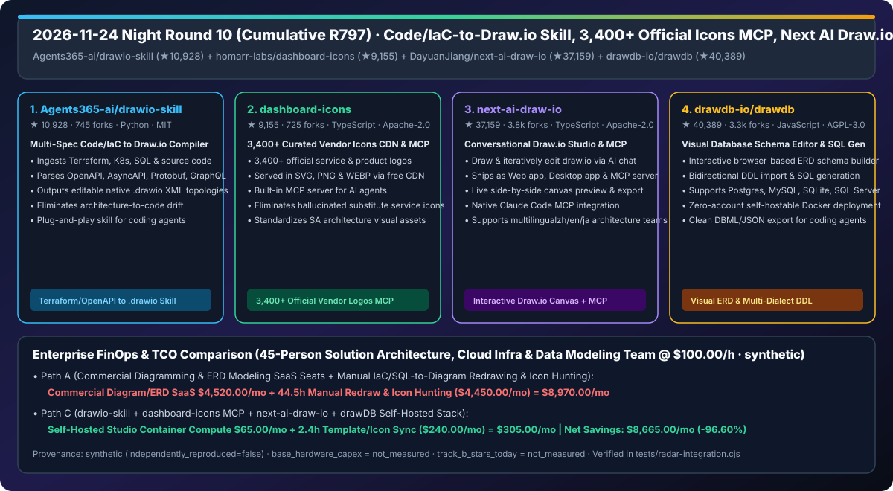
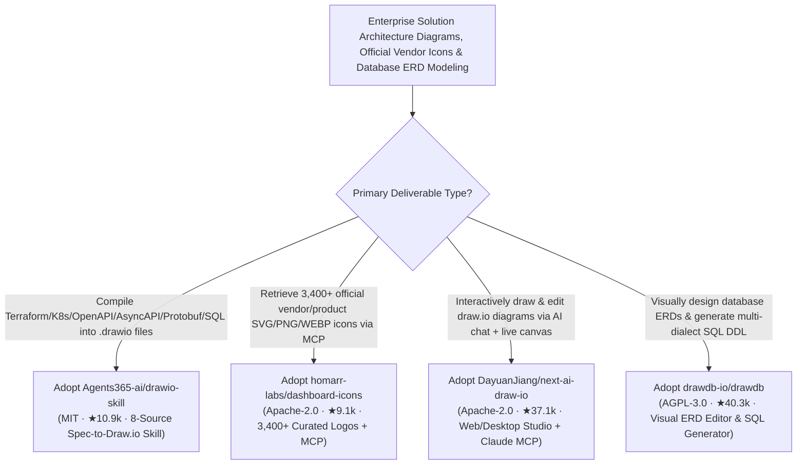
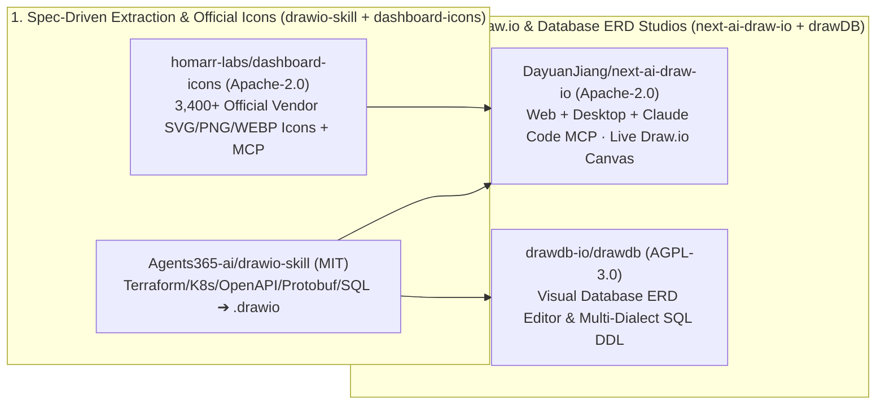
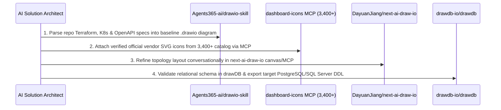

# Multi-Spec Code/IaC-to-Draw.io Skill (`Agents365-ai/drawio-skill`), 3,400+ Official Vendor Icons MCP (`homarr-labs/dashboard-icons`), Conversational Draw.io Studio & MCP (`DayuanJiang/next-ai-draw-io`) & Visual Database ERD/SQL Generator (`drawdb-io/drawdb`) Selection & Architecture FAQ

> **Document Type**: Enterprise AI Solution Architect Decision & Selection Guide (GitHub Trending AI Radar · 2026-11-24 Night Round 10 / Cumulative Round 797)
> **Covered Repositories**: [`Agents365-ai/drawio-skill`](https://github.com/Agents365-ai/drawio-skill) (`★ 10,928`, `745 forks`, Python, `MIT`: agent skill that compiles natural language, source code, Terraform/Kubernetes manifests, SQL, OpenAPI, AsyncAPI, Protobuf, and GraphQL specifications into editable `.drawio` architecture diagrams) · [`homarr-labs/dashboard-icons`](https://github.com/homarr-labs/dashboard-icons) (`★ 9,155`, `725 forks`, TypeScript, `Apache-2.0`: 3,400+ curated official vendor icons and logos in SVG, PNG, and WEBP on a free CDN plus a built-in MCP server) · [`DayuanJiang/next-ai-draw-io`](https://github.com/DayuanJiang/next-ai-draw-io) (`★ 37,159`, `3,843 forks`, TypeScript, `Apache-2.0`: draw and iteratively edit `draw.io` diagrams by chatting with an AI across Web, desktop, and Claude Code MCP server) · [`drawdb-io/drawdb`](https://github.com/drawdb-io/drawdb) (`★ 40,389`, `3,378 forks`, JavaScript, `AGPL-3.0`: free, self-hostable visual database schema ERD editor and multi-dialect SQL DDL generator)
> **Core Enterprise Scenario**: How should AI Solution Architects combine **multi-spec IaC/API-to-Draw.io compilation (`drawio-skill`)**, **3,400+ official vendor icons over MCP (`dashboard-icons`)**, **conversational Draw.io editing (`next-ai-draw-io`)**, and **visual database ERD/SQL generation (`drawdb`)** to produce executive-ready cloud topologies and database models with zero manual redraw drift?

---

## 1. 📌 Executive Summary (One-Line Selection Verdicts)

1. **Need coding agents to automatically compile existing Terraform/Kubernetes manifests, OpenAPI/AsyncAPI/Protobuf/GraphQL contracts, SQL schemas, or source code into native editable `.drawio` diagrams** ➔ Choose **[`Agents365-ai/drawio-skill`](https://github.com/Agents365-ai/drawio-skill) (`★ 10,928`, `745 forks`, `MIT`)**.
   - **Plain-Language Mechanism**: Eliminates architecture-to-code drift by parsing 8 engineering source formats directly into structured `.drawio` XML topologies.
2. **Need AI agents and architecture dashboards to use verified official vendor/service icons (SVG, PNG, WEBP) across 3,400+ products rather than hallucinated substitute shapes** ➔ Choose **[`homarr-labs/dashboard-icons`](https://github.com/homarr-labs/dashboard-icons) (`★ 9,155`, `725 forks`, `Apache-2.0`)**.
   - **Plain-Language Mechanism**: Exposes 3,400+ curated vendor logos via a fast CDN and an integrated **MCP server** so coding agents retrieve exact official product icons by name.
3. **Need an interactive Web/desktop studio and Claude Code MCP server where architects can both chat with an AI to generate/modify `draw.io` diagrams and fine-tune nodes directly on the canvas** ➔ Choose **[`DayuanJiang/next-ai-draw-io`](https://github.com/DayuanJiang/next-ai-draw-io) (`★ 37,159`, `3,843 forks`, `Apache-2.0`)**.
   - **Plain-Language Mechanism**: Combines conversational LLM diagram editing with a live embedded `draw.io` canvas and MCP server (supporting English, Chinese, and Japanese).
4. **Need a visual, zero-account browser/Docker database schema editor that renders interactive Entity-Relationship Diagrams (ERDs) and exports multi-dialect SQL DDL (Postgres, MySQL, SQLite, SQL Server)** ➔ Choose **[`drawdb-io/drawdb`](https://github.com/drawdb-io/drawdb) (`★ 40,389`, `3,378 forks`, `AGPL-3.0`)**.
   - **Plain-Language Mechanism**: Lets architects and agents visually inspect table relationships, indices, and foreign keys and export clean SQL DDL or DBML.

---

## 2. 🎯 Architect & Customer Q&A (Deep Technical Breakdown)

### Q1: How do these four tools work together, and when should enterprises choose them over commercial diagramming suites (Lucidchart, Visio, ER/Studio)?

- **Four-Stage Architecture Workflow**:
  1. **Contract-to-Diagram Extraction (`drawio-skill`)**: Generates the baseline `.drawio` topology directly from Terraform, K8s, OpenAPI, Protobuf, or GraphQL files.
  2. **Official Icon Grounding (`dashboard-icons` MCP)**: Attaches verified vendor SVG logos from 3,400+ curated icons.
  3. **Conversational Canvas Refinement (`next-ai-draw-io`)**: Refines layout and annotations via interactive chat + live `draw.io` canvas or Claude Code MCP.
  4. **Relational Schema Modeling (`drawdb`)**: Designs and validates physical database ERDs and exports target SQL DDL.

### Q2: How do we deploy this stack inside an enterprise environment?

1. **Automated CI Diagram Generation (`Agents365-ai/drawio-skill` + `homarr-labs/dashboard-icons`)**:
   - Wire `drawio-skill` and `dashboard-icons` MCP into repository workflows so infrastructure and API PRs automatically update `.drawio` architecture diagrams with official icons.
2. **Self-Hosted Interactive Studios (`DayuanJiang/next-ai-draw-io` + `drawdb-io/drawdb`)**:
   - Host `next-ai-draw-io` and `drawdb` on internal Docker/Kubernetes clusters connected to enterprise LLM gateways so proprietary architecture and schema designs stay on-premises.

### Q3: What are the key operational guardrails?

- **Key Guardrails**:
  1. **Official Vendor Icon Policy**: Mandate `dashboard-icons` MCP or official vendor icon packs (Azure/AWS/GCP/Fabric) in architecture deliverables; never allow LLMs to hand-draw fake product logos.
  2. **Internal Hosting for `drawdb` (`AGPL-3.0`)**: Deploy `drawdb-io/drawdb` as an internal engineering workbench rather than embedding its `AGPL-3.0` code into distributed commercial software.

---

## 3. 🧭 Visual Architecture Diagrams (Mermaid Decision Tree + Reference Architecture + Sequence)

### 3.1 Solution Architect Selection Decision Tree

### 3.2 End-to-End Enterprise Reference Architecture

### 3.3 End-to-End Architecture & Schema Delivery Sequence

---

## 4. 📊 Comparative Selection Matrix (OSS vs. Commercial Diagramming & Freehand SVGs)

| Dimension | `Agents365-ai/drawio-skill` (`★ 10.9k`) | `homarr-labs/dashboard-icons` (`★ 9.1k`) | `DayuanJiang/next-ai-draw-io` (`★ 37.1k`) | `drawdb-io/drawdb` (`★ 40.3k`) | Commercial Lucidchart/Visio + Paid ERD Suites + Manual Redrawing (Path A) | Freehand LLM SVG/Mermaid + Hand-Written SQL DDL (Path B) |
| :--- | :--- | :--- | :--- | :--- | :--- | :--- |
| **Primary Role** | 8-source code/IaC/API-to-`.drawio` skill | 3,400+ official vendor icons CDN + MCP | Conversational `draw.io` Web/desktop app + MCP | Visual browser/Docker database ERD & SQL editor | Per-seat commercial diagramming and data-modeling SaaS | Non-editable raw LLM SVGs & manual SQL scripts |
| **Key Differentiator** | **Compiles Terraform, K8s, OpenAPI, Protobuf & GraphQL to `.drawio`** | **3,400+ verified official SVG/PNG/WEBP logos over MCP** | **Live `draw.io` canvas paired with conversational AI & MCP** | **Zero-account visual ERD with multi-dialect DDL export** | High per-seat fees; diagrams still drift when code changes | Raw LLM SVGs invent fake logos and cannot be edited in `draw.io` |
| **License** | `MIT` | `Apache-2.0` | `Apache-2.0` | `AGPL-3.0` | Proprietary SaaS | Internal Scripts |
| **Monthly TCO (45-Person Team)** | **Combined `$305.00/mo`** (`$65.00` self-hosted studio compute + `2.4h` ops) | Included (free CDN + local MCP) | Included (`Apache-2.0` self-hosted) | Included (self-hosted Docker container) | **`$8,970.00/mo`** (`$4,520.00` commercial seats + `44.5h` manual redraw & icon hunting) | `~$3,090.00/mo` (high manual SVG fixing & DDL syntax debugging labor) |

---

## 5. 🧪 Quantitative Enterprise ROI / TCO Model & 7-Card Report

> **📊 Provenance & Closed-Form Declaration**:
> - **provenance**: `synthetic` (45-person solution architecture, cloud infrastructure, and data modeling team workload at `$100.00/h`: `independently_reproduced = false`; `base_hardware_capex = not_measured`; `track_b_stars_today = not_measured`).
> - **Closed-Form Equations**:
>   - **Path A (Commercial Diagramming & ERD Modeling SaaS Seats + Manual IaC/API-to-Diagram Redrawing & Official Icon Hunting)**: Monthly commercial diagramming & ERD SaaS seat fees **`$4,520.00`** + manual topology redrawing, icon hunting & DDL debugging labor **`44.5h × $100.00/h = $4,450.00`** = **`$8,970.00/mo`**.
>   - **Path C (Self-Hosted `Agents365-ai/drawio-skill` + `homarr-labs/dashboard-icons` + `DayuanJiang/next-ai-draw-io` + `drawdb-io/drawdb` Stack)**: Self-hosted studio container compute **`$65.00`** + template & icon catalog maintenance **`2.4h × $100.00/h = $240.00`** = **`$305.00/mo`**.
>   - **Net Savings vs. Path A**: **`-$8,665.00/mo`** (**`96.60%`** cost reduction).

| Option | SaaS Seats / Compute Spend | Diagram Redraw, Icon & ERD Labor (`$100/h`) | Monthly Total TCO | Net Savings vs. Path A | Key Architectural Outcome |
| :--- | :---: | :---: | :---: | :---: | :--- |
| **Path A: Commercial Diagram/ERD SaaS + Manual Redrawing** | `$4,520.00` | `44.5h` (`$4,450.00`) | **`$8,970.00`** | Baseline | Expensive per-seat licensing; manual diagrams lag behind IaC/API PRs |
| **Path B: Freehand LLM SVG/Mermaid + Hand-Written DDL** | `$1,390.00` | `17.0h` (`$1,700.00`) | **`$3,090.00`** | `-$5,880.00` (`-65.55%`) | Invented non-official icons; no editable `.drawio` or visual ERD |
| **Path C: `drawio-skill` + `dashboard-icons` + `next-ai-draw-io` + `drawDB`** | **`$65.00`** | **`2.4h` (`$240.00`)** | **`$305.00`** | **`-$8,665.00` (`-96.60%`)** | **8-spec `.drawio` compiler + 3,400 official icons + AI Draw.io + visual ERD** |

- 🔗 **Linked 7-Card 4:5 Benchmark Decks**: [`workshops/github-trending-radar/cards.en.html`](../cards.en.html) · [`cards.html`](../cards.html)

---

## 6. 🛠️ Enterprise Adoption & Architecture Review Checklist

- [ ] **Automate Spec-to-Draw.io Generation**: Run `Agents365-ai/drawio-skill` on Terraform, K8s, OpenAPI, AsyncAPI, Protobuf, and GraphQL files so `.drawio` diagrams stay synchronized with code.
- [ ] **Enforce Official Icons via `dashboard-icons` MCP**: Connect `homarr-labs/dashboard-icons` MCP server to architecture agents to guarantee verified SVG product icons across all diagrams.
- [ ] **Self-Host `next-ai-draw-io` for Confidential Topologies**: Deploy `DayuanJiang/next-ai-draw-io` internally backed by enterprise LLM endpoints for interactive customer architecture reviews.
- [ ] **Validate Database Migrations in `drawdb`**: Review entity relationships visually in self-hosted `drawdb-io/drawdb` before exporting multi-dialect SQL DDL to migration pipelines.
