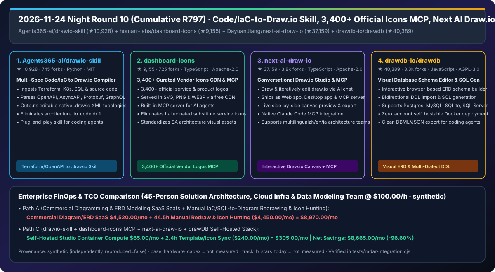
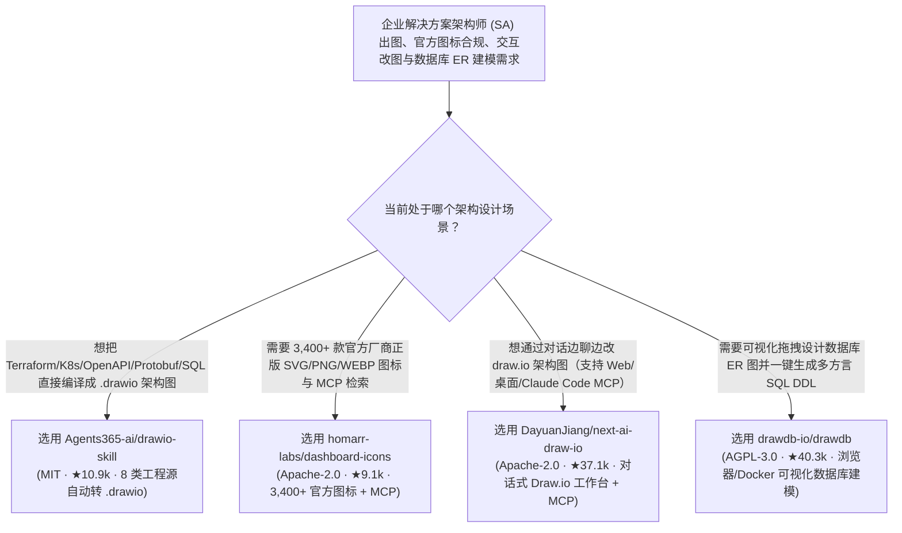
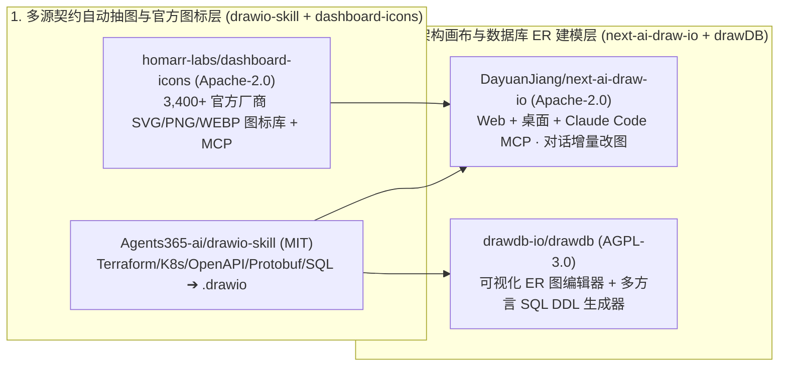
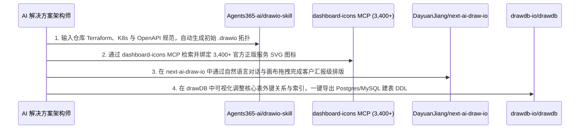

# 多源 IaC/契约转 Draw.io 架构图技能（`Agents365-ai/drawio-skill`）、3,400+ 官方厂商图标库与 MCP（`homarr-labs/dashboard-icons`）、对话式 Draw.io 协同工作台与 MCP（`DayuanJiang/next-ai-draw-io`）及可视化数据库 ER 建模与多方言 SQL 生成器（`drawdb-io/drawdb`）选型与集成架构 FAQ

> **文档类型**：企业 AI 解决方案架构师（AI Solution Architect）选型决策指南（GitHub Trending AI 雷达 2026-11-24 Night Round 10 / 累计第 797 轮）
> **覆盖项目**：[`Agents365-ai/drawio-skill`](https://github.com/Agents365-ai/drawio-skill)（`★ 10,928`、`745 forks`、`MIT`，将自然语言、业务源码、Terraform/Kubernetes 配置、SQL、OpenAPI、AsyncAPI、Protobuf 与 GraphQL 直接编译为专业 `.drawio` 可编辑架构图的智能体技能）· [`homarr-labs/dashboard-icons`](https://github.com/homarr-labs/dashboard-icons)（`★ 9,155`、`725 forks`、`Apache-2.0`，收录 **3,400+ 个经过策展的官方厂商服务与产品图标**，同时提供免费 CDN 的 SVG/PNG/WEBP 与内置 **MCP Server**）· [`DayuanJiang/next-ai-draw-io`](https://github.com/DayuanJiang/next-ai-draw-io)（`★ 37,159`、`3,843 forks`、`Apache-2.0`，支持通过对话实时绘制与增量修改 `draw.io` 图表的 Web 应用、桌面客户端与 Claude Code **MCP Server**）· [`drawdb-io/drawdb`](https://github.com/drawdb-io/drawdb)（`★ 40,389`、`3,378 forks`、`AGPL-3.0`，零账号开箱即用的可视化数据库 Schema 实体关系图编辑器与多方言 SQL DDL 生成器）
> **核心场景**：当企业 AI 解决方案架构师（SA）在售前投标、技术评审与系统重构中需要高频交付**“云原生拓扑图、微服务 API 调用图与数据库 ER 模型”**时，如何解决**“手画 Visio/Lucidchart 永远跟不上 Terraform/K8s/OpenAPI 代码变更、大模型瞎编乱造非官方厂商图标违反架构规范、生成的静态图无法在画布里二次微调、以及手写多方言数据库建表 DDL 容易出错”**四大痛点？

---

## 一、📌 核心结论速览（选型一句话结论）

1. **想把仓库里现成的 Terraform/Kubernetes 清单、OpenAPI/AsyncAPI/Protobuf/GraphQL 接口规范、SQL 或业务源码直接一键反向生成标准 `.drawio` 架构图** ➔ 选 **[`Agents365-ai/drawio-skill`](https://github.com/Agents365-ai/drawio-skill)（`★ 10,928`，`745 forks`，`MIT`）**。
   - **通俗原理**：根治“文档里的架构图永远比真实生产代码落后三个月”的顽疾。直接让编码 Agent 读取仓库里的 IaC 与接口契约文件（Terraform、K8s、OpenAPI、Protobuf、GraphQL、SQL），自动解析服务依赖与数据流并输出原生 `.drawio` XML 文件。
2. **想让 AI 架构师或编码 Agent 在生成架构图、运维大盘与 H5 汇报页时，100% 使用真实、准确的官方厂商产品图标（SVG/PNG/WEBP），彻底杜绝大模型自己手绘山寨替代图标** ➔ 选 **[`homarr-labs/dashboard-icons`](https://github.com/homarr-labs/dashboard-icons)（`★ 9,155`，`725 forks`，`Apache-2.0`）**。
   - **通俗原理**：收录了 **3,400+ 款** 主流云服务、开源中间件、数据库与企业软件的官方矢量 SVG、PNG 与 WEBP 图标，不仅支持 jsDelivr 高速 CDN 引用，更自带 **MCP Server** 让 Agent 按服务名精准检索官方图标资产。
3. **想一边跟 AI 聊天口述需求，一边在右侧实时预览并拖拽修改 `draw.io` 画布（或者在 Claude Code 里通过 MCP 持续增量改图）** ➔ 选 **[`DayuanJiang/next-ai-draw-io`](https://github.com/DayuanJiang/next-ai-draw-io)（`★ 37,159`，`3,843 forks`，`Apache-2.0`）**。
   - **通俗原理**：集成了完整的 Web 端、桌面端与 Claude Code MCP Server（支持中/英/日三语），让“对话生成 ➔ 画布手动拖拽微调 ➔ 对话局部增量修改”在同一个原生 `draw.io` 工作台中丝滑闭环。
4. **想在设计数据库表结构时，用直观的可视化 ER 画布拖拽表与外键关系，并一键双向导入/导出 PostgreSQL、MySQL、SQLite、SQL Server 等多方言 SQL DDL 与 DBML** ➔ 选 **[`drawdb-io/drawdb`](https://github.com/drawdb-io/drawdb)（`★ 40,389`，`3,378 forks`，`AGPL-3.0`）**。
   - **通俗原理**：4 万星标杆级开源数据库建模台，无需注册账号即可在浏览器或内网 Docker 容器中运行，支持将 Agent 生成的 JSON/DBML/SQL 一键渲染为高清 ER 图，并反向导出零语法错误的生产建表脚本。

---

## 二、🎯 客户与架构师灵魂拷问 Q&A（深度架构拆解）

### Q1：这四个高星架构与建模工具如何分工配合？何时选它们 vs 商业软件（Lucidchart / ER/Studio / Visio）？

- **四步黄金分工**：
  1. **从代码/契约自动抽图 ➔ `drawio-skill`**：把存量 Terraform/K8s/OpenAPI/Protobuf 直接转成 `.drawio` 初稿。
  2. **注入官方正版厂商图标 ➔ `dashboard-icons` MCP**：从 3,400+ 图标库中匹配正版官方 SVG 图标。
  3. **人机对话式增量精修 ➔ `next-ai-draw-io`**：在交互式画布或 Claude Code MCP 中完成布局精修与汇报定稿。
  4. **数据库物理模型专精设计 ➔ `drawdb`**：针对关系型数据模型生成精确外键 ERD 与多方言 DDL。
- **何时用商业工具（Path A）？**
  - 若客户强制要求交付专有 `.vsdx` 或与大型传统主机数据字典双向同步，可保留对应商业软件；对于 95% 的云原生架构设计、招投标方案与敏捷数据建模，本轮四合一开源栈（Path C）兼具自动化与零席位成本优势。

### Q2：典型企业级“契约反编译出图 (`drawio-skill`) + 3,400 官方图标 (`dashboard-icons`) + 对话画布精修 (`next-ai-draw-io`) + 可视化 ER 建模 (`drawdb`)”架构怎么搭？

1. **代码与契约驱动初稿层（`Agents365-ai/drawio-skill`）**：
   - 在 CI 或架构师终端扫描 Terraform/K8s、OpenAPI/Protobuf 与 SQL，生成与代码 100% 同步的 `.drawio` 拓扑初稿。
2. **官方图标资产挂载层（`homarr-labs/dashboard-icons`）**：
   - 通过 `dashboard-icons` MCP Server 为图中组件匹配官方 SVG 图标。
3. **交互式架构与数据库双画布精修层（`next-ai-draw-io` + `drawdb`）**：
   - 系统架构图在 `next-ai-draw-io` 中通过对话与拖拽定稿；数据库表结构在 `drawdb` 中完成可视化外键校验并导出迁移 DDL。

### Q3：这套架构的生产落地红线是什么？

- **架构师落地红线**：
  1. **官方厂商图标合规铁律**：严禁让大模型用基础几何图形手绘伪造云厂商或第三方产品 Logo，必须通过 `dashboard-icons` 或官方架构图标包引用正版 SVG。
  2. **数据库 DDL 外键与索引二次校核**：从 `drawdb` 导出多方言 SQL DDL 后，需结合目标数据库版本核对复合索引顺序与分区表语法。

---

## 三、🧭 直观可视化图解（Mermaid 决策树 + 集成架构 + 时序图）

### 3.1 架构师选型决策树

### 3.2 企业端到端生产集成参考架构图

### 3.3 IaC/OpenAPI 自动抽图、3,400+ 官方图标匹配、对话画布精修与 drawDB 导出 DDL 时序图

---

## 四、📊 同类开源与商业云服务横向选型决策矩阵

| 对比维度 | `Agents365-ai/drawio-skill` (`★ 10.9k`) | `homarr-labs/dashboard-icons` (`★ 9.1k`) | `DayuanJiang/next-ai-draw-io` (`★ 37.1k`) | `drawdb-io/drawdb` (`★ 40.3k`) | 商业 Lucidchart/Visio + 商业 ER/Studio 席位 + 手工重画 (Path A) | 裸 LLM 手写 Mermaid/SVG + 手写 SQL 建表 (Path B) |
| :--- | :--- | :--- | :--- | :--- | :--- | :--- |
| **核心能力定位** | 8 类代码/IaC/API 契约转 `.drawio` 技能 | 3,400+ 官方厂商图标库与 MCP Server | 对话式 `draw.io` Web/桌面工作台与 MCP | 可视化数据库 ER 图编辑器与 SQL 生成器 | 按席位按月付费的商业绘图与商业数据建模软件 | 无法拖拽微调的静态代码图与易写错外键的纯手写 DDL |
| **核心技术突破** | **直接吃进 Terraform/K8s/OpenAPI/Protobuf/SQL 出图** | **3,400+ 正版官方 SVG/PNG 图标，内置 MCP** | **对话生成与原生 `draw.io` 画布编辑双向打通** | **零账号浏览器即开即用，支持双向 SQL DDL 转换** | 商业建模软件席位昂贵；代码改后仍需人工手动重画架构图 | 裸 LLM 常捏造虚假图标；复杂多表外键手写 SQL 极易出错 |
| **开源协议** | `MIT` | `Apache-2.0` | `Apache-2.0` | `AGPL-3.0` | 闭源商业 SaaS | 内部脚本 |
| **月度 TCO（45 人团队）** | **组合仅 `$305.00/月`**（`$65.00` 自托管画布容器 + `2.4h` 维护） | 同左（免费 CDN 与本地 MCP） | 同左（Apache-2.0 自托管） | 同左（内网 Docker 零席位费） | **`$8,970.00/月`**（`$4,520.00` 商业绘图/ER 席位 + `44.5h` 手工重画与找图标） | 约 `$3,090.00/月`（大量手工调整图形排版与修复建表语法工时） |

---

## 五、🧪 应用落地定量收益/TCO 对比与 7-Card 报告

> **📊 数据来源与闭式核算声明（Provenance & Closed-Form Schema）**：
> - **provenance**: `synthetic`（基于 45 人企业解决方案架构师、云基础设施与数据建模团队月度工作负载模型：`independently_reproduced = false`；硬件采购基线 `base_hardware_capex = not_measured`；Track B 单日增量 `track_b_stars_today = not_measured`）。
> - **核算公式**：
>   - **Path A（采购商业绘图 SaaS 与商业数据库 ER 建模席位 + 架构师根据 Terraform/OpenAPI 变更手工重画拓扑图与到处搜寻官方图标）**：月度商业绘图与建模软件席位费 **`$4,520.00`** + 手工同步代码改图、搜寻对齐官方图标与手调 DDL 人工 **`44.5h × $100.00/h = $4,450.00`** = **`$8,970.00/月`**。
>   - **Path C（自建 `Agents365-ai/drawio-skill` + `homarr-labs/dashboard-icons` + `DayuanJiang/next-ai-draw-io` + `drawdb-io/drawdb` 开源架构建模栈）**：内网自托管 `next-ai-draw-io` 与 `drawdb` 容器开销 **`$65.00`** + 企业标准模板与图标库同步维护人工 **`2.4h × $100.00/h = $240.00`** = **`$305.00/月`**。
>   - **净节省（Net Savings vs Path A）**：**`-$8,665.00/月`**（成本降低 **`96.60%`**）。

| 评估方案 | 商业软件席位 / 容器算力成本 | 架构重画、找图标与 ER 建模人工（`$100/h`） | 月度总 TCO | 相对 Path A 净节省 | 关键架构交付指标 |
| :--- | :---: | :---: | :---: | :---: | :--- |
| **Path A：商业绘图 SaaS + 商业 ER 软件 + 手工重画** | `$4,520.00` | `44.5h` (`$4,450.00`) | **`$8,970.00`** | Baseline | 席位费昂贵；IaC/API 变更后仍靠人工重画 |
| **Path B：裸 LLM 画 Mermaid/SVG + 纯手写 SQL DDL** | `$1,390.00` | `17.0h` (`$1,700.00`) | **`$3,090.00`** | `-$5,880.00` (`-65.55%`) | 缺少官方正版图标库与原生 `.drawio`/ERD 拖拽微调 |
| **Path C：`drawio-skill` + `dashboard-icons` + `next-ai-draw-io` + `drawDB`** | **`$65.00`** | **`2.4h` (`$240.00`)** | **`$305.00`** | **`-$8,665.00` (`-96.60%`)** | **8 源自动转 `.drawio` + 3,400 官方图标 + 对话改图 + 可视化 ERD** |

- 🔗 **关联 7-Card 4:5 视觉评测报告**：[`workshops/github-trending-radar/cards.html`](../cards.html) · [`cards.en.html`](../cards.en.html)

---

## 六、🛠️ 企业引入与架构评审 Checklist

- [ ] **IaC 与 API 契约变更自动触发 `.drawio` 同步**：在仓库 CI 中挂载 `Agents365-ai/drawio-skill`，当 Terraform、K8s 或 OpenAPI/Protobuf 发生变更时自动刷新架构拓扑初稿。
- [ ] **强制使用 `dashboard-icons` 官方正版图标**：将 `homarr-labs/dashboard-icons` MCP 接入架构师工作流，严禁在客户交付物中使用 AI 臆造的非官方产品图标。
- [ ] **内网私有化部署 `next-ai-draw-io`**：针对涉密客户架构图，在企业内网容器部署 `DayuanJiang/next-ai-draw-io` 并对接内部私有大模型端点。
- [ ] **数据库变更前 `drawdb` ER 图与 DDL 双签收**：在评审新业务表结构时，通过内网自托管的 `drawdb-io/drawdb` 导出可视化 ER 图与对应数据库方言 DDL 一并纳入 PR 评审。
