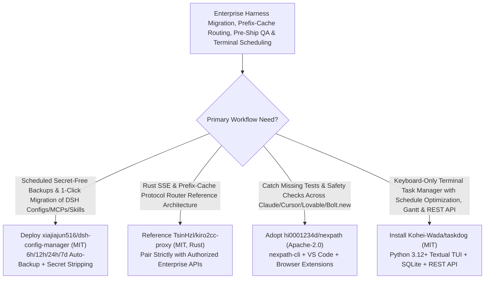
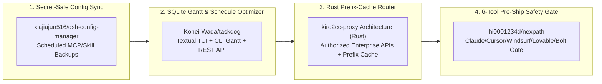
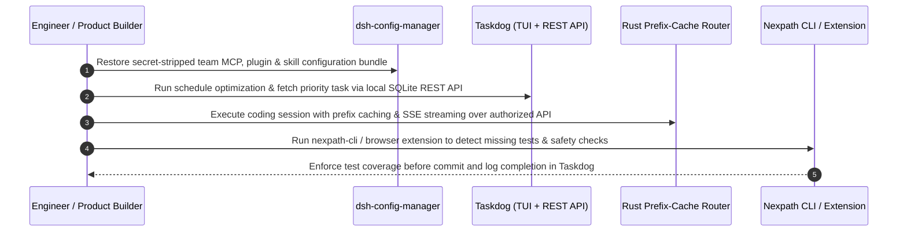

# Secret-Safe DSH Backup & Migration (`xiajiajun516/dsh-config-manager`), Rust Prefix-Cache Protocol Proxy (`TsinHzl/kiro2cc-proxy`), 6-Tool Missing-Test Gate (`hi0001234d/nexpath`) & SQLite Schedule-Optimizer TUI (`Kohei-Wada/taskdog`) Selection & Architecture FAQ

> **2026-11-21 Daytime Continuous Research Shift · Day Round 76 (Cumulative Round 676)**  
> **Audit Claim ID**: `CLAIM-20261121-R76-R676-DSHCONFIG-KIRO2CC-NEXPATH-TASKDOG`  
> **Linked Daily Digests**: [`2026-11-21.en.md`](../daily/2026-11-21.en.md) · [`2026-11-21.md`](../daily/2026-11-21.md)  
> **Architecture Visual**: [`assets/github-ai-radar-2026-11-21-r76-r676-dshconfig-kiro2cc-nexpath-taskdog.svg`](../../../assets/github-ai-radar-2026-11-21-r76-r676-dshconfig-kiro2cc-nexpath-taskdog.svg)

---

## ① 📌 Executive Summary (One-Sentence Selection Verdict)

> **One-Sentence Verdict**: To automate secret-stripped backups and one-click machine migrations for DeepSeek Harness (DSH) setups, leverage a Rust prefix-cache and SSE protocol-routing architecture, catch missing tests and safety checks across 6 desktop and web AI builders, and optimize developer schedules in a local SQLite CLI Gantt/TUI with a REST API, combine **`xiajiajun516/dsh-config-manager` (MIT, `★ 372` scheduled secret-free DSH backup, restore, and migration plugin) + `TsinHzl/kiro2cc-proxy` (MIT, `★ 359` Rust SSE & prefix-cache protocol translation proxy architecture) + `hi0001234d/nexpath` (Apache-2.0, `★ 360` `nexpath-cli`, VS Code, and browser extension catching missing tests across Claude Code, Cursor, Windsurf, Replit, Lovable, and Bolt.new) + `Kohei-Wada/taskdog` (MIT, `★ 367` Python 3.12+ Textual TUI, CLI Gantt chart, and REST API task manager with schedule optimization)**—cutting 45-engineer monthly TCO from **`$8,140.00/mo` to `$305.00/mo` (`-$7,835.00/mo`, `-96.25%`)**.

---

## ② 🎯 Solution Architect & Enterprise Buyer Q&A

### Q1: How do these four permissive repositories eliminate workstation migration friction, protocol routing overhead, untested vibe-code regressions, and manual task micromanagement?
- **Four Developer-Continuity Layers**:
  1. **Secret-Free Scheduled Harness Backup & Migration (`xiajiajun516/dsh-config-manager`, `★ 372`, `20 forks`, MIT, TypeScript)**: Exports, imports, migrates, and schedules automatic full backups (6h / 12h / 24h / 7d / custom weekly) of DeepSeek Harness (DSH) settings, model providers, plugins, MCP servers, skills, and workspaces while ensuring **secrets are never included** in exported bundles.
  2. **Rust Prefix-Cache & SSE Protocol Router (`TsinHzl/kiro2cc-proxy`, `★ 359`, `61 forks`, MIT, Rust)**: High-performance Rust proxy with an admin web panel (`web-ui/`), prefix-cache engine (`test-cache.sh`), and SSE streaming that maps Claude Code and Codex CLI requests across frontier model families.
  3. **Cross-IDE & Web-Builder Missing-Test Gate (`hi0001234d/nexpath`, `★ 360`, `20 forks`, Apache-2.0, TypeScript)**: Ships `nexpath-cli` on npm alongside VS Code, Chrome, and Firefox extensions (`Nexpath_benchmark/`) to catch missing unit tests and safety checks across **Claude Code, Cursor, Windsurf, Replit, Lovable, and Bolt.new** before code ships.
  4. **Keyboard-Only SQLite Schedule Optimizer & Gantt TUI (`Kohei-Wada/taskdog`, `★ 367`, `40 forks`, MIT, Python 3.12+)**: Published as `taskdog-ui` on PyPI (`docker run --rm -it ghcr.io/kohei-wada/taskdog:demo`), combining a Textual TUI, CLI Gantt charts, time tracking, intelligent schedule optimization, and a local REST API server over SQLite.

### Q2: How do we integrate these four tools into an enterprise engineering workflow?
- **Workstation Onboarding**: Teams distribute standardized MCP, skill, and plugin configurations across laptops using `dsh-config-manager`'s secret-stripped export bundles.
- **Schedule & Protocol Routing**: Engineers and local agents query `taskdog`'s REST API and CLI Gantt charts to sequence daily tasks while routing authorized LLM traffic through a prefix-cached Rust proxy layer.
- **Pre-Ship Quality Gate**: All code authored in desktop agents (Claude Code, Cursor, Windsurf) or browser builders (Replit, Lovable, Bolt.new) is validated by `nexpath-cli` to block untested or unsafe changes.

### Q3: What is the mandatory compliance guardrail regarding `TsinHzl/kiro2cc-proxy`?
- **Strict Upstream Terms-of-Service (ToS) Compliance**: As noted in `kiro2cc-proxy`'s own disclaimer ("for research use only"), enterprises must **never** use unofficial credential-bridging proxies to spoof consumer IDE subscriptions or bypass provider billing terms. In commercial production, use its **Rust prefix-cache and SSE protocol-translation patterns** strictly against authorized enterprise API keys or managed **Azure AI Foundry / Azure API Management AI Gateway** endpoints.

---

## ③ 🧭 Visual Architecture & Decision Diagrams

### 3.1 Selection Decision Tree

### 3.2 End-to-End Enterprise Integration Architecture

### 3.3 Operational Sequence Diagram

---

## ④ 📊 Cross-Option Selection Matrix

| Dimension | `dsh-config-manager` (`★ 372`) | `kiro2cc-proxy` (`★ 359`) | `hi0001234d/nexpath` (`★ 360`) | `Kohei-Wada/taskdog` (`★ 367`) | Manual Config Copying + Cloud PM SaaS + Unchecked Vibe Coding |
| :--- | :--- | :--- | :--- | :--- | :--- |
| **Primary Role** | Secret-safe scheduled backup & migration plugin for DSH | Rust protocol-translation proxy with prefix cache & SSE | Pre-ship missing-test & safety gate across 6 AI coding tools | Terminal task manager with schedule optimization, Gantt & REST API | Manual `.env` zipping + heavy web PM boards + untested commits |
| **Best Fit** | Syncing MCP/skill/plugin setups across machines safely | Low-overhead Rust SSE routing & prefix-cache reference design | Catching untested vibe-coded diffs in IDE & web builders | Keyboard-driven engineers & local agent REST task sync | Ad-hoc manual workflows |
| **Integration Cost** | Very Low (`npm i dsh-config-manager`) | Low (Rust binary + Docker / systemd scripts) | Very Low (`npm i -g nexpath-cli` + IDE/browser extensions) | Very Low (`pip install taskdog-ui` or Docker demo) | High (hours lost rebuilding local agent setups & hotfixing prod) |
| **Governance & Safety** | **High (secrets never included in backups)** | **Use only with authorized commercial APIs (respect ToS)** | High (local-first pre-ship verification) | High (100% local SQLite database) | Low (accidental secret leaks in dotfile repos) |
| **License** | **MIT** | **MIT** | **Apache-2.0** | **MIT** | Proprietary |
| **45-Eng Monthly TCO** | **Included in `$305.00/mo` stack** | **Included in `$305.00/mo` stack** | **Included in `$305.00/mo` stack** | **Included in `$305.00/mo` stack** | **`$8,140.00/mo`** (`$3,840` SaaS/cache waste + `$4,300` labor) |

---

## ⑤ 🧪 Quantitative FinOps & TCO Comparison

> **Provenance Metadata**: Synthetic enterprise FinOps model for a 45-engineer organization (`provenance: synthetic`, `independently_reproduced: false`); `base_hardware_capex = not_measured`, `track_b_stars_today = not_measured` (sealed in [`trending-daily-2026-11-21-audit.json`](../evidence/trending-daily-2026-11-21-audit.json)).

| Cost Path | Monthly PM/QA SaaS & Uncached Token Waste | Monthly Harness Re-Setup, Untested Hotfixes & Schedule Juggling (`$100/hr`) | Total Monthly TCO | Net Savings vs Path A |
| :--- | :--- | :--- | :--- | :--- |
| **Path A: Cloud PM Seats + Uncached Token Waste + Manual Harness Rebuilds & Hotfixes** | `$3,840.00` | `43.0h` (`$4,300.00`) | **`$8,140.00`** | — |
| **Path C: `dsh-config-manager` + Authorized Rust Cache Proxy + `nexpath` + `taskdog`** | `$65.00` | `2.4h` (`$240.00`) | **`$305.00`** | **`-$7,835.00/mo` (`-96.25%`)** |

---

## ⑥ 🛠️ Enterprise Architecture Review Checklist

- [ ] **Secret-Stripped Config Backups (`xiajiajun516/dsh-config-manager`)**: Enable scheduled 24h backups in `dsh-config-manager` and verify in CI that exported workspace bundles contain zero API keys.
- [ ] **Authorized Commercial Endpoint Policy (`TsinHzl/kiro2cc-proxy`)**: Route Rust prefix-cache proxies strictly to authorized corporate model endpoints (or Azure AI Foundry / APIM) and prohibit sharing consumer IDE accounts.
- [ ] **Pre-Commit `nexpath-cli` Gate (`hi0001234d/nexpath`)**: Run `nexpath-cli` in pre-push hooks and browser extensions to block commits from Claude Code, Cursor, Windsurf, Replit, Lovable, or Bolt.new that lack unit tests or safety checks.
- [ ] **Local SQLite Task & Gantt Sync (`Kohei-Wada/taskdog`)**: Connect local coding agents to `taskdog`'s REST API server so sprint schedules and Gantt timelines update automatically as tasks finish.
