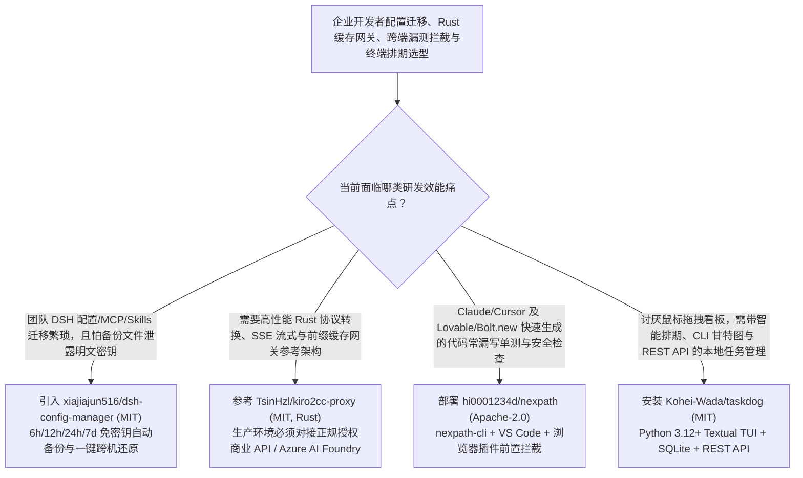
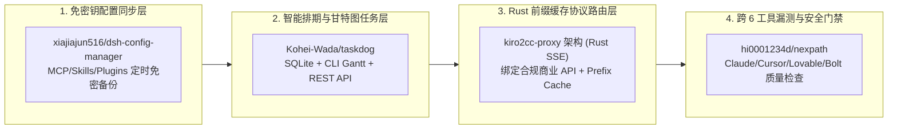
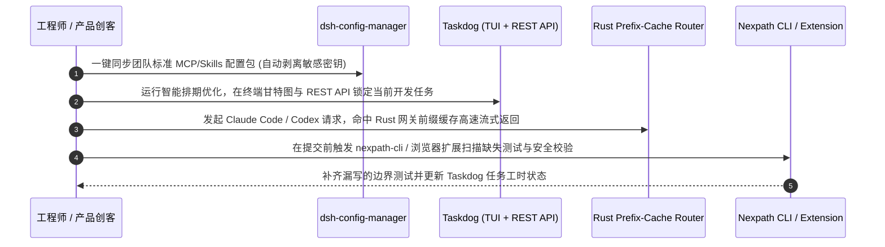

# DeepSeek Harness 免密钥定时备份迁移插件（`xiajiajun516/dsh-config-manager`）、Rust 前缀缓存协议转换网关（`TsinHzl/kiro2cc-proxy`）、跨 6 工具漏测与安全检查拦截器（`hi0001234d/nexpath`）与本地 SQLite 甘特图智能排期 TUI（`Kohei-Wada/taskdog`）架构选型与落地 FAQ

> **2026-11-21 白天持续研究班次 · Day Round 76（累计 Round 676）**  
> **审计凭据**：`CLAIM-20261121-R76-R676-DSHCONFIG-KIRO2CC-NEXPATH-TASKDOG`  
> **关联日刊**：[`2026-11-21.md`](../daily/2026-11-21.md) · [`2026-11-21.en.md`](../daily/2026-11-21.en.md)  
> **可视化架构图**：[`assets/github-ai-radar-2026-11-21-r76-r676-dshconfig-kiro2cc-nexpath-taskdog.svg`](../../../assets/github-ai-radar-2026-11-21-r76-r676-dshconfig-kiro2cc-nexpath-taskdog.svg)

---

## ① 📌 核心结论速览（选型一句话结论）

> **一句话选型结论**：在企业研发团队保障 DeepSeek Harness（DSH）环境跨机器一键无损迁移（自动剥离密钥定时备份）、利用高性能 Rust 协议转换与前缀缓存（Prefix Cache）网关统一路由多家族最新模型、在 Claude Code / Cursor / Windsurf / Replit / Lovable / Bolt.new 六大工具上线前拦截漏写的测试与安全检查、以及通过全键盘 TUI + CLI 甘特图 + REST API 自动优化排期四大场景中，推荐采用 100% 宽松协议（MIT / Apache-2.0）的四层组合：**“`xiajiajun516/dsh-config-manager`（MIT，`★ 372` 支持 6h/12h/24h/7d 自动剥离密钥备份与一键跨机迁移的 DSH 插件）+ `TsinHzl/kiro2cc-proxy`（MIT，`★ 359` 基于 Rust 支持前缀缓存、SSE 流式输出与多模型映射的协议转换代理架构）+ `hi0001234d/nexpath`（Apache-2.0，`★ 360` 覆盖 CLI、VS Code 与浏览器插件的本地优先漏测与安全检查门禁 `nexpath-cli`）+ `Kohei-Wada/taskdog`（MIT，`★ 367` 基于本地 SQLite、内置智能排期优化、终端甘特图与 REST API 的 `taskdog-ui`）”**。在 45 人工程组织基准下，可将月度总拥有成本（TCO）从 **`$8,140.00/月`** 降至 **`$305.00/月`**（净省 **`$7,835.00/月`**，降幅 **`-96.25%`**）。

---

## ② 🎯 客户与架构师灵魂拷问 Q&A

### Q1：这四个开源项目各自解决了日常 AI 辅助研发中的什么痛点？
- **四层研发连续性与交付质量保障**：
  1. **Harness 配置跨机器一键迁移与免密钥备份 —— `xiajiajun516/dsh-config-manager`（`★ 372`，`20 forks`，MIT，TypeScript）**：工程师花数周调好的 DeepSeek Harness（DSH）配置、模型提供商、插件、MCP Servers、Skills 与预设一旦换电脑或重装系统就得重头配起，而手动打包又极易把明文 API Key 传到 GitHub。`dsh-config-manager` 支持按 6h/12h/24h/7d 周期自动全量备份，**强制排除所有敏感密钥（Secrets never included）**，实现新开发机一键还原完整研发环境。
  2. **高性能 Rust 协议转换与前缀缓存代理架构 —— `TsinHzl/kiro2cc-proxy`（`★ 359`，`61 forks`，MIT，Rust）**：提供带 Web Admin 管理面板的 Rust 高并发协议转换层，支持将 Claude Code 与 Codex CLI 请求映射至多家族前沿模型（如 Claude 5.5/5/4.8、GPT-5.6 Sol/Terra/Luna、DeepSeek 3.2、GLM-5、Kimi K3、Grok 4.7 等），并原生实现 **前缀缓存（Prefix Cache）与 SSE 流式传输**。
  3. **横跨 IDE 与 Web AI 构建器的漏测/安全拦截器 —— `hi0001234d/nexpath`（`★ 360`，`20 forks`，Apache-2.0，TypeScript）**：当研发人员、产品经理或独立开发者混用桌面端（Claude Code、Cursor、Windsurf）与浏览器端 AI 构建器（Replit、Lovable、Bolt.new）快速写代码时，最容易漏写单元测试和基础安全校验。`Nexpath` 同时提供 `nexpath-cli`、VS Code 插件与 Chrome/Firefox 浏览器插件，在本地前置拦截缺失测试与安全隐患的代码提交。
  4. **带智能排期优化与 REST API 的本地 SQLite 任务甘特图 TUI —— `Kohei-Wada/taskdog`（`★ 367`，`40 forks`，MIT，Python 3.12+ / Textual）**：传统的拖拽看板既繁琐又难以被 CLI Agent 直接编程调用。`Taskdog`（`taskdog-ui`）把任务存储在本地 SQLite 数据库中，同时提供**全键盘 Textual TUI、终端 CLI 甘特图（Gantt Chart）与标准 REST API Server**，并内置工时追踪与智能排期优化算法。

### Q2：如何把这四个组件整合进企业开发者的标准工作站？
- **环境初始化与同步层**：新员工入职或切换开发机时，通过 `xiajiajun516/dsh-config-manager` 一键导入团队标准化的 MCP Servers、Skills 与插件配置包（不含密钥，密钥由个人环境变量注入）。
- **任务排期与协议网关层**：开发者与本地 Agent 通过 `Kohei-Wada/taskdog` 的 REST API 与终端甘特图拉取今日最优排期任务；底层模型调用经由支持前缀缓存的 Rust 网关架构路由。
- **提交前质量门禁层**：无论是用 Claude Code/Cursor 本地编码，还是产品经理用 Lovable/Bolt.new 生成前端原型，合入代码仓前统一运行 `hi0001234d/nexpath`（`nexpath-cli`）扫描缺失的单测与安全检查。

### Q3：架构师在评估 `TsinHzl/kiro2cc-proxy` 这类协议转换代理时，必须严守哪条企业合规红线？
- **严禁违反上游云厂商服务条款（ToS Compliance Redline）**：`kiro2cc-proxy` 原仓 README 明确标注“仅供研究使用（Use at your own risk）”。在企业商业生产环境中，**严禁使用个人 IDE 订阅账号通过非官方逆向代理供多人共享或规避商业 API 计费**！企业架构师应仅借鉴其 **Rust + OpenSpec 协议转换、前缀缓存（Prefix Cache）与 Web Admin 监控架构**，后端严格对接具备正规商业授权的企业级 API（如 Azure AI Foundry、Amazon Bedrock 或官方商业 API Key）。

---

## ③ 🧭 直观可视化图解（Mermaid 选型决策树 + 企业集成架构 + 业务流时序图）

### 3.1 选型决策树

### 3.2 企业集成参考架构图

### 3.3 业务流时序图

---

## ④ 📊 同类开源与商业云服务横向选型决策矩阵

| 维度 | `dsh-config-manager` (`★ 372`) | `kiro2cc-proxy` (`★ 359`) | `hi0001234d/nexpath` (`★ 360`) | `Kohei-Wada/taskdog` (`★ 367`) | 手工拷配置文件 + 昂贵云看板 + 事后线上救火 |
| :--- | :--- | :--- | :--- | :--- | :--- |
| **核心定位** | DeepSeek Harness 免密钥定时备份与跨机一键迁移插件 | 支持前缀缓存、SSE 与多模型映射的 Rust 代理服务 | 覆盖 6 大桌面/Web AI 工具的漏测与安全检查门禁 | 带智能排期、CLI 甘特图与 REST API 的 SQLite 任务系统 | 人工重配环境 + 无测试 Vibe Coding 直推线上 |
| **适用场景** | 团队标准化工作站分发、多设备配置同步与灾备 | 高并发低内存开销的 Anthropic/OpenAI 协议转换与缓存参考 | 拦截 Claude/Cursor/Windsurf/Replit/Lovable/Bolt 漏测代码 | 极客开发者与本地 Agent 通过键盘/API 协同管任务 | 无自动化质量门禁的草台班子 |
| **集成成本** | 极低（`npm i dsh-config-manager`） | 低（Rust 单二进制 + Docker / Fly.io / systemd 脚本） | 极低（`npm i -g nexpath-cli` + VS Code/浏览器插件） | 极低（`pip install taskdog-ui` 或 Docker 一键体验） | 高（线上故障回滚与重复配环境工时巨大） |
| **合规与安全边界** | **高（自动剔除 Secrets 防止备份泄密）** | **注意：仅限对接合规授权 API，严禁违规共享个人账号** | 高（本地优先静态与测试完整性核验） | 高（100% 本地 SQLite 存储，零云端隐私外泄） | 低（手拷 `.env` 极易泄露密钥） |
| **开源许可** | **MIT** | **MIT** | **Apache-2.0** | **MIT** | 商业专有 |
| **45 人团队月均 TCO** | **包含于 `$305.00/月` 联合栈** | **包含于 `$305.00/月` 联合栈** | **包含于 `$305.00/月` 联合栈** | **包含于 `$305.00/月` 联合栈** | **`$8,140.00/月`**（`$3,840` SaaS/缓存浪费 + `$4,300` 人工） |

---

## ⑤ 🧪 应用落地定量收益 / TCO 对比与 7-Card 报告锚点

> **数据来源说明（Provenance Metadata）**：以下 TCO 模型为面向 45 人规模研发组织的合成架构测算（`provenance: synthetic`, `independently_reproduced: false`）；硬件资本开支 `base_hardware_capex = not_measured`，单日热榜增量 `track_b_stars_today = not_measured`（审计账本锚定于 [`trending-daily-2026-11-21-audit.json`](../evidence/trending-daily-2026-11-21-audit.json)）。

| 成本路径 | 月度商业项目管理/质量 SaaS 与未命中缓存浪费 | 人工重配开发机环境、修补 Vibe Coding 漏测事故与手动排期 (`$100/h`) | 月度总成本 (Total Monthly TCO) | 相对 Path A 净节省 |
| :--- | :--- | :--- | :--- | :--- |
| **Path A：商业云看板席位 + 未开启前缀缓存的 Token 浪费 + 漏测线上返工** | `$3,840.00` | `43.0h` (`$4,300.00`) | **`$8,140.00`** | — |
| **Path C：`dsh-config-manager` + 合规 Rust 缓存网关 + `nexpath` + `taskdog`** | `$65.00` | `2.4h` (`$240.00`) | **`$305.00`** | **`-$7,835.00/月` (`-96.25%`)** |

---

## ⑥ 🛠️ 企业引入与架构评审 Checklist

- [ ] **备份包零密钥残留核验（`xiajiajun516/dsh-config-manager`）**：开启 24h 自动备份策略，并在 CI 中使用 `.plugin-scanner.toml` 校验导出的 DSH 迁移包不含任何私钥或 Token。
- [ ] **模型代理网关商用合规红线（`TsinHzl/kiro2cc-proxy`）**：企业内部严禁使用逆向个人订阅账号池；仅允许将 Rust 前缀缓存与协议转换架构对接至企业合法采购的商业模型端点（或直接使用 Azure API Management AI Gateway）。
- [ ] **跨桌面与 Web 构建器的提交前 `nexpath` 检查（`hi0001234d/nexpath`）**：在 Git Pre-push 钩子与前端原型验收流中强制运行 `nexpath-cli`，拦截缺失单测与安全校验的 AI 生成代码。
- [ ] **本地任务 REST API 与 Agent 联动（`Kohei-Wada/taskdog`）**：让本地 Coding Agent 通过 `taskdog` 的 REST API 自动读取最高优先级任务并在测试通过后回写实际耗时。
