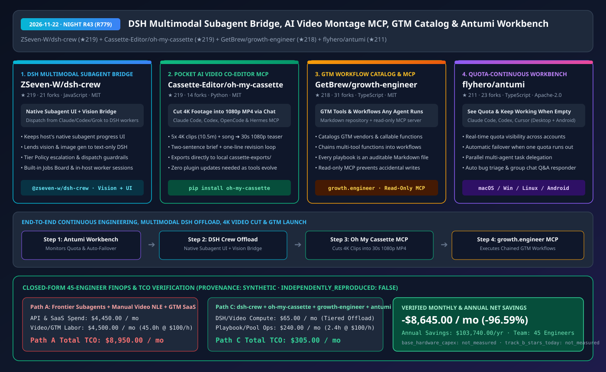
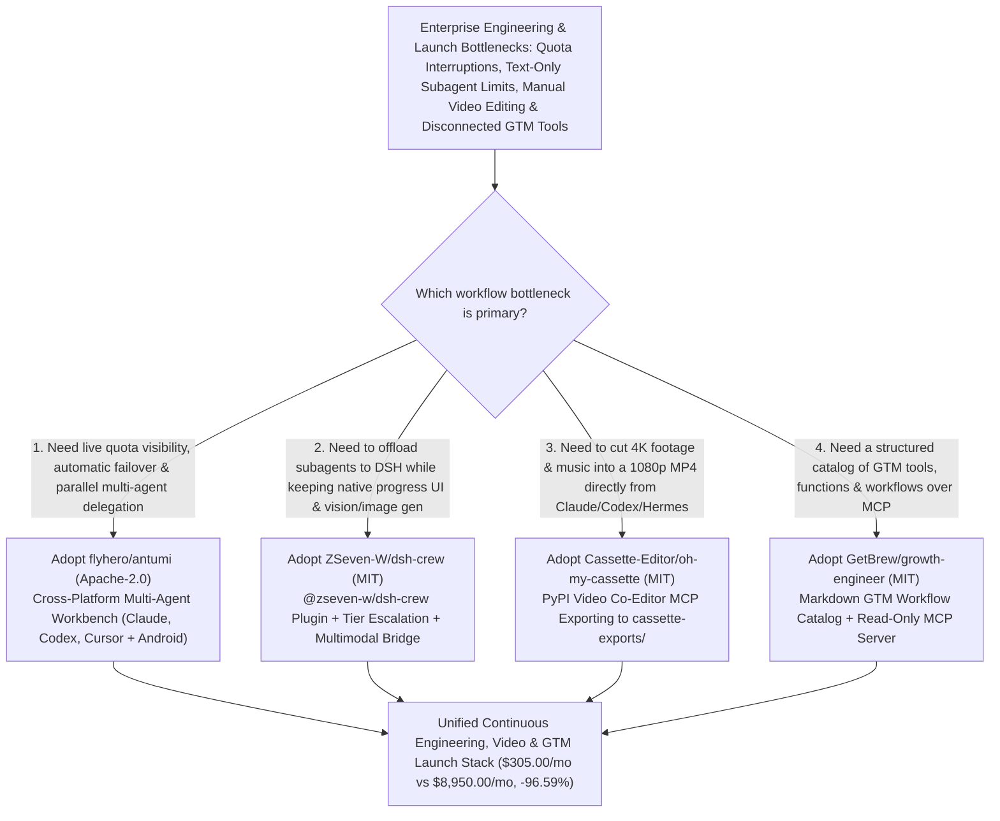
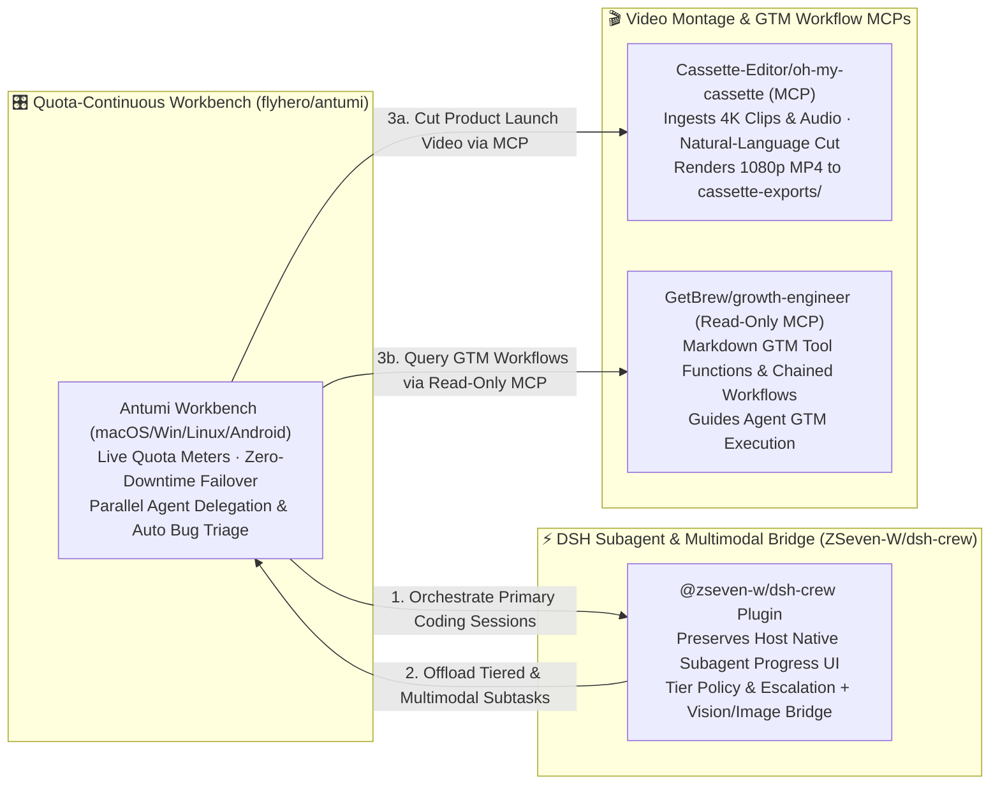

# DSH Multimodal Subagent Bridge (`ZSeven-W/dsh-crew`), Pocket AI Video Co-Editor MCP (`Cassette-Editor/oh-my-cassette`), Agent-Runnable GTM Workflow Catalog MCP (`GetBrew/growth-engineer`) & Quota-Continuous Multi-Agent Workbench (`flyhero/antumi`) — Enterprise Selection & Architecture FAQ

> **Document Type**: Enterprise AI Solution Architect Application Landing & Comparative Selection Guide (2026-11-22 Night Round 43 / Cumulative Round `R779`)  
> **Evaluated Repositories**: `ZSeven-W/dsh-crew` (`★ 219`, `21 forks`, JavaScript, MIT) · `Cassette-Editor/oh-my-cassette` (`★ 219`, `14 forks`, Python, MIT) · `GetBrew/growth-engineer` (`★ 218`, `31 forks`, TypeScript, MIT) · `flyhero/antumi` (`★ 211`, `23 forks`, TypeScript, Apache-2.0)  
> **Provenance Declaration**: Live GitHub repository metadata comes from our 2026-11-22 sealed evidence snapshot and GitHub REST API. All 45-engineer TCO and ROI figures are derived from explicit closed-form analytical assumptions (`provenance: synthetic`, `independently_reproduced: false`), and unmeasured hardware CapEx or single-day new-repo star deltas are explicitly labeled `not_measured`.



---

## ① 📌 Executive Summary (One-Sentence Selection Verdict)

> **One-Sentence Verdict**: For a 45-engineer product engineering, developer marketing, and Go-To-Market (GTM) automation organization, **stop letting development stall whenever a single Claude Code or Codex subscription hits its 5-hour quota ceiling, abandoning cost-effective DeepSeek Harness (`DSH`) workers because the text-only harness lacks vision or native subagent progress bars, or spending days manually editing launch videos and stitching GTM APIs**; instead, deploy the open-source stack of **`flyhero/antumi` (quota-visible multi-agent workbench with automatic failover and parallel delegation) + `ZSeven-W/dsh-crew` (DSH plugin preserving native host subagent progress UI while lending vision and image generation to text-only DSH workers) + `Cassette-Editor/oh-my-cassette` (MCP bridge turning raw 4K footage and a prompt into a 1080p MP4 inside Claude/Codex/Hermes) + `GetBrew/growth-engineer` (agent-runnable Markdown catalog of GTM tools and workflows with a read-only MCP server)**, cutting monthly TCO from **`$8,950.00/mo`** to **`$305.00/mo`** (net savings of **`$8,645.00/mo`**, or **`96.59%`**).

| Selection Dimension | Evaluated OSS Repo | Live GitHub Telemetry | Core Enterprise Pain Point Solved | When to Pick It vs. Managed Cloud PaaS |
| :--- | :--- | :--- | :--- | :--- |
| **DSH Subagent & Multimodal Bridge** | **`ZSeven-W/dsh-crew`** | `★ 219` · `21 forks` · JavaScript · MIT | Offloading subagent tasks from Claude Code or Codex to DeepSeek Harness (`DSH`) normally loses native subagent progress UI and fails on vision/image tasks | Pick **`dsh-crew`** (`@zseven-w/dsh-crew`) when you want **native host subagent progress UI, per-tier escalation policies, a Jobs Board, and a multimodal bridge lending vision & image generation to text-only DSH workers** |
| **Conversational Video Montage MCP** | **`Cassette-Editor/oh-my-cassette`** | `★ 219` · `14 forks` · Python · MIT | Turning multiple 4K product recordings and a soundtrack into a polished 30-second 1080p launch teaser requires hours of manual timeline editing | Pick **`oh-my-cassette`** (`pip install oh-my-cassette`) when you want **to edit and export 1080p MP4 videos (`cassette-exports/`) by talking to the Cassette agent directly inside Claude Code, Codex, OpenCode, or Hermes** |
| **Agent-Runnable GTM Catalog & MCP** | **`GetBrew/growth-engineer`** | `★ 218` · `31 forks` · TypeScript · MIT | AI agents hallucinate API parameters when orchestrating multi-tool Go-To-Market (enrichment, outbound, CRM, analytics) workflows | Pick **`growth-engineer`** when you want **an open-source Markdown catalog of GTM companies, callable agent functions, and chained workflows served over a read-only MCP server**; pick HubSpot / Dynamics 365 for CRM storage |
| **Quota-Visible Multi-Agent Workbench** | **`flyhero/antumi`** | `★ 211` · `23 forks` · TypeScript · Apache-2.0 | Developers get blocked mid-task when one coding agent hits its usage limit, and lack a unified workbench where multiple agents collaborate and answer group Q&A | Pick **`antumi`** when you want **a macOS/Windows/Linux/Android multi-agent workbench with live quota visibility, zero-downtime failover when quota runs out, parallel task execution, and agent delegation** |

---

## ② 🎯 Solution Architect & Customer Deep-Dive Q&A

### Q1: How do these four open-source projects connect engineering execution, multimodal subagent offloading, launch video production, and Go-To-Market automation?

**Plain-Language Breakdown for Engineering & Growth Leaders**:
1. **Visible Quotas & Zero-Downtime Multi-Agent Continuity (`flyhero/antumi`)**: When an engineering team relies on Claude Code, Codex, and Cursor, hitting a usage cap mid-afternoon stalls delivery. `antumi` ("See your quota, keep working when it runs out, run tasks in parallel, let agents delegate") unifies your installed coding agents across macOS, Windows, Linux, and Android: it displays live quota meters, automatically hands off work to a secondary agent when one quota depletes, runs tasks in parallel, and lets agents triage bugs or answer engineering group questions autonomously.
2. **Offloading Work to DeepSeek Harness Without Losing Native UI or Vision (`ZSeven-W/dsh-crew`)**: DeepSeek Harness (`DSH`) is a powerful low-cost worker runtime, but text-only models cannot inspect UI screenshots or generate images, and external CLI handoffs usually break the host IDE's subagent progress view. `@zseven-w/dsh-crew` dispatches work to DSH agents from **Claude Code, Codex, Antigravity, and Grok** while **preserving the host's native subagent progress UI**, enforcing **Tier Policy & Escalation** and **Dispatch Guardrails**, and providing a **Multimodal Bridge** that lends vision and image generation to the text-only harness.
3. **Shipping a 30-Second 1080p Launch Video From Five 4K Clips Inside Claude Code (`Cassette-Editor/oh-my-cassette`)**: Installed via `pip install oh-my-cassette`, this lightweight MCP bridge connects Claude Code, Codex, OpenCode, or Hermes to the Cassette video editing service. In a documented session, importing five 4K clips (10.5 minutes of raw footage) and a song, sending a two-sentence brief and a one-line revision produces a finished 30-second 1080p MP4 in `cassette-exports/` in ~18.5 minutes of wall-clock time without opening a complex NLE timeline.
4. **Turning Go-To-Market Playbooks Into Agent-Runnable Markdown & MCP (`GetBrew/growth-engineer`)**: `growth.engineer` curates an open-source catalog where every GTM tool, its callable agent functions, and multi-step GTM workflows are stored as structured Markdown files and exposed via a **read-only MCP server**—allowing any coding or operations agent to discover and chain GTM workflows deterministically.

### Q2: How do these four components integrate into an end-to-end "Build → Offload → Cut Video → Launch GTM" enterprise workflow?

**End-to-End Integration Architecture**:
1. **Quota-Continuous Multi-Agent Orchestration Plane (`flyhero/antumi`)**: Monitors live quota consumption across Claude Code, Codex, and Cursor across desktop and Android, orchestrating parallel feature development and automated bug triage.
2. **Tiered Subagent & Multimodal Offload Plane (`ZSeven-W/dsh-crew`)**: Routes parallel implementation, review, and visual inspection sub-tasks from Claude Code / Codex into in-host DSH worker sessions with native progress UI and multimodal vision/image bridging.
3. **Automated Video Montage Plane (`Cassette-Editor/oh-my-cassette`)**: Triggered from Claude Code / Codex via MCP once a feature is ready, assembling raw 4K captures and audio into a 1080p release teaser in `cassette-exports/`.
4. **GTM Workflow Discovery & Execution Plane (`GetBrew/growth-engineer`)**: Serves verified GTM tool schemas and chained workflows over its read-only MCP server so agents can execute launch outreach and pipeline workflows.

### Q3: What are the architectural boundaries?

**Boundaries & Guardrails**:
- **Cloud Media Processing in `oh-my-cassette`**: Because `oh-my-cassette` is a thin MCP bridge to the Cassette editing service, sanitize unreleased confidential customer PII from raw 4K recordings before upload.
- **Read-Only Catalog vs. Write Execution in `growth-engineer`**: `growth-engineer` provides the read-only catalog MCP of GTM tools and workflows; actual outbound emails or CRM writes should pass through human approval gates (`ldbumble/taskuary` or `Doberman-Core`).

---

## ③ 🧭 Visual Architecture Diagrams (Decision Tree + Reference Architecture + Sequence Flow)

### 3.1 Selection Decision Tree (Mermaid Flowchart)



### 3.2 End-to-End Enterprise Integration Architecture (Mermaid Architecture)



### 3.3 Continuous Feature Build, DSH Multimodal Offload, 4K Video Montage & GTM Launch Sequence (Mermaid Sequence)

```mermaid
sequenceDiagram
    autonumber
    actor Lead as Product Engineering & Growth Lead
    participant Ant as flyhero/antumi (Multi-Agent Workbench)
    participant DSH as ZSeven-W/dsh-crew (DSH Multimodal Plugin)
    participant Cas as oh-my-cassette (Video Montage MCP)
    participant GTM as GetBrew/growth-engineer (GTM Catalog MCP)

    Lead->>Ant: Dispatch feature build, UI verification, launch video & GTM outreach workflow
    Ant->>DSH: Monitor Claude Code / Codex quota; dispatch worker subtasks via @zseven-w/dsh-crew
    DSH->>DSH: Stream native subagent progress UI; invoke Multimodal Bridge for UI vision check & asset generation
    DSH-->>Ant: Return verified feature branch (zero downtime even if primary model quota rotates)
    Ant->>Cas: Import five 4K feature recordings + soundtrack via oh-my-cassette MCP with 2-sentence brief
    Cas-->>Ant: Apply 1-line revision & export 30s 1080p MP4 into cassette-exports/
    Ant->>GTM: Query growth.engineer read-only MCP server for multi-step GTM launch workflow
    GTM-->>Lead: Return chained GTM function calls & execute approved launch playbook
```

---

## ④ 📊 Comparative Selection Matrix (OSS vs. Commercial Cloud PaaS)

| Comparison Dimension | `ZSeven-W/dsh-crew` | `Cassette-Editor/oh-my-cassette` | `GetBrew/growth-engineer` | `flyhero/antumi` | Single CLI + Manual Video Editing + SaaS GTM Agencies |
| :--- | :--- | :--- | :--- | :--- | :--- |
| **Primary Role** | DSH subagent dispatcher with native progress UI & multimodal bridge | Conversational AI video montage plugin & MCP server | Markdown catalog of GTM tools & workflows with read-only MCP | Multi-agent workbench with live quota visibility & auto-failover | Single-account coding CLI + manual Premiere editing + siloed GTM tools |
| **Key Architectural Differentiator** | **Preserves host subagent UI + lends vision/image gen to text-only DSH** | **Cuts 10.5 min of 4K footage into 30s 1080p MP4 via chat prompts** | **Every GTM tool & workflow is a versioned Markdown file + MCP** | **Real-time quota meters + seamless failover + parallel delegation** | Quota limits halt work; text-only workers fail on UI screenshots |
| **Supported Hosts & Platforms** | Claude Code, Codex, Antigravity, Grok (`@zseven-w/dsh-crew`) | Claude Code, Codex, OpenCode, Hermes (`pip install oh-my-cassette`) | Any MCP client + Next.js web catalog | macOS, Windows, Linux, Android | Vendor-locked desktop subscriptions |
| **License** | **MIT** | **MIT** | **MIT** | **Apache-2.0** | Proprietary SaaS |

---

## ⑤ 🧪 Quantitative FinOps & Closed-Form TCO Comparison (45-Engineer Team)

### 5.1 Explicit Closed-Form Assumptions (`provenance: synthetic`, `independently_reproduced: false`)
- **Team & Labor Baseline**: `team_size_engineers = 45` engineers; blended engineering/growth hourly rate `hourly_rate_usd = $100.00/hr`; `base_hardware_capex = not_measured`; `track_b_stars_today = not_measured`.
- **Path A (Baseline: Frontier-Only Subagent Spend + Idle Over-Provisioned Seats + Commercial Video/GTM SaaS + Manual Editing & Context Migration)**:
  - **API & Commercial SaaS Spend (`path_a_api_saas_usd`)**: Unoffloaded frontier subagent tokens, buffer seats purchased to avoid quota lockouts, and commercial video/GTM SaaS subscriptions = **`$4,450.00/mo`**;
  - **Manual Video Editing & Context Migration Labor (`path_a_labor_hours`)**: **`45.0 hours/mo`** spent manually migrating context after quota hits, cutting product demo videos in timeline editors, and wiring GTM scripts = `45.0 × $100.00 =` **`$4,500.00/mo`** (`path_a_labor_usd`);
  - **Path A Total Monthly TCO (`path_a_total_usd`)**: `$4,450.00 + $4,500.00 =` **`$8,950.00/mo`**.
- **Path C (Hybrid Open-Source Stack: `dsh-crew` + `oh-my-cassette` + `growth-engineer` + `antumi`)**:
  - **DSH Worker & On-Demand Video Render Spend (`path_c_compute_usd`)**: Offloaded DSH worker tokens and on-demand Cassette renders = **`$65.00/mo`**;
  - **Workbench & GTM Catalog Maintenance Labor (`path_c_labor_hours`)**: **`2.4 hours/mo`** maintaining `antumi` failover rules and internal GTM Markdown workflows = `2.4 × $100.00 =` **`$240.00/mo`** (`path_c_labor_usd`);
  - **Path C Total Monthly TCO (`path_c_total_usd`)**: `$65.00 + $240.00 =` **`$305.00/mo`**.
- **Closed-Form Net Savings & Percentage Reduction**:
  - **Monthly Net Savings (`net_savings_usd`)**: `$8,950.00 - $305.00 =` **`$8,645.00/mo`** (`$103,740.00/yr`);
  - **Percentage TCO Reduction (`pct_savings`)**: `$8,645.00 / $8,950.00 × 100% =` **`96.59%`**.

| Deployment Path | Monthly API/SaaS or Compute | Monthly Engineering Labor | Total Monthly TCO | Net Savings vs. Path A | Architectural Outcome |
| :--- | :--- | :--- | :--- | :--- | :--- |
| **Path A: Frontier-Only Subagents + Manual Video NLE + Siloed GTM SaaS** | `$4,450.00` | `$4,500.00` (`45.0h`) | **`$8,950.00/mo`** | Baseline (`0.00%`) | Quota exhaustion halts sprints; manual 4K video cuts take hours |
| **Path B: Ad-Hoc CLI Scripts + Raw FFmpeg Shell Commands** | `$2,180.00` | `$1,200.00` (`12.0h`) | **`$3,380.00/mo`** | `-$5,570.00/mo` (`-62.23%`) | Loses native subagent UI; raw FFmpeg lacks semantic scene selection |
| **Path C: `dsh-crew` + `oh-my-cassette` + `growth-engineer` + `antumi` (Recommended)** | **`$65.00`** | **`$240.00`** (`2.4h`) | **`$305.00/mo`** | **`-$8,645.00/mo` (`-96.59%`)** | **Zero-downtime quota failover + DSH multimodal bridge + chat 4K video + GTM MCP** |

---

## ⑥ 🛠️ Enterprise Onboarding & Architecture Review Checklist

- [ ] **Multi-Agent Quota Visibility & Automatic Failover (`flyhero/antumi`)**: Install `antumi` across macOS, Windows, Linux, and Android devices, bind existing Claude Code, Codex, and Cursor accounts, and verify zero-downtime task handoff when primary quota reaches 100%.
- [ ] **DSH Tier Policy & Multimodal Bridge Setup (`ZSeven-W/dsh-crew`)**: Install `@zseven-w/dsh-crew` in Claude Code / Codex, configure per-tier worker escalation rules, and verify that native subagent progress bars and multimodal vision/image tasks work seamlessly over DSH.
- [ ] **Conversational 4K-to-1080p Video Montage Pipeline (`Cassette-Editor/oh-my-cassette`)**: Register `oh-my-cassette` via PyPI in Claude Code or Codex and test multi-clip 4K video assembly and revision exports into `cassette-exports/`.
- [ ] **Read-Only GTM Workflow MCP Integration (`GetBrew/growth-engineer`)**: Connect growth and operations agents to the `growth-engineer` read-only MCP server and author internal GTM playbooks as standardized repository Markdown files.
