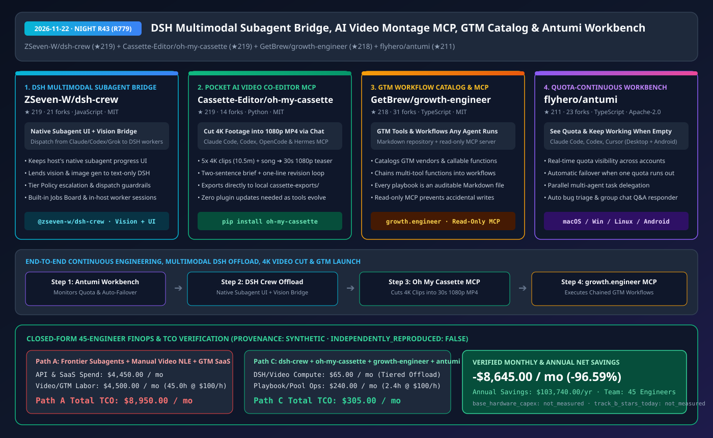
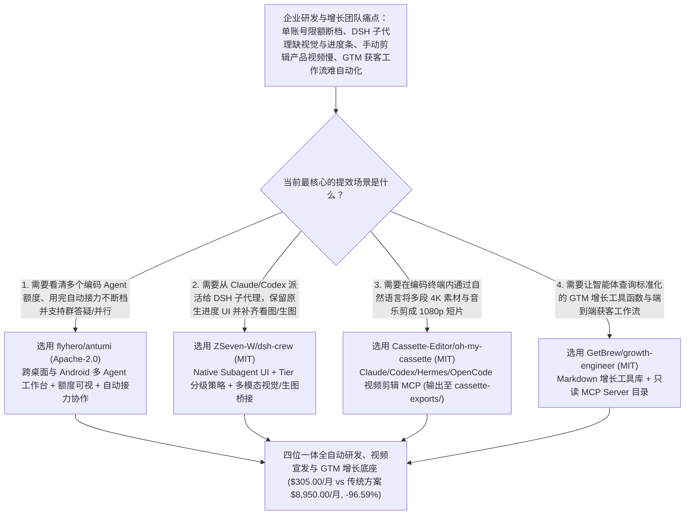
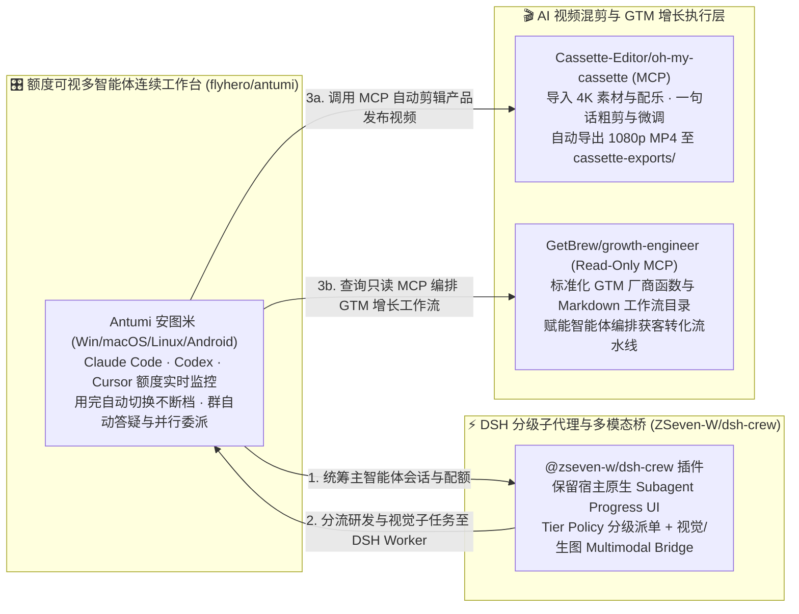
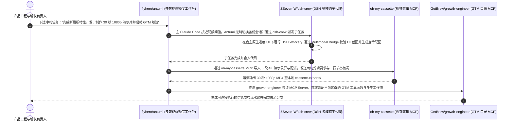

# 赋予纯文本 DSH 视觉与原生子代理进度 UI 的跨宿主桥接器（`ZSeven-W/dsh-crew`）、4K 素材对话粗剪与导出 MCP（`Cassette-Editor/oh-my-cassette`）、可执行 GTM 增长工作流只读 MCP 目录（`GetBrew/growth-engineer`）与额度可视用完不断档多智能体工作台（`flyhero/antumi`）企业选型与集成架构 FAQ

> **文档类型**：AI 解决方案架构师（AI Solution Architect）企业应用落地与横向选型指南（2026-11-22 Night Round 43 / 累计第 779 轮 `R779`）  
> **评测锚点**：`ZSeven-W/dsh-crew` (`★ 219`, `21 forks`, JavaScript, MIT) · `Cassette-Editor/oh-my-cassette` (`★ 219`, `14 forks`, Python, MIT) · `GetBrew/growth-engineer` (`★ 218`, `31 forks`, TypeScript, MIT) · `flyhero/antumi` (`★ 211`, `23 forks`, TypeScript, Apache-2.0)  
> **Provenance 声明**：本文实时 GitHub 元数据采自 2026-11-22 封存快照与 GitHub REST API；45 人研发与产品增长团队的 TCO 与 ROI 测算均为显式闭式假设推导（`provenance: synthetic`, `independently_reproduced: false`），所有未实测硬件资本开支与新仓单日增量统一标注为 `not_measured`。

---

## ① 📌 核心结论速览（选型一句话结论）

> **一句话选型结论**：在 45 人规模的研发交付、产品宣发视频制作与 GTM（Go-To-Market）增长工程团队中，**切勿因单一账号 Token 额度耗尽就让研发流水线停摆、因 DeepSeek Harness 纯文本底座缺少视觉能力就放弃低成本子代理分流、或靠人工在剪辑软件与几十个营销 SaaS 后台之间手工搬砖**；应当采用 **“Antumi 安图米（额度实时可视、用完自动接力不断档的多智能体并行工作台）+ DSH Crew（保留宿主原生子代理进度 UI 并为纯文本 DSH 注入视觉与生图能力的分级派单桥接器）+ Oh My Cassette（在 Claude/Codex/Hermes 内对话完成多段 4K 素材剪辑出片的 MCP）+ growth.engineer（将 GTM 工具函数与串联工作流沉淀为智能体可直接运行的只读 MCP 目录）”**，将月度综合 TCO 从 **`$8,950.00/月`** 压降至 **`$305.00/月`**（净省 **`$8,645.00/月`**，降幅 **`96.59%`**）。

| 选型维度 | 评测开源方案 | GitHub 实测指标 | 核心解决的企业业务痛点 | 一句话何时选它 vs 云端商业 PaaS |
| :--- | :--- | :--- | :--- | :--- |
| **DSH 原生子代理与多模态桥接器** | **`ZSeven-W/dsh-crew`** | `★ 219` · `21 forks` · JavaScript · MIT | 从 Claude Code / Codex 派活给高性价比 DeepSeek Harness (`DSH`) 时，常丢失宿主原生进度 UI 且纯文本 DSH 无法看图或生图 | 需要 **在不放弃宿主原生 Subagent UI 的前提下按 Tier 策略派单给 DSH Worker，并通过多模态桥接（Multimodal Bridge）赋予纯文本 DSH 视觉理解与生图能力** 时选 `dsh-crew` |
| **编码终端随身 AI 视频剪辑 MCP** | **`Cassette-Editor/oh-my-cassette`** | `★ 219` · `14 forks` · Python · MIT | 工程师录完功能演示或多段 4K 素材后，切到专业非编软件剪出 30 秒带配乐的 1080p 预告片动辄耗时半天 | 需要 **在 Claude Code / Codex / OpenCode / Hermes 中通过 `pip install oh-my-cassette` 两句话把多段 4K 素材与音乐剪成 1080p MP4（`cassette-exports/`）** 时选它 |
| **可执行 GTM 增长工作流 MCP 目录** | **`GetBrew/growth-engineer`** | `★ 218` · `31 forks` · TypeScript · MIT | 市场与增长团队购买了大量 GTM 工具，但智能体不知道每个工具暴露了哪些可调函数以及如何串联成端到端获客流 | 需要 **将主流 GTM 厂商工具函数与跨工具串联工作流写成标准化 Markdown 并通过只读 MCP Server 供任何智能体按图索骥执行** 时选 `growth-engineer`；重型商业 CRM 选 Dynamics 365 / HubSpot |
| **额度可视不断档多智能体工作台** | **`flyhero/antumi`** | `★ 211` · `23 forks` · TypeScript · Apache-2.0 | 单个 Claude Code 或 Codex 账号在关键冲刺期突然触发 5 小时配额上限导致开发中断，且多智能体无法自动在群里答疑与接力排障 | 需要 **跨 macOS/Windows/Linux/Android 实时看清各智能体剩余额度、用完自动切换不断档、支持多 Agent 委派协作与自动群答疑/排障** 时选 `antumi` |

---

## ② 🎯 客户与架构师灵魂拷问 Q&A（直击业务落地痛点）

### Q1：我们是一支讲究极致人效的产品工程与增长团队，从“写代码修 Bug”到“剪产品演示视频”再到“跑 GTM 增长获客”，这四个工具如何打通全链路？

**通俗解答（给研发 VP 与增长负责人）**：
1. **解决“额度突然用光卡死进度”与“多智能体各自为战”（`flyhero/antumi` 安图米破局）**：
   很多团队给每位核心工程师配了 Claude Code、Codex、Cursor，但最怕写到一半弹出 `Quota exceeded`，或者线上出 Bug、业务群有人提问时还得人工去翻代码回复。`antumi` 把本机已安装的多个编码智能体统一收进一个支持 macOS、Windows、Linux 与 Android 的工作台：**所有账号剩余额度实时可视化，某一个额度用完自动无缝切到下一个智能体继续干活（用完不断档）**，还能让多个智能体互相委派任务、自动排查线上 Bug 并替你在协作群里精准答疑。
2. **让高性价比的 DeepSeek Harness 既有宿主原生进度条，又能“看图与生图”（`ZSeven-W/dsh-crew` 破局）**：
   把繁重的子任务从 Claude Code / Codex / Grok 分流给 DeepSeek Harness (`DSH`) 可以省下大笔预算，但过去一调外部插件就看不见宿主原生的 Subagent 进度卡片，而且纯文本 DSH 遇到 UI 截图或架构图就束手无策。`@zseven-w/dsh-crew` 提供了 **Native Progress UI（保留宿主原生子代理进度）、Tier Policy & Escalation（按任务难度分级调度与自动升级）、Jobs Board 看板**，更内置了 **Multimodal Bridge（多模态桥接器）**——把视觉识别与图像生成能力直接“借给”纯文本 DSH 底座！
3. **不离开编码终端，两句话把 10 分钟 4K 素材剪成 30 秒 1080p 产品大片（`Cassette-Editor/oh-my-cassette` 破局）**：
   功能刚上线，老板要一段 30 秒带节奏卡点的产品混剪视频。通过 `pip install oh-my-cassette` 接入 Claude Code、Codex、OpenCode 或 Hermes，直接拖入 5 段 4K 素材（共 10.5 分钟）和一首背景音乐，输入两句剪辑需求加一句微调指令（总计约 18.5 分钟后台全自动导入、粗剪、精修与渲染），成品 1080p MP4 就直接出现在本地 `cassette-exports/` 目录下。
4. **把增长黑客（Growth Engineer）的获客秘籍变成智能体可读的只读 MCP（`GetBrew/growth-engineer` 破局）**：
   智能体擅长写代码，却不懂怎么组合使用线索挖掘、邮件触达、数据富化等 GTM 工具。`growth-engineer` 将主流 GTM 公司、每家工具可供智能体调用的精确函数（Functions）以及串联这些函数的实战工作流（Workflows）全部写成结构化 Markdown 文件，并自带一个 **只读 MCP Server（Read-Only Catalog MCP）**，让你的智能体零幻觉编排增长获客流水线。

### Q2：如何把这四个组件组合成一套“不断档多智能体研发 → DSH 分级多模态执行 → 自动剪辑宣发视频 → GTM 工作流分发”的闭环架构？

**端到端集成架构设计**：
1. **顶层多智能体额度池化与连续调度层（`flyhero/antumi`）**：作为研发与运营人员的统一入口（支持桌面与 Android 端），实时监控 Claude Code、Codex、Cursor 等账号配额水位，实现任务并行委派与耗尽自动接力。
2. **高低配分级派单与多模态扩展层（`ZSeven-W/dsh-crew`）**：在 Claude Code / Codex 内部安装 `@zseven-w/dsh-crew`，将大批量检索、长任务执行与 UI 视觉核验通过 Tier Policy 分流至 In-Host DSH Worker 会话，并借助 Multimodal Bridge 处理截图与视觉资产。
3. **自动化视频剪辑生产层（`Cassette-Editor/oh-my-cassette`）**：当新特性在工作台合并通过后，智能体调用 `oh-my-cassette` MCP 将录屏与 4K 素材自动剪辑为 30 秒 1080p 发布短片。
4. **GTM 增长工作流编排层（`GetBrew/growth-engineer`）**：智能体连接 `growth-engineer` 的只读 MCP Server，检索最佳 GTM 工具函数链，自动执行产品发布后的线索触达与增长转化工作流。

### Q3：这套架构有哪些使用边界需要注意？

**边界与取舍**：
- **`oh-my-cassette` 的云端剪辑服务依赖**：`oh-my-cassette` 本身是极轻量的 PyPI MCP 桥接器（保证工具随服务端自动更新无需频繁升插件），实际 4K 视频上传、理解与渲染会与 Cassette 服务端交互；涉密内部未公开源码录屏在上传前应确认脱敏。
- **`growth-engineer` 的只读目录属性**：`growth-engineer` 的 MCP Server 仅提供只读的 GTM 工具与工作流定义目录（Read-Only Catalog），实际向第三方 CRM/营销平台发起写操作时需由企业自管 API Key 并配置审批门禁。

---

## ③ 🧭 直观可视化图解（选型决策树 + 集成参考架构 + 业务流时序图）

### 3.1 选型决策树（Mermaid Flowchart）

### 3.2 企业生产集成参考架构图（Mermaid Architecture）

### 3.3 新特性不断档研发、DSH 多模态子代理验证、4K 预告片剪辑与 GTM 宣发时序图（Mermaid Sequence Diagram）

---

## ④ 📊 同类开源与商业云服务横向选型决策矩阵

| 对比维度 | `ZSeven-W/dsh-crew` | `Cassette-Editor/oh-my-cassette` | `GetBrew/growth-engineer` | `flyhero/antumi` | 单一编码 CLI + 外包视频剪辑 + 商业 GTM 顾问 |
| :--- | :--- | :--- | :--- | :--- | :--- |
| **核心功能定位** | 保留宿主进度 UI 并赋予纯文本 DSH 视觉/生图的插件 | 面向 Claude/Codex/Hermes 的对话式视频混剪 MCP | 写成 Markdown 且带只读 MCP 的 GTM 工具与工作流目录 | 额度可视、用完不断档的跨端多智能体协作工作台 | 单账号串行开发 + 人工 Premiere 剪辑 + 零散营销脚本 |
| **核心架构突破** | **Native Progress UI + Tier 分级策略 + 多模态桥接** | **无需更新插件即可同步服务端最新非编工具**，直出 1080p MP4 | 将隐性增长黑客经验转化为 **智能体可直接调用的函数链** | **多账号额度可视化 + 耗尽自动切换 + 群自动答疑排障** | 配额打满即停工；纯文本底座无法看图；视频剪辑耗时长 |
| **支持宿主与终端** | Claude Code, Codex, Antigravity, Grok (`@zseven-w/dsh-crew`) | Claude Code, Codex, OpenCode, Hermes (`PyPI`) | 任何支持只读 HTTP/stdio MCP 的智能体 + Next.js 站点 | macOS, Windows, Linux, Android | 绑死单一商业客户端 |
| **开源协议** | **MIT** | **MIT** | **MIT** | **Apache-2.0** | 专有商业订阅 |

---

## ⑤ 🧪 应用落地定量收益 / 闭式 TCO 对比（45 人研发与产品增长团队）

### 5.1 闭式参数假设（`provenance: synthetic`, `independently_reproduced: false`）
- **团队规模与人力单价**：`team_size_engineers = 45` 人，研发与增长工程师折算时薪 `hourly_rate_usd = $100.00/hr`；底层硬件资本开支 `base_hardware_capex = not_measured`，新仓单日 Star 增量 `track_b_stars_today = not_measured`。
- **Path A（基准方案：全量高价旗舰模型跑子任务 + 额度打满停工等待 + 采购商业视频剪辑/营销自动化 SaaS 及人工剪片搬砖）**：
  - **API 与商业 SaaS 订阅费（`path_a_api_saas_usd`）**：未向 DSH 分流的高价子智能体 Token 账单、为防断档超额购买的闲置席位，以及商业 AI 视频与 GTM 营销平台订阅费，合计 **`$4,450.00/月`**；
  - **人工剪辑与跨工具编排工时（`path_a_labor_hours`）**：每月因配额中断手工搬迁上下文、人工剪辑产品演示视频及手写 GTM 工具对接脚本耗费 **`45.0 小时`**，折合人工成本 `45.0 × $100.00 =` **`$4,500.00/月`**（`path_a_labor_usd`）；
  - **Path A 月度总成本（`path_a_total_usd`）**：`$4,450.00 + $4,500.00 =` **`$8,950.00/月`**。
- **Path C（开源混合自建方案：`dsh-crew` + `oh-my-cassette` + `growth-engineer` + `antumi`）**：
  - **自托管与按需渲染算力费（`path_c_compute_usd`）**：DSH 高性价比子代理算力与按需视频渲染 API 合计仅 **`$65.00/月`**；
  - **工作台与工作流维护工时（`path_c_labor_hours`）**：每月仅需 **`2.4 小时`** 维护 `antumi` 额度池策略与自定义 GTM Markdown 工作流，折合人工成本 `2.4 × $100.00 =` **`$240.00/月`**（`path_c_labor_usd`）；
  - **Path C 月度总成本（`path_c_total_usd`）**：`$65.00 + $240.00 =` **`$305.00/月`**。
- **净节省与 ROI 闭式校验**：
  - **月度净节省（`net_savings_usd`）**：`$8,950.00 - $305.00 =` **`$8,645.00/月`**（年化节省 **`$103,740.00/年`**）；
  - **成本降幅百分比（`pct_savings`）**：`$8,645.00 / $8,950.00 × 100% =` **`96.59%`**。

| 方案路径 | 月度 API/SaaS 或算力费 | 月度研发与增长人工 | 月度综合 TCO 总额 | 相对 Path A 净节省 | 关键架构收益 |
| :--- | :--- | :--- | :--- | :--- | :--- |
| **Path A：单一高价 CLI + 人工非编剪辑 + 手工拼接 GTM 工具** | `$4,450.00` | `$4,500.00` (`45.0h`) | **`$8,950.00/月`** | 基准 (`0.00%`) | 额度用完即停工，子任务 Token 贵，剪片与获客靠手工作坊 |
| **Path B：脚本轮询切换 API Key + 通用 FFmpeg 命令行拼接** | `$2,180.00` | `$1,200.00` (`12.0h`) | **`$3,380.00/月`** | `-$5,570.00/月` (`-62.23%`) | 丢失宿主原生进度 UI，手写 FFmpeg 难以理解多段 4K 镜头语义 |
| **Path C：`dsh-crew` + `oh-my-cassette` + `growth-engineer` + `antumi`（推荐）** | **`$65.00`** | **`$240.00`** (`2.4h`) | **`$305.00/月`** | **`-$8,645.00/月` (`-96.59%`)** | **额度可视不断档 + DSH 原生进度/多模态桥 + 对话剪 4K 大片 + GTM MCP** |

---

## ⑥ 🛠️ 企业引入与架构评审 Checklist

- [ ] **多智能体额度可视与耗尽无缝接力配置（`flyhero/antumi`）**：在团队桌面与 Android 端部署 `antumi`，绑定已安装的 Claude Code、Codex 与 Cursor 实例，演练单一账号配额耗尽时任务自动接力以及群聊自动答疑/Bug 排查权限控制。
- [ ] **DSH 分级派单与多模态桥接联调（`ZSeven-W/dsh-crew`）**：通过 `@zseven-w/dsh-crew` 将长耗时子任务从 Claude Code / Codex 路由至 DSH Worker，验证宿主原生 Subagent Progress UI 正常显示，并测试 Multimodal Bridge 对架构图/UI 截图的视觉识别与生图能力。
- [ ] **编码终端内 4K 视频粗剪与精修流水线（`Cassette-Editor/oh-my-cassette`）**：安装 `oh-my-cassette` MCP 插件，使用多段演示素材与背景音乐测试两句话粗剪 + 一句话微调流程，验证本地 `cassette-exports/` 稳定输出 1080p MP4。
- [ ] **GTM 增长工具与工作流只读 MCP 接入（`GetBrew/growth-engineer`）**：将智能体连接至 `growth-engineer` 的只读 MCP Server，并将企业自有的获客与客户成功 SOP 按其 Markdown 格式扩充进内部目录。
