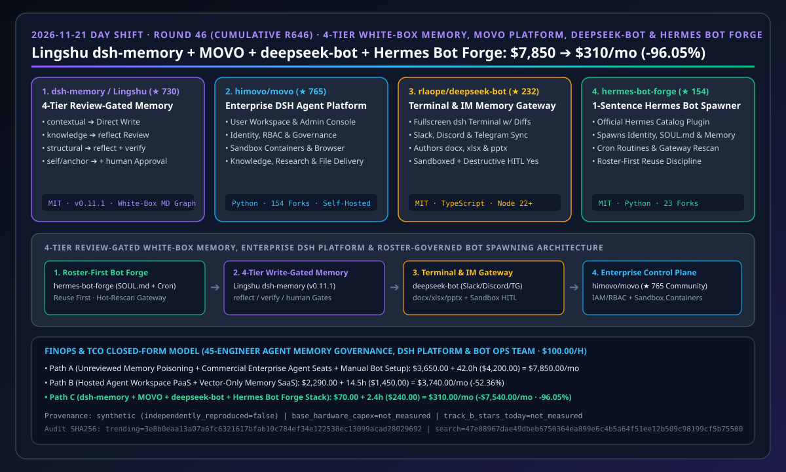
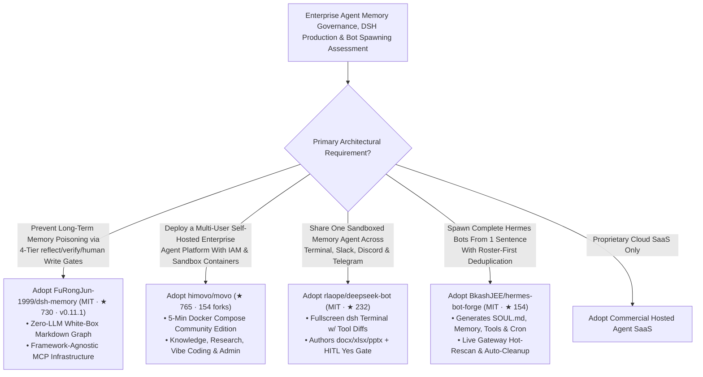
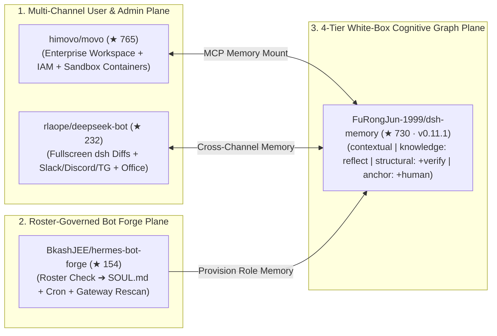
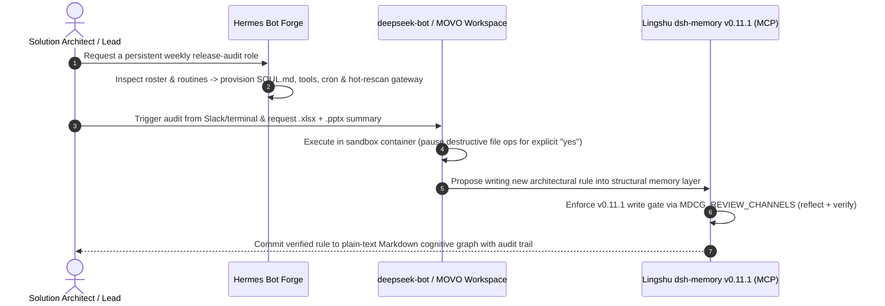

# 4-Tier Review-Gated White-Box Memory (`FuRongJun-1999/dsh-memory`), Self-Hosted Enterprise DSH Platform (`himovo/movo`), Terminal & IM Sandboxed Memory Gateway (`rlaope/deepseek-bot`) & 1-Sentence Hermes Bot Spawner (`BkashJEE/hermes-bot-forge`) Selection FAQ

> **Document Metadata (2026-11-21 Day Shift Round 46 · Cumulative Round 646 Deep-Dive)**  
> - **Target Audience**: Enterprise AI Solution Architects, Long-Term Memory & Multi-Agent Platform Architects, and Engineering Productivity Leads  
> - **Evaluated Repositories**:  
>   1. [`FuRongJun-1999/dsh-memory`](https://github.com/FuRongJun-1999/dsh-memory) (`★ 730` · `71 forks` · Python/Node · MIT · **Lingshu (`灵枢 v0.11.1`)**: Framework-agnostic MCP long-term memory infrastructure storing conversations as a plain-text Markdown cognitive graph governed by a **zero-LLM white-box pipeline** and **4-tier review-gated writes** [`contextual` direct, `knowledge` requires `reflect`, `structural` requires `reflect + verify`, `self/anchor` adds `human` approval])  
>   2. [`himovo/movo`](https://github.com/himovo/movo) (`★ 765` · `154 forks` · Python · **MOVO Community Edition**: Self-hosted enterprise Agent platform built on DeepSeek Harness (`DSH runs the Agent; MOVO brings the Agent into enterprise production`) with user workspaces, enterprise knowledge, IAM/RBAC, sandbox containers, and governance controls)  
>   3. [`rlaope/deepseek-bot`](https://github.com/rlaope/deepseek-bot) (`★ 232` · `25 forks` · TypeScript · MIT · **deepseek-bot**: Always-on agentic memory & gateway across fullscreen terminal [`dsh` with inline tool diffs], **Slack, Discord, and Telegram**, authoring `.docx`/`.xlsx`/`.pptx` in a sandbox while holding destructive commands for an explicit `yes`)  
>   4. [`BkashJEE/hermes-bot-forge`](https://github.com/BkashJEE/hermes-bot-forge) (`★ 154` · `23 forks` · Python · MIT · **Hermes Bot Forge (`hermes plugins install bot-forge`)**: Official NousResearch Hermes catalog plugin that spawns a complete Bot Mode profile [Identity, `SOUL.md`, memory, tools/skills, cron routines, and live gateway hot-rescan] from one sentence while enforcing **roster-first reuse**)  
> - **Sealed Evidence Chain**: `workshops/github-trending-radar/evidence/search-new-repos-2026-11-21-raw.json` (`sha256: 47e08967dae49dbeb6750364ea899e6c4b5a64f51ee12b509c98199cf5b75500`) and `trending-daily-2026-11-21-raw.html` (`sha256: 3e8b0eaa13a07a6fc6321617bfab10c784ef34e122538ec13099acad28029692`)  
> - **Architecture Visual**: [`assets/github-ai-radar-2026-11-21-r46-r646-dshmemory-movo-deepseekbot-hermesbotforge.svg`](../../../assets/github-ai-radar-2026-11-21-r46-r646-dshmemory-movo-deepseekbot-hermesbotforge.svg) · [中文版 (`dsh-memory-movo-deepseek-bot-hermes-bot-forge-selection-faq.md`)](dsh-memory-movo-deepseek-bot-hermes-bot-forge-selection-faq.md)

---

## ① 📌 Executive Summary (One-Sentence Selection Verdict)

> **Solution Architect's Verdict**:  
> Taking open-source agent harnesses (such as DeepSeek Harness and NousResearch Hermes Agent) into multi-user production exposes four governance gaps: **(1) unreviewed memory writes let a single hallucinated conclusion poison the reusable knowledge layer for months, (2) raw local harnesses lack multi-user workspaces, IAM, and container sandboxes, (3) developers want one persistent agent accessible across both a diff-aware fullscreen terminal and Slack/Discord/Telegram with native Office file creation, and (4) teams spawn redundant bots without checking existing rosters or gateway state**.  
> - **For a framework-agnostic MCP long-term memory system (`v0.11.1`) with a zero-LLM white-box Markdown cognitive graph and 4-tier write gates (`reflect` / `verify` / `human`)** ➔ Choose **`FuRongJun-1999/dsh-memory`** (MIT, `★ 730`);  
> - **To turn DeepSeek Harness into a self-hosted enterprise platform with workspaces, knowledge bases, IAM, governance, and sandbox containers** ➔ Choose **`himovo/movo`** (`★ 765`, `154 forks`);  
> - **For an always-on agentic memory & gateway spanning fullscreen terminal (`dsh`), Slack, Discord, and Telegram with `.docx/.xlsx/.pptx` authoring and HITL sandbox gates** ➔ Choose **`rlaope/deepseek-bot`** (MIT, `★ 232`);  
> - **To spawn complete Hermes Agent Bot profiles (`SOUL.md`, memory, tools, cron routines, gateway hot-rescan) from one sentence after roster-first deduplication** ➔ Choose **`BkashJEE/hermes-bot-forge`** (MIT, `★ 154`).  
> Together, this stack cuts monthly memory-poisoning debugging, commercial enterprise agent seat fees, and manual bot provisioning TCO for a 45-engineer team from **$7,850.00/mo** to **$310.00/mo (-$7,540.00/mo, -96.05%)**.

---

## ② 🎯 Solution Architect & Customer Deep-Dive Q&A

### Q1: Why did `FuRongJun-1999/dsh-memory` (`★ 730`, Lingshu `v0.11.1`) make memory writes fail by default on higher tiers unless reviewed?
- **`FuRongJun-1999/dsh-memory` (4-Tier Review-Gated White-Box Cognitive Graph)**:
  1. **Preventing Knowledge-Layer Poisoning**: Once an entry is written to the `knowledge` or `structural` layer, future sessions retrieve it as a reusable conclusion. Allowing unverified writes lets a single bad inference corrupt downstream reasoning.
  2. **Deterministic 4-Tier Write Policy (`v0.11.0+`)**:
     - `contextual`: written directly;
     - `knowledge`: requires `reflect` review (rejected if review channel is undeclared);
     - `structural`: requires `reflect + verify`;
     - `self / anchor`: requires `reflect + verify + human` approval (configured via `MDCG_REVIEW_CHANNELS=hive,subagent` and `MDCG_REVIEWERS=reflect,verify,human`).
  3. **Zero-LLM White-Box Pipeline**: Stores memory as auditable plain-text Markdown cognitive graphs and exposes standard MCP tools compatible with any agent framework.

### Q2: How do `himovo/movo` (`★ 765`) and `rlaope/deepseek-bot` (`★ 232`) serve enterprise teams vs. terminal/IM power users on top of DeepSeek Harness?
- **`himovo/movo` (Self-Hosted Enterprise Agent Production Platform)**:
  - Divides responsibilities cleanly—*"DSH runs the Agent; MOVO brings the Agent into enterprise production"*—adding a 5-minute Docker Compose deployment with multi-user web workspaces, enterprise knowledge, deep research, vibe coding, browser automation, isolated sandbox containers (`SANDBOX_CONTAINERS.md`), and admin governance.
- **`rlaope/deepseek-bot` (Terminal + Slack/Discord/Telegram Memory Gateway)**:
  - Provides one persistent agent across a fullscreen terminal (`dsh` showing streaming answers and inline tool diffs) and Slack, Discord, and Telegram—capable of writing `.docx`, `.xlsx`, and `.pptx` files, reading links via headless browser, and holding any destructive sandbox command for a `yes` in chat.

### Q3: How does `BkashJEE/hermes-bot-forge` (`★ 154`) automate Hermes Bot provisioning while preventing bot sprawl?
- **`BkashJEE/hermes-bot-forge` (Official Hermes Plugin Catalog Spawner)**:
  - Provisions a complete Bot Mode profile from one sentence: Proper Case identity + blob face, tailored `SOUL.md`, starter memory, file/web/browser tools, optional cron routines, Bot Chat intro, and live gateway hot-rescan (with automatic cleanup on creation failure).
  - Enforces **Roster-First Reuse**: checks existing Bots, skills, and routines before creating a new profile, and explicitly reminds architects that **profiles isolate responsibility/state, not security sandboxes**.

---

## ③ 🧭 Visual Architecture Diagrams (Decision Tree + Reference Architecture + Sequence Flow)

### 3.1 Solution Architect Selection Decision Tree (Mermaid Flowchart)

### 3.2 4-Tier Review-Gated White-Box Memory, Enterprise DSH Platform & Roster-Governed Bot Spawning Architecture (Mermaid Architecture)

### 3.3 Roster-Checked Bot Provisioning, Sandboxed Office Generation & 4-Tier Memory Review Sequence (Mermaid Sequence Diagram)

---

## ④ 📊 Horizontal Selection Matrix (Open-Source Quartet vs. Ungated Vector Memory & Cloud SaaS)

| Dimension | `FuRongJun-1999/dsh-memory` (`★ 730`) | `himovo/movo` (`★ 765`) | `rlaope/deepseek-bot` (`★ 232`) | `BkashJEE/hermes-bot-forge` (`★ 154`) | Ungated Vector Memory & Per-Seat Cloud SaaS |
| :--- | :--- | :--- | :--- | :--- | :--- |
| **Primary Role** | 4-tier review-gated white-box Markdown memory MCP | Self-hosted enterprise DSH production platform | Fullscreen terminal + Slack/Discord/TG memory gateway | 1-sentence Hermes Bot Mode provisioning plugin | Unverified vector dumps & proprietary SaaS |
| **Best-Fit Scenario** | Preventing hallucinated conclusions from poisoning long-term agent memory | Multi-user enterprise rollouts needing IAM, knowledge & sandboxes | Developers wanting one persistent agent across terminal & IMs | Rapidly provisioning persistent Hermes Bots without config toil | Throwaway single-session chatbots |
| **Key Differentiator** | **4-tier `reflect / verify / human` write gates + zero-LLM white-box pipeline** | Complete user workspace, admin console & sandbox containers | Terminal tool diffs + `.docx/.xlsx/.pptx` creation + HITL `yes` gate | **Roster-first reuse check** + `SOUL.md`/cron generation + gateway rescan | Unchecked vector writes compound errors over time |
| **Integration & Ops Effort** | Very Low (standard MCP server over plain-text `.md` files) | Low (5-minute Docker Compose v2 setup) | Very Low (`install.sh` + `dsh` CLI) | Very Low (`hermes plugins install bot-forge`) | High (manual memory pruning & recurring per-seat SaaS bills) |
| **License** | MIT | Open-Source Community Edition | MIT | MIT | Proprietary |
| **45-Eng Monthly TCO** | **Combined `$310.00/mo`** (`$70` shared container host + `2.4h` ops) | Included (self-hosted multi-user workspace) | Included (bridges terminal, Slack, Discord & Telegram) | Included (automated bot provisioning & cleanup) | **`$3,740.00 – $7,850.00/mo`** |

---

## ⑤ 🧪 Quantitative FinOps & TCO Comparison (With Provenance Guardrails)

> **Provenance & Guardrails Declaration**:  
> - `provenance`: `"synthetic"` (`independently_reproduced: false`, closed-form FinOps model for a 45-engineer agent memory governance, enterprise DSH platform, and bot operations team at `$100.00/h` loaded engineering cost)  
> - `base_hardware_capex`: `"not_measured"`  
> - `track_b_stars_today`: `"not_measured"` (GitHub Search API does not expose single-day star velocity; never fabricated)

| Cost Component (45-Engineer Team / Month) | Path A: Unreviewed Memory Poisoning + Commercial Enterprise Agent Seats + Manual Bot Setup | Path B: Hosted Agent Workspace PaaS + Vector-Only Memory SaaS | Path C: `dsh-memory` + `MOVO` + `deepseek-bot` + `hermes-bot-forge` Stack |
| :--- | :--- | :--- | :--- |
| **Enterprise Agent SaaS Seats & Poisoned-Context Re-Run Tokens** | `$3,650.00 / mo` | `$2,290.00 / mo` | **`$70.00 / mo`** (shared container host + `$0` zero-LLM white-box memory) |
| **Memory De-Poisoning, Custom IAM/IM Wrappers & Bot Setup** | `42.0 hours / mo` | `14.5 hours / mo` | **`2.4 hours / mo`** (4-tier write gates + MOVO admin + 1-sentence bot forge) |
| **Engineering Labor Cost (`$100.00/h`)** | `$4,200.00 / mo` | `$1,450.00 / mo` | **`$240.00 / mo`** |
| **Total Monthly TCO** | **`$7,850.00 / mo`** | **`$3,740.00 / mo`** | **`$310.00 / mo`** |
| **Net Monthly Savings vs. Path A** | Baseline (`0.00%`) | `-$4,110.00 / mo` (`-52.36%`) | **`-$7,540.00 / mo` (`-96.05%`)** |

---

## ⑥ 🛠️ Enterprise Adoption & Architecture Review Checklist

- [ ] **Enforce 4-Tier Write Review Gates in Production (`FuRongJun-1999/dsh-memory`)**: Configure `MDCG_REVIEW_CHANNELS=hive,subagent` and `MDCG_REVIEWERS=reflect,verify,human` on Lingshu `v0.11.1` (avoiding permanent `MDCG_WRITE_GATE=warn` in production) so `knowledge`, `structural`, and `self/anchor` layers stay unpolluted.
- [ ] **Isolate Enterprise DSH Workloads in Sandbox Containers (`himovo/movo`)**: Deploy MOVO Community Edition with container sandboxes (`SANDBOX_CONTAINERS.md`) and RBAC governance for multi-team rollouts.
- [ ] **Gate Destructive Terminal & IM Actions With Explicit Confirmation (`rlaope/deepseek-bot`)**: Keep sandbox execution enabled across `dsh`, Slack, Discord, and Telegram so destructive operations wait for an explicit `yes`.
- [ ] **Audit Roster Reuse Before Spawning New Hermes Profiles (`BkashJEE/hermes-bot-forge`)**: Require roster inspection before creating new Bot Mode profiles and pair profiles with OS/container sandboxes for untrusted code execution.
