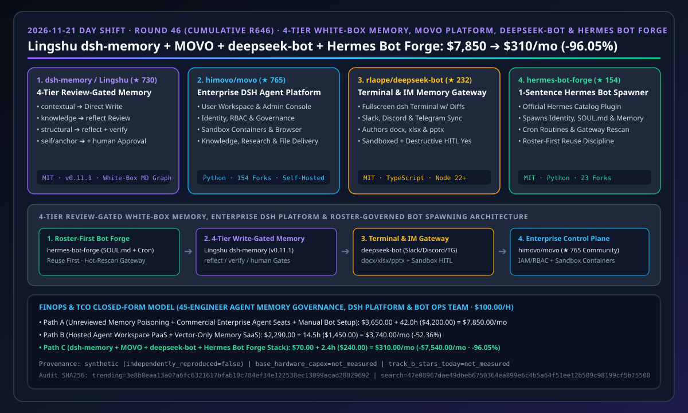
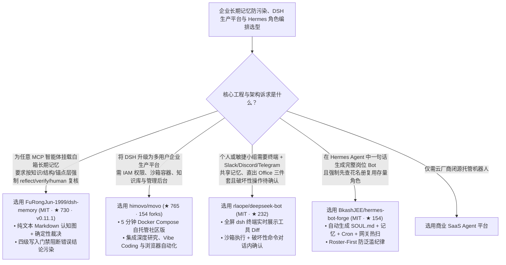
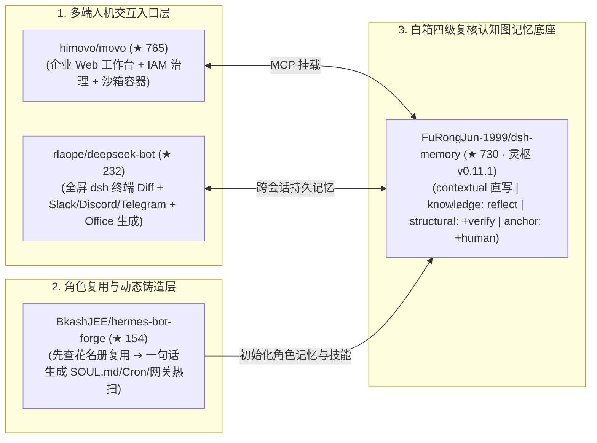
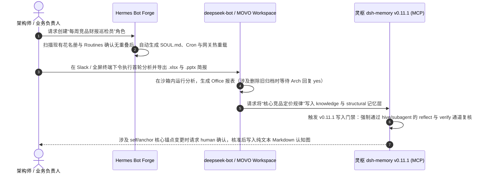

# 四级复核门禁白箱认知图记忆（`FuRongJun-1999/dsh-memory`）、自托管企业级 DSH 生产平台（`himovo/movo`）、全屏终端与 IM 沙箱记忆网关（`rlaope/deepseek-bot`）与一句话生成完整 Hermes 机器人插件（`BkashJEE/hermes-bot-forge`）选型 FAQ

> **文档元数据（2026-11-21 白班 Day Round 46 · 累计第 646 轮深潜专题）**  
> - **面向对象**：企业 AI 解决方案架构师（AI Solution Architect）、长期记忆与多智能体平台架构师、研发效能负责人  
> - **本轮核心评估对象**：  
>   1. [`FuRongJun-1999/dsh-memory`](https://github.com/FuRongJun-1999/dsh-memory)（`★ 730` · `71 forks` · Python/Node · MIT · **灵枢 LINGSHU `v0.11.1`**：面向任意 MCP 智能体的零 LLM 白箱纯文本 Markdown 认知图长期记忆基础设施，自 `0.11.0` 起引入**四级分层写入复核门禁**[`contextual` 直写、`knowledge` 需 `reflect`、`structural` 需 `reflect+verify`、`self/anchor` 再加 `human` 人工审批]）  
>   2. [`himovo/movo`](https://github.com/himovo/movo)（`★ 765` · `154 forks` · Python · **MOVO Community Edition**：基于 DeepSeek Harness（DSH）构建的自托管企业级 Agent 生产平台，提供多用户工作区、企业知识库、IAM 权限治理、沙箱容器与管理后台）  
>   3. [`rlaope/deepseek-bot`](https://github.com/rlaope/deepseek-bot)（`★ 232` · `25 forks` · TypeScript · MIT · **deepseek-bot**：面向 DSH 的常驻记忆与多端网关，打通全屏终端 `dsh`[实时展示工具 Diff]、**Slack、Discord 与 Telegram**，原生读写 `.docx`/`.xlsx`/`.pptx` 并在沙箱中对破坏性动作强制等待对话内 `yes` 确认）  
>   4. [`BkashJEE/hermes-bot-forge`](https://github.com/BkashJEE/hermes-bot-forge)（`★ 154` · `23 forks` · Python · MIT · **Hermes Bot Forge**：NousResearch Hermes Agent 官方插件目录收录插件——说一句“make me a `<role>`”即可自动创建包含专属名称头像、`SOUL.md`、初始记忆、工具/技能、定时任务（Routines）与网关热重载的完整 Bot，并强制执行**先查花名册复用（Roster-First Reuse）**原则）  
> - **关联检索证据链**：`workshops/github-trending-radar/evidence/search-new-repos-2026-11-21-raw.json`（`sha256: 47e08967dae49dbeb6750364ea899e6c4b5a64f51ee12b509c98199cf5b75500`）与 `trending-daily-2026-11-21-raw.html`（`sha256: 3e8b0eaa13a07a6fc6321617bfab10c784ef34e122538ec13099acad28029692`）  
> - **高清架构图**：[`assets/github-ai-radar-2026-11-21-r46-r646-dshmemory-movo-deepseekbot-hermesbotforge.svg`](../../../assets/github-ai-radar-2026-11-21-r46-r646-dshmemory-movo-deepseekbot-hermesbotforge.svg) · [English Version (`dsh-memory-movo-deepseek-bot-hermes-bot-forge-selection-faq.en.md`)](dsh-memory-movo-deepseek-bot-hermes-bot-forge-selection-faq.en.md)

---

## ① 📌 核心结论速览（选型一句话结论）

> **架构师一句话选型结论**：  
> 当企业把 DeepSeek Harness（DSH）与 NousResearch Hermes Agent 等开源智能体运行底座推向多人协同生产时，会立即撞上四个治理痛点：**（1）长期记忆库“有求必应、来者不拒”，单次错误推断写入知识层就会污染未来几个月的全部检索判断、（2）开源单机 Harness 缺乏企业级多租户工作空间、身份权限（IAM）与容器沙箱管理面、（3）工程师既想在终端看实时代码 Diff，又想在移动端 Slack/Discord/Telegram 里让同一个记得上下文的 Agent 生成 Word/Excel/PPT、（4）团队遇到新任务就盲目新建一堆僵尸 Bot，配置繁琐且角色职责重叠**。  
> - **需要一套与框架解耦（支持任意 MCP 客户端）、纯文本 Markdown 认知图且具备“按记忆层级强制 `reflect / verify / human` 复核后才准落盘”的白箱长期记忆系统** ➔ 选 **`FuRongJun-1999/dsh-memory`**（灵枢 `v0.11.1`，MIT，`★ 730`）；  
> - **需要将单机 DSH 升级为具备企业知识库、深度研究、Vibe Coding、浏览器自动化、容器沙箱与管理员后台的自托管生产平台** ➔ 选 **`himovo/movo`**（`★ 765`，`154 forks`）；  
> - **需要一个跨全屏终端（带实时 Diff）与 Slack/Discord/Telegram 共享长期记忆、能直接生成 `.docx/.xlsx/.pptx` 且破坏性命令强制对话确认的轻量级网关** ➔ 选 **`rlaope/deepseek-bot`**（MIT，`★ 232`）；  
> - **需要在 Hermes Agent 中遵循“先查花名册复用存量角色、确需持久职责隔离时一句话生成完整 `SOUL.md`+记忆+工具+定时任务+网关热加载”** ➔ 选 **`BkashJEE/hermes-bot-forge`**（MIT，`★ 154`）。  
> 四者组合可将 45 人智能体平台、记忆治理与多端协作团队因脏记忆污染导致的排障返工、商业多租户 Agent 平台席位费与手工配置 Bot 总成本从 **$7,850.00/月** 降至 **$310.00/月（节省 $7,540.00/月，降幅 96.05%）**。

---

## ② 🎯 客户与架构师灵魂拷问 Q&A（业务痛点 · 架构集成 · 边界取舍）

### Q1：为什么大多数向量记忆库用得越久，Agent 越容易一本正经地胡说八道？`FuRongJun-1999/dsh-memory`（灵枢 `v0.11.1`，`★ 730`）在 `0.11.0+` 引入的“分层写入复核门禁”是如何从根源阻断记忆投毒与污染的？
- **传统记忆库的致命隐患**：“写记忆永远成功”——一旦模型在某次对话中产生了一条错误归因并写入知识层，后续检索会把它当作“既定事实/可复用结论”反复提取，形成雪球式幻觉污染。
- **灵枢 `v0.11.1` 的四级确定性写入裁决（White-Box Write Gate）**：
  1. **零 LLM 白箱纯文本 Markdown 认知图**：记什么、取什么、能不能写全部由确定性规则裁决，不绑定任何单一框架（任何支持 MCP 的 Agent 均可挂载）；
  2. **按层级递进的复核要求**：
     - `contextual`（上下文层）：直接落盘；
     - `knowledge`（知识层）：**必须经过 `reflect` 复核**（未声明复核通道即拒绝写入）；
     - `structural`（结构层）：**必须经过 `reflect + verify` 双重核验**；
     - `self / anchor`（自我与核心锚点层）：**必须再叠加 `human` 人工确认**！
  3. **生产级通道配置**：通过 `MDCG_REVIEW_CHANNELS=hive,subagent` 与 `MDCG_REVIEWERS=reflect,verify,human` 显式开启多智能体协同复核（严禁在生产环境长期开启只告警不拦截的 `MDCG_WRITE_GATE=warn`）。

### Q2：“DSH 负责跑智能体，MOVO 负责把智能体带进企业生产”——`himovo/movo`（`★ 765`）与 `rlaope/deepseek-bot`（`★ 232`）各自适合什么规模的团队？
- **重型企业平台 vs 极客多端常驻分身的精准分工**：
  - **`himovo/movo`（`★ 765`，`154 forks` · 自托管企业级全功能生产平台）**：
    - 适合需要**多部门共享、统一身份认证（IAM）、企业知识库、深度研究（Deep Research）、内容生成、浏览器自动化、独立沙箱容器（`SANDBOX_CONTAINERS.md`）与管理员治理台**的中大型团队，5 分钟 Docker Compose 即可拉起完整用户端与管理面。
  - **`rlaope/deepseek-bot`（`★ 232` · 终端 `dsh` + Slack/Discord/Telegram 一体化记忆分身）**：
    - 适合追求极简体验的工程师与敏捷小组：一行命令安装后输入 `dsh` 即进入带工具调用 Diff 流式预览的全屏终端；**同一个带持久记忆的 Agent 同时在线响应你的 Slack、Discord 和 Telegram**，内置 `.docx`、`.xlsx`、`.pptx` 文档生成与无头浏览器阅读，且所有命令跑在沙箱中、遇到破坏性操作强制在聊天框等待人类回复 `yes`。

### Q3：团队用 NousResearch Hermes Agent 时，如何既能“一句话拉起一个带定时任务的新岗位 Bot”，又防止 Bot 数量失控？`BkashJEE/hermes-bot-forge`（`★ 154`）是怎么定规矩的？
- **`BkashJEE/hermes-bot-forge`（Hermes 官方插件目录认证 · 一句话铸造 + 花名册复用铁律）**：
  1. **一句话全自动装配**：执行 `hermes plugins install bot-forge` 后，只需描述岗位职责，插件自动生成：**唯一规范命名与头像（Identity）、定制 `SOUL.md`、初始记忆、文件/网页/浏览器工具与技能、定时投递到 Bot Chat 的 Cron Routines，并触发宿主网关热扫描（Hot-Rescan）**，若创建中途失败还会自动清理残留文件。
  2. **强制先查花名册（Roster-First Reuse）与安全边界警示**：内置技能强制要求调用方**先检查现有 Bot 花名册、技能与定时任务**——能复用现有 Owner、临时委派或加一条 Routine 解决的，绝不滥建新 Bot；同时在文档中明确警告架构师：**Bot Profiles 只是职责与状态隔离，绝不是安全沙箱（Profiles are not security sandboxes）**！

---

## ③ 🧭 直观可视化图解（选型决策树 + 企业集成架构 + 业务流时序图）

### 3.1 架构师选型决策树（Mermaid Flowchart）

### 3.2 企业“MOVO 生产控制面 + 灵枢四级复核记忆 + deepseek-bot 多端网关 + Hermes Bot Forge”架构图（Mermaid Architecture）

### 3.3 花名册查重铸造、多端 Office 任务执行与灵枢四级记忆写入复核时序图（Mermaid Sequence Diagram）

---

## ④ 📊 同类开源与商业云服务横向选型决策矩阵

| 评估维度 | `FuRongJun-1999/dsh-memory` (`★ 730`) | `himovo/movo` (`★ 765`) | `rlaope/deepseek-bot` (`★ 232`) | `BkashJEE/hermes-bot-forge` (`★ 154`) | 无门禁向量记忆 + 商业多租户 SaaS |
| :--- | :--- | :--- | :--- | :--- | :--- |
| **核心定位** | 带四级写入复核门禁的白箱 Markdown 认知图记忆 MCP | 基于 DSH 的自托管企业级多租户 Agent 生产平台 | 全屏终端 + Slack/Discord/Telegram 沙箱记忆网关 | Hermes 官方目录收录的一句话完整 Bot 铸造插件 | 盲目全量写入的向量库 + 按席位计费云平台 |
| **最适用场景** | 跨框架（任何 MCP 客户端）需要高可信、可审计、零幻觉污染的长期记忆 | 企业将 DSH 落地为带权限、知识库、沙箱容器的部门级生产力 | 工程师跨终端与 IM 保持同一 Agent 记忆并自动产出 Office 文档 | 在 Hermes Agent 中按需快速孵化带 `SOUL.md` 与定时任务的持久岗位 Bot | 短期一次性对话测试 |
| **关键差异化机制** | **`v0.11.1` 按层强制 `reflect / verify / human` 复核才准写入** + 零 LLM 白箱管线 | 完整补齐企业级工作空间、IAM、治理后台与容器沙箱 | 全屏终端流式展示工具 Diff + 原生生成 `.docx/.xlsx/.pptx` + 破坏性操作确认 | **强制先查花名册防滥建** + 失败自动回滚清理 + 宿主网关热重载 | 一条错误推断即可污染整个向量库；手工配一个新 Bot 需改七八处文件 |
| **集成与运维成本** | 极低（标准 MCP 协议挂载，纯文本 `.md` 可直接用 Git 审计） | 低（Docker Compose 5 分钟一键启动） | 极低（`curl ... | bash` 后直接输入 `dsh`） | 极低（`hermes plugins install bot-forge`） | 高（脏记忆人工清洗成本与商业平台高额年费） |
| **开源协议** | MIT | 开源社区版 | MIT | MIT | 商业专有 |
| **45 人团队月均 TCO** | **组合方案 `$310.00/月`**（共享自托管容器节点 `$70` + 运维 `2.4h`） | 同左（内网自托管零席位溢价） | 同左（复用免费 Slack/Discord/TG 机器人通道） | 同左（一句话完成角色配置与网关热加载） | **`$3,740.00 ~ $7,850.00/月`** |

---

## ⑤ 🧪 应用落地定量收益 / FinOps TCO 对比（含数据血缘声明）

> **数据血缘与严谨性声明（Provenance & Guardrails）**：  
> - `provenance`: `"synthetic"`（`independently_reproduced: false`，基于 45 人智能体长期记忆治理、企业 DSH 生产平台与多角色运维团队在 `$100.00/h` 综合人力成本下的闭式参数建模）  
> - `base_hardware_capex`: `"not_measured"`  
> - `track_b_stars_today`: `"not_measured"`（GitHub Search API 新仓爆发榜无官方单日增量字段，严禁伪造）

| 成本分项（45 人团队 / 月） | Path A：无门禁脏记忆污染重跑 + 商业企业级 Agent 平台席位 + 手工配置多角色 Bot | Path B：托管云 Agent 工作空间 + 商业向量记忆 SaaS | Path C：`dsh-memory` + `MOVO` + `deepseek-bot` + `hermes-bot-forge` 栈 |
| :--- | :--- | :--- | :--- |
| **商业平台席位 / 记忆 API 与脏记忆引发的重复推理 Token 费** | `$3,650.00 / 月` | `$2,290.00 / 月` | **`$70.00 / 月`**（共享自托管容器 + 零 LLM 白箱记忆管线 `$0` 记忆 Token） |
| **清洗被错误结论污染的记忆库、自研权限外壳与手工配 Bot 工时** | `42.0 小时 / 月` | `14.5 小时 / 月` | **`2.4 小时 / 月`**（四级写入复核门禁 + MOVO 开箱后台 + 一句话铸造 Bot） |
| **折算工程人力成本（`$100.00/h`）** | `$4,200.00 / 月` | `$1,450.00 / 月` | **`$240.00 / 月`** |
| **月度总拥有成本（Total Monthly TCO）** | **`$7,850.00 / 月`** | **`$3,740.00 / 月`** | **`$310.00 / 月`** |
| **相对 Path A 净节省额与降幅** | 基准线（`0.00%`） | `-$4,110.00 / 月`（`-52.36%`） | **`-$7,540.00 / 月`（`-96.05%`）** |

---

## ⑥ 🛠️ 企业引入与架构评审 Checklist

- [ ] **开启灵枢 `v0.11.1` 四级记忆写入复核门禁（`FuRongJun-1999/dsh-memory`）**：在生产环境中配置 `MDCG_REVIEW_CHANNELS=hive,subagent` 与 `MDCG_REVIEWERS=reflect,verify,human`（严禁长期开启 `MDCG_WRITE_GATE=warn`），确保写入 `knowledge`、`structural` 与 `self/anchor` 层的每条结论都经过确定性复核。
- [ ] **用 `MOVO` 容器沙箱与权限控制面承载部门级智能体（`himovo/movo`）**：对照 `SANDBOX_CONTAINERS.md` 启用隔离容器，将浏览器自动化与 Vibe Coding 置于受控企业工作空间内。
- [ ] **打通终端与 IM 跨端记忆并开启破坏性命令确认（`rlaope/deepseek-bot`）**：连接 Slack/Discord/Telegram 与终端 `dsh`，确保所有文件删除或高危 Shell 命令必须在对话中获得明确 `yes` 才能执行。
- [ ] **执行“先查花名册复用”纪律并区分 Profile 与安全沙箱（`BkashJEE/hermes-bot-forge`）**：在调用 `bot-forge` 新建 Hermes Bot 前先审查存量角色与定时任务；牢记 Bot Profile 仅提供配置与记忆隔离，涉及不信任代码执行必须配合容器级安全沙箱。
