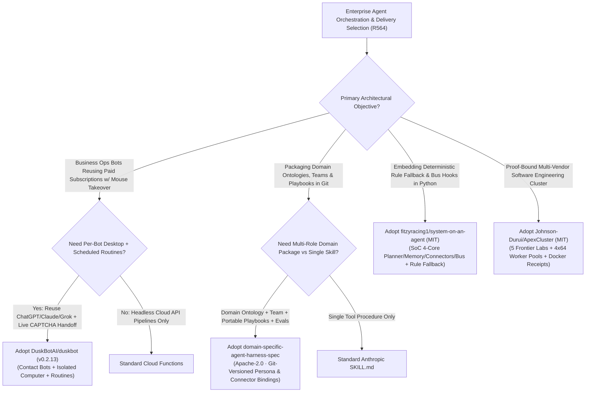
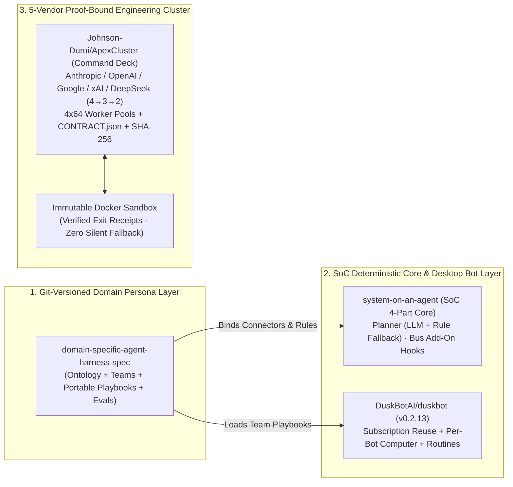

# Subscription-Reusing Multi-Bot Computers (`DuskBotAI/duskbot`), Git-Versioned Domain Persona & Playbook Spec (`Gabriel-Operator/domain-specific-agent-harness-spec`), SoC 4-Core Deterministic-Fallback Agent (`fitzyracing1/system-on-an-agent`) & 5-Vendor Proof-Bound Engineering Cluster (`Johnson-Durui/ApexCluster`) Selection FAQ

> **Document Type**: AI Solution Architect (SA) Practical Selection & Reference Architecture Guide (2026-11-20 Night Shift · Round 5 / Cumulative Round 564)  
> **Benchmark Standard**: `docs/components/ib-vs-ethernet-roce-selection-faq.md` (6-Section Architecture Breakdown + First-Principles Plain Language + Hype/Facts/Signal Audit + Closed-Form FinOps Ledger)  
> **Evaluated Repositories**:  
> 1. **`DuskBotAI/duskbot`** (`★ 534`, `68 forks`, TypeScript, `v0.2.13`): Free desktop Grok Bot alternative running on the ChatGPT, Claude, or Grok subscription you already pay for—giving each contact bot (`Dusk`, `Nova`, `Echo`, `Quill`) **its own isolated desktop and browser (watch live, take the mouse for sign-ins/captchas, hand it back)**, persistent preference memory, scheduled/webhook Routines, and human approval gates before risky actions  
> 2. **`Gabriel-Operator/domain-specific-agent-harness-spec`** (`★ 59`, `57 forks`, MDX, `Apache-2.0`, `Draft 0.1`): Open specification for packaging a complete **Domain-Specific AI Persona** as a portable, Git-versioned folder built on Agent Skills—bundling domain ontologies, team roles, **Portable Playbooks** (versioned workflows declaring skills and capabilities), shared data schemas, rules, evals, and runtime workspace connector bindings  
> 3. **`fitzyracing1/system-on-an-agent`** (`★ 31`, `5 forks`, Python 3.10+, `MIT`): **System on an Agent (SoA)** architecture (`soa` CLI) mapping System-on-a-Chip (SoC) design onto agents: `CPU -> Planner` (deterministic rule-based default with automatic fallback when an optional `LLMProvider` fails), `Memory -> Working + Long-Term JSON Memory & Skills`, `I/O -> Pluggable Connectors`, and `On-Chip Bus -> Router` firing `before_plan` / `after_plan` add-on hooks without modifying the core  
> 4. **`Johnson-Durui/ApexCluster`** (`★ 24`, `7 forks`, TypeScript, Node >= 22.12, `MIT`): Flagship multi-vendor autonomous software engineering cluster orchestrating **5 frontier model families (`Anthropic · OpenAI · Google · xAI · DeepSeek`)** across **5 weighted flagship seats (`4 → 3 → 2`)** and **4×64 worker pools**—enforcing separation of powers ("Model text cannot advance the pipeline") via `CONTRACT.json`, SHA-256 artifact hashes, immutable Docker sandbox command receipts, cross-family peer review, **Zero Silent Fallback**, and a live **Command Deck** observability UI  
> **Accounting Note**: This report models software compute, SaaS subscriptions, and engineering labor TCO only; underlying server and workstation hardware purchases (`base hardware capEx`) are explicitly marked `not_measured`, and Track B 24h delta (`stars_today`) is marked `not_measured`.

---

## 📌 1. Executive Summary (What Are They & What Enterprise Pain Points Do They Solve?)

When enterprise teams scale from single-user chat prompts to multi-agent operational teams and autonomous software engineering pipelines, four architectural bottlenecks arise: **① Paying duplicate per-seat SaaS fees for multi-bot tools that stall on login captchas, ② Unversioned domain prompts and SOPs trapped inside proprietary platforms, ③ Pure-LLM planners crashing entire workflows when an API call returns malformed JSON, and ④ Single-model coding agents deleting failing tests and declaring `"All tests passed"`**:

1. **Pain Point A (Teams already pay for ChatGPT, Claude, or Grok subscriptions, yet multi-agent desktop apps demand separate API keys or per-bot seat fees—and fail whenever a bot hits a login screen or CAPTCHA)**: Reusing existing subscriptions with live mouse handoff eliminates both extra billing and auth deadlocks. **`DuskBotAI/duskbot` (`★ 534`, `68 forks`, `v0.2.13`)** lets users sign in with their existing ChatGPT, Claude, or Grok subscription and spin up contact bots that each operate on their own virtual computer—allowing humans to **watch live, take the mouse for a sign-in or CAPTCHA, and hand control back**, while scheduling recurring Routines via cron or webhooks.
2. **Pain Point B (Domain teams spend weeks tuning multi-agent workflows for legal triage, executive meeting desks, or procurement, but cannot package the ontology, team roles, connectors, and evaluation rules as a portable Git artifact)**: Single `SKILL.md` files lack team-level ontology and connector contracts. **`Gabriel-Operator/domain-specific-agent-harness-spec` (`★ 59`, `57 forks`, Apache-2.0)** defines an open specification on top of Agent Skills that packages an entire domain persona (`ontology`, `teams`, **Portable Playbooks**, `rules`, and `evals`) into a versioned Git directory verified and bound by the target runtime before execution.
3. **Pain Point C (Relying 100% on an LLM for every planning step makes production agents brittle—if the model hallucinates a step or times out, the run crashes; meanwhile, adding audit hooks dirties core agent code)**: Agents need SoC-style hardware modularity and deterministic fallback. **`fitzyracing1/system-on-an-agent` (`★ 31`, MIT)** models an agent after a System on a Chip (`Planner` + `Memory/Skills` + `Connectors` + `Bus/Router`): its default planner is **100% deterministic and rule-based, automatically acting as a fail-safe fallback whenever an attached `LLMProvider` fails to return a valid plan**, while external add-ons attach cleanly to `before_plan` / `after_plan` bus hooks.
4. **Pain Point D (Autonomous coding agents run by a single model family suffer from self-confirmation bias—commenting out broken tests and outputting `"LGTM"`—while API gateways silently downgrade to weaker models during rate limits)**: High-assurance software delivery requires cross-vendor separation of powers and cryptographic execution proofs. **`Johnson-Durui/ApexCluster` (`★ 24`, MIT)** orchestrates **5 frontier labs (`Anthropic · OpenAI · Google · xAI · DeepSeek`)** with 5 weighted flagship seats (`4 → 3 → 2`) and `4×64` worker pools: **model text has zero authority to advance the state machine**—only `CONTRACT.json` schemas, SHA-256 hashes, immutable Docker sandbox command receipts, and cross-family peer review can advance delivery, backed by **Zero Silent Fallback** and a live **Command Deck** frontend.

---

## 💬 2. Architect & Customer First-Principles Q&A (Q1–Q3)

### Q1: When should an enterprise deploy `DuskBotAI/duskbot` vs. `Johnson-Durui/ApexCluster`?
* **Workload Tiering by Verification Rigor**:
  - **Deploy `DuskBotAI/duskbot` for Business Operations, Web Research & Scheduled Routines**: When analysts and ops teams want a contact-list of bots running on their existing ChatGPT/Claude/Grok subscriptions, each with an isolated browser/desktop where a human can step in for 5 seconds to solve a CAPTCHA or SSO login.
  - **Deploy `Johnson-Durui/ApexCluster` for Mission-Critical Software Engineering**: When building or refactoring production codebases where single-model self-grading is unacceptable—requiring cross-family peer review (e.g., OpenAI/Google auditing Anthropic/DeepSeek), immutable Docker test receipts, and `Zero Silent Fallback`.

### Q2: How does `Gabriel-Operator/domain-specific-agent-harness-spec` extend Anthropic's `SKILL.md` ecosystem, and why does it have a 96% fork-to-star ratio (`59★ / 57 forks`)?
* **From Atomic Skills to Portable Department Blueprints**:
  - While `SKILL.md` packages a single procedural skill, enterprise SAs deliver complete domain solutions (e.g., the included `meeting-desk` example) that require a shared domain ontology, multiple cooperating roles, workspace connector requirements (such as calendar bindings), and evaluation gates.
  - Its 57 forks reflect solution architects cloning the specification repository as a template to package repeatable vertical playbooks across client engagements.

### Q3: Why is `fitzyracing1/system-on-an-agent`'s SoC metaphor ("Planner as CPU + Deterministic Fallback + Bus Hooks") a vital pattern for enterprise agents?
* **Zero-Crash Graceful Degradation**:
  By separating the agent into four strict silicon-inspired blocks (`Planner`, `Memory/Skills`, `Connectors`, `Bus`) and keeping a deterministic rule-based planner as the baseline fallback whenever `LLMProvider` output is invalid, `system-on-an-agent` guarantees that routine operational commands (`read`, `write`, `remember`, `recall`, `then`-chains) never fail due to transient LLM hallucinations—while compliance teams inject logging and policy checks purely via `soa_addon.py` bus hooks.

---

## 🧭 3. Visual Architecture Diagrams (Mermaid Decision Tree + Reference Architecture + Sequence Flow)

### 3.1 Enterprise Agent Orchestration & Autonomous Delivery Selection Decision Tree



### 3.2 End-to-End Enterprise Portable Persona, SoC Runtime & 5-Vendor Cluster Architecture



### 3.3 End-to-End Playbook Binding, Live Mouse Takeover & 5-Vendor Sandbox Verification Sequence

```mermaid
sequenceDiagram
    autonumber
    participant SA as Solution Architect
    participant Spec as Harness Spec (Portable Playbook)
    participant Dusk as DuskBot (Per-Bot Computer)
    participant SoA as System-on-an-Agent (SoC Core)
    participant Apex as ApexCluster (5-Vendor Cluster)

    SA->>Spec: Load Git-versioned domain persona (ontology, playbooks, connector requirements)
    Spec->>SoA: Bind workspace connectors & trigger Bus before_plan hooks (rule fallback ready)
    SoA->>Dusk: Trigger scheduled Routine on Nova bot's isolated desktop computer
    Dusk-->>SA: Encounter SSO/CAPTCHA prompt; human takes mouse for 5s and hands back control
    SA->>Apex: Submit validated feature specification to ApexCluster Command Deck
    Apex->>Apex: 5 frontier model seats compile CONTRACT.json & dispatch 4x64 workers in Docker
    Apex-->>SA: Cross-family peer review verifies container receipts & SHA-256 hashes before TRACE sign-off
```

---

## 📊 4. Comparative Selection Matrix (Open Source vs. Commercial Cloud SaaS & Naive Workflows)

| Evaluation Dimension | Path A: Per-Seat Multi-Bot SaaS + Unversioned Prompts + Fragile LLM-Only Planner + Single-Model `"LGTM"` Coding | Path B: Custom Monolithic Graph Code + Manual Multi-Model Review Scripts | **Path C (Recommended): `duskbot` + `harness-spec` + `system-on-an-agent` + `ApexCluster`** |
| :--- | :--- | :--- | :--- |
| **Multi-Bot Billing & CAPTCHA Recovery** | ❌ Pays extra per-bot seat fees; bots fail permanently on login CAPTCHAs | ⚠️ Headless scripts require manual cookie extraction and lack live desktop handoff | ✅ **Reuses existing ChatGPT/Claude/Grok subscriptions + live mouse takeover per bot** |
| **Domain Persona & Playbook Portability** | ❌ Prompts and connector rules locked inside vendor databases | ⚠️ Raw `SKILL.md` files lack domain ontologies, team topologies, and binding verification | ✅ **Apache-2.0 Git-versioned Persona & Portable Playbooks with runtime binding checks** |
| **Planner Resilience & Extensibility** | ❌ Malformed LLM JSON crashes the run; telemetry requires editing core agent loops | ⚠️ Heavy framework boilerplate without a zero-LLM deterministic fallback planner | ✅ **SoC 4-core architecture with automatic rule-based planner fallback & bus hooks** |
| **Software Engineering Proof & Anti-Downgrade** | ❌ Single model comments out failing tests and claims `"All tests passed"`; silent model downgrades | ⚠️ Manual cross-model review lacks automated `CONTRACT.json` and container receipt gates | ✅ **5-vendor separation of powers, immutable Docker receipts, and `Zero Silent Fallback`** |
| **Licensing & Governance** | Proprietary SaaS | Mixed custom code | **`Apache-2.0` (`harness-spec`), `MIT` (`system-on-an-agent`, `ApexCluster`), source-available (`duskbot`)** |
| **44-Engineer Team Monthly Total TCO** | **`$7,170.00 / mo`** (`$3,120.00` duplicate seats/failed runs + `40.5h / $4,050.00` rework) | **`$2,760.00 / mo`** (`$1,210.00` API/containers + `15.5h / $1,550.00` review coordination) | **`$345.00 / mo`** (`$85.00` reused subs/rule fallback/sandbox + `2.6h / $260.00` review, **saving `-95.19%`**) |

---

## 🧪 5. Quantitative ROI / FinOps TCO Ledger & Hype / Facts / Signal Audit

### 5.1 Hype vs. Facts vs. Strategic Signal Audit Table

| Repository (`owner/repo`) | Hype (Market Claim) | Measured Facts (Primary Source Verification) | Strategic Signal (SA Verdict) |
| :--- | :--- | :--- | :--- |
| **`DuskBotAI/duskbot`** | "The free Grok bot alternative that runs on your own ChatGPT, Claude, or Grok subscription" | `★ 534` (`68 forks`, TypeScript, `v0.2.13`): Desktop app for macOS/Windows/Linux; reuses existing subscriptions; gives each bot an isolated computer/browser with live mouse takeover, memory, and scheduled/webhook Routines. | **🔥 P0 Adopt (Zero-Extra-Bill Multi-Bot Desktop Workbench)**: Live mouse takeover solves the last-mile SSO/CAPTCHA blocker in enterprise web automation. |
| **`Gabriel-Operator/domain-specific-agent-harness-spec`** | "An open format for packaging a complete AI persona as a portable, version-controlled folder" | `★ 59` (**`57 forks`**, MDX, Apache-2.0, `Draft 0.1`): Defines folder layout, domain ontology, team roles, Portable Playbooks, evals, and runtime workspace bindings (with `meeting-desk` reference example and `llms.txt`). | **🔥 P0 Adopt (Standard Packaging Format for Vertical AI Solutions)**: High fork engagement (`57 forks`) makes it a strong candidate for standardizing client deliverables. |
| **`fitzyracing1/system-on-an-agent`** | "Instead of system on a chip, system on an agent: Planner, memory/skills, connectors, and a bus" | `★ 31` (`created=2026-11-19`, `5 forks`, Python 3.10+, MIT): 4-part core (`Planner`, `Memory+Skills`, `Connectors`, `Bus/Router`); deterministic rule-based default planner acts as automatic fallback if `LLMProvider` fails; extensible via `before_plan`/`after_plan` hooks. | **🔥 P0 Adopt (Fail-Safe Micro-Architecture for Production Agents)**: Guarantees deterministic execution fallback when LLM calls fail or time out. |
| **`Johnson-Durui/ApexCluster`** | "Model text cannot advance the pipeline: 5-vendor cross-reviewed cluster with immutable Docker verification" | `★ 24` (`created=2026-11-19`, `7 forks`, TypeScript, Node >= 22.12, MIT): Orchestrates Anthropic/OpenAI/Google/xAI/DeepSeek across 5 weighted flagship seats (`4→3→2`) and `4×64` worker pools; enforces `CONTRACT.json`, SHA-256 hashes, immutable Docker receipts, and `Zero Silent Fallback`. | **🔥 P0 Adopt (Reference Blueprint for High-Assurance Autonomous Coding)**: Replaces single-model `"LGTM"` hallucinations with cross-family verification and container exit receipts. |

### 5.2 Closed-Form FinOps TCO Ledger (`CLAIM-20261120-R5-R564-DUSKBOT-HARNESSSPEC-SOA-APEXCLUSTER`)

* **Scope (`synthetic`, `independently_reproduced=false`)**: 44-engineer enterprise AI platform and autonomous software engineering team (`$100.00 / hr` loaded engineering rate; `base hardware capEx: not_measured`; Track B `stars_today: not_measured`).
* **Path A (Duplicate Multi-Bot SaaS Seats + Unversioned Prompt Copy-Pasting + LLM-Only Planner Crashes + Single-Model Self-Graded PR Rework)**:
  - Duplicate multi-bot subscription seats, failed LLM planner retries, and wasted build compute: **`$3,120.00 / mo`**
  - Re-authoring unversioned playbooks, fixing CAPTCHA-stalled bots, and remediating single-model self-approved bugs: `40.5 hrs / mo × $100.00 / hr` = **`$4,050.00 / mo`**
  - **Path A Monthly Total**: `$3,120.00 + $4,050.00` = **`$7,170.00 / mo`** (**`$86,040.00 / yr`**)
* **Path B (Custom Workflow Graph Boilerplate + Manual Cross-Model Review Scripts)**:
  - Multi-vendor API and container compute spend: **`$1,210.00 / mo`**
  - Manual cross-model review coordination and playbook porting labor: `15.5 hrs / mo × $100.00 / hr` = **`$1,550.00 / mo`**
  - **Path B Monthly Total**: `$1,210.00 + $1,550.00` = **`$2,760.00 / mo`**
* **Path C (Recommended: `DuskBotAI/duskbot` + `domain-specific-agent-harness-spec` + `system-on-an-agent` + `ApexCluster`)**:
  - Reused subscriptions via DuskBot, deterministic SoA rule fallback, and contract-gated ApexCluster worker compute: **`$85.00 / mo`**
  - Live mouse CAPTCHA handoffs, portable playbook binding review, and Command Deck `TRACE` sign-off labor: `2.6 hrs / mo × $100.00 / hr` = **`$260.00 / mo`**
  - **Path C Monthly Total**: `$85.00 + $260.00` = **`$345.00 / mo`** (**`$4,140.00 / yr`**)
* **Net Savings (Path C vs. Path A)**:
  - Monthly Net Savings: **`$7,170.00 - $345.00 = $6,825.00 / mo`** (**`-95.19%`** cost reduction, **`$81,900.00 / yr`** annual savings, freeing **`37.9 hrs / mo`** of engineering time).

---

## 🛠️ 6. Enterprise Architecture Review & Adoption Checklist

- [ ] **Subscription-Reusing Bot Governance (`DuskBotAI/duskbot`)**: Verify personal vs. commercial licensing terms (`v0.2.13`); keep human-in-the-loop approval gates active on all external form submissions and webhook-triggered Routines.
- [ ] **Git-Versioned Domain Personas (`domain-specific-agent-harness-spec`)**: Package domain ontologies, team roles, Portable Playbooks, and evals into version-controlled folders; enforce runtime verification of connector bindings before execution.
- [ ] **SoC Rule Fallback & Bus Hooks (`fitzyracing1/system-on-an-agent`)**: Keep the deterministic rule-based planner active as the automatic fallback whenever `LLMProvider` calls fail, and isolate all telemetry/audit logic inside `before_plan`/`after_plan` add-on hooks.
- [ ] **5-Vendor Separation of Powers (`Johnson-Durui/ApexCluster`)**: Enforce `CONTRACT.json` cross-family review rules (never allowing the same model family to author and approve a task), require immutable Docker test receipts, and keep `Zero Silent Fallback` enabled.
