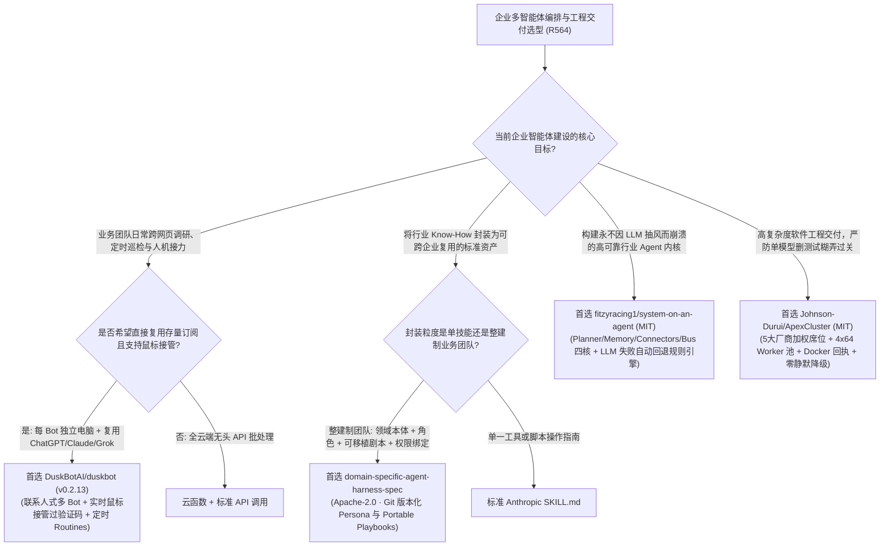
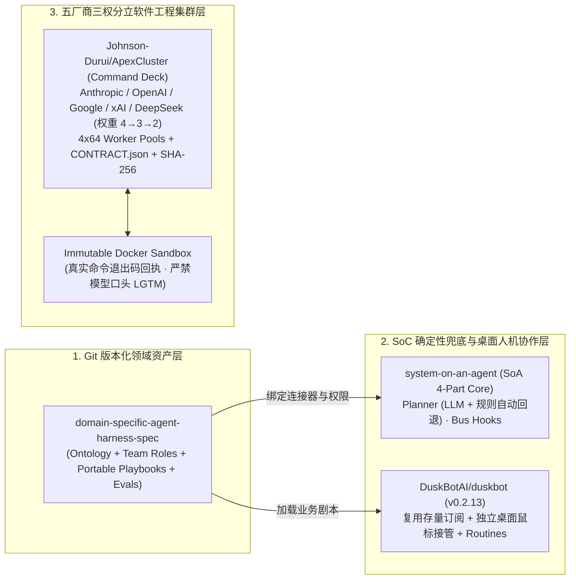
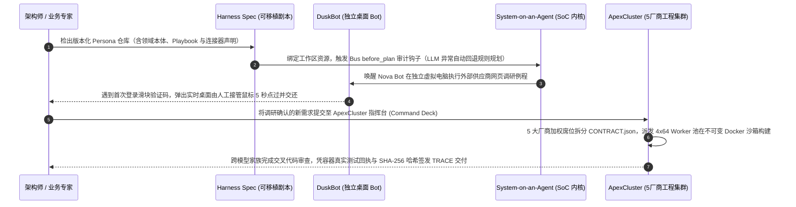

# 复用存量订阅的多 Bot 独立电脑工作台（`DuskBotAI/duskbot`）、Git 版本化领域智能体与可移植剧本规范（`Gabriel-Operator/domain-specific-agent-harness-spec`）、SoC 四核确定性回退智能体架构（`fitzyracing1/system-on-an-agent`）与五厂商三权分立沙箱验证工程集群（`Johnson-Durui/ApexCluster`）选型 FAQ

> **文档类型**：AI Solution Architect（AI 解决方案架构师）实战选型与架构内功指南（2026-11-20 Night Shift · Round 5 / 累计第 564 轮）  
> **对标标杆**：`docs/components/ib-vs-ethernet-roce-selection-faq.md`（六段式架构拆解 + 第一性原理大白话 + Hype/Facts/Signal 审计 + 闭式 TCO 账本）  
> **本轮评估对象**：  
> 1. **`DuskBotAI/duskbot`**（`★ 534`，`68 forks`，TypeScript，`v0.2.13`）：直接复用团队已付费的 ChatGPT、Claude 或 Grok 订阅账号的桌面多 Bot 协同工作台（开源 Grok Bot 平替）——每个联系人 Bot（如 `Dusk`、`Nova`、`Echo`、`Quill`）都拥有**专属的独立电脑桌面与浏览器（支持实时观看、人工接管鼠标完成登录/验证码再交还）**、独立长期偏好记忆、定时/Webhook 触发例程（Routines）以及高危动作前置询问门禁  
> 2. **`Gabriel-Operator/domain-specific-agent-harness-spec`**（`★ 59`，`57 forks`，MDX，Apache-2.0，`Draft 0.1`）：基于 Agent Skills 扩展的**领域特定智能体底座开放规范（Domain-Specific Agent Harness Spec）**——将完整的 AI 业务人设（Persona）打包为可 Git 版本控制的便携式文件夹，统一声明领域本体（Ontology）、团队角色、**可移植剧本（Portable Playbooks）**、共享数据规则、评测集（Evals）及运行时工作区连接器绑定契约  
> 3. **`fitzyracing1/system-on-an-agent`**（`★ 31`，`5 forks`，Python 3.10+，MIT）：借鉴芯片设计（System on a Chip, SoC）第一性原理构建的 **System on an Agent（SoA）** 极简四核架构（`soa` CLI）——将智能体内核收敛为 **Planner（CPU 处理器：默认确定性规则引擎，可选挂载 `LLMProvider` 且在模型规划失败时自动无损回退至规则引擎）**、**Memory + Skills（片上存储）**、**Connectors（I/O 接口）** 与 **Bus / Router（片上总线与 `before_plan`/`after_plan` 插件钩子）**  
> 4. **`Johnson-Durui/ApexCluster`**（`★ 24`，`7 forks`，TypeScript，Node >= 22.12，MIT）：面向复杂软件工程的**五厂商（Anthropic / OpenAI / Google / xAI / DeepSeek）三权分立自治工程集群**——配置 **5 个加权旗舰席位（权重 `4 → 3 → 2`）** 与 **4×64 并发 Worker 算力池**，奉行“**模型文本无权推进流水线**”铁律：唯有程序状态机、`CONTRACT.json` 结构化契约、SHA-256 产物哈希、不可变 Docker 沙箱回执与跨模型家族交叉评审才能推进交付（严禁静默降级 `Zero Silent Fallback`），并附带零后端依赖的 **Command Deck** 实时观测指挥台  
> **审计折算说明**：本报告仅计量软件算力、SaaS 订阅与工程运维人力 TCO，底层服务器与工作站硬件采购（base hardware capEx）显式标注为 `not_measured`，赛道 B 新仓今日增量显式标注为 `not_measured`，严禁捏造坐标。

---

## 📌 一、核心结论速览（Executive Summary：它到底是什么？解决什么业务痛点？）

当企业从“单点试用 AI 聊天框”走向“构建部门级数字员工战队与自治软件交付流水线”时，架构师普遍遭遇四大工程瓶颈——**① 每个多智能体 SaaS 工具都要重复购买 API/席位且遇到图形验证码即卡死、② 业务部门沉淀的 Prompt 与 SOP 散落在个人聊天记录里无法跨环境移植复用、③ 纯大模型驱动的 Planner 一旦输出格式畸形就导致整条业务流崩溃、④ 单模型 Coding Agent 自己写代码自己喊 `"LGTM / All tests passed"` 蒙混过关**：

1. **痛点 A（企业员工已经买了 ChatGPT Plus/Team、Claude Pro 或 Grok 订阅，但使用第三方多 Bot 桌面工具时还要再掏一份高昂的 API Token 账单；且 Bot 在后台操作网页遇到登录滑块或 MFA 验证码时无法人工搭把手）**：复用存量订阅 + 独立桌面随时接管鼠标才是高性价比正解。**`DuskBotAI/duskbot` (`★ 534`, `68 forks`, `v0.2.13`) 的破局之道**：直接登录复用现有的 ChatGPT、Claude 或 Grok 订阅，在侧边栏创建各司其职的联系人 Bot，每个 Bot 拥有独立的电脑与浏览器视图——**遇到登录或验证码时，人直接接管鼠标点完再一键交还给 Bot 继续执行**，并支持按工作日定时（如每天早 8 点）或 Webhook 自动触发例程（Routines）。
2. **痛点 B（法务、投研、行政会议室等垂直业务场景好不容易调通了一套多 Agent 协作流程，换一套底层运行框架或移交给客户环境时，发现角色提示词、日历连接器权限、领域术语表与验收标准全耦合在代码里，根本搬不走）**：技能包（`SKILL.md`）之上还缺一层“领域团队与可移植剧本”封装标准。**`Gabriel-Operator/domain-specific-agent-harness-spec` (`★ 59`, `57 forks`, Apache-2.0) 的破局之道**：提出将完整的业务 AI 团队（Persona）定义为版本化的 Git 文件夹——内含领域本体、团队编制、**声明式可移植剧本（Portable Playbooks）**与评测标准；目标环境的宿主运行时（Runtime）先校验包签名并动态绑定本地日历/数据库权限，再交由底层 Harness 执行，实现“一次定义业务剧本，跨企业环境即插即用”。
3. **痛点 C（在工业级自动化流水线中，如果把所有步骤规划完全交给 LLM，一旦上游 API 抖动或模型返回非法 JSON，整个智能体就会陷入报错死循环；而且每次加审计日志或限流都要去改智能体核心源码）**：智能体需要像芯片（SoC）一样分清“确定性内核”与“外围扩展钩子”。**`fitzyracing1/system-on-an-agent` (`★ 31`, MIT) 的破局之道**：按 SoC 四大件（`Planner` + `Memory/Skills` + `Connectors` + `Bus/Router`）构建内核——**默认采用确定性规则规划器，即使挂载了可选 `LLMProvider`，一旦大模型规划异常也会瞬间回退（Fallback）至确定性规则引擎兜底**；所有安全审计与遥测通过 `soa_addon.py` 挂载到总线的 `before_plan`/`after_plan` 钩子上，内核代码零污染。
4. **痛点 D（复杂软件工程交给单个大模型闭门造车，模型经常为了省事把失败的测试注释掉，然后嘴硬输出 `"All tests passed"`；或者当旗舰模型限流时，网关偷偷降级成弱智小模型把代码改烂）**：工程交付必须实行“跨模型家族三权分立”与“只认容器回执不认嘴炮”。**`Johnson-Durui/ApexCluster` (`★ 24`, MIT) 的破局之道**：同时编排 **Anthropic、OpenAI、Google、xAI、DeepSeek 五大厂商**（5 个加权旗舰席位 `4→3→2` + `4×64` Worker 池）：
   - **三权分立与实证通关**：编写者、审查者与验收者必须来自**不同模型家族**；模型输出的自然语言无权推进状态机，必须凭 `CONTRACT.json`、SHA-256 哈希与**不可变 Docker 沙箱真实退出码回执**通关；
   - **严禁静默降级（Zero Silent Fallback）**：一旦指定旗舰模型不可用，显式告警阻断而非偷偷降级，全程在 **Command Deck 指挥台** 可视化追踪。

---

## 💬 二、客户与架构师灵魂拷问 Q&A（Q1–Q3 First-Principles Deep Dive）

### Q1：在为企业设计多智能体系统时，什么时候用轻量级 `DuskBotAI/duskbot`，什么时候用重型 `Johnson-Durui/ApexCluster`？
* **按“容错成本与交付物属性”分级选型**：
  - **选 `DuskBotAI/duskbot`（日常运营、市场调研、电商比价与个人/小团队助理）**：当任务是每天定时去多个网站搜集价格生成 CSV、整理行程或处理日常办公例程，核心诉求是**零额外 Token 账单（复用现有 ChatGPT/Claude/Grok 账号）+ 遇到验证码能人工接管鼠标**时。
  - **选 `Johnson-Durui/ApexCluster`（核心代码库重构、高可靠软件交付与关键架构演进）**：当交付物是必须上线运行、零容忍单模型幻觉或“删测试凑绿灯”的企业级软件工程时——用五大厂商异构交叉审查 + 不可变 Docker 容器回执 + `CONTRACT.json` 状态机锁死工程质量。

### Q2：`Gabriel-Operator/domain-specific-agent-harness-spec` 与 Anthropic 官方 `SKILL.md` 规范是什么关系？为什么它的 Fork 率高达 96%（59★ / 57 forks）？
* **从“单个工具技能”升级为“整建制业务部门交付包”**：
  - `SKILL.md` 解决的是“教单个 Agent 怎么用一个工具或写某类代码”；但在企业交付中，客户要的是一个完整的**“智能会议办（Meeting Desk）”**或**“智能法务合规组”**——里面包含多个角色的分工、共享的领域词典（Ontology）、必须绑定的外部系统权限（如 Exchange 日历）以及多步审批剧本（Playbooks）。
  - 该规范直接在 Agent Skills 之上定义了标准目录结构与绑定契约，57 个 Fork 正是因为各行业 ISV 与解决方案架构师纷纷 Fork 它的模板去封装各自行业的标准化 AI 交付包。

### Q3：`fitzyracing1/system-on-an-agent` 的“SoC 总线 + 规则回退”模式对企业生产级 Agent 有什么启发？
* **高可用架构的黄金法则——“LLM 只是加速协处理器，确定性状态机才是主 CPU”**：
  在金融、制造与运维自动化中，90% 的常规指令链（`echo/read/write/remember then ...`）完全可以由零延迟、零成本的确定性规则 Planner 执行；只有遇到非结构化模糊意图时才调用 `LLMProvider`，且一旦 LLM 超时或输出越界，系统立即无缝降级回规则 Planner 并通过 Bus 总线钩子发出告警，实现 `99.99%` 的业务连续性。

---

## 🧭 三、直观可视化图解（Mermaid 选型决策树 + 企业集成参考架构 + 业务流时序图）

### 3.1 多 Bot 桌面助理、可移植领域规范、SoC 确定性内核与五厂商工程集群选型决策树

### 3.2 企业级“可移植领域规范 × SoC 内核 × 多厂商验证集群”集成参考架构图

### 3.3 从加载可移植业务剧本、鼠标接管登录到五厂商沙箱交叉验收的时序图

---

## 📊 四、同类开源与商业云服务横向选型决策矩阵（Decision Matrix）

| 评估维度 | 路径 A：按席位付费商业多 Bot SaaS + 散落群聊的复制粘贴 Prompt + 纯 LLM 脆弱规划器 + 单模型自写自审 | 路径 B：重型工作流图框架（LangGraph 自研） + 手工维护 Docker 测试脚本 | **路径 C（推荐）：`duskbot` + `harness-spec` + `system-on-an-agent` + `ApexCluster`** |
| :--- | :--- | :--- | :--- |
| **多 Bot 账号成本与验证码人工接力** | ❌ 商业 SaaS 按每个 Bot/席位重复收月租，遇到登录验证码直接任务失败 | ⚠️ 自写 Playwright 脚本需频繁导出导入 Cookie，非技术人员无法介入 | ✅ **直接复用已付 ChatGPT/Claude/Grok 订阅，独立桌面随时接管鼠标过验证** |
| **行业 Persona 与业务剧本跨环境移植** | ❌ 提示词与连接器硬编码在平台数据库里，迁移环境需全部推倒重写 | ⚠️ 仅能复用单文件 `SKILL.md`，缺乏团队编制、领域本体与权限绑定校验 | ✅ **Apache-2.0 开放规范将本体、团队、Playbook 与 Eval 封装为标准 Git 目录** |
| **规划器容错韧性与插件扩展性** | ❌ LLM 返回格式微瑕即全链路崩溃；加日志需侵入修改核心调度代码 | ⚠️ 节点图过于庞大，缺乏芯片级清晰边界与零成本确定性规则兜底 | ✅ **SoC 四核极简隔离，LLM 失败自动回退确定性规则引擎，`before/after` 钩子扩展** |
| **复杂软件工程防糊弄与防暗降级** | ❌ 单模型常删掉报错单测谎称 `"All tests passed"`；上游限流时偷偷切弱模型 | ⚠️ 人工配置多模型 Review 流程繁琐，缺乏统一 `CONTRACT.json` 与哈希追溯 | ✅ **五厂商跨家族三权分立 + 不可变 Docker 回执 + 零静默降级 + Command Deck** |
| **开源协议与企业自主权** | 商业闭源专有协议 | MIT / Apache-2.0 | **`harness-spec` 为 `Apache-2.0`；`system-on-an-agent` 与 `ApexCluster` 为 `MIT`；`duskbot` 个人免费源码可见** |
| **44 人团队月度综合 TCO** | **`$7,170.00 / 月`**（重复订阅席位与无效重跑算力 `$3,120` + 剧本移植与线上漏测返工 `40.5h / $4,050`） | **`$2,760.00 / 月`**（多模型 API 与容器成本 `$1,210` + 手工跨模型审查协调 `15.5h / $1,550`） | **`$345.00 / 月`**（复用存量订阅 + 规则兜底 + 沙箱实证算力 `$85` + 指挥台终审 `2.6h / $260`，**净省 `-95.19%`**） |

---

## 🧪 五、应用落地定量收益/TCO 对比与 Hype / Facts / Signal 审计账本

### 5.1 Hype vs. Facts vs. Strategic Signal 审计表

| 仓库 (`owner/repo`) | Hype（市场宣传口径） | Measured Facts（一手源码与文档实证事实） | Strategic Signal（架构师选型信号） |
| :--- | :--- | :--- | :--- |
| **`DuskBotAI/duskbot`** | “用你已经付过钱的 ChatGPT/Claude/Grok 订阅，免费拥有一支各有独立电脑的 Bot 团队” | `★ 534`（`68 forks`，TypeScript，`v0.2.13`）：支持 macOS/Windows/Linux；复用现有订阅登录；每个 Bot 具备独立浏览器/桌面（支持实时接管鼠标）、独立记忆与定时/事件触发 Routines。 | **🔥 P0 采纳（业务人员多智能体桌面工作台首选）**：用“实时鼠标接管”优雅化解了企业内网 SSO 登录与验证码拦截难题。 |
| **`Gabriel-Operator/domain-specific-agent-harness-spec`** | “把完整的 AI 行业团队与剧本打包成一个可 Git 版本控制的便携文件夹” | `★ 59`（**`57 forks`**，MDX，Apache-2.0，`Draft 0.1`）：定义领域本体、团队角色、可移植剧本（Portable Playbooks）、评测集与工作区资源绑定规范，提供 `meeting-desk` 完整参考实现与 `llms.txt`。 | **🔥 P0 采纳（企业级 AI 解决方案资产封装标准）**：高达 96% 的 Fork 率证明其正成为架构师跨项目交付行业 Agent 团队的标准信封格式。 |
| **`fitzyracing1/system-on-an-agent`** | “不造芯片造智能体：把 CPU、内存、I/O 和片上总线装进一个零废话 Agent” | `★ 31`（`created=2026-11-19`，`5 forks`，Python 3.10+，MIT）：核心仅含 `Planner`、`Memory+Skills`、`Connectors`、`Bus/Router` 四部分；默认规则规划器零 LLM 即可运行，挂载 LLM 失败时自动回退规则规划；支持 `before_plan`/`after_plan` 等钩子扩展。 | **🔥 P0 采纳（高可靠生产 Agent 内核设计模板）**：“LLM 规划失败自动回退确定性规则 + 总线钩子解耦”是工业级 Agent 防雪崩的教科书设计。 |
| **`Johnson-Durui/ApexCluster`** | “模型文本无权推进流水线：五厂商三权分立、4×64 并发池与不可变 Docker 实证集群” | `★ 24`（`created=2026-11-19`，`7 forks`，TypeScript，Node >= 22.12，MIT）：编排 Anthropic/OpenAI/Google/xAI/DeepSeek 五大厂商（5 个加权席位 `4→3→2` + `4×64` Worker 池）；强制 `CONTRACT.json`、SHA-256 哈希与不可变 Docker 沙箱回执；严禁静默降级，自带纯前端在线可交互 Command Deck 演示。 | **🔥 P0 采纳（大型复杂软件工程自治交付标杆）**：彻底终结单模型“嘴炮通关”与网关偷偷降级导致的代码质量滑坡。 |

### 5.2 闭式 FinOps TCO 核算账本（Claim ID：`CLAIM-20261120-R5-R564-DUSKBOT-HARNESSSPEC-SOA-APEXCLUSTER`）

* **核算范围（Synthetic Parametric Model · `independently_reproduced=false`）**：44 人规模的企业 AI 平台架构与核心研发团队（涵盖日常多网站业务巡检、跨项目行业 Agent 剧本复用、高可靠后台自动化及核心代码库多智能体交付；工程师综合时薪 `$100.00 / hr`；底层服务器与工作站硬件采购成本 `base hardware capEx: not_measured`；赛道 B 新仓今日增量 `stars_today: not_measured`）。
* **路径 A（重复购买商业多 Bot 席位 + 手工复制粘贴业务 Prompt + 纯 LLM 脆弱规划器报错重跑 + 单模型自审漏测返工）**：
  - 商业多 Bot 平台席位费、纯 LLM 规划失败循环重试与无效构建算力浪费：**`$3,120.00 / 月`**
  - 跨项目重写业务 Prompt/连接器、人工排查验证码断流、以及修复单模型“假通过”引入的线上 Bug 人力：`40.5 小时 / 月 × $100.00 / hr` = **`$4,050.00 / 月`**
  - **路径 A 月度总计**：`$3,120.00 + $4,050.00` = **`$7,170.00 / 月`**（年化 **`$86,040.00 / 年`**）
* **路径 B（重型自研工作流图 + 手工维护多模型审查脚本）**：
  - 多模型 API 与容器环境开销：**`$1,210.00 / 月`**
  - 手工协调多模型交叉 Review 与剧本迁移适配人力：`15.5 小时 / 月 × $100.00 / hr` = **`$1,550.00 / 月`**
  - **路径 B 月度总计**：`$1,210.00 + $1,550.00` = **`$2,760.00 / 月`**
* **路径 C（推荐：`DuskBotAI/duskbot` + `domain-specific-agent-harness-spec` + `system-on-an-agent` + `ApexCluster` 闭环）**：
  - `duskbot` 复用存量订阅（`$0` 新增席位费）、`SoA` 确定性规则分流以及 `ApexCluster` 契约门禁下的精准算力消耗：**`$85.00 / 月`**
  - 登录验证码鼠标接管、可移植剧本权限绑定审批与 `ApexCluster` Command Deck 终审签收：`2.6 小时 / 月 × $100.00 / hr` = **`$260.00 / 月`**
  - **路径 C 月度总计**：`$85.00 + $260.00` = **`$345.00 / 月`**（年化 **`$4,140.00 / 年`**）
* **净节省收益（Path C vs. Path A）**：
  - 月度净省：**`$7,170.00 - $345.00 = $6,825.00 / 月`**（成本直降 **`-95.19%`**，年化净省 **`$81,900.00 / 年`**，每月释放 **`37.9 小时`** 架构与研发工时）。

---

## 🛠️ 六、企业引入与架构评审 Checklist（Actionable Adoption Checklist）

- [ ] **桌面多 Bot 订阅复用与接管（`DuskBotAI/duskbot`）**：确认個人免费许可（`free forever for personal use`）与企业商用授权边界；对涉及付款、外发消息与删除文件的 Routines 开启强制人工前置确认。
- [ ] **行业 Persona 标准封装（`domain-specific-agent-harness-spec`）**：按 `Draft 0.1` 规范为每个垂直业务方案建立包含 `ontology`、`teams`、`playbooks` 与 `evals` 的 Git 目录，在部署前由 Runtime 强制校验目标工作区连接器权限。
- [ ] **SoC 规则回退与钩子审计（`fitzyracing1/system-on-an-agent`）**：将高频确定性动作注册为内置规则与 Skills，确保 `LLMProvider` 网络抖动时 100% 自动回退至规则引擎，并通过 `soa_addon.py` 的 `before_plan`/`after_plan` 钩子采集统一审计日志。
- [ ] **五厂商三权分立与零静默降级（`Johnson-Durui/ApexCluster`）**：在 `CONTRACT.json` 中固化编码、审查与验收必须分属不同模型家族的策略，开启不可变 Docker 沙箱回执校验与 `Zero Silent Fallback` 告警。
