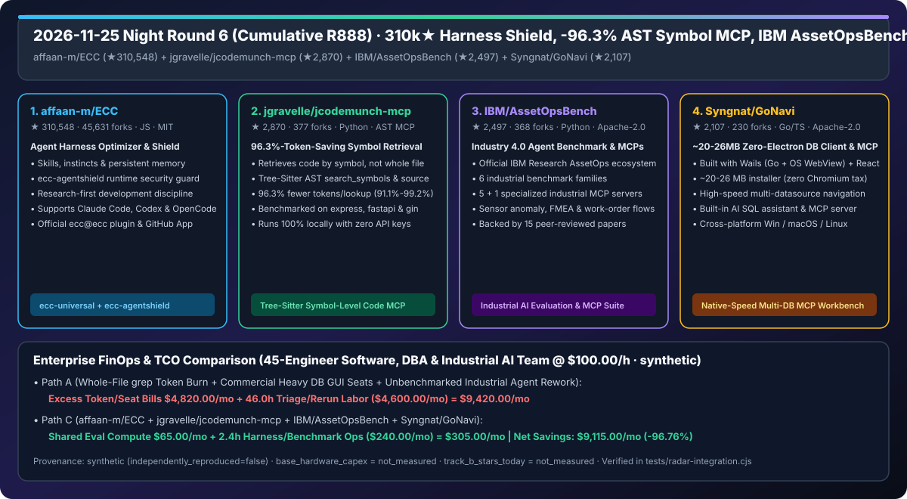
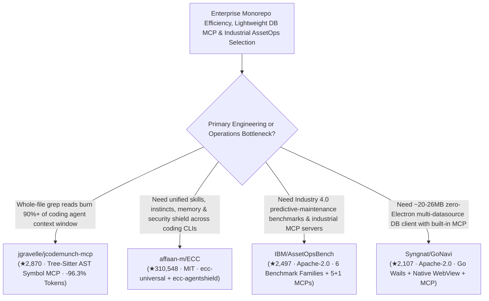
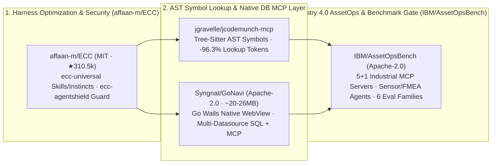
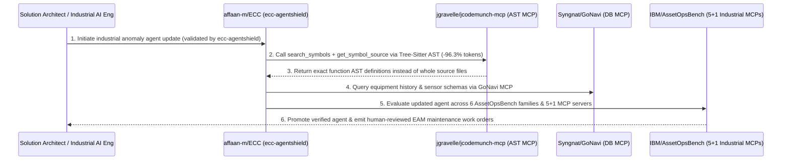

# 310k-Star Agent Harness Optimization & Shield System (`affaan-m/ECC`), 96.3%-Token-Saving Tree-Sitter Symbol MCP (`jgravelle/jcodemunch-mcp`), IBM Industry 4.0 AssetOps Benchmark & 6-MCP Suite (`IBM/AssetOpsBench`) & 20MB Zero-Electron Multi-DB MCP Client (`Syngnat/GoNavi`) Selection & Integration Architecture FAQ

> **Document Type**: Enterprise AI Solution Architect Selection Decision Guide (GitHub Trending AI Radar — 2026-11-25 Night Round 6 / Cumulative Round 888)
> **Covered Repositories**: [`affaan-m/ECC`](https://github.com/affaan-m/ECC) (`★ 310,548`, `45,631 forks`, `MIT`: comprehensive agent harness performance optimization system `ecc-universal` and security shield `ecc-agentshield` providing skills, instincts, memory, security, and research-first workflows for Claude Code, Codex, and OpenCode) · [`jgravelle/jcodemunch-mcp`](https://github.com/jgravelle/jcodemunch-mcp) (`★ 2,870`, `377 forks`: local MCP server that retrieves source code by AST symbol (`search_symbols` + `get_symbol_source`) rather than whole files using Tree-Sitter, reducing token usage per lookup by **`96.3%` on average** [`91.1%` to `99.2%` across a 15-lookup benchmark on `express`, `fastapi`, and `gin` at pinned commits, `anonymized_reported`]) · [`IBM/AssetOpsBench`](https://github.com/IBM/AssetOpsBench) (`★ 2,497`, `368 forks`, `Apache-2.0`: official IBM Research framework and benchmark suite [`arXiv:2506.03828`] with **6 benchmark families and `5 + 1` MCP servers** for building, orchestrating, and evaluating Industry 4.0 predictive maintenance and asset operations agents) · [`Syngnat/GoNavi`](https://github.com/Syngnat/GoNavi) (`★ 2,107`, `230 forks`, `Apache-2.0`: high-performance cross-platform multi-datasource database client built with Wails [Go + native OS WebView] + React featuring **`~20–26 MB` installers**, zero Electron bloat, and native AI/MCP integration)
> **Core Enterprise Scenario**: Solving four critical bottlenecks across large-scale software engineering and industrial AI operations—**whole-file `grep` reads burning 96%+ wasted context tokens, unguarded multi-CLI agent harnesses, unbenchmarked industrial predictive-maintenance agents, and bloated Electron database GUIs**.

---

## 1. 📌 Executive Summary (One-Line Selection Verdict)

1. **Need your coding agents to fetch exact functions and classes via Tree-Sitter AST rather than reading entire files, cutting code-lookup token spend by `96.3%` on average** ➔ Choose **[`jgravelle/jcodemunch-mcp`](https://github.com/jgravelle/jcodemunch-mcp) (`★ 2,870`, `377 forks`)**.
   - **Plain-English Mechanism**: Instead of ranking files by `grep` matches and stuffing three entire multi-thousand-line files into the prompt, `jCodeMunch MCP` parses the AST locally with Tree-Sitter and returns only the requested symbol via `search_symbols` + `get_symbol_source` (`91.1%–99.2%` token reduction verified across `express`, `fastapi`, and `gin` using `tiktoken cl100k_base`, `anonymized_reported`).
2. **Need a battle-tested harness optimization and security layer (`ecc-universal` + `ecc-agentshield`) across Claude Code, Codex, and OpenCode** ➔ Choose **[`affaan-m/ECC`](https://github.com/affaan-m/ECC) (`★ 310,548`, `45,631 forks`, `MIT`)**.
   - **Plain-English Mechanism**: Equips coding agents with structured skills, automatic instincts, persistent memory, research-first development discipline, and runtime security guardrails via the official `ecc@ecc` plugin and `ecc-agentshield`.
3. **Need to build, orchestrate, and rigorously evaluate Industry 4.0 predictive maintenance, sensor anomaly detection, and work-order agents before factory deployment** ➔ Choose **[`IBM/AssetOpsBench`](https://github.com/IBM/AssetOpsBench) (`★ 2,497`, `368 forks`, `Apache-2.0`)**.
   - **Plain-English Mechanism**: Provides IBM Research's open ecosystem (`arXiv:2506.03828`) featuring **6 industrial benchmark families**, Hugging Face datasets, and **`5 + 1` specialized industrial MCP servers** covering telemetry analysis, FMEA failure reasoning, and EAM maintenance workflows.
4. **Need a lightweight (`~20–26 MB` installer), zero-Electron multi-datasource database workbench that serves both human DBAs and AI agents via MCP** ➔ Choose **[`Syngnat/GoNavi`](https://github.com/Syngnat/GoNavi) (`★ 2,107`, `230 forks`, `Apache-2.0`)**.
   - **Plain-English Mechanism**: Built on Wails (Go + native OS WebView) and React rather than bundling a 300MB+ Chromium runtime, giving engineers fast multi-DB navigation alongside built-in AI and MCP query capabilities.

---

## 2. 🎯 Architect & Customer Deep-Dive Q&A

### Q1: How does this open-source stack compare against managed cloud suites (e.g., Azure IoT Operations + Fabric Real-Time Intelligence + GitHub Copilot)?

- **Four-Layer Engineering & Industrial Stack (Path C)**:
  1. **Harness Optimization & Security Shield ➔ `affaan-m/ECC`**: Standardizes research-first skills, instincts, and `ecc-agentshield` guardrails.
  2. **AST Symbol-Level Code Retrieval ➔ `jgravelle/jcodemunch-mcp`**: Slashes code-lookup tokens by `96.3%` across large monorepos.
  3. **Lightweight Multi-Datasource DB & MCP Client ➔ `Syngnat/GoNavi`**: Replaces heavy Electron DB tools with a `~20–26 MB` Go+WebView MCP client.
  4. **Industrial AssetOps Evaluation & 6-MCP Suite ➔ `IBM/AssetOpsBench`**: Grounds predictive maintenance agents in 6 industrial benchmark suites and `5 + 1` MCP servers.
- **When to choose Managed Cloud PaaS vs. Path C?**
  - Choose **Azure IoT Operations + Microsoft Fabric RTI + Dynamics 365 Field Service** for cloud-connected plants standardized on Microsoft's end-to-end telemetry-to-work-order cloud fabric.
  - Choose **Path C** when operating air-gapped/on-prem industrial sites, validating custom multi-agent maintenance logic against `IBM/AssetOpsBench`'s peer-reviewed datasets, or cutting monorepo coding agent token bills by **`96.3%`** locally.

### Q2: How do we integrate these four components in production?

1. **Guarded Developer & Industrial AI Workstation (`affaan-m/ECC` + `Syngnat/GoNavi`)**:
   - Install `ecc@ecc` and `ecc-agentshield` from verified official channels, and connect `GoNavi` (`~20–26 MB`) to operational and equipment-history databases.
2. **AST Symbol Lookup Pipeline (`jgravelle/jcodemunch-mcp`)**:
   - Route all codebase symbol lookups through `jcodemunch-mcp` (`search_symbols` / `get_symbol_source`) so agents never ingest whole files unnecessarily.
3. **Industrial Multi-Agent Verification Loop (`IBM/AssetOpsBench`)**:
   - Wire industrial agents to `AssetOpsBench`'s `5 + 1` MCP servers and require passing scores across all 6 benchmark families before promoting changes to plant EAM systems.

### Q3: What are the critical security guardrails?

- **Architect Redlines**:
  1. **Install `affaan-m/ECC` strictly from verified official channels**: Whitelist only `github.com/affaan-m/ECC`, npm packages `ecc-universal` / `ecc-agentshield`, and official plugin `ecc@ecc`; block unverified third-party mirrors.
  2. **Keep industrial agents in human-approved advisory mode**: Restrict `IBM/AssetOpsBench` agents to read-only sensor telemetry and draft work-order creation; never permit autonomous PLC actuation without human sign-off.

---

## 3. 🧭 Visual Architecture Diagrams (Mermaid Decision Tree + Architecture + Sequence)

### 3.1 Architect Selection Decision Tree

### 3.2 End-to-End Enterprise Integration Architecture

### 3.3 End-to-End Execution Sequence

---

## 4. 📊 Horizontal Selection Matrix

| Dimension | `affaan-m/ECC` (`★ 310,548`) | `jgravelle/jcodemunch-mcp` (`★ 2,870`) | `IBM/AssetOpsBench` (`★ 2,497`) | `Syngnat/GoNavi` (`★ 2,107`) | Managed Cloud Suite (Azure IoT Ops + Copilot + Commercial DB GUI) | Whole-File `grep` Reads + Heavy Electron GUIs + Unbenchmarked Agents (Path A) |
| :--- | :--- | :--- | :--- | :--- | :--- | :--- |
| **Primary Role** | Agent harness optimizer & `ecc-agentshield` | Tree-Sitter AST symbol retrieval MCP | IBM Industry 4.0 benchmark & 6-MCP suite | `~20–26MB` Go+WebView DB client & MCP | Fully managed cloud IoT & coding suite | Whole-file context dumps & unverified industrial prompts |
| **Key Differentiator** | **310k-star skills, instincts & security shield** | **`96.3%` fewer tokens per code lookup** | **6 benchmark families + `5 + 1` industrial MCP servers** | **`~20–26MB` installer with zero Electron bloat** | Turnkey cloud fabric & enterprise SLA | 25× higher code lookup token burn; high false-positive maintenance tickets |
| **License** | `MIT` | Open-Source | `Apache-2.0` | `Apache-2.0` | Managed Cloud PaaS | Proprietary / Ad-hoc |
| **Monthly TCO (45-Eng Team)** | **`$305.00/mo` combined** (`$65.00` compute + `2.4h` ops) | Included in `$305.00/mo` stack | Included in `$305.00/mo` stack | Included in `$305.00/mo` stack | `~$2,300.00/mo` (cloud IoT ingestion + commercial DB seats) | **`$9,420.00/mo`** (`$4,820.00` whole-file token waste/seats + `46.0h` triage) |

---

## 5. 🧪 Quantitative FinOps & TCO Comparison (45-Person Enterprise Team)

> **📊 Provenance & Closed-Form Schema**:
> - **provenance**: `synthetic` (`independently_reproduced = false`; `base_hardware_capex = not_measured`; `track_b_stars_today = not_measured`; upstream `jcodemunch-mcp` `96.3%` reduction and cumulative counter figures are `anonymized_reported`).
> - **Closed-Form Formula**:
>   - **Path A (Whole-File `grep` Token Burn + Commercial Database GUI Seats + Unbenchmarked Industrial Agent False-Positive Rework)**: **`$4,820.00`** monthly excess API token and commercial tool bills + **`46.0h × $100.00/h = $4,600.00`** engineering/ops triage labor = **`$9,420.00/mo`**.
>   - **Path C (`affaan-m/ECC` + `jgravelle/jcodemunch-mcp` + `IBM/AssetOpsBench` + `Syngnat/GoNavi` Stack)**: **`$65.00`** shared benchmark compute + **`2.4h × $100.00/h = $240.00`** harness/eval maintenance = **`$305.00/mo`**.
>   - **Net Savings vs. Path A**: **`-$9,115.00/mo`** (**`96.76%`** TCO reduction).

| Evaluation Path | API Token / Commercial Seat & Compute Cost | False-Positive Triage & Context Rerun Labor (`$100/h`) | Monthly Total TCO | Net Savings vs. Path A | Key Architectural Outcome |
| :--- | :---: | :---: | :---: | :---: | :--- |
| **Path A: Whole-File `grep` Reads + Heavy DB Seats + Unbenchmarked Ops Agents** | `$4,820.00` | `46.0h` (`$4,600.00`) | **`$9,420.00`** | Baseline | 25× code lookup token waste; unvalidated industrial work-order errors |
| **Path B: Naive Line-Slicing Scripts + Unshielded CLI Prompts** | `$1,410.00` | `17.5h` (`$1,750.00`) | **`$3,160.00`** | `-$6,260.00` (`-66.45%`) | Truncated function bodies; no `ecc-agentshield` or industrial MCP suite |
| **Path C: `ECC` + `jcodemunch-mcp` + `AssetOpsBench` + `GoNavi`** | **`$65.00`** | **`2.4h` (`$240.00`)** | **`$305.00`** | **`-$9,115.00` (`-96.76%`)** | **`-96.3%` AST symbol lookup + 310k★ shield + IBM 6-family bench + `~20MB` DB MCP** |

- 🔗 **7-Card 4:5 Visual Benchmark Deck**: [`workshops/github-trending-radar/cards.en.html`](../cards.en.html) · [`cards.html`](../cards.html)

---

## 6. 🛠️ Enterprise Adoption & Architecture Review Checklist

- [ ] **Enforce Official `affaan-m/ECC` Provenance**: Install only from `github.com/affaan-m/ECC`, `ecc-universal`, `ecc-agentshield`, and `ecc@ecc`.
- [ ] **Default to `jcodemunch-mcp` Symbol Lookups**: Configure coding agents to call `search_symbols` and `get_symbol_source` before reading whole source files.
- [ ] **Gate Industrial Agents on `IBM/AssetOpsBench`**: Validate anomaly detection and work-order agents across all 6 `AssetOpsBench` benchmark families prior to plant rollout.
- [ ] **Read-Only MCP Credentials in `Syngnat/GoNavi`**: Bind AI MCP database connections in `GoNavi` to read-only roles with explicit row limits.
