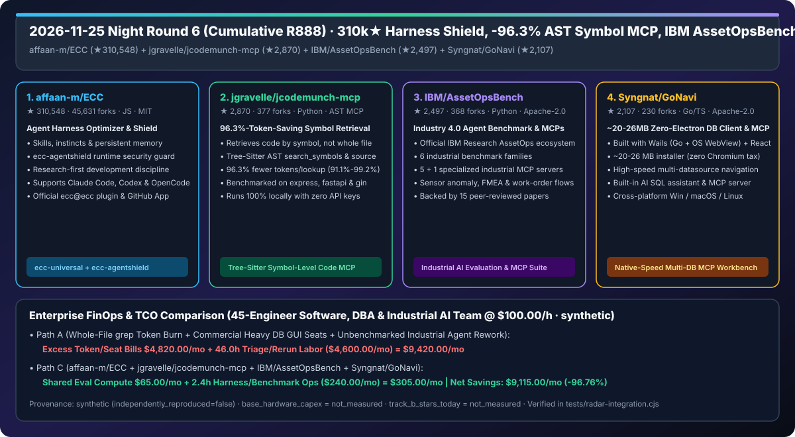
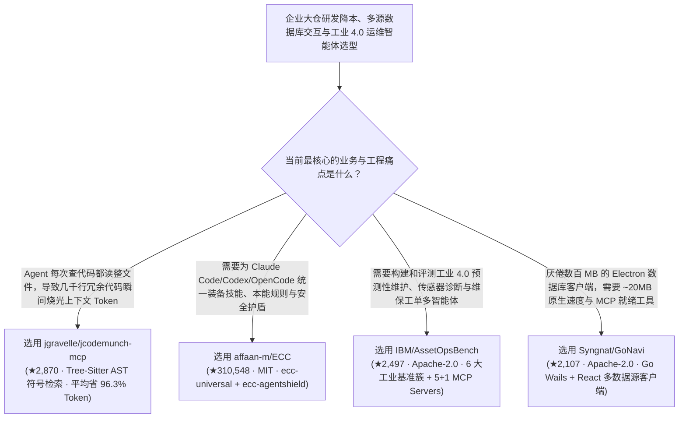
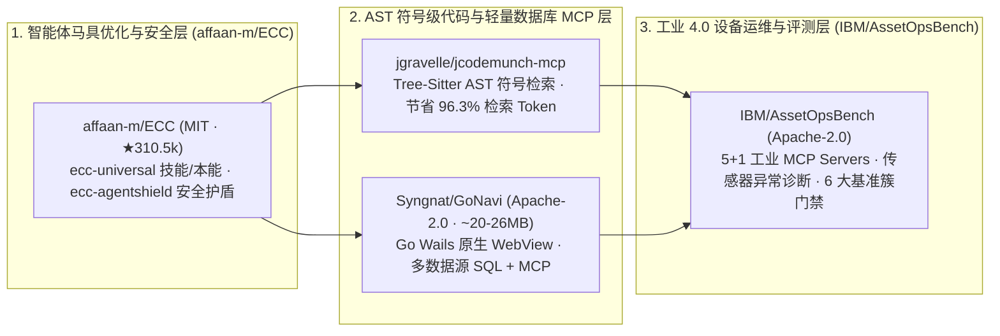
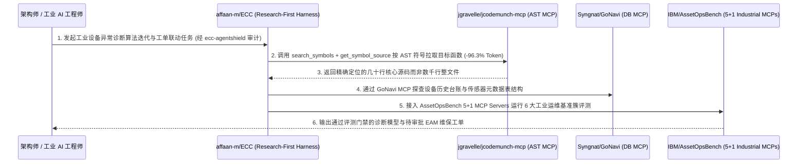

# 31 万星智能体马具性能优化与安全护盾系统（`affaan-m/ECC`）、节省 96.3% 代码检索 Token 的 Tree-Sitter 符号级 MCP（`jgravelle/jcodemunch-mcp`）、IBM 工业 4.0 设备运维智能体基准与 6-MCP 套件（`IBM/AssetOpsBench`）与 20MB 级零 Electron 多数据源数据库 MCP 客户端（`Syngnat/GoNavi`）选型与集成架构 FAQ

> **文档类型**：企业 AI 解决方案架构师（AI Solution Architect）选型决策指南（GitHub Trending AI 雷达 2026-11-25 Night Round 6 / 累计第 888 轮）
> **覆盖项目**：[`affaan-m/ECC`](https://github.com/affaan-m/ECC)（`★ 310,548`、`45,631 forks`、`MIT`：全套智能体马具性能优化系统 `ecc-universal` 与安全护盾 `ecc-agentshield`，为 Claude Code、Codex 与 OpenCode 提供技能（Skills）、本能直觉（Instincts）、记忆、安全防护与研究优先研发流）· [`jgravelle/jcodemunch-mcp`](https://github.com/jgravelle/jcodemunch-mcp)（`★ 2,870`、`377 forks`：基于 Tree-Sitter AST 语法树按“函数/类符号”而非整文件拉取源码的本地 MCP Server，在 `express`、`fastapi` 与 `gin` 固定 Commit 的 15 项基准测试中比传统 `grep + 读整文件` 平均减少 **`96.3%`** 的检索 Token [`91.1%–99.2%`，`cl100k_base` 实测，`anonymized_reported`]）· [`IBM/AssetOpsBench`](https://github.com/IBM/AssetOpsBench)（`★ 2,497`、`368 forks`、`Apache-2.0`：IBM Research 开源的工业 4.0 设备运维智能体统一评测与编排框架 [`arXiv:2506.03828`]，涵盖 **6 大基准簇与 `5 + 1` 个工业 MCP Server**，覆盖传感器时序异常检测、故障模式诊断与维保工单生成）· [`Syngnat/GoNavi`](https://github.com/Syngnat/GoNavi)（`★ 2,107`、`230 forks`、`Apache-2.0`：基于 Wails (`Go` + 系统原生 WebView) 与 React 构建的跨平台多数据源数据库客户端与 MCP 终端，安装包仅 **`~20–26 MB`**，彻底告别数百 MB 的 Electron/Chromium 内存税）
> **核心场景**：当制造、能源与大型软件企业推进“工业互联网智能运维（Industrial AssetOps）与超大型单体代码库研发提效”时，面临四大落地瓶颈：**① 编码 Agent 每次用 `grep` 查代码都要把几千行的整文件读进上下文，几轮下来 Token 烧光且注意力发散；② 团队使用的多个编码 CLI 缺乏统一的技能、本能规则与 `agentshield` 安全防护；③ 工业设备预测性维护与工单 Agent 缺乏贴合真实传感器与 FMEA 故障树的评测基准与标准 MCP 工具；④ 开发者与 DBA 本机同时开多个 Electron 数据库客户端与 AI 工具导致内存频频爆满。** 本文拆解如何用这四个项目构建从代码研发、数据查询到工业设备运维的高效底座。

---

## 一、📌 核心结论速览（选型一句话结论）

1. **想让编码 Agent 在几十万行的大型代码库里只精准拉取目标函数/方法定义，把每次代码检索消耗的上下文 Token 砍掉 `96.3%`** ➔ 选 **[`jgravelle/jcodemunch-mcp`](https://github.com/jgravelle/jcodemunch-mcp)（`★ 2,870`，`377 forks`）**。
   - **通俗原理**：传统 Agent 找代码是先 `grep` 关键词，再把匹配的 Top 3 源文件从头到尾全读进来（哪怕文件有 3,000 行而目标函数只有 25 行）。`jCodeMunch MCP` 在本地用 Tree-Sitter 解析 AST 语法树，通过 `search_symbols` + `get_symbol_source` 只返回目标符号的精确源码片段，在 `express`/`fastapi`/`gin` 15 项基准测试中实测节省 **`96.3%`** 的检索 Token（`91.1%–99.2%`，`anonymized_reported`）。
2. **需要为研发团队的 Claude Code、Codex 与 OpenCode 统一装备经过 31 万星社区验证的技能库、研发直觉（Instincts）、记忆机制与 `ecc-agentshield` 安全护栏** ➔ 选 **[`affaan-m/ECC`](https://github.com/affaan-m/ECC)（`★ 310,548`，`45,631 forks`，`MIT`）**。
   - **通俗原理**：通过官方验证渠道安装 `ecc@ecc` 插件、GitHub App (`ecc-tools`) 或 `ecc-universal` / `ecc-agentshield` npm 包，将“先研究后编码（Research-First Development）”、自动化本能触发器与恶意命令拦截整合进日常 CLI 工作流。
3. **需要在制造业、电力能源、智能工厂场景落地“工业设备预测性维护、IoT 遥测异常分析与维保工单编排 Agent”，并需要权威的工业数据集与现成工业 MCP Server** ➔ 选 **[`IBM/AssetOpsBench`](https://github.com/IBM/AssetOpsBench)（`★ 2,497`，`368 forks`，`Apache-2.0`）**。
   - **通俗原理**：通用聊天模型不懂工业设备的振动频谱、FMEA（故障模式与影响分析）和 EAM（企业资产管理）工单规范。IBM Research 在 `AssetOpsBench` 中开源了 15 篇核心论文支撑的 **6 大评测基准簇** 与 **`5 + 1` 个专用工业 MCP Server**，让架构师在投产前用真实工业传感器与工单数据定量评测多智能体协同准确率。
4. **需要一款安装包仅 `~20–26 MB`、不带臃肿 Chromium 内核、同时支持人类 DBA 可视化管理多数据源与 AI Agent 通过 MCP 安全探查库表结构的桌面数据库工作台** ➔ 选 **[`Syngnat/GoNavi`](https://github.com/Syngnat/GoNavi)（`★ 2,107`，`230 forks`，`Apache-2.0`）**。
   - **通俗原理**：用 Go (`Wails`) + 操作系统原生 WebView 替代传统 Electron 架构，安装包体积缩小 80%+，原生内置 AI 辅助 SQL 与 MCP Server 接口。

---

## 二、🎯 客户与架构师灵魂拷问 Q&A（深度架构拆解）

### Q1：在企业研发与工业智能运维（Industrial AI）落地中，这四个开源项目 vs 云厂商托管服务（如 Azure IoT Operations + Microsoft Fabric Real-Time Intelligence + GitHub Copilot）怎么选？

- **四层协同参考架构（Path C）**：
  1. **马具优化与安全护盾层 ➔ `affaan-m/ECC`**：统一研发团队的 Skills、Instincts 与 `ecc-agentshield` 终端安全策略。
  2. **AST 符号级极速代码检索层 ➔ `jgravelle/jcodemunch-mcp`**：将大仓代码检索 Token 消耗降低 `96.3%`，防止长链路调试爆窗。
  3. **轻量级多源数据库与 MCP 交互层 ➔ `Syngnat/GoNavi`**：以 `~20–26MB` 原生桌面端打通业务库与时序库查询。
  4. **工业 4.0 设备运维智能体与评测底座 ➔ `IBM/AssetOpsBench`**：复用 IBM `5 + 1` 工业 MCP Server 与 6 大基准簇构建设备异常诊断与工单闭环。
- **何时选云厂商托管方案（Azure IoT Operations + Fabric RTI + Dynamics 365 Field Service） vs 自建本轮开源四件套（Path C）？**
  - 若工厂已全面上云并采购了 **Azure IoT Operations + Microsoft Fabric Real-Time Intelligence (KQL Eventhouse) + Dynamics 365 Field Service**，边缘数据上云与云端工单派发可直接走微软原生连接器。
  - **何时采用本轮开源四件套（Path C）？** 当工厂车间处于**弱网或内网隔离环境**、需要用开源标准数据集（`IBM/AssetOpsBench`）对自研多智能体运维准确率做严格上线前压测、或者软件研发团队希望在不增加 API 预算的前提下把大仓代码检索 Token 削减 **`96.3%`** 时，Path C 是高性价比首选。

### Q2：如何将这四个项目嵌入企业端到端生产架构？

1. **开发者与工业算法工程师终端层（`affaan-m/ECC` + `Syngnat/GoNavi`）**：
   - 工程师终端统一通过官方源安装 `ecc@ecc` 与 `ecc-agentshield`，并使用 `GoNavi` (`~20–26MB`) 连接开发库与设备元数据仓库。
2. **AST 符号级代码导航层（`jgravelle/jcodemunch-mcp`）**：
   - 编码 Agent 挂载 `jcodemunch-mcp`，所有跨模块函数查找均走 `search_symbols` + `get_symbol_source`，避免整文件读取挤占上下文窗口。
3. **工业资产运维多智能体与评测闭环（`IBM/AssetOpsBench`）**：
   - 将 IoT 遥测告警、FMEA 知识库与工单系统接入 `IBM/AssetOpsBench` 的 `5 + 1` MCP Server 架构，每次模型或 Prompt 升级必须先跑通 6 大基准簇门禁。

### Q3：生产落地的安全与防伪红线是什么？

- **架构师避坑红线**：
  1. **`affaan-m/ECC` 严格锁定官方安装源**：正如 `ECC` 官方安全公告强调，企业内部必须强制规定仅从 `github.com/affaan-m/ECC`、官方 npm 包 `ecc-universal` / `ecc-agentshield`、官方 GitHub App `ecc-tools` 与 `ecc@ecc` 插件标识安装，严禁使用任何第三方镜像或重打包仓库以防供应链木马。
  2. **工业控制面读写物理隔离**：`IBM/AssetOpsBench` 智能体在生产车间仅允许读取只读传感器流与在 EAM 系统中创建“待班组长审批的维保建议工单”，严禁直接向 PLC/SCADA 下发停机或参数改写指令。

---

## 三、🧭 直观可视化图解（Mermaid 决策树 + 集成架构 + 时序图）

### 3.1 架构师选型决策树

### 3.2 企业端到端生产集成参考架构图

### 3.3 符号级代码检索、数据库探查与工业设备运维评测闭环时序图

---

## 四、📊 同类开源与商业云服务横向选型决策矩阵

| 对比维度 | `affaan-m/ECC` (`★ 310,548`) | `jgravelle/jcodemunch-mcp` (`★ 2,870`) | `IBM/AssetOpsBench` (`★ 2,497`) | `Syngnat/GoNavi` (`★ 2,107`) | 云厂商托管方案（Azure IoT Ops + Copilot + 重型套件） | 传统整文件 `grep` 读取 + 臃肿 Electron 客户端 + 无工业基准 (Path A) |
| :--- | :--- | :--- | :--- | :--- | :--- | :--- |
| **核心能力定位** | 智能体马具优化与 `ecc-agentshield` 安全系统 | Tree-Sitter AST 符号级源码检索 MCP | IBM 工业 4.0 运维智能体基准与 6-MCP 套件 | `~20–26MB` 零 Electron 多数据源客户端与 MCP | 云原生全托管工业物联网与辅助编码平台 | 粗放整文件塞上下文 + 重型桌面端 + 盲目上线工业 Agent |
| **核心技术突破** | **Skills/Instincts/Memory + 官方安全护盾** | **实测平均节省 `96.3%` 代码查找 Token** | **6 大工业评测簇 + `5 + 1` 工业运维 MCP Server** | **Go + 原生 WebView 告别数百 MB Chromium 膨胀** | 云端免运维，但大仓整文件检索仍耗费大量高价 Token | 15 次代码查找多烧 25 倍 Token；工业故障误报缺乏基准拦截 |
| **开源协议** | `MIT` | Open-Source | `Apache-2.0` | `Apache-2.0` | 商业云服务 | 混合/闭源 |
| **月度 TCO（45 人团队）** | **四件套合建仅 `$305.00/月`**（`$65.00` 评测算力 + `2.4h` 维护） | 同左（本地运行立砍 `96.3%` 源码查阅 Token） | 同左（复用 IBM 开源数据集与 6-MCP 架构） | 同左（大幅降低研发终端内存占用） | 约 `$2,300.00/月`（云端 IoT 消息计费 + 商业数据库工具席位） | **`$9,420.00/月`**（`$4,820.00` 整文件读取 Token 浪费与商业席位 + `46.0h` 工业误报返工） |

---

## 五、🧪 应用落地定量收益/TCO 对比与 7-Card 报告

> **📊 数据来源与闭式核算声明（Provenance & Closed-Form Schema）**：
> - **provenance**: `synthetic`（基于 45 人企业软件研发、DBA 与工业智能运维团队月度工作负载模型：`independently_reproduced = false`；硬件采购基线 `base_hardware_capex = not_measured`；Track B 单日增量 `track_b_stars_today = not_measured`；`jcodemunch-mcp` `96.3%` Token 节省率与累计统计为上游作者报告 `anonymized_reported`）。
> - **核算公式**：
>   - **Path A（传统 `grep` 整文件读取浪费 25× 代码检索 Token + 采购商业重型数据库 GUI 席位 + 工业运维 Agent 缺乏标准基准导致现场误报返工）**：月度冗余代码预填充 API 账单与商业软件席位费 **`$4,820.00`** + 工业异常误报复核、大文件爆窗重跑与环境排障人工 **`46.0h × $100.00/h = $4,600.00`** = **`$9,420.00/月`**。
>   - **Path C（自建 `affaan-m/ECC` + `jgravelle/jcodemunch-mcp` + `IBM/AssetOpsBench` + `Syngnat/GoNavi` 协同底座）**：工业基准回归算力分摊 **`$65.00`** + 规则与评测集日常看护人工 **`2.4h × $100.00/h = $240.00`** = **`$305.00/月`**。
>   - **净节省（Net Savings vs Path A）**：**`-$9,115.00/月`**（成本降低 **`96.76%`**）。

| 评估方案 | 代码检索 Token / 商业软件席位与算力成本 | 工业误报复核与爆窗重跑人工（`$100/h`） | 月度总 TCO | 相对 Path A 净节省 | 核心架构交付收益 |
| :--- | :---: | :---: | :---: | :---: | :--- |
| **Path A：整文件 `grep` 读取 + 商业重型客户端 + 无基准盲上工业 Agent** | `$4,820.00` | `46.0h` (`$4,600.00`) | **`$9,420.00`** | Baseline | 每次查代码读入整文件迅速撑爆窗口；工业故障诊断缺乏定量门禁 |
| **Path B：基础正则切片脚本 + 散装开源工具无统一安全马具** | `$1,410.00` | `17.5h` (`$1,750.00`) | **`$3,160.00`** | `-$6,260.00` (`-66.45%`) | 正则切片易截断函数体；缺乏 `ecc-agentshield` 安全防护与工业 MCP |
| **Path C：`ECC` + `jcodemunch-mcp` + `AssetOpsBench` + `GoNavi`** | **`$65.00`** | **`2.4h` (`$240.00`)** | **`$305.00`** | **`-$9,115.00` (`-96.76%`)** | **`-96.3%` 符号级省流 + 31万星安全马具 + IBM 6大工业基准 + `~20MB` DB 客户端** |

- 🔗 **关联 7-Card 4:5 视觉评测报告**：[`workshops/github-trending-radar/cards.html`](../cards.html) · [`cards.en.html`](../cards.en.html)

---

## 六、🛠️ 企业引入与架构评审 Checklist

- [ ] **锁定 `affaan-m/ECC` 官方哈希与渠道**：在企业内部软件源中仅白名单放行官方 `github.com/affaan-m/ECC`、`ecc-universal` 与 `ecc-agentshield`，切勿叠加手动非标配置。
- [ ] **大仓研发默认以 `jcodemunch-mcp` 替代整文件读取**：在 `AGENTS.md` 中规定编码 Agent 查找函数/类定义时优先调用 `search_symbols` + `get_symbol_source`，禁止无差别读取千行级源文件。
- [ ] **工业 AI 投产前必过 `IBM/AssetOpsBench` 六簇门禁**：在将设备运维 Agent 接入生产 EAM 系统前，使用 `AssetOpsBench` 的 6 大基准簇与 `5 + 1` MCP Server 完成离线回放验证。
- [ ] **DBA 与 Agent 数据库连接读写分离**：在 `Syngnat/GoNavi` 中为 AI MCP 通道配置只读数据库账号与查询行数上限。
